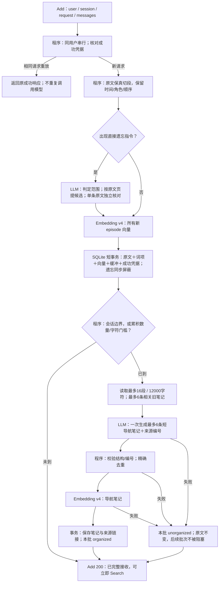
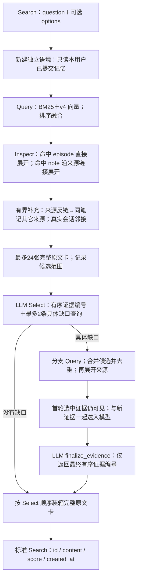

# AM-Link：从证据出发的第三版设计

更新：2026-10-30。当前实现为 `amlink/ 0.3.0-clean`；二期 r11 已归档。工程实现与方法质量分开验收，最新结果见[实施核对](docs/doing/2026-10-29-clean-rebuild-implementation.md)。

研究入口已统一为 [记忆研究室](research/README.md)：数据、案例、100题真实运行和逐步输入输出同页展示。本轮只迁移研究导入，不改下述方法算法。100题实测复核51正确/47未达标/2不确定；[下一轮方案](docs/phase-3/2026-10-30-evidence-method-review.md)提出遗忘确认回流、事件归属披露、候选覆盖与交付预算协同，均尚未实施。不要将理论案例或建议流程理解为当前已经实现。

## 为什么重做

二期最终 PersonaMem 历史完成 26/75 个 Reflection 组。问题不只是模型时间不足：一次整理同时承担人物归属、事实合并、旧节点修改、关系方向、来源补充、协议遵守和审查收束。每增加一道保证，模型需要协调的状态也增加；合法节点可能被坏关系拖住，失败组又影响后续整理。

新设计改变任务本身：**先完整保存可以交付的证据；再给证据建立导航；在问题到来时组合原文。** 不再要求 Add 先建立正确、完整的世界模型，Search 才能有效。

像整理档案：原文是档案页，导航笔记是目录卡，引用是目录卡指向的页码。目录卡可以帮助找材料，却不能替代档案页成为事实依据。

## 从前两期保留和移除什么

| 来源 | 保留的理念 | 此次取舍 |
|---|---|---|
| 一期 | 原文优先、词法入口、事务、幂等、按用户隔离、对外只提供 Add/Search | 不照搬旧模型或内部重试 |
| 二期 | 跨 Add 缓冲、向量检索、语义引用、来源回溯、Select、缺口查询、过程观测 | 移除反复修改旧节点、关系类型菜单、草案审查/修订循环和持久推理语境 |
| TinySoul | 人与模型都读得懂的引用叙事；先定位再展开；基于已见材料继续找信息 | 用有界两轮检索和确定来源链接代替自由 Agent/BFS loop |

没有隐藏的旧方法、可选启用的图构建或失败时切换纯词法的分支。向量与 Select 都属于当前默认方法。

## 记忆对象

- **Source**：一条 Add 消息的不可变原文，保留角色、毫秒时间、会话、请求及消息顺序。
- **episode**：Source 的精确连续原文范围，最多 1,800 字符、5,500 UTF-8 字节；按句段边界切分，不改写正文。每个范围独立建立词项和 1,024 维向量。事务分配稳定入库顺序，明确区别于事件发生日期。所有范围拼接等于原文。
- **note**：Reflection 生成的短自然语言导航笔记，只有标题、正文、来源位置三项模型输出。程序生成 ref 和 support_refs。它是检索提示，不是经审查确证的事实。
- **WorkingMemory**：已索引 episode 的待整理登记，不是 Search 的另一个数据源。
- **Reference**：例如 `memory:episode/maya-knows-rowan~短稳定标识#0:17`。语义标签帮助阅读，后缀区分同名对象；旁边始终展示角色、原始时间、会话、消息顺序、字符范围和原文正文。

目前不再把 person/entity/concept/event/fact 六类建模作为必需步骤，也不生成 supersedes/contradicts/about 等语义边。新关系只有实际来源链接和会话邻接。角色不等于人物身份；未知的人物和日期保持未知。

## Add：先接收，达到积累门槛再整理

**成功的含义**：所有本轮有效原文已保存并完成词法/向量索引，必要的遗忘也已提交。embedding 或必要遗忘在接收事务之前失败时，本轮没有成功凭据、没有半条记忆，调用方可以重送。事务提交后，即使整理失败，Add 仍成功；相同 request_id 和相同内容重放不会再次整理。相同 ID 换内容返回 422。

**缓冲的含义**：普通 Add 不逐条调用整理模型。默认至少积累两个不同请求，且达到 16 个片段或 12,000 字符才整理；会话切换可提前触发。每次 Add 最多处理两批，批内最多 16 段/12,000 字符。尾部即使未整理也已经能被检索。这里保留“一起看材料再整理”的目的，不保留持续膨胀的模型上下文。

**整理失败的含义**：该批保留失败状态，原文仍是可用证据；不会在每次新 Add 自动重试。进程中断的 running 批在重启时标为 interrupted/unorganized。完成率必须另报，不能把 Add 200 当作整理成功。完成的空笔记也应单列，不能冒充产生了有效导航。

旧笔记只作为只读背景帮助避免重复，新笔记只能引用本批原文。程序去掉完全相同的笔记正文；近义重复、跨批关联目前没有自动合并。导航不是权威事实，因此无需“改错一处、重新审查整张图”的长链。

## Search：读原文，再决定缺哪一块

Query 两个通道各取前 48，再使用排名融合。导航笔记和原文均可命中；笔记最终必须展开为原文。排名靠前的六个来源可带出同一笔记的其它原文，以及同一请求中前后相邻消息；这是有据可查的链接扩展，不是自动推断人物关系。

Select 读的是完整候选片段，不再经历“Reference 摘要看不到 → Inspect 另一窗口 → 装箱又改窗口”的三次证据漂移。最多 24 张卡、60,000 字符；模型请求总上限 80,000 字符。最终装箱复用同一正文，保持 Select 顺序，不按旧检索分数重排、不再次摘要。

第一轮允许根据已见人名/实体/缺失主题提出最多两条查询；不得泛泛重复原问题、猜日期金额。分支合并后再次筛选，最多两次 LLM 决策。末轮使用独立的单字段工具，不能继续查询。Select/必要 Query 失败对外明确失败，不伪装成空结果或切换另一种方法。

最终最多 top_k 条、24,000 字符。超过输出预算的卡片记录为装箱遗漏；不截掉卡片中间内容。空语料或模型明确选空可以合法返回空数组。Search 不消费 WorkingMemory、不触发 Reflection、不生成 Answer。

## 三个例子与边界

**配额从 1,000 改为 1,200**：保存两段原文及各自时间；笔记可以把它们组织为配额变化的入口。Search 找到旧值和更新声明，将原句交给官方 Answer 判断当前值。不会因为错误 supersedes 边删掉旧证据。

**Maya 的朋友住哪里**：原文甲“Maya 的朋友是 Rowan”，原文乙“Rowan 住 Ghent”。首轮读到甲后可以提出 Rowan 的居住地查询，合并后选中甲乙。若两段属于同一笔记，来源反链还可直接带出另一段。跨三层及更长关系没有保证，不宣称保留了原版自由 BFS 的全部能力。

**昨天参加活动**：原句“昨天”与来源时间同时交付，不擅自把年份写入不可变正文。Answer 可以基于时间推断；记忆系统不提前冻结可能错误的日期结论。

## 遗忘、稳定与代价

遗忘是接收语义的一部分，和可选整理分开。当前仅识别直接用户指令的入口，模型区分 none/all/topic；全量遗忘仅影响指令前的原文，同批之后的新信息保留。主题遗忘给模型完整原文页，每页最多12段，页内选中仅是候选，再将指令与单条完整原文交给独立模型调用确认同一主题，不传上一步解释。只有确认后的来源及派生笔记一起屏蔽，向量同步撤出。这里是逻辑不可检索，并非物理安全擦除。

**明确局限**：主题遗忘目前以整条消息为屏蔽单位，可能连带同消息其它主题；间接表达可能未触发；同义识别仍需实测。不能把它描述为精确遗忘已解决。大量历史的逐页检索及候选逐条核对成本也需要单列。独立核对是另一项有不同输入/职责的判断，不是错误重试。

SQLite WAL/FULL，单进程单数据库 owner；线程可并发接收，不同用户使用分桶锁，同用户顺序执行。Add/Search 的最长内部期限 1,740 秒；每个 provider 请求最多90秒。工具schema只描述必要形状，数量/编号/去重由程序验证；模型仍必须输出合法工具参数，不进行JSON修补。没有内部错误重试。数据库版本300，拒绝混入旧版向量/数据库。生产进程不设置累计寿命调用上限；研究 runner 显式设置每库预算。

普通 Add 需要原文 embedding 批次，至多每10条一次请求；一次整理需要1次 LLM，若有笔记再加 embedding。一次 Search 通常1次查询 embedding＋1次 Select；补查时最多加2次查询 embedding和1次最终 Select。中文长查询可能拆为多段，实际批次数据实记录。

当前 BM25/向量排序在本用户语料内扫描，尚不是大规模 ANN 服务。数据库和模型输入有界不等于无限历史的吞吐已验收。

## 验收标准

2026-10-30 实测：固定本版方法完成六类26历史100题，780 Add/100 Search/100 Answer均成功，导航整理726/732批完成。Codex复核51正确/47未达标/2不确定，非官方分数。主要新证据是集合候选遗漏、长日志片段缺事件标题、建议/完成状态混淆，以及遗忘后的助手确认复述回流。仅评论题最终预算丢弃13段，不能将所有缺失归因装箱。细节见[百题报告](docs/doing/2026-10-30-hundred-answer-report.md)；本轮没有修改上述方法。

工程检查：失败无半提交、成功重放无重复调用、隔离、重启、遗忘不回流、来源范围、并发、工具协议及可观测关联。质量检查：完整历史 Add/Search、整理协议完成及笔记语义、必要事实组合、未见证据、成本和延迟分别报告。

小切片调试不能替代完整历史；新批次与旧75组定义不同，不能直接用完成率比值宣称提升。100题清单可以冻结，只有实际运行部分才计入成绩。研究日志、模型输入/输出和数据库都留在忽略路径；不自动提交或部署。
