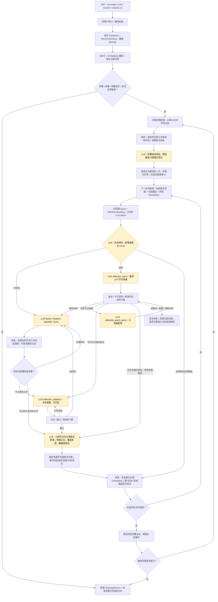
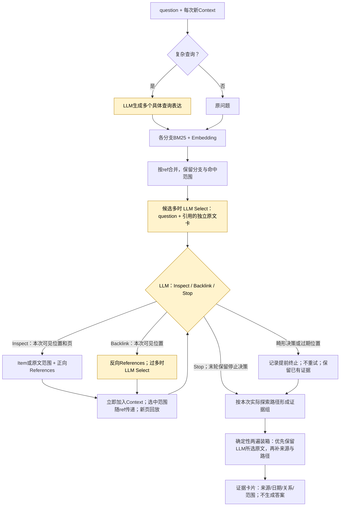

# AM-Link Add/Search 当前设计

更新：2026-10-27。[本轮执行计划](docs/phase-2/2026-10-27-convergence-execution.md)已实施程序推进、保真原文段分组、小组联合审查、有理由的无新增完成、Select覆盖说明及精确向量复用。下方描述当前默认实现；测试和真实诊断见[实施核对](docs/doing/2026-10-27-convergence-implementation.md)。未部署、未参加官方Smoke；关系语义和完整长历史质量尚未验收。

前轮[清理与成本审读](docs/doing/2026-10-26-convergence-audit-and-reset.md)保留历史轨迹并清空旧实验库。本轮从新库验证，承接[整体收敛计划](docs/phase-2/2026-10-26-method-convergence-plan.md)；不能用Search成功或边数增长代替Add及语义质量验收。

## 边界和对象

只提供Add/Search，主办方负责Answer/Eval。公开接口不变；同用户锁内同步执行，没有内部模型重试、后台补偿、自动重建或静默降级。默认开启embedding及模型Select。

MemoryItem包含episode/person/entity/concept/event/fact，MemoryRelation保留about/contains/supersedes/contradicts/same_event_as。最低episode是不可变原文投影，RawEvent保存原始角色、会话、顺序及来源时间。user_id是隔离空间，不等于真实speaker；角色也不能代替人物姓名。

References始终是语义ref加可读叙事。MemoryWorking保留尚未整理的原文，Workspace是跨Add保留的有界活跃语境。位置清单、原文片段和证据组都是内部调用/输出组织，不新增长期记忆类型。

## Add：先保证可查，再按稳定前缀整理

普通触发要求至少2个不同Add，并达到8条消息或6000正文字符；单Add达到64条或约36000序列化字符可以容量触发。普通now/never或“忘带伞”不触发；update the等宽泛词面只作为观测线索，不绕过积累门槛。明确更正/删除仍要通过来源与遗忘授权校验。会话切换仅整理此前连续前缀；新会话首条保留在缓冲，若本次同时满足积累/容量/明确变更条件，则处理到本请求末端。A→B→A按连续段处理，不按相同session_id合并。

最低episode索引成功不等于每次Reflection。触发后Add等待冻结目标完成才返回200；未触发则保留缓冲。标准Search不排空WorkingMemory，最后一次Add没有触发也能通过最低episode检索。

默认总期限1740秒，包含排队；模型单次120秒。规划批次32条/18000字符，最多64批；每组Reflection最多16次主决策，联合审查另计调用但共用Add期限和模型调用总额。没有纯提交/校验模型步骤；正常组是节点草案、关系草案、联合审查三次内容调用；无合法双端点组合时省去关系生成，直接审查节点。补读/修订/Select另计。单轮工具定义、正文、语境共计80000字符。未解决的缺材料提案不能改成空Mutation/no-op推进水位。完整并发追加协调器未实现，仍使用同用户锁。

分组是内部工作进度，不是新的MemoryItem。原文按自然段/句界切成最多1800字符的连续保真范围；没有边界才硬切。规划完整读取本批，逐段填写所属组映射，程序生成每组范围；每段主归属恰好一次，背景可共享；组内仅展开选中范围并标明用途，原文digest及全局坐标不变。建议少量相关组，不要求每段生成节点。`reflection_plans`冻结v2范围清单，旧版未完成计划显式拒绝，不静默迁移；已完成旧记录无需重写。节点/边/向量与完成理由同事务提交，全部组完成才推进完整消息水位。后一组失败不会撤销前组，Add仍失败；调用方重放跳过已完成组。此前组产物可供后组比较，本批未处理的最低episode不能冒充旧匹配。

## Search：独立语境，沿引用读取证据

Search近似于Query＋有深度上限的Inspect/Backlink多跳＋候选过多时Select。默认最多3跳、8次主决策；模型可从不同深度已知引用选择，并非逐层清空队列的经典BFS。续页不新增节点/跳数，但消耗决策步数。Inspect不做Select；Backlink返回带叙事引用，正文按需Inspect。

Query合并后候选超过5个就执行Select。每个引用的互补原文片段独立作为临时输入卡；不再固定24张分页，按包含工具定义的完整80000字符预算组织。每ref最多4段，预览总预算为`preview_chars`的3倍（默认3600字符），短原文尽量完整。分页保留后统一Select，再按ref合并，保留模型顺序及选中范围；全局保留集仍装不下时显式`select_merge_budget`，不再次暗中截短证据。

Select仍输出References子集，不新建节点、不生成答案。模型看到问题、任务用途、语义ref、原文、角色、日期与命中说明；Search寻找回答证据，Reflection寻找旧目标及支持来源。完整坐标/hash/覆盖信息进入观测。语义去重和互补性由模型判断，尚不能宣称更大的同屏候选已经带来稳定收益。

Select的coverage说明仅接受绑定实际选中位置的条目，传入后续语境作为待核验的导航说明，不能当成原文或答案。主选择中非法位置仍失败；无效辅助说明被剔除并记录。查询向量仅在同一语境内按问题原文和模型指纹精确复用，候选检索重新执行，不缓存过期结果。BFS分别记录新引用和新增读取范围；范围增长不等于语义增益。

BFS选择清单展示真实入边/出边数量与类型，帮助模型判断何时查Backlink；这只是导航元数据，不冒充读过正文。已有时间信息但缺地点等属性时，模型可沿相关主体的反链找补充事实。仍由模型选择具体引用与动作，无kind准入闸门。当前L1实测是一轮Backlink补入相关事件后由来源装箱闭合；尚不能称为连续2—3跳普遍增益。

局部BFS协议异常会记录终止原因并保留已有证据；依赖失败、Query/Select失败仍显式报错，无内部重试。

## 引用位置和模型实际可见范围

所有工具模型调用共用`narrative.py`渲染器，预算预检和实际HTTP使用同一正文。输入按任务、新材料、相关旧记忆、草案缺项及可读动作位置组织；工具输出仍保持结构化。原话、角色、来源日期、限定条件和引用不改写成自由摘要。内部观测保留完整结构，但不把哈希和范围账本反复塞入模型正文。

关系审查必须同时显示两端实际可见的正文，包括Inspect放在disclosures里的旧正文；修改旧节点时额外呈现修改前正文，身份比较所需的已读正文也进入审查。不会偷偷从数据库读取模型未见材料。小组联合审查先校正节点，再明确按修改后的端点判断边；未明确重新判断的依赖边撤销。缺端点显式失败；节点被撤销后，依赖边一起撤销。这个保证是材料和处理一致，不是模型判断必然正确。

每次先投影，再冻结显式编号清单；工具枚举、模型输入与解码共用这一清单。字典排序不能改变工具位置。Inspect/Backlink/Evict仅提供本次实际允许的位置，空清单不会生成空整数枚举。Select使用同样的页内位置规则，合法空集、去重并保持顺序；混入无效位置会显式失败。

内部片段记录origin_ref、正文digest、Python Unicode字符半开区间[start,end)及原文text。标签、来源时间和省略说明放在范围外。Reference能保留同源多个分支命中窗口；重叠合并，二次裁剪同步收缩范围。

10月26日窗口改为整段命中区分度排序，来源加入长度归一化，短消息尽量完整保留；同分时为命中后限定语留空间。Select对多来源episode保留互补窗口，不再按分支数限制来源个数。原文、字符预算及遗漏账本不变。查询扩展不得自行确定相对时间；包含输入未提供数值的分支会被记录并丢弃，无模型重试。这只检查数值，不保证所有扩展语义正确。

Inspect按已有Item及其合法sources分页。模型选择可读页编号，不直接提供任意偏移；每次最多展示8个续页选项，后续调用可继续披露。新页先占预算，再填自动预览；页的保护在下一次成功主决策实际包含该页后解除，Select/embedding不解除。实际输入范围进入receipt：它证明材料送达并返回，不证明模型理解。遗忘、删除或版本变化使缓存范围及阅读依据失效。

Select实际选中的原文卡不再机械裁成520字符；若被语境整体预算移除，仍记录实际遗漏。Reflection待办与提交共用missing_material检查；冲突两侧的来源缺口映射到真实来源页，读入后保护至验证。C2真实复验仍有protected_workspace_budget，不能称长文语境已稳定。

receipt统一收集disclosures、items正文、sources片段、References片段及完整working，按来源版本和范围记录。明确读取记录与当前可见范围分开：自动展示正文不冒充Inspect；历史取过但当前隐藏的页可以重新选择。页映射在模型调用前冻结，结果按同一映射解码。Reflection默认先读节点正文，再按需读长来源；必要语义正文保留至本批终结。来源片段中的query说明最多160字，避免重复携带完整维护问题。

## Reflection依据与Workspace

旧候选资格先于词法/向量候选上限检查；本批及未来最低episode不能冒充旧身份匹配。更新旧目标、改旧关系端点需要同版本Inspect，且所需正文在最终Mutation调用可见。冲突/替代两侧需要可见来源；新引用来源必须是已展示来源，继承来源不被冒充新增支持。

旧范围非空时，每个新person需要绑定new ref的定向旧身份Query：成功空结果允许no_prior_match；有候选需读相关候选。数据库确认本用户的有效旧资格范围完全为空时，使用明确scope_empty凭据，不执行无意义空Query，不伪造query_performed。全新端点之间的关系可由本批原文直接支持。程序校验的是材料与过程，人物语义是否正确仍需实测。

Workspace格式v2，有界至2×context_chars，节点和引用受现有预算限制。先折叠非保护来源页、未展示来源预览，再逐出可释放节点/引用；保护的是必需范围，不是节点的所有旧来源。v0/v1清除旧阅读凭据、恢复有效引用；未知格式显式拒绝。原文始终留在数据库。

非法方向/类型/端点会阻止整批Mutation，不自动翻转或静默过滤。反馈列出缺项、引用位置和合法方向；材料已齐时动态提示重新提交。错误未解决时不提供Stop，空Mutation不得掩盖失败。同样错误且无新增材料时显式无进展失败；无法留下补材料和提交槽时报告材料预算不足。

写入工具的Item身份限定为新`new:`标签或已加载的明确可修改节点。预检先拒绝虚构旧身份、最低episode覆盖和非法类型，再进入材料门槛。唯一流程先暂存节点/遗忘草案，再通过`reflection_relations`提出关系。模型可明确撤回非法边，但合法性、材料和最终提交仍整包检查，未完成时不移动水位。新批次不继承过期暂存提案。

Reference/Inspect中实际展示过且本次有可见凭据的来源，即使重复的`workspace.sources`缓存已折叠，也可在校验时回载；仍检查同用户和冻结批次资格。隐藏来源和未来来源不会因存在数据库里就自动变成可引用依据。

### 唯一的分步草案与来源对应

首次只提出节点或有明确理由的no-op。有效草案不能任意重写；只有明确节点缺陷才开放`reflection_patch_items`。局部操作先移除草案项再upsert，未提及项保持原样，绝不借此删除数据库原文。纯关系缺陷只修关系。材料补齐由程序自动推进，不再提供`reflection_validate`或`reflection_commit`。可供下次调用不等于模型已读，提交依据仍来自实际返回的内容调用和审查输入。

程序调度小组联合审查：把实际已展示的直接来源、本组原文及冲突两侧原文组织为带位置的片段表，关系同时呈现两端正文。模型可保留、修订节点正文/日期/来源，或撤销提案；关系只可保留/撤销。修订工具要求非空完整正文，理由字段不能替代正文。修改节点后保留的边需明确列出重审端点，否则撤销。整包过大按节点先、关系后分页，后页读取已修订端点，完整原文不暗中截断。分页源位置保留原编号，不当作新列表下标。

来源表含角色、原文范围、主要工作/共享背景及发言时间；发言时间不是事件日期。模型选择来源位置，程序展开原文范围和版本作为实际审查凭据。全撤销只有明确`episode_only`理由且没有真实更新/冲突/遗忘待办才可完成；仍有语义增量、缺材料或预算不足不能伪装no-op。`needs_revision`目前显式失败供调用方重放，不额外套审查重试循环。

审查后再次执行材料、身份、来源、类型和闭合检查，通过后一次提交。语义审查是模型判断，不是事实金标准；仍需检查主体、时序和关系。person导航的姓名可以由speaker支持；对话role不代表职业。supersedes要求同主体/同属性/同条件下明确替代，泛化/特例或同义陈述不构成替代。

别名去重后两个不同提案引用若归为同一真实节点，其自环作为重复关系消除并记录；直接提出同ref自环仍被拒绝。没有跨类型自动反转、模型故障吞并、内部网络重试或后台补偿。

完整长记录仍会暴露身份/预算/结构化输出与关系语义问题。已通过的小窗口不能代表完整人物记录已验收；逐运行版本、失败与调用量见实施报告。

## 最终证据组合与研究对照

保持Query/Select根引用顺序，把实际探索且有用的图补充、连接节点、关系及其来源放入较早根引用的证据组。A→C的有效补充不再默认排在所有初始候选之后。supersedes/contradicts两侧不提前过滤。卡片id仍是已有根ref，score表达返回顺序；证据组不是存储节点。

两遍分配先给各组支持窗口，其中Select实际选中的原文范围优先，再补剩余材料；最终入选后才按来源版本/范围去重，共享标记只指向前面已经返回的卡片。逐项记录来源缺失或预算裁剪。声明来源完整、路径闭合、答案证据充分是三件事，最后一项默认unknown。

模型参与证据组合的入口是Select选中的具体原文卡；装箱确定性展开这些原文，并补关系路径及来源。没有追加一个能重写证据的生成器。历史`packing_experiment.compare`属于靶场离线对照工具，不能当成当前服务的备用执行分支，也不承诺未来切换。

## 观测及验证

[观测标准](benchmark/OBSERVABILITY.md)沿用span及artifact协议。当前记录引用清单、工具参数、原文范围回执、Reflection门槛缺项、缓冲目标及证据组决策；网页显示有界预览和原始artifact路径，旧记录缺项显示未知。HTTP默认不开内部轨迹。

[本轮实施报告](docs/doing/2026-10-27-convergence-implementation.md)将工程验收、真实诊断和待验证质量分开。记录冻结范围、主归属/背景、程序推进、实际联合审查范围、完成决定、向量复用与探索增量；真实源码哈希与方法快照保留于运行目录。窗口/锚点是辅助诊断，完整材料样本单列；失败Add后的Search、模型局部异常终止、未评分任务分别报告，不合成总体准确率。

历史[10月23日闭环](docs/doing/2026-10-23-reflection-convergence-implementation.md)、[前轮实施](docs/doing/2026-10-23-evidence-loop-implementation.md)、[100题重跑](docs/doing/2026-10-14-amlink-100-rerun-review.md)不能当作当前代码成绩。继续扩大独立历史和数据类型覆盖，并通过冻结数据库/输入定位退化；当前没有Answer准确率或新一轮100题总体结论。
