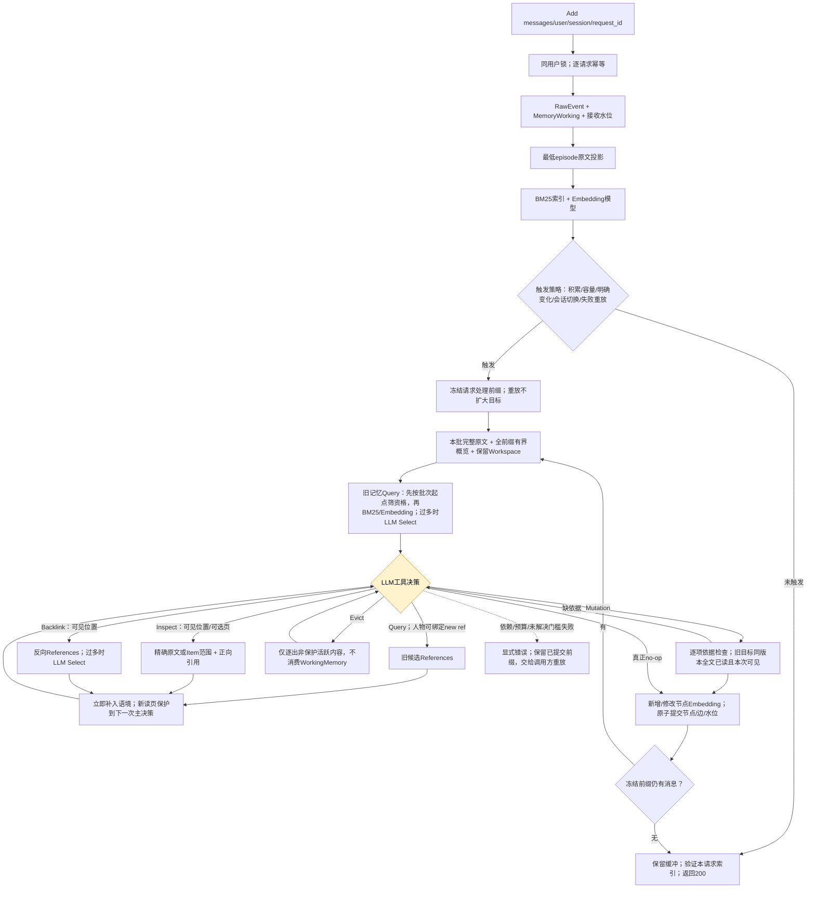
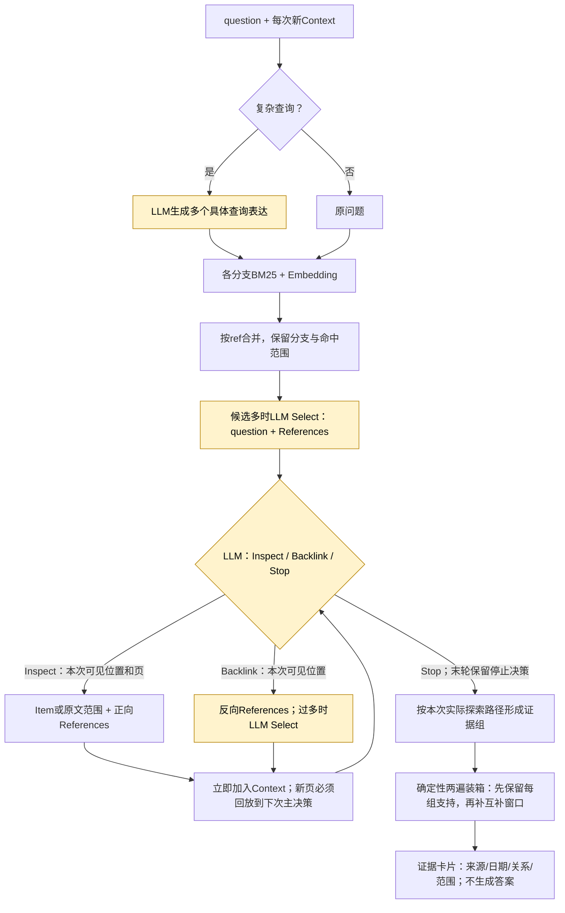

# AM-Link Add/Search 当前设计

更新：2026-10-23。当前为0.2.1上的P0/P1实施分支，未部署、未参加官方Smoke。五个工作包已接入，正在按[执行计划](docs/phase-2/evidence-loop-execution-plan.md)进行工程及真实切片验收；以[实施核对报告](docs/doing/2026-10-23-evidence-loop-implementation.md)中的逐项结论为准，不以工具存在或HTTP200代替方法效果。

## 边界和对象

只提供Add/Search，主办方负责Answer/Eval。公开接口不变；同用户锁内同步执行，没有内部模型重试、后台补偿、自动重建或静默降级。默认开启embedding及模型Select。

MemoryItem包含episode/person/entity/concept/event/fact，MemoryRelation保留about/contains/supersedes/contradicts/same_event_as。最低episode是不可变原文投影，RawEvent保存原始角色、会话、顺序及来源时间。user_id是隔离空间，不等于真实speaker；角色也不能代替人物姓名。

References始终是语义ref加可读叙事。MemoryWorking保留尚未整理的原文，Workspace是跨Add保留的有界活跃语境。位置清单、原文片段和证据组都是内部调用/输出组织，不新增长期记忆类型。

## Add：先保证可查，再按稳定前缀整理

普通触发要求至少2个不同Add，并达到8条消息或6000正文字符；单Add达到64条或约36000序列化字符可以容量触发。普通now/never或“忘带伞”不触发；明确更新/删除只是触发信号，仍要通过来源与遗忘授权校验。会话切换仅整理此前连续前缀；新会话首条保留在缓冲，若本次同时满足积累/容量/明确变更条件，则处理到本请求末端。A→B→A按连续段处理，不按相同session_id合并。

最低episode索引成功不等于每次Reflection。触发后Add等待冻结目标完成才返回200；未触发则保留缓冲。标准Search不排空WorkingMemory，最后一次Add没有触发也能通过最低episode检索。

默认总期限1740秒，包含排队；模型单次120秒。批次32条/18000字符，最多64批；Reflection16轮，最后一轮只允许提交或真正no-op。单轮工具定义、正文、语境共计80000字符。未解决的缺材料提案不能改成空Mutation/no-op推进水位。完整并发追加协调器仍属于P2。

## Search：独立语境，沿引用读取证据

Search近似于Query＋有深度上限的Inspect/Backlink多跳＋候选过多时Select。默认最多3跳、8次主决策；模型可从不同深度已知引用选择，并非逐层清空队列的经典BFS。续页不新增节点/跳数，但消耗决策步数。Inspect不做Select；Backlink返回带叙事引用，正文按需Inspect。

## 引用位置和模型实际可见范围

每次先投影，再冻结显式编号清单；工具枚举、模型输入与解码共用这一清单。字典排序不能改变工具位置。Inspect/Backlink/Evict仅提供本次实际允许的位置，空清单不会生成空整数枚举。Select使用同样的页内位置规则，合法空集、去重并保持顺序；混入无效位置会显式失败。

内部片段记录origin_ref、正文digest、Python Unicode字符半开区间[start,end)及原文text。标签、来源时间和省略说明放在范围外。Reference能保留同源多个分支命中窗口；重叠合并，二次裁剪同步收缩范围。

Inspect按已有Item及其合法sources分页。模型选择可读页编号，不直接提供任意偏移；每次最多展示8个续页选项，后续调用可继续披露。新页先占预算，再填自动预览；页的保护在下一次成功主决策实际包含该页后解除，Select/embedding不解除。实际输入范围进入receipt：它证明材料送达并返回，不证明模型理解。遗忘、删除或版本变化使缓存范围及阅读依据失效。

## Reflection依据与Workspace

旧候选资格先于词法/向量候选上限检查；本批及未来最低episode不能冒充旧身份匹配。更新旧目标、改旧关系端点需要同版本Inspect，且所需正文在最终Mutation调用可见。冲突/替代两侧需要可见来源；新引用来源必须是已展示来源，继承来源不被冒充新增支持。

每个新person需要绑定new ref的定向旧身份Query：成功空结果允许no_prior_match；有候选需读相关候选。全新端点之间的关系可由本批原文直接支持，不强迫无关旧检索。程序校验的是材料与过程，人物语义是否正确仍需实测。

Workspace格式v1，有界至2×context_chars，节点和引用受现有预算限制。先折叠非保护正文，再逐出低优先级引用；保护新读页与未解决变更依据，全部受保护仍超限则失败。旧格式仅恢复有效引用，不虚构旧阅读凭据；未知格式显式拒绝。原文始终留在数据库。

## 最终证据组合与研究对照

保持Query/Select根引用顺序，把实际探索且有用的图补充、连接节点、关系及其来源放入较早根引用的证据组。A→C的有效补充不再默认排在所有初始候选之后。supersedes/contradicts两侧不提前过滤。卡片id仍是已有根ref，score表达返回顺序；证据组不是存储节点。

两遍分配先给各组支持窗口，再补剩余材料；最终入选后才按来源版本/范围去重，共享标记只指向前面已经返回的卡片。逐项记录来源缺失或预算裁剪。声明来源完整、路径闭合、答案证据充分是三件事，最后一项默认unknown。

`amlink.packing_experiment.compare`用于离线受限LLM对照：冻结相同候选/范围/路径/字符预算，只调用一次模型选择已有组和片段位置，拒绝新写证据或答案，失败不回退成成功。默认Search不调用这个阶段。组卡改变@k含义，实验必须注明packing_unit，并同时报告字符预算覆盖，不能与旧独立节点卡直接混算。

## 观测及验证

[观测标准](benchmark/OBSERVABILITY.md)沿用span及artifact协议。当前记录引用清单、工具参数、原文范围回执、Reflection门槛缺项、缓冲目标及证据组决策；网页显示有界预览和原始artifact路径，旧记录缺项显示未知。HTTP默认不开内部轨迹。

[本轮实施报告](docs/doing/2026-10-23-evidence-loop-implementation.md)保存测试、真实失败/复跑和执行计划核对。历史[0.2.0审计](docs/doing/2026-10-11-amlink-core-audit.md)、[100题重跑](docs/doing/2026-10-14-amlink-100-rerun-review.md)保留原貌，不能当作当前代码成绩。
