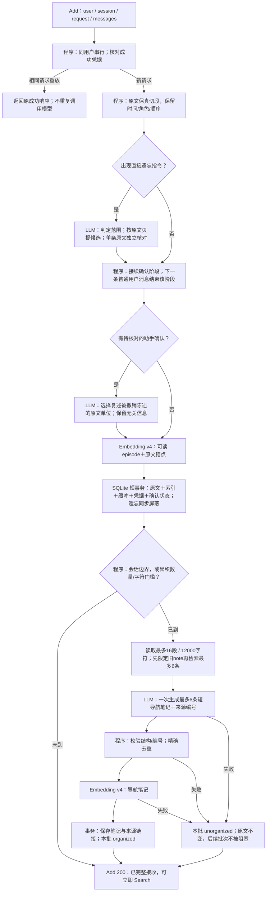
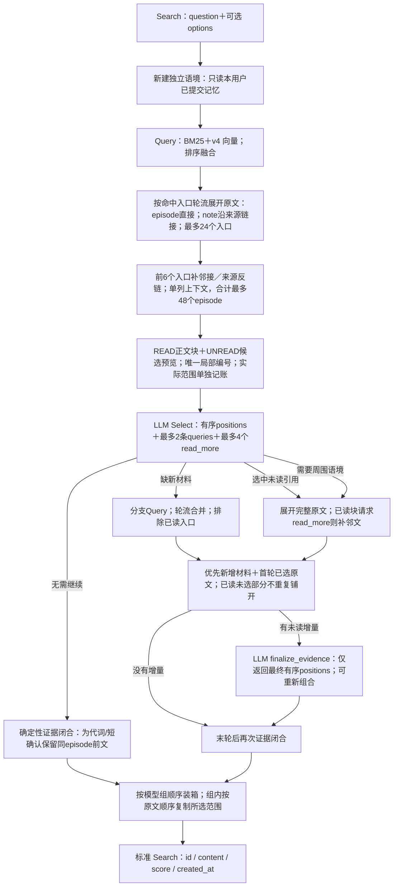

# AM-Link：从证据出发的第三版设计

更新：2026-10-31。当前实现为 `amlink/ 0.3.3-evidence-closure`，数据库301；二期 r11 已归档。最新[执行计划](docs/phase-3/2026-10-30-reading-continuation-execution.md)已实施单一引用、原文阅读块与候选续读；本轮[Search证据闭合计划](docs/phase-3/2026-10-31-search-evidence-improvement-plan.md)已实施，真实完整历史验证单独记录，整体质量未验收。

后续[两组真实对照](docs/doing/2026-10-30-intent-validation-findings.md)已完成：96固定候选调用、四类6历史24题两臂新库。短证据说明和增量整理提示均未证明稳定整体收益，没有修改本页生产链路。新发现包括query不理解“除此之外”的意图、末轮删掉刚展开的所指前文；不把更多说明或模型自称充分当作修复。

本版[实测与核对](docs/doing/2026-10-30-reading-continuation-implementation.md)：六类18完整历史，555/555 Add、61/61 Search/Answer、604/606整理；153回归＋5子测试。16次有新增范围的续读、3次无增量停止真实执行，所有交付与所选原文一致。自行车、状态变化与多部分比赛日志仍暴露“读到却没选齐”；评论24引文完成但仍丢59块选中材料。不存在整体质量已通过的结论。

研究入口已统一为 [记忆研究室](research/README.md)：数据、案例、真实运行和逐步输入输出同页展示。旧版100题复核51正确/47未达标/2不确定，仅作为基线。本轮已实施标题锚点、真实邻接、入口与上下文分开、原文单位Select、旧笔记范围内检索和有限遗忘确认边界；新旧版本成绩分别记录，不合并为一份验收结果。

此前[叙事实测](docs/doing/2026-10-30-narrative-and-answer-findings.md)完成118次固定输入调用，指导了本版改进；研究Answer默认GPT-5.4 medium，方法内部仍mini/v4。模型提示变清楚能减少部分接口问题，但协议合法不等于语义正确。原轮结果和本版新库实验分别保存。

## 为什么重做

二期最终 PersonaMem 历史完成 26/75 个 Reflection 组。问题不只是模型时间不足：一次整理同时承担人物归属、事实合并、旧节点修改、关系方向、来源补充、协议遵守和审查收束。每增加一道保证，模型需要协调的状态也增加；合法节点可能被坏关系拖住，失败组又影响后续整理。

新设计改变任务本身：**先完整保存可以交付的证据；再给证据建立导航；在问题到来时组合原文。** 不再要求 Add 先建立正确、完整的世界模型，Search 才能有效。

像整理档案：原文是档案页，导航笔记是目录卡，引用是目录卡指向的页码。目录卡可以帮助找材料，却不能替代档案页成为事实依据。

## 从前两期保留和移除什么

| 来源 | 保留的理念 | 此次取舍 |
|---|---|---|
| 一期 | 原文优先、词法入口、事务、幂等、按用户隔离、对外只提供 Add/Search | 不照搬旧模型或内部重试 |
| 二期 | 跨 Add 缓冲、向量检索、语义引用、来源回溯、Select、缺口查询、过程观测 | 移除反复修改旧节点、关系类型菜单、草案审查/修订循环和持久推理语境 |
| TinySoul | 人与模型都读得懂的引用叙事；先定位再展开；基于已见材料继续找信息 | 用有界两轮检索和确定来源链接代替自由 Agent/BFS loop |

没有隐藏的旧方法、可选启用的图构建或失败时切换纯词法的分支。向量与 Select 都属于当前默认方法。

## 记忆对象

- **Source**：一条 Add 消息的不可变原文，保留角色、毫秒时间、会话、请求及消息顺序。
- **episode**：Source 的精确连续原文范围，最多 1,800 字符、5,500 UTF-8 字节；优先在明确标题处断开，再按句段切分，不改写正文。每个范围保留原文标题或开头锚点、完整来源长度与范围；带锚点的索引文本最多6,000 UTF-8字节，独立建立词项和1,024维向量。事务分配稳定入库顺序，明确区别于事件发生日期。除明确排除的遗忘确认范围外，原文完整保留。
- **阅读单位**：episode内部相邻短段组织成约600字符的连续原文块，保留空行和明确标题边界，过长不可分原句保留完整；不把界面短词逐个变成选项。不跨来源或遗忘排除区，不改变索引。单位精确指向Source范围，不由模型改写；Select读的单位与最终复制的单位相同。
- **note**：Reflection 生成的短自然语言导航笔记，只有标题、正文、来源位置三项模型输出。程序生成 ref 和 support_refs。它是检索提示，不是经审查确证的事实。
- **WorkingMemory**：已索引 episode 的待整理登记，不是 Search 的另一个数据源。
- **Reference**：后台引用如 `memory:episode/maya-knows-rowan~短稳定标识#0:17`；模型看到本次唯一编号、原文标题/开头、角色、说话时间及正文或明确标为预览的片段。稳定ref、全局序号和字符范围保留在观测映射，不与操作编号竞争。历史顺序用同一套局部编号串联，最终交付用证据之间的先后说明，不能把入库顺序当事件日期。

目前不再把 person/entity/concept/event/fact 六类建模作为必需步骤，也不生成 supersedes/contradicts/about 等语义边。新关系只有实际来源链接和会话邻接。角色不等于人物身份；未知的人物和日期保持未知。

## Add：先接收，达到积累门槛再整理

**成功的含义**：所有本轮有效原文已保存并完成词法/向量索引，必要的遗忘也已提交。embedding 或必要遗忘在接收事务之前失败时，本轮没有成功凭据、没有半条记忆，调用方可以重送。事务提交后，即使整理失败，Add 仍成功；相同 request_id 和相同内容重放不会再次整理。相同 ID 换内容返回 422。

**缓冲的含义**：普通 Add 不逐条调用整理模型。默认至少积累两个不同请求，且达到 16 个片段或 12,000 字符才整理；会话切换可提前触发。每次 Add 最多处理两批，批内最多 16 段/12,000 字符。尾部即使未整理也已经能被检索。这里保留“一起看材料再整理”的目的，不保留持续膨胀的模型上下文。

**整理失败的含义**：该批保留失败状态，原文仍是可用证据；不会在每次新 Add 自动重试。进程中断的 running 批在重启时标为 interrupted/unorganized。完成率必须另报，不能把 Add 200 当作整理成功。完成的空笔记也应单列，不能冒充产生了有效导航。

旧笔记先在note范围内检索，只作为只读背景帮助避免重复，新笔记只能引用本批原文。模型任务是生成有辨识度的检索入口，保留具体人物、对象、动作、数值和语气，避免泛泛的鼓励或对话摘要。程序去掉完全相同的笔记正文；近义重复、跨批关联目前没有自动合并。导航不是权威事实，因此无需“改错一处、重新审查整张图”的长链。

## Search：读原文，再决定缺哪一块

官方query就是原始问题，没有独立intent字段。当前Select会看到问题/选项，并在同一次调用中看到由问题推导的任务形状提示：补集、比较/状态、多项清单和指代上下文。它可以请求补查，但没有单独的“已经能回答”认证步骤；空补查或达到两轮上限不是充分性证明。计算、比较、基于偏好推荐仍由外部Answer完成；部分有据结果是合法交付。

Query两个通道各取前48，再使用排名融合，完整记录融合后的候选。导航笔记和原文均可命中；笔记最终必须展开为原文。每个命中入口每轮只提出一段尚未读过的原文，不把笔记分数赋给它的每个来源。先保留最多24个独立入口，再为前6个补充邻接及同笔记其它来源；合计最多48段。上下文不能在入口构建时挤掉直接命中，但仍受总阅读字符预算限制。

邻接指同Source首尾相接的范围，或同会话前后消息边界；按来源入库顺序，跨Add分包仍可关联。同一长消息的远端切片不再一律当作邻居。来源反链只是支持同一笔记的材料链接，不自动推断人物关系，也不恢复自由BFS。

Select看到连续原文块及唯一的[N]编号，卡头只展示一次锚点和来源信息。首轮正文预算50,000字符，另有最多24项/8,000字符的未读候选目录；预览来自query相关原文块，最长300字符。目录不是全文；未能呈现的候选仍在观测里。末轮正文58,000字符，模型请求总上限80,000字符；输入明确最终top_k和24,000字符交付预算。元信息指出API角色不是人物身份、来源日期不是事件日期、笔记标题只是检索提示。

第一轮的queries可探索问题缺少的主题或已见实体，不能编造姓名、金额和日期。positions选中未读引用时，程序先打开其完整原文；选择预览不直接产生交付证据。read_more指已读块时补邻文，指未读项时主动展开。两者复用唯一编号和确定的阅读状态；非法编号不修补。分支查询去掉重复与原问题，新的阅读排除已见范围，首轮已选内容独立携入末轮；没有新增范围则不额外Select。最多两次LLM决策，末轮仅输出positions。必要Query或Select失败仍对外失败，无隐藏替代路径。

最终按Select首次选中各episode的顺序分组，组内按原文顺序复制；在末轮前后执行确定性证据闭合：若所选句含代词、简短确认或承接表达，则优先把同一episode中紧邻的前一原文单位作为 `context_closure` 携入；同一episode没有前文时，只从已披露的同会话即时前一episode补一个原文单位。闭合单元仍是逐字原文，不跨不连续来源，也不额外占用同一passage group名额；跨episode闭合若进入结果会按普通top_k组计数。模型选择与程序闭合在观测中分开记录。未选范围明确标出空档，不拼成连续引文。最多top_k组、24,000字符（含自然来源头与历史先后说明）。稳定ID和偏移不塞进Answer正文，最终所选范围仍在观测中。超限逐单位记录并继续尝试后面的短单位，不改写或硬截句子；顺序说明预留每组64字符。锚点和所选原文此前对模型可见，预览未经完整展开/末轮选择不得交付。空语料或明确选空可返回空数组。Search不消费WorkingMemory、不触发Reflection、不生成Answer。

## 三个例子与边界

**配额从 1,000 改为 1,200**：保存两段原文及各自时间；笔记可以把它们组织为配额变化的入口。Search 找到旧值和更新声明，将原句交给官方 Answer 判断当前值。不会因为错误 supersedes 边删掉旧证据。

**Maya 的朋友住哪里**：原文甲“Maya 的朋友是 Rowan”，原文乙“Rowan 住 Ghent”。首轮读到甲后可以提出 Rowan 的居住地查询，合并后选中甲乙。若两段属于同一笔记，来源反链还可直接带出另一段。跨三层及更长关系没有保证，不宣称保留了原版自由 BFS 的全部能力。

**昨天参加活动**：原句“昨天”与来源时间同时交付，不擅自把年份写入不可变正文。Answer 可以基于时间推断；记忆系统不提前冻结可能错误的日期结论。

## 遗忘、稳定与代价

遗忘是接收语义的一部分，和可选整理分开。当前仅识别直接用户指令的入口，模型区分 none/all/topic；全量遗忘仅影响指令前的原文，同批之后的新信息保留。主题遗忘给模型完整原文页，每页最多12段，页内选中仅是候选，再将指令与单条完整原文交给独立模型调用确认同一主题，不传上一步解释。只有确认后的来源及派生笔记一起屏蔽，向量同步撤出。这里是逻辑不可检索，并非物理安全擦除。

**明确局限**：主题遗忘目前以整条消息为屏蔽单位，可能连带同消息其它主题；间接表达可能未触发；同义识别仍需实测。不能把它描述为精确遗忘已解决。大量历史的逐页检索及候选逐条核对成本也需要单列。独立核对是另一项有不同输入/职责的判断，不是错误重试。

已接受遗忘后，确认阶段与成功凭据一起持久化，跨Add、重启、会话切换延续，直到下一条普通用户消息。此阶段LLM从助手消息中选择确认删除／复述已撤销陈述的句段，阻止它们重新建立episode和索引；同条消息中的一般知识等无关句段仍保留，锚点也只来自可读范围。之后新的用户陈述可重新进入记忆。这是有界确认处理，不是永久主题黑名单；它也没有将历史整消息遗忘改成精确范围删除。

SQLite WAL/FULL，单进程单数据库owner；线程可并发接收，不同用户使用分桶锁，同用户顺序执行。Add/Search最长内部期限1,740秒；单次provider请求最多90秒。工具schema描述必要形状，数量／编号／去重由程序验证，不修补JSON。无内部错误重试。数据库版本301、索引指纹passages-v2，拒绝混入旧库和旧向量；新实验新建库。生产进程不设置累计寿命调用上限；研究runner显式设置每库预算。

普通 Add 需要原文 embedding 批次，至多每10条一次请求；一次整理需要1次 LLM，若有笔记再加 embedding。一次 Search 通常1次查询 embedding＋1次 Select；补查时最多加2次查询 embedding和1次最终 Select。中文长查询可能拆为多段，实际批次数据实记录。

当前 BM25/向量排序在本用户语料内扫描，尚不是大规模 ANN 服务。数据库和模型输入有界不等于无限历史的吞吐已验收。

## 验收标准

旧版0.3.0基线：六类26历史100题，780 Add/100 Search/100 Answer均成功，导航整理726/732批完成。Codex复核51正确/47未达标/2不确定，非官方分数；只有评论题实际预算丢弃13段，不能将所有缺失归因装箱。见[百题报告](docs/doing/2026-10-30-hundred-answer-report.md)。

工程检查：失败无半提交、成功重放无重复调用、隔离、重启、遗忘不回流、来源范围、并发、工具协议及可观测关联。质量检查：完整历史 Add/Search、整理协议完成及笔记语义、必要事实组合、未见证据、成本和延迟分别报告。

本版针对[根因复核](docs/phase-3/2026-10-30-mechanism-audit-and-directions.md)实施上述修正。最终146回归＋3子测试；公开r2六类12份完整历史400/400 Add、36/38 Search/Answer、409/420整理。人工17正确／18未达标／3不确定；同题24项旧版13正确，本轮11，不能宣称整体收益。额外Query为0、补读位置1个，尚未证明多分支有效。最终控制10 Add／6 Search通过；公开r2后空开头显示小修只另做控制与回归。详见[实施核对](docs/doing/2026-10-30-reading-contract-implementation.md)。原文保真、来源链接正确、检索相关和答案充分，是四种不同保证，不能相互替代。

小切片调试不能替代完整历史；新批次与旧75组定义不同，不能直接用完成率比值宣称提升。100题清单可以冻结，只有实际运行部分才计入成绩。研究日志、模型输入/输出和数据库都留在忽略路径；不自动提交或部署。
