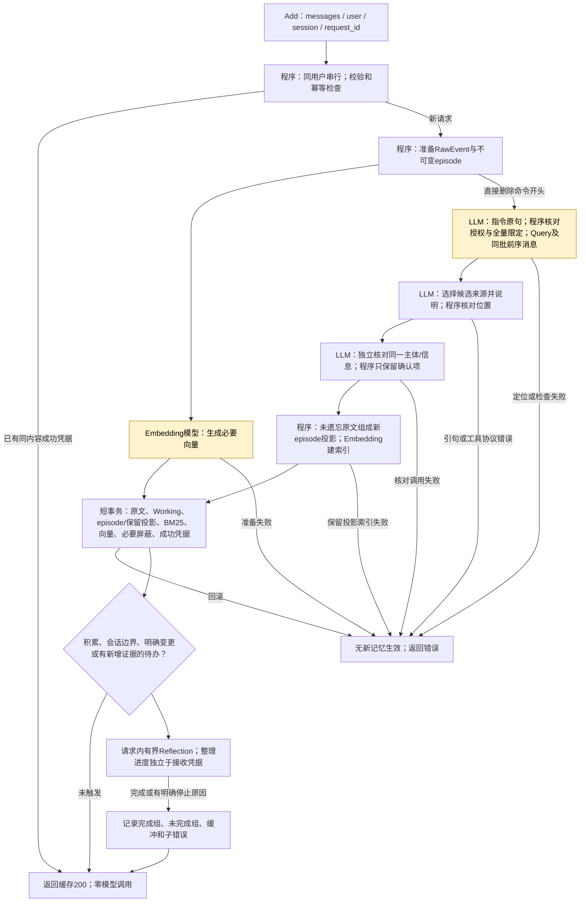
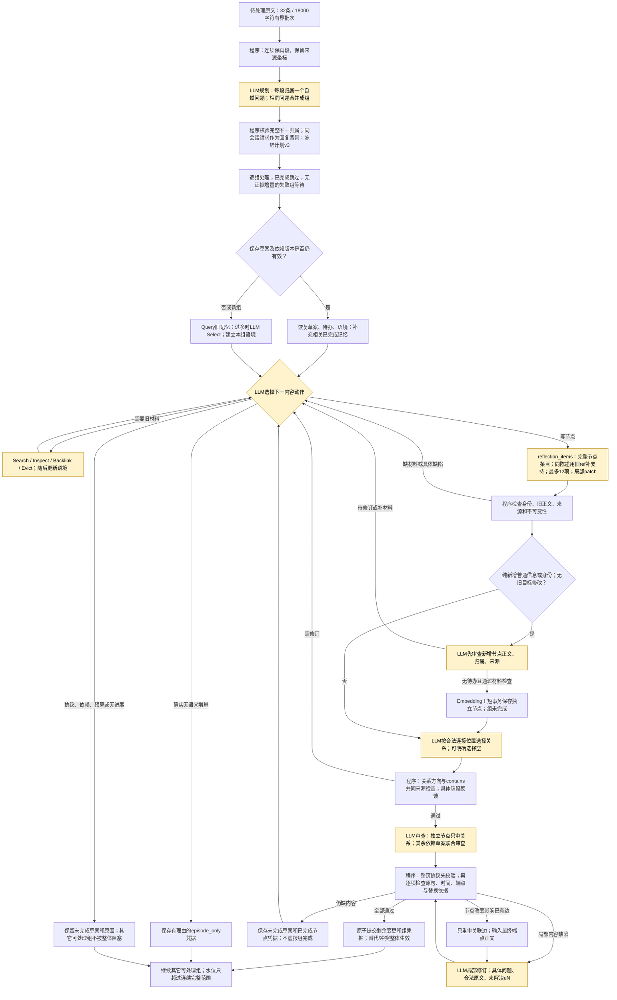
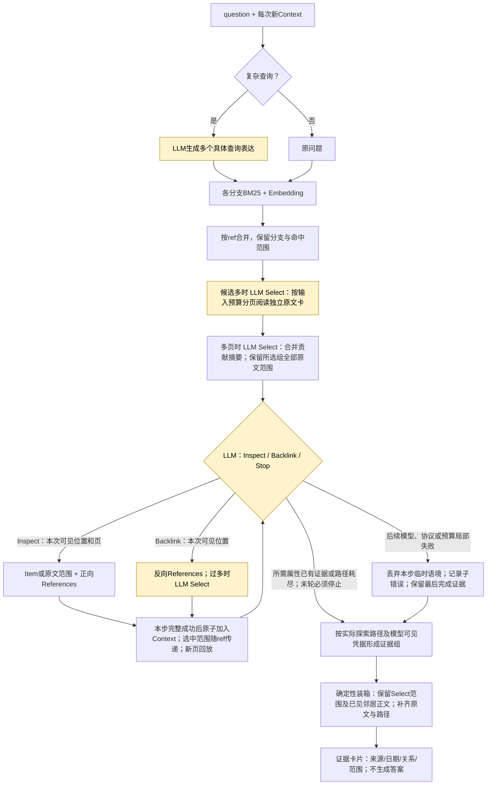

# AM-Link Add/Search 当前设计

更新：2026-10-29。当前默认实施[100题准备计划](docs/phase-2/2026-10-29-hundred-question-readiness-plan.md)：多片段向量索引、合法关系选择、已审查独立新增节点检查点，以及冻结完整历史的运行入口。356项回归＋3子测试通过，六类分版本完整历史预检结束；最终r11 PersonaMem13/13 Add、6/6 Search，已可启动100题本地诊断，剩94题未运行；工程通过不代表自动构图/回答质量通过。无内部重试、备用协议或公开接口变更，未部署。

## 边界和对象

默认智增增`text-embedding-v4`/1024维、每批最多10条，LLM继续`gpt-4o-mini`。长Item正文保持完整；索引按自然边界拆成每片最多6000 UTF-8字节的保守输入，保存ref、正文版本及字符范围。不是精确token计量，也不截断原文。所有片段成功后才原子接收；查询按节点合并多片命中，最佳片段决定节点向量名次，最多三个正相似度范围/分支进入可见候选，再由Select与装箱预算决定交付。长查询按同样边界嵌入后合成归一化向量。新索引使用新指纹/数据库4，旧库不自动迁移。

只提供Add/Search，主办方负责Answer/Eval。公开接口不变；同用户锁内同步执行，没有内部模型重试、后台补偿、自动重建或静默降级。默认开启embedding及模型Select。

MemoryItem包含episode/person/entity/concept/event/fact，MemoryRelation保留about/contains/supersedes/contradicts/same_event_as。最低episode是不可变原文投影，RawEvent保存原始角色、会话、顺序及来源时间。Reflection 不再新建摘要 episode；历史派生 episode 的正文/时间也不可改。新信息写 fact/event，重复陈述保持原正文并补来源；只有 person/entity/concept 导航内容可修改。user_id是隔离空间，不等于真实speaker；角色也不能代替人物姓名。

References始终是语义ref加可读叙事。MemoryWorking保留尚未整理的原文，Workspace是跨Add保留的有界活跃语境。位置清单、原文片段和证据组都是内部调用/输出组织，不新增长期记忆类型。

## Add：原子接收，按积累整理

原文、索引与成功凭据在同一个事务中生效，远程模型调用不持有数据库事务。准备或必要索引失败，本轮没有可检索材料；提交后响应丢失不代表撤销，同 ID 重放读取成功凭据。Reflection 的模型、预算或协议失败不撤销已可靠接收的原文，也不伪称整理完成。

每个成功Add的未遗忘内容都有可检索的episode投影，因此保留WorkingMemory不妨碍标准Search，Search不需要处理尾部；全量遗忘可以合法地没有活动Item。仅当前用户明确中英文删除命令开头进入授权模型，结构化记录、引述与否定表达不是控制指令。完整指令原句先经程序核对；全量删除不能由“关于某个属性的全部信息”推导。Query找到旧来源，同批次指令之前的原文也参与定位；之后的内容不回溯删除。

检索直接使用完整删除指令，避免模型把具体主题泛化。范围选择返回候选来源位置及说明，空列表表示未找到。随后每条候选独立核对：模型只看指令和这一条完整原文，不看选择器的解释，避免相邻润色版本和先前结论干扰。阳性必须附实际原文中的短quote，程序逐字核对；阴性quote必须为null。这是分工后的语义决策，不是失败重试。必要调用或协议失败时本轮Add不接收。事务屏蔽确认来源与依赖节点；受影响旧episode正文不改，在同一事务保存未遗忘原文的新episode投影及双索引，避免连带隐藏同批其它消息。当前遗忘单位仍是完整原消息，不能只擦除一条消息中的一句话；语义核对降低风险但不是完美保证。

普通积累为至少 2 个 Add 且达到 8 条或 6000 正文字符；单 Add 达到 64 条或约 36000 序列化字符可容量触发。会话边界优先处理此前连续前缀，明确变更可处理到当前末端。默认请求期限 1740 秒含排队，模型单次最多 120 秒；整理提前最多 5 秒收束，给进度保存和返回留余量。同用户仍串行，无后台补偿或内部网络重试。

分组是工作进度，不是长期节点。原文按自然边界切成不超过 1800 字符的段；每段工具键直接填写自然问题，消除“groups 数组＋动态组号表”的交叉编号。提示强调同一人物属性属于同一整理组，组内仍可创建多个合适的节点。组数最多 12，组内最多 16 次主决策，自动审查每页也计入该额度；嵌套Query/Select和embedding另计真实调用，共享请求与研究预算。

同一冻结批次内，助手回复若与请求分组不同，会带上最近的同会话用户请求作为共享背景；原文主归属不变，不跨会话或读取未来批次。模型需要逐陈述区分真实自述、引文/虚构材料、助手建议与用户采纳。角色和第一人称不足以判断归属；限定语必须进入持久正文，不能只留在审查解释里。真实实验仍有角色误归属，规则并不等于语义保证。

`reflection_items.items` 与局部 `upsert` 只有完整节点条目一种格式。已实际 Inspect 完整同版本正文、且在本次输入仍完整可见的旧节点，会列入可读复用提示；模型用同 ref、相同正文/类型/时间和新增支持原文提交，统一走材料检查、审查和原子写入，程序保留旧支持。最低 episode 不允许修改。独立 `reuse` 数组和简写条目均因真实字段混用/遗漏撤回，不留备用开关；不自动模糊归并近义陈述，也不把“补充另一个事件”当旧陈述的新支持。

关系提案为`connection_position/source_refs/support`。程序提供类型方向合法、无自链接、与本组节点有关的组合；菜单与端点正文同时可见。菜单不是事实，模型可不选任何边。实际菜单为空时程序推进审查，不再调用只能返回空列表的工具。`contains`还要求共同来源，审查继续验证真正支持。未知位置/缺字段仍显式失败，不自动纠错或静默丢边。

纯新增普通事实/身份先通过节点审查、材料验证和embedding，再以短事务保存节点与本组检查点；此时不推进整理水位、不发整组完成凭据。关系失败保留这些已审查节点。更新旧节点、解决冲突不走此路径，仍共同审查、原子提交。遗忘仅由Add接收阶段授权和原子处理，不再由Reflection另行发起。新节点正文在后续真实模型输入完整出现时可作为本组已读端点；数据库存在或模型刚生成并不等于已经读到。最终完成凭据包括先前保存的节点；同一`new:`标签解析到已有节点也不能绕过不可变性保护。

提交观测区分实际新增节点、旧正文不变而补来源、导航正文更新和无节点变化。它在事务成功后输出；审查通过和模型建议不会提前计为写入。

旧正文及完整事件时间（包括null）必须实际进入模型叙事，与消息日期分开。不可变错误反馈逐字段列旧值/新值；只有完整旧正文实际已读且仍可见才引用其原值，否则先要求Inspect。不同草案修正不因错误码相同而被误判无进展；相同草案和材料再次失败仍停止。

联合审查按实际差异处理：旧陈述补支持只评估新增原文是否支持同主体、同条件的完整旧陈述，不能用旧来源替新来源作证。无效新增可撤回，旧记忆不删除；真实更新/冲突或剩余待办不能冒充完成。person/entity仅作短身份路标，具体经历和决定用fact/event；这是写入与审查任务，不新增持久类型。完整历史仍有身份混同和缺边，规则不是语义保证。

`reflection_plans` 保存逐组完成凭据与未完成草案；后组可以先完成，低水位不会导致已分组材料被重新规划。只在冻结原文或实际已读的草案依赖有变化时重新考虑失败组；后来出现同关键词节点不会重启旧失败组，新Add由新组整理；相同成功 Add 重放永不再次整理。恢复前核对原文版本及已加载旧节点版本，失效草案不覆盖新记忆。积压没有后台自动清理，必须如实计入未完成质量指标。

数据库`user_version=4`，计划格式v3，Workspace阅读格式仍为v2，未完成组可携带已提交节点凭据。旧数据库显式拒绝，不静默迁移或重新处理旧研究数据。新实验一律新库。

## Search：独立语境，沿引用读取证据

Search近似于Query＋有深度上限的Inspect/Backlink多跳＋候选过多时Select。默认最多3跳、8次主决策；模型可从不同深度已知引用选择，并非逐层清空队列的经典BFS。续页不新增节点/跳数，但消耗决策步数。Inspect不做Select；Backlink返回带叙事引用，正文按需Inspect。

Query合并后候选超过5个就执行Select。每个引用的互补原文片段独立作为临时输入卡；不再固定24张分页，按包含工具定义的完整80000字符预算组织。不再固定每 ref 最多 4 段；按总模型输入预算、候选数量和分支贡献分配原文窗口，短原文尽量完整，同源重叠合并。分页保留后统一Select，再按ref合并，保留模型顺序及选中范围；全局保留集仍装不下时显式`select_merge_budget`，不再次暗中截短证据。

Select仍输出References子集，不新建节点、不生成答案。模型看到问题、任务用途、语义ref、原文、角色、日期与命中说明；Search寻找回答证据，Reflection寻找旧目标及支持来源。完整坐标/hash/覆盖信息进入观测。语义去重和互补性由模型判断，尚不能宣称更大的同屏候选已经带来稳定收益。

核查“是否真的发生”的问题时，虚构限定、他人引文、明确否定或未采纳也可能是必要证据，Select不能只保留用户的正面事实。新样本已验证虚构原文恢复到最终输出；正面互补事实仍保留，但边缘材料有所增加，精简性未证明全面改善。

多页Select的全局阶段比较“前页贡献说明＋可读ref＋部分原文引文”，不把全部长原文再次塞入单次调用。贡献摘要显式标记为导航而非证据；内部保留到完整已选原文卡的映射，选中一组后所有成员范围继续传递，绝不以摘要替代持久正文或阅读凭据。未被coverage描述的已选卡仍有独立候选，重叠组按原文范围去重。摘要仍有语义遗漏风险；调用观测分别记录原文页和贡献摘要，不能声称两者模型可见范围相同。页面没有提及某事不等于否定发生，不应整页作为“没有答案”的证据选中。

Select的coverage说明仅接受绑定实际选中位置的条目，传入后续语境作为待核验的导航说明，不能当成原文或答案。主选择中非法位置仍失败；无效辅助说明被剔除并记录。查询向量仅在同一语境内按问题原文和模型指纹精确复用，候选检索重新执行，不缓存过期结果。BFS分别记录新引用和新增读取范围；范围增长不等于语义增益。

BFS选择清单以自然叙事解释：多少其他记忆指向当前项（Backlinks），当前项指向多少其他记忆（Inspect正向展开）。这只是导航元数据，不冒充读过正文；零出边不等于零反链。找到项目/事件名称而所需地点等仍缺失时，应继续探索相关路径；已有充分证据则停止。仍由模型选择，无kind准入闸门。人工图已验证Backlink→Inspect→Stop和Inspect→Stop，不能当作真实Reflection自动构图或普遍多跳收益。

正向邻居正文若已实际出现在最后一次BFS输入，装箱依据同版本范围凭据保留，不再要求重复Inspect。先保留该范围，再补原文与路径；标签和过期凭据不合格，预算及来源完整性检查仍生效。`visible_graph_refs`记录这部分成员，不表示Answer一定采用它。

首次 Query、查询 embedding 和必要 Select 是基础检索，失败仍报错，合法空结果才返回空集。后续 BFS/Backlink Select 的模型、协议或预算错误可终止扩展，从最后完成语境装箱；失败步骤的引用、路径、读取凭据和覆盖说明全部丢弃。数据库或来源完整性错误仍报错，有候选但无法合法装箱也不伪装为空集。无内部重试。

## 引用位置和模型实际可见范围

所有工具模型调用共用`narrative.py`渲染器，预算预检和实际HTTP使用同一正文。输入按任务、新材料、相关旧记忆、草案缺项及可读动作位置组织；工具输出仍保持结构化。原话、角色、来源日期、限定条件和引用不改写成自由摘要。内部观测保留完整结构，但不把哈希和范围账本反复塞入模型正文。

关系审查必须同时显示两端实际可见的正文，包括Inspect放在disclosures里的旧正文；修改旧节点时额外呈现修改前正文，身份比较所需的已读正文也进入审查。不会偷偷从数据库读取模型未见材料。小组联合审查先校正节点；端点改变时只重审受影响边，未通过前整组不提交。缺端点显式失败；节点被撤销后，依赖边一起撤销。这个保证是材料和处理一致，不是模型判断必然正确。

每次先投影，再冻结显式编号清单；工具枚举、模型输入与解码共用这一清单。字典排序不能改变工具位置。Inspect/Backlink/Evict仅提供本次实际允许的位置，空清单不会生成空整数枚举。Select使用同样的页内位置规则，合法空集、去重并保持顺序；混入无效位置会显式失败。

内部片段记录origin_ref、正文digest、Python Unicode字符半开区间[start,end)及原文text。标签、来源时间和省略说明放在范围外。Reference能保留同源多个分支命中窗口；重叠合并，二次裁剪同步收缩范围。

10月26日窗口改为整段命中区分度排序，来源加入长度归一化，短消息尽量完整保留；同分时为命中后限定语留空间。Select对多来源episode保留互补窗口，不再按分支数限制来源个数。原文、字符预算及遗漏账本不变。查询扩展不得自行确定相对时间；包含输入未提供数值的分支会被记录并丢弃，无模型重试。这只检查数值，不保证所有扩展语义正确。

Inspect按已有Item及其合法sources分页。模型选择可读页编号，不直接提供任意偏移；每次最多展示8个续页选项，后续调用可继续披露。新页先占预算，再填自动预览；页的保护在下一次成功主决策实际包含该页后解除，Select/embedding不解除。实际输入范围进入receipt：它证明材料送达并返回，不证明模型理解。遗忘、删除或版本变化使缓存范围及阅读依据失效。

Select实际选中的原文卡不再机械裁成520字符；若被语境整体预算移除，仍记录实际遗漏。Reflection待办与提交共用missing_material检查；冲突两侧的来源缺口映射到真实来源页，读入后保护至验证。C2真实复验仍有protected_workspace_budget，不能称长文语境已稳定。

receipt统一收集disclosures、items正文、sources片段、References片段及完整working，按来源版本和范围记录。明确读取记录与当前可见范围分开：自动展示正文不冒充Inspect；历史取过但当前隐藏的页可以重新选择。页映射在模型调用前冻结，结果按同一映射解码。Reflection默认先读节点正文，再按需读长来源；必要语义正文保留至本批终结。来源片段中的query说明最多160字，避免重复携带完整维护问题。

## Reflection依据与Workspace

旧候选资格先于词法/向量候选上限检查；本批及未来最低episode不能冒充旧身份匹配。更新旧目标、改旧关系端点需要同版本Inspect，且所需正文在最终Mutation调用可见。冲突/替代两侧需要可见来源；新引用来源必须是已展示来源，继承来源不被冒充新增支持。

旧范围非空时，每个新person需要绑定new ref的定向旧身份Query：成功空结果允许no_prior_match；有候选需读相关候选。数据库确认本用户的有效旧资格范围完全为空时，使用明确scope_empty凭据，不执行无意义空Query，不伪造query_performed。全新端点之间的关系可由本批原文直接支持。程序校验的是材料与过程，人物语义是否正确仍需实测。

Workspace格式v2，有界至2×context_chars，节点和引用受现有预算限制。先折叠非保护来源页、未展示来源预览，再逐出可释放节点/引用；保护的是必需范围，不是节点的所有旧来源。v0/v1清除旧阅读凭据、恢复有效引用；未知格式显式拒绝。原文始终留在数据库。

非法方向/类型/端点会阻止整批Mutation，不自动翻转或静默过滤。反馈列出缺项、引用位置和合法方向；材料已齐时动态提示重新提交。错误未解决时不提供Stop，空Mutation不得掩盖失败。同样错误且无新增材料时显式无进展失败；无法留下补材料和提交槽时报告材料预算不足。

写入工具的Item身份限定为新`new:`标签或已加载的明确可修改节点。预检先拒绝虚构旧身份、全部旧episode正文/时间覆盖、重复摘要episode和非法类型，再进入材料门槛。唯一流程先暂存节点草案，再通过`reflection_relations`提出关系。模型可明确撤回非法边，但合法性、材料和最终提交仍整包检查，未完成时不移动水位。新组不继承另一组草案；同一未完成组仅恢复版本仍有效的草案。

Reference/Inspect中实际展示过且本次有可见凭据的来源，即使重复的`workspace.sources`缓存已折叠，也可在校验时回载；仍检查同用户和冻结批次资格。隐藏来源和未来来源不会因存在数据库里就自动变成可引用依据。

当前支持与历史溯源分开：只有正文/时间完全不变的节点保留旧支持并增加新支持。person/entity/concept 内容变化时仅提交本次审查选中的来源，不再无条件并回旧来源；历史提交仍在观测轨迹中。预检与最终提交都执行 episode/fact/event 不可变规则。

审查先读原文，再读草案，草案旁重列直接引用的原句。以“写出忠于证据的最终陈述”代替仅判真伪，保留可能性、未决定、否定和明确承诺。time_expression 必须确实出现在所选可见原句中；标准化日期年份必须出现在所选原文，发言时间/引用名称不能替代。原文缺年或只有未锚定相对时间时保留原话、日期字段留空。程序仅验证必要引用/年份条件；人物、日期的完整语义及关系仍由模型审查，不能视为金标准。

### 唯一的分步草案与来源对应

首次只提出节点或有明确理由的no-op。Reflection工具不再包含forget字段，程序拒绝任何从此路径发起的删除。有效草案不能任意重写；只有明确节点缺陷才开放`reflection_patch_items`。局部操作先移除草案项再upsert，未提及项保持原样，绝不借此删除数据库原文。纯关系缺陷只修关系。材料补齐由程序自动推进，不再提供`reflection_validate`或`reflection_commit`。可供下次调用不等于模型已读，提交依据仍来自实际返回的内容调用和审查输入。

程序调度小组联合审查：把实际已展示的直接来源、本组原文及冲突两侧原文组织为带位置的片段表，关系同时呈现两端正文。节点直接返回最终完整正文、时间和支持来源，正文为 null 才撤销。程序比较前后记录保留或修订；关系仍可保留/撤销。理由字段不能替代正文。整包过大按节点先、关系后分页，后页读取已修订端点，完整原文不暗中截断。分页源位置保留原编号，不当作新列表下标；前页检查点和待办不会因后页失败丢失。

关系审查统一action/detail/evidence_positions/replacement_quote四字段；只有保留的supersedes允许非空原句，其它关系严格为null。动作必须与理由一致；结构化档案不能仅凭JSON形式被标为虚构。真实控制例仍有错误about判断，工具合法不等于语义通过。

审查采用 evidence_positions：保留/修改时是写入支持，撤销时可作为否定依据但不产生支持凭据。顶层 uN 在同组按节点ref/关系三元组稳定绑定；原文位置按版本和范围绑定。取消 revised_endpoints，由程序检查节点变化，使受影响边的审查失效；撤销节点同时移除依赖草案边。合法草案保存在group progress检查点v1；仅上文规定的独立新增节点可先持久化，其余有依赖变更整组原子提交。初审加最多两轮内容修订；自动审查每页计入16次主决策，重复无进展停止。协议失败不提取部分结果、不修补JSON、不进入业务修订。关系审查携带写入模型实际读过、版本相同的端点正文，防止二次语境裁剪丢失；新的整理组释放上一组页面保护，保留历史阅读记录。

来源表含角色、原文范围、主要工作/共享背景及发言时间；发言时间不是事件日期。模型选择来源位置，程序展开原文范围和版本作为实际审查凭据。全撤销只有明确`episode_only`理由且没有真实更新/冲突待办才可完成；仍有语义增量、缺材料或预算不足不能伪装no-op。审查不再输出 `resolution/needs_revision`，而是顶层每个明确 `uN` 键的最终内容及 `remaining_work` 具体待办；没有 reviews 容器及每项重复的 anyOf 动作分支。有效修改先留在草案，再进入补读或局部 patch；无新材料或实质修订不反复审查。重复 JSON 键、错键、缺键和数组代替映射均拒绝，不猜对应关系。

审查后再次执行材料、身份、来源、类型和闭合检查，通过后一次提交。语义审查是模型判断，不是事实金标准；仍需检查主体、时序和关系。person导航的姓名可以由speaker支持；对话role不代表职业。supersedes 要求同主体/同属性/同条件下明确替代，审查必须提供可在所选来源中逐字核对的 replacement_quote。泛化、特例、另一场事件或共同兴趣不构成替代。原句存在仍不自动证明语义成立。

别名去重后两个不同提案引用若归为同一真实节点，其自环作为重复关系消除并记录；直接提出同ref自环仍被拒绝。没有跨类型自动反转、内部网络重试或后台补偿；维护/后续探索失败可以停止并保留已完成交付，但子错误与未完成范围必须记录。

完整长记录仍会暴露身份/预算/结构化输出与关系语义问题。已通过的小窗口不能代表完整人物记录已验收；逐运行版本、失败与调用量见实施报告。

## 最终证据组合与研究对照

保持Query/Select根引用顺序，把实际探索且有用的图补充、连接节点、关系及其来源放入较早根引用的证据组。A→C的有效补充不再默认排在所有初始候选之后。supersedes/contradicts两侧不提前过滤。卡片id仍是已有根ref，score表达返回顺序；证据组不是存储节点。

两遍分配先给各组支持窗口，其中 Select 选中原句优先，再补剩余材料。没有新增关系且原文范围已由前卡完整交付的纯 episode 不再占名额；其它材料最终按来源版本/范围去重，共享标记只指向已经返回的卡片。路径未闭合时去掉未闭合关系陈述，仍可返回独立支持材料。逐项记录来源缺失或预算裁剪。声明来源完整、路径闭合、答案证据充分是三件事，最后一项默认unknown。

模型参与证据组合的入口是Select选中的具体原文卡；装箱确定性展开这些原文，并补关系路径及来源。没有追加一个能重写证据的生成器。历史`packing_experiment.compare`属于靶场离线对照工具，不能当成当前服务的备用执行分支，也不承诺未来切换。

## 工具交付边界

一次调用依次检查：完整结束 → 一个已知工具和真实call ID → 唯一键JSON → 当次实际schema → 业务语义。命名单工具可返回stop＋完整tool_calls；length/content_filter不解析。jsonschema统一校验所有实际LLM工具，缺少nullable字段也不能自动填值。没有旧JSON模式、字段丢弃或内部重试。节点/关系内容检查可以提出有新任务的局部修订，来源完整性或未知数据库状态不能让模型猜测修复。

统一使用max_completion_tokens：BFS/查询扩展最多1024，其它内容任务5000。单一工具明确指定名称，多工具菜单required，禁用并行工具输出。实际请求、结束原因、call/request ID、schema指纹、用量和失败路径进入已有观测artifact。当前gpt-4o-mini没有新增推理强度参数。

## 观测及验证

[观测标准](benchmark/OBSERVABILITY.md)沿用span及artifact协议。当前记录引用清单、工具参数、原文范围回执、Reflection门槛缺项、缓冲目标及证据组决策；网页显示有界预览和原始artifact路径，旧记录缺项显示未知。HTTP 默认不开内部轨迹。native 网页分别展示接收结果、整理完成/待办/未分组数量、图扩展局部停止与子错误；旧记录缺字段显示未知，不能从父步骤 200 推断内部全成功。

[本轮实施报告](docs/doing/2026-10-28-tool-repair-implementation.md)将工程验收、真实诊断和待验证质量分开。记录冻结范围、主归属/背景、程序推进、实际联合审查范围、完成决定、向量复用与探索增量；真实源码哈希与方法快照保留于运行目录。窗口/锚点是辅助诊断，完整材料样本单列；失败Add后的Search、模型局部异常终止、未评分任务分别报告，不合成总体准确率。

历史[10月23日闭环](docs/doing/2026-10-23-reflection-convergence-implementation.md)、[前轮实施](docs/doing/2026-10-23-evidence-loop-implementation.md)、[100题重跑](docs/doing/2026-10-14-amlink-100-rerun-review.md)不能当作当前代码成绩。继续扩大独立历史和数据类型覆盖，并通过冻结数据库/输入定位退化；当前没有Answer准确率或新一轮100题总体结论。
