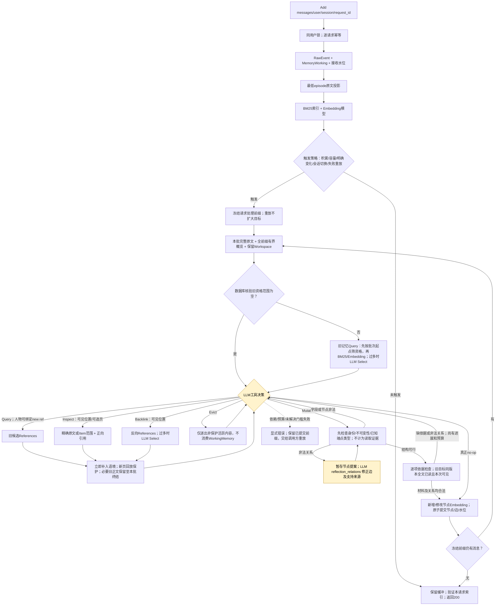
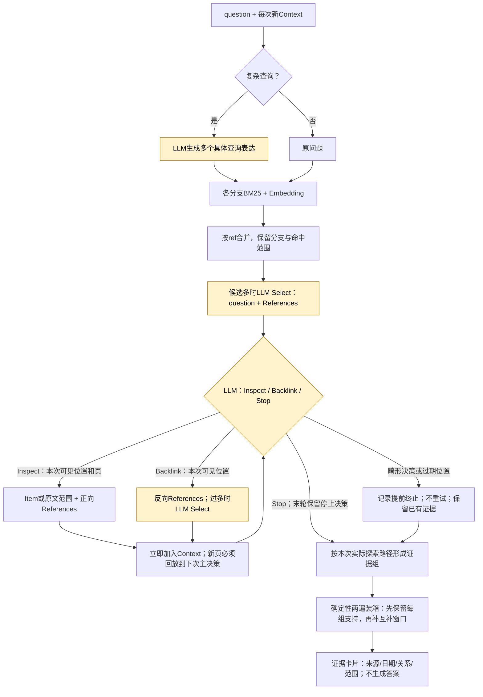
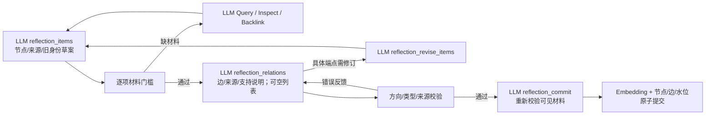

# AM-Link Add/Search 当前设计

更新：2026-10-26。基线为用户已提交的 `6e34e1f`；本轮[实施报告](docs/doing/2026-10-26-evidence-and-draft-implementation.md)与[执行计划](docs/phase-2/2026-10-26-evidence-and-draft-plan.md)记录证据窗口、数值查询约束、已展示来源回载及分步Reflection实验。LM4关键金额已进入Select输入，但仍被排除；新协议有小窗口成功和完整人物记录失败。自然构图、长材料整理和最终证据组合仍未验收；未部署、未参加官方Smoke。下面区分默认行为和实验选项，不能以工具存在或HTTP200代替质量。

## 边界和对象

只提供Add/Search，主办方负责Answer/Eval。公开接口不变；同用户锁内同步执行，没有内部模型重试、后台补偿、自动重建或静默降级。默认开启embedding及模型Select。

MemoryItem包含episode/person/entity/concept/event/fact，MemoryRelation保留about/contains/supersedes/contradicts/same_event_as。最低episode是不可变原文投影，RawEvent保存原始角色、会话、顺序及来源时间。user_id是隔离空间，不等于真实speaker；角色也不能代替人物姓名。

References始终是语义ref加可读叙事。MemoryWorking保留尚未整理的原文，Workspace是跨Add保留的有界活跃语境。位置清单、原文片段和证据组都是内部调用/输出组织，不新增长期记忆类型。

## Add：先保证可查，再按稳定前缀整理

普通触发要求至少2个不同Add，并达到8条消息或6000正文字符；单Add达到64条或约36000序列化字符可以容量触发。普通now/never或“忘带伞”不触发；update the等宽泛词面只作为观测线索，不绕过积累门槛。明确更正/删除仍要通过来源与遗忘授权校验。会话切换仅整理此前连续前缀；新会话首条保留在缓冲，若本次同时满足积累/容量/明确变更条件，则处理到本请求末端。A→B→A按连续段处理，不按相同session_id合并。

最低episode索引成功不等于每次Reflection。触发后Add等待冻结目标完成才返回200；未触发则保留缓冲。标准Search不排空WorkingMemory，最后一次Add没有触发也能通过最低episode检索。

默认总期限1740秒，包含排队；模型单次120秒。批次32条/18000字符，最多64批；Reflection16轮，最后一轮只允许提交或真正no-op。单轮工具定义、正文、语境共计80000字符。未解决的缺材料提案不能改成空Mutation/no-op推进水位。完整并发追加协调器仍属于P2。

## Search：独立语境，沿引用读取证据

Search近似于Query＋有深度上限的Inspect/Backlink多跳＋候选过多时Select。默认最多3跳、8次主决策；模型可从不同深度已知引用选择，并非逐层清空队列的经典BFS。续页不新增节点/跳数，但消耗决策步数。Inspect不做Select；Backlink返回带叙事引用，正文按需Inspect。

Query候选超过16个时默认执行Select。10月24日试验按top-k提前Select，未改善LM4的遗漏且top-1退化，已撤回；当前门槛与小top-k之间的缺口仍需结合可见片段改进。局部BFS协议异常只终止后续图探索并记录原因，不把已收集证据整体丢弃；模型网络/超时、Query/Select失败仍显式报错。提前结束不等于完整多跳，需在运行观测中区分。

## 引用位置和模型实际可见范围

每次先投影，再冻结显式编号清单；工具枚举、模型输入与解码共用这一清单。字典排序不能改变工具位置。Inspect/Backlink/Evict仅提供本次实际允许的位置，空清单不会生成空整数枚举。Select使用同样的页内位置规则，合法空集、去重并保持顺序；混入无效位置会显式失败。

内部片段记录origin_ref、正文digest、Python Unicode字符半开区间[start,end)及原文text。标签、来源时间和省略说明放在范围外。Reference能保留同源多个分支命中窗口；重叠合并，二次裁剪同步收缩范围。

10月26日窗口改为整段命中区分度排序，来源加入长度归一化，短消息尽量完整保留；同分时为命中后限定语留空间。Select对多来源episode保留互补窗口，不再按分支数限制来源个数。原文、字符预算及遗漏账本不变。查询扩展不得自行确定相对时间；包含输入未提供数值的分支会被记录并丢弃，无模型重试。这只检查数值，不保证所有扩展语义正确。

Inspect按已有Item及其合法sources分页。模型选择可读页编号，不直接提供任意偏移；每次最多展示8个续页选项，后续调用可继续披露。新页先占预算，再填自动预览；页的保护在下一次成功主决策实际包含该页后解除，Select/embedding不解除。实际输入范围进入receipt：它证明材料送达并返回，不证明模型理解。遗忘、删除或版本变化使缓存范围及阅读依据失效。

receipt统一收集disclosures、items正文、sources片段、References片段及完整working，按来源版本和范围记录。明确读取记录与当前可见范围分开：自动展示正文不冒充Inspect；历史取过但当前隐藏的页可以重新选择。页映射在模型调用前冻结，结果按同一映射解码。Reflection默认先读节点正文，再按需读长来源；必要语义正文保留至本批终结。来源片段中的query说明最多160字，避免重复携带完整维护问题。

## Reflection依据与Workspace

旧候选资格先于词法/向量候选上限检查；本批及未来最低episode不能冒充旧身份匹配。更新旧目标、改旧关系端点需要同版本Inspect，且所需正文在最终Mutation调用可见。冲突/替代两侧需要可见来源；新引用来源必须是已展示来源，继承来源不被冒充新增支持。

旧范围非空时，每个新person需要绑定new ref的定向旧身份Query：成功空结果允许no_prior_match；有候选需读相关候选。数据库确认本用户的有效旧资格范围完全为空时，使用明确scope_empty凭据，不执行无意义空Query，不伪造query_performed。全新端点之间的关系可由本批原文直接支持。程序校验的是材料与过程，人物语义是否正确仍需实测。

Workspace格式v2，有界至2×context_chars，节点和引用受现有预算限制。先折叠非保护来源页、未展示来源预览，再逐出可释放节点/引用；保护的是必需范围，不是节点的所有旧来源。v0/v1清除旧阅读凭据、恢复有效引用；未知格式显式拒绝。原文始终留在数据库。

非法方向/类型/端点会阻止整批Mutation，不自动翻转或静默过滤。反馈列出缺项、引用位置和合法方向；材料已齐时动态提示重新提交。错误未解决时不提供Stop，空Mutation不得掩盖失败。同样错误且无新增材料时显式无进展失败；无法留下补材料和提交槽时报告材料预算不足。

写入工具的Item身份限定为新`new:`标签或已加载的明确可修改节点。预检先拒绝虚构旧身份、最低episode覆盖和非法类型，再进入材料门槛。默认仍采用完整Mutation，关系错误可暂存节点/遗忘提案，通过`reflection_relations`仅修边。模型可明确撤回非法边，但合法性、材料和最终提交仍整包检查，未完成时不移动水位。新批次不继承过期暂存提案。

Reference/Inspect中实际展示过且本次有可见凭据的来源，即使重复的`workspace.sources`缓存已折叠，也可在校验时回载；仍检查同用户和冻结批次资格。隐藏来源和未来来源不会因存在数据库里就自动变成可引用依据。

### 实验选项：首次节点—关系—提交分步

`AML2_REFLECTION_STAGED=true`启用，**默认false**。它复用同一WorkingMemory、来源门槛、读页、预算和事务，不增加持久记忆类型。模型首次只选择节点草案或真正no-op；草案最多12项。没有完成的提案不能用Stop退出。

关系工具按当前节点类型枚举合法方向；没有`drop_invalid`冗余开关。接受节点后不能直接反复重写，必须说明具体修订原因；相同草案不能算进展。支持说明保留到提交语境及观测，允许简短中文，非空不代表语义正确。L1已经真实构建出有支持的about边；完整人物材料仍出现空字段、错误来源和无进展，故实验实现done而质量验收未完成，尚不替换默认协议。

**真实未闭合处：**模型仍可能穷举来源到最后一轮才提出变更，或撤回所有关系后留下没有导航作用的语义节点。10月24日R2—R4的24个新库均为0边；四段新人物历史的top-5来源覆盖完整，主要依靠episode/正文检索，不能归功于图多跳。长材料Add仍有失败；LM4又观测到写入成功但语义节点挤占top-k证据，详见报告。没有通过跨批身份复用、有效多跳或整体构图验收。完整并发追加协调器仍未实现。

## 最终证据组合与研究对照

保持Query/Select根引用顺序，把实际探索且有用的图补充、连接节点、关系及其来源放入较早根引用的证据组。A→C的有效补充不再默认排在所有初始候选之后。supersedes/contradicts两侧不提前过滤。卡片id仍是已有根ref，score表达返回顺序；证据组不是存储节点。

两遍分配先给各组支持窗口，再补剩余材料；最终入选后才按来源版本/范围去重，共享标记只指向前面已经返回的卡片。逐项记录来源缺失或预算裁剪。声明来源完整、路径闭合、答案证据充分是三件事，最后一项默认unknown。

`amlink.packing_experiment.compare`用于离线受限LLM对照：冻结相同候选/范围/路径/字符预算，只调用一次模型选择已有组和片段位置，工具绑定组与对应片段，本地拒绝超top_k、越界或新写证据/答案。默认Search不调用这个阶段。10月23日对照输出合法但丢失一个标注来源，仍不默认开启。组卡改变@k含义，实验必须注明packing_unit，并报告字符预算覆盖。

## 观测及验证

[观测标准](benchmark/OBSERVABILITY.md)沿用span及artifact协议。当前记录引用清单、工具参数、原文范围回执、Reflection门槛缺项、缓冲目标及证据组决策；网页显示有界预览和原始artifact路径，旧记录缺项显示未知。HTTP默认不开内部轨迹。

[本轮实施报告](docs/doing/2026-10-26-evidence-and-draft-implementation.md)将方向、实施、跨数据集验证与反例分析分开，并保留全部运行清单。实际源码哈希进入native工件；研究运行还保存方法源码快照。窗口/锚点是辅助诊断，完整材料样本单列；失败Add后的Search、模型局部异常终止、未评分任务分别报告，不合成总体准确率。查询分支拒绝、草案阶段和真正提交分别埋点，不把草案展示称为已写入。

历史[10月23日闭环](docs/doing/2026-10-23-reflection-convergence-implementation.md)、[前轮实施](docs/doing/2026-10-23-evidence-loop-implementation.md)、[100题重跑](docs/doing/2026-10-14-amlink-100-rerun-review.md)不能当作当前代码成绩。继续扩大独立历史和数据类型覆盖，并通过冻结数据库/输入定位退化；当前没有Answer准确率或新一轮100题总体结论。
