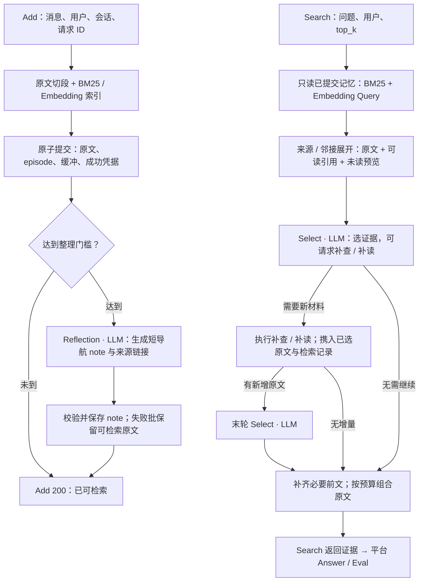

# AM-Link

**先保存证据，再建立导航；根据问题寻找并组合原文。**

AM-Link 是 [Graygoo7529](https://github.com/Graygoo7529) 原创的智能体长期记忆系统，面向 [Agent Memory Leaderboard](https://agentmemoryleaderboard.ai/)。系统只提供 **Add / Search**：接收对话、组织记忆、返回可追溯的证据，最终 Answer / Eval 由评测平台完成。

当前版本为 **AM-Link 0.3.4-continuity**，已部署文本接口。以下部署状态核对于 **2026-10-31**。

| 项目 | 当前配置 |
| --- | --- |
| 部署代码 | `1f9136563bdc3d56d0425d57000739adb8dc0379`；后续文档提交不改变该部署身份 |
| 记忆系统 LLM | `gpt-4o-mini` |
| Embedding | `text-embedding-v4`，1024 维 |
| 存储与检索 | SQLite 持久化、BM25、向量检索、来源链接与会话邻接 |
| 运行环境 | Python 3.13；已验证 Windows 与 Ubuntu 24.04 / Python 3.13.14 |
| 接入范围 | 文本 Add / Search；HTTPS + Bearer 鉴权 |

[设计与流程](DESIGN.md) · [部署指南](deploy/README.md) · [实际部署记录](docs/doing/2026-10-31-server-deployment.md) · [记忆研究室](research/README.md) · [文档索引](docs/README.md)

## 方法概览

可以把 AM-Link 理解为一间档案室：**原始消息是档案，episode 是保留原文的档案页，note 是指向档案页的目录卡，Reference 是附有可读说明的引用。** 导航笔记帮助找到材料，最终交给回答模型的是原文证据。

**Add：接收与整理分工。** 消息保留角色、时间、会话及顺序，切分为连续原文片段，完成词法和向量索引后原子提交。已索引的片段同时进入工作记忆缓冲；累积到数量、字符或会话边界门槛时，Reflection 使用模型一次生成少量短导航笔记及其来源链接。缓冲尾部即使尚未整理，也可直接检索。

**Search：先读材料，再决定是否继续找。** BM25 与向量检索共同寻找入口；命中笔记时沿来源展开原文，并补充相关的相邻内容。Select 模型看到问题、可读引用、来源信息、原文和未读预览，选择互补证据，也可提出补查或补读。新增材料与首轮已选原文、实际检索记录一起进入末轮选择，最多两轮 Select。最终按选择顺序组合原文，补充必要的紧邻前文，并在数量和字符预算内返回。



例如，“每日配额从 1,000 改为 1,200”会保存为两段有来源和时间的原文。笔记可以成为“配额变化”的导航入口；Search 将相关原句交给回答模型判断当前值。对于“Maya 的朋友是 Rowan”“Rowan 住在 Ghent”，读到第一段后可围绕 Rowan 补查，再组合两段证据。

设计吸收了一期的原文优先、事务和幂等，二期的跨 Add 缓冲、引用与 Select，以及同作者 TinySoul-Agent 的可读导航理念。完整对象定义、工具输入输出与取舍见 [DESIGN.md](DESIGN.md)。

## 已部署接口

| 用途 | 方法与地址 | 鉴权 |
| --- | --- | --- |
| Health | `GET https://121.43.49.84/amlink/health` | 无 |
| Add | `POST https://121.43.49.84/amlink/v1/memory/add` | Bearer |
| Search | `POST https://121.43.49.84/amlink/v1/memory/search` | Bearer |

Add / Search 请求使用 `Content-Type: application/json` 和 `Authorization: Bearer <Memory System Key>`。接口密钥由部署方单独提供，不写入仓库；它与模型服务商密钥不同。公网地址中的 **`/amlink/` 不可省略**，原站 `/health` 并非 AM-Link 的健康接口。

Add 请求示例：

```json
{
  "request_id": "demo-add-001",
  "user_id": "demo-user",
  "session_id": "demo-session",
  "messages": [
    {
      "role": "user",
      "content": "Cedar 项目的每日调用配额现已调整为 1200 次。",
      "timestamp": 1780358400000
    }
  ]
}
```

成功返回 `success: true` 及原样的 `request_id`、`user_id`、`session_id`。消息 `role` 支持 `user` / `assistant`，`content` 为非空文本；`timestamp` 可省略，提供时使用 Unix 毫秒整数。

Search 请求示例：

```json
{
  "user_id": "demo-user",
  "query": "Cedar 项目当前每天可以调用多少次？",
  "top_k": 5
}
```

`top_k` 必填，范围为 1–100；选择题可另传顶层 `options` 字符串数组。响应为有序 `data` 数组，每项含 `id`、`content`，以及可选 `score`、`created_at`。返回数量不超过 `top_k`，可返回空数组。精确请求定义见 [schemas.py](amlink/schemas.py)，路由与错误响应见 [api.py](amlink/api.py)。

接口语义：

- **Add 成功**表示本轮有效原文、必要索引、遗忘处理和成功凭据已提交，可立即 Search。可选整理未完成或失败，不撤销已接收的证据。
- **幂等与隔离**以 `user_id` 为范围。同一用户的相同 `request_id`、相同内容重放不重复写入或调用模型；同 ID 换内容返回 422。不同用户的记忆相互隔离。
- **Search 独立只读**，不消费工作缓冲，不触发 Reflection，不生成最终答案。
- **错误由调用方处理**。必要接收操作失败不留半轮写入，模型和请求均不做内部错误重试。鉴权错误返回 401，参数或冲突重放返回 422。

初次评测使用 Add / Search 并发 **16 / 16**，请求超时 **1800 秒**；此并发已完成短合成历史检查。应用期限为 1740 秒，单次模型期限为 90 秒。Health 仅表示服务进程可响应，不代替模型可用性检查。部署参数及核对依据见 [部署记录](docs/doing/2026-10-31-server-deployment.md)。

## 从源码运行

在项目根目录操作，准备 Python **3.13** 和可调用上述两个模型的凭据。生产运行依赖固定在 [deploy/requirements.lock](deploy/requirements.lock)，无需安装数据集或 Mem0 等研究依赖。

首次创建环境和本地配置文件；已有配置时直接复用，不覆盖密钥。

**Linux：**

```bash
python3.13 -m venv .venv
.venv/bin/python -m pip install -r deploy/requirements.lock
mkdir -p docs/private
cp deploy/.env.example docs/private/local.env
```

**Windows（PowerShell）：**

```powershell
py -3.13 -m venv .venv
.\.venv\Scripts\python.exe -m pip install -r deploy/requirements.lock
New-Item -ItemType Directory -Force docs/private
Copy-Item deploy/.env.example docs/private/local.env
```

编辑 `docs/private/local.env`，填写以下值。示例中的占位符须替换；其余模型名称、维度及服务地址见模板。

```dotenv
AML3_DB_PATH=amlink/data/local-memory.sqlite3
AML3_LLM_API_KEY=<LLM 服务密钥>
AML3_EMBEDDING_API_KEY=<Embedding 服务密钥>
AML3_AUTH_SCHEME=bearer
AML3_API_KEY=<自行生成的记忆服务接口密钥>
```

模板使用 `https://api.zhizengzeng.com/v1`。`docs/private/` 和本地数据库路径已被 Git 忽略；配置通过 `--env-file` 显式加载。两种模型凭据均需填写，启动不会自动进入无模型模式。

启动服务：

```bash
# Linux
.venv/bin/python -m amlink --env-file docs/private/local.env --host 127.0.0.1 --port 8080
```

```powershell
# Windows
.\.venv\Scripts\python.exe -m amlink --env-file docs/private/local.env --host 127.0.0.1 --port 8080
```

本地入口为 `http://127.0.0.1:8080/health`、`/v1/memory/add`、`/v1/memory/search`，不含公网代理前缀。服务使用单个 worker；同用户写入串行，不同用户可并发。新建数据库采用 DB301 / passages-v2，不能直接加载旧期数据库或旧向量。

Linux 正式部署、持久化目录、systemd、HTTPS、发布包核验与回退见 [deploy/README.md](deploy/README.md)。密钥只在运行时配置，发布包不包含数据集、研究记录或数据库。

## 验证结果与范围

以下各行是不同验证范围，不能合并成回答准确率。详见 [稳定版实施核对](docs/doing/2026-10-31-continuity-budget-implementation.md)和 [服务器部署记录](docs/doing/2026-10-31-server-deployment.md)。

| 验证 | 已记录结果 | 范围 |
| --- | --- | --- |
| 本地回归 | 159 项测试、5 项子测试通过 | 契约、原子性、检索、观测与研究设施 |
| 最终方法版本 | 38/38 Add、15/15 Search；37/38 Reflection | LoCoMo、PerLTQA、CL-bench 各一份完整公开历史；未运行 Answer |
| 公网并发 | 32/32 Add、16/16 Search、16/16 Reflection | 16 用户短合成历史，真实 mini / v4 调用 |
| 部署检查 | HTTPS、鉴权、并发幂等、隔离、重启后检索通过 | 已部署发布包与持久库 |
| 收敛前百题实验 | 780/780 Add、100/100 Search；801/810 Reflection；99/100 本地 Answer 完成 | 六类、26 份完整公开历史；部分提示随后撤回，与最终版本不完全相同 |

**调用完成、证据充分和回答正确是不同指标。** 最终版本仍有导航整理的长尾协议错误，多跳和长清单问题仍可能漏选材料或受交付预算限制。长历史全量容量尚未验收；截至上述部署记录，未运行官方 Smoke / Full。

已有环境中可执行：

```powershell
# 离线回归；另需 pytest，生产依赖锁不包含测试依赖
.\.venv\Scripts\python.exe -m pytest -q

# 合成 HTTP 检查；会写入独立测试用户并产生真实模型调用
.\.venv\Scripts\python.exe deploy/smoke.py --base-url http://127.0.0.1:8080 --env-file docs/private/local.env
```

新开发环境可在安装生产锁定依赖后，另执行 `python -m pip install "pytest>=8.3,<10"`；这里的 `python` 应使用该虚拟环境中的解释器。Linux 使用 `.venv/bin/python` 执行同样的验证命令。

## 数据、案例与可视化

[记忆研究室](research/README.md)统一展示数据集构成、字段与标注、理论案例、真实 Add/Search/Answer 轨迹和逐步评注。案例研究关注：要回答问题需要哪些证据，模型实际看到了什么，材料在哪一步未召回、未展开、未选择或未交付。

理论案例与登记见 [research/cases/catalog.json](research/cases/catalog.json)，典型深入研究见 [真实证据链案例](research/cases/2026-10-30-real-evidence-studies.md)和 [跨轮阅读与集合选择案例](research/cases/2026-10-30-continuation-studies.md)。数据准备入口为 [dataset/README.md](dataset/README.md)，按案例运行见 [STUDIES.md](research/benchmark/STUDIES.md)。

具备本地数据和运行档案后，可生成离线页面：

```powershell
.\.venv\Scripts\python.exe -X utf8 -m research.web.build
```

产物为 `research/data/index.html` 及配套 `runs/` 分片，保持相对位置即可用普通浏览器打开；构建不调用模型，页面不保存选择状态。原始数据、完整模型 I/O 和生成页面保存在忽略目录，克隆源码不会自动获得这些运行材料。研究侧本地 Answer 使用 GPT-5.4，与生产 Add/Search 的 mini 配置分开，也不代表官方 Answer 型号。

## 项目结构

| 路径 | 职责 |
| --- | --- |
| [amlink/](amlink/README.md) | 当前参赛方法：HTTP、Add/Search、原文组织、存储与模型调用 |
| [DESIGN.md](DESIGN.md) | 当前设计理念、完整流程和实现边界 |
| [deploy/](deploy/README.md) | 依赖锁、发布包、服务与代理配置、部署检查 |
| [dataset/](dataset/README.md) | 公开数据获取、预处理与切片 |
| [research/benchmark/](research/benchmark/README.md) | 靶场适配、计划与执行、Answer/Eval、观测和评注 |
| [research/cases/](research/cases/catalog.json) | 唯一案例登记、理论证据链和实测研究 |
| [research/web/](research/web/build.py) | 唯一研究页面的离线构建与展示 |
| [docs/](docs/README.md) | 设计计划、实施核对和研究报告 |
| [archive/phase-1/](archive/phase-1/README.md) | 一期代码与设计归档 |
| [archive/phase-2/](archive/phase-2/20261029-clean-rebuild/) | 二期重构前的实现与设计 |

当前实现入口为 [engine.py](amlink/engine.py)；原文披露与组合在 [reading.py](amlink/reading.py)，事务存储在 [store.py](amlink/store.py)，模型调用在 [providers.py](amlink/providers.py)。研究记录与生产服务分开，正式服务不加载研究 Answer、评分标注或公开实验库。
