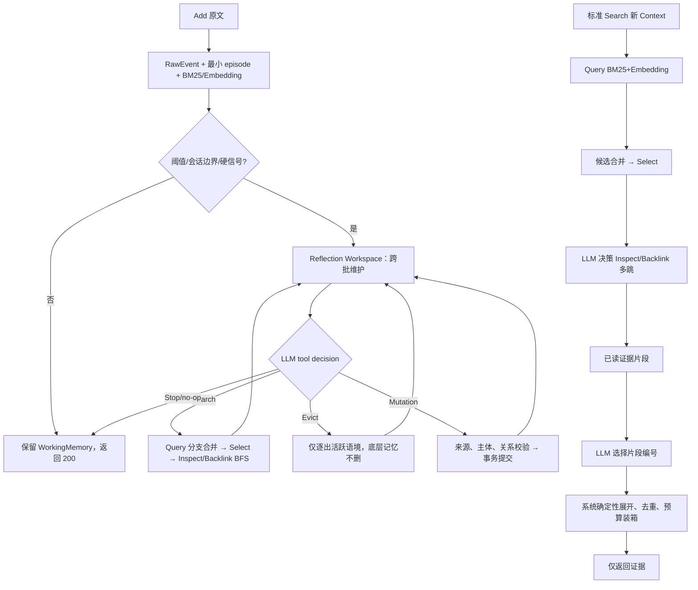

# AM-Link 0.2.1 真实重跑与方法改进诊断

更新日期：2026-10-12。本文记录 0.2.1 修复版的 100 题 LoCoMo 重跑过程、可复核的中间结果和后续改进方案。它不等同于官方 Smoke/Full 成绩；模型返回的证据仍由主办方 Answer/Eval 负责评测。

## 状态边界

本轮第一次 100 题进程在用户切换会话时被中断，只留下部分运行目录 `benchmark/data/runs/amlink-repaired-locomo-100-real-20261011/`，没有 `report.json`，因此不能称为完整 100 题结果。该目录的观测文件和数据库保留为中间证据，不能覆盖或删除。

截至该进程停止时，目录中可核查到：

| 项目 | 结果 |
| --- | ---: |
| Add 记录 | 28 |
| Add 成功 | 13 |
| Search 记录 | 19 |
| Search 成功 | 11 |
| 原始消息 | 419 |
| MemoryItem | 71（29 episode、42 event） |
| MemoryRelation | 8（7 contains、1 same_event_as） |
| 主要错误事件 | 46 selection_unknown_ref、9 mutation_relation_types、3 minimum_episode_immutable、3 mutation_invalid_identity |

这些是嵌套观测中的错误事件计数，不等于独立请求失败数；对应的请求级统计以 `trace.jsonl` 为准。它们只说明真实链路已经走到了错误位置：不代表全量准确率，也不代表 0.2.1 已完成。随后已用新的 run-id 完成完整四记录、100 题重跑，结果见下文。

## 完整 100 题基线（done，2026-10-12）

运行目录为忽略的 `benchmark/data/runs/amlink-repaired-locomo-100-real-20261012/`，包含四个记录、100 个问题、145 次 Add 和 100 次 Search；版本标识为 `0.2.1-position-select`。

| 指标 | 结果 |
| --- | ---: |
| Add 成功 | 138/145（95.17%） |
| Search 成功 | 90/100（90.00%） |
| Add 延迟 p50 / p95 / 最大 | 15.75s / 44.31s / 71.09s |
| Search 延迟 p50 / p95 / 最大 | 23.33s / 41.36s / 52.03s |
| 成功 Search @5 证据召回 / 命中率 / 完整链覆盖 | 0.323 / 0.410 / 0.270 |
| 多跳 @5 证据召回 / 命中率 / 完整链覆盖 | 0.278 / 0.486 / 0.143 |
| 时间题 @5 证据召回 / 命中率 / 完整链覆盖 | 0.375 / 0.358 / 0.358 |
| 结构化节点 | 146 episode、164 event、26 fact；person/entity/concept 为 0 |
| 关系 | 29 条：about 4、contains 22、contradicts 1、supersedes 2 |
| Reflection 图工具 | Inspect 192、Backlink 42；Reflection 内 Inspect/Backlink 仍为 0 |

这说明请求级链路可以完成，但成功率不是记忆质量。Add 失败 7 次，主要为 mutation 引用/关系/不可变 episode 校验；Search 失败 10 次均为 `selection_invalid_position`。成功 Search 的标注证据召回只有 0.323；`single_hop` 只有 2 题，不能据此比较单跳优势。

### Select 分页坐标错误（已修复，待真实重跑）

完整基线中 10 次 `selection_invalid_position` 具有同一模式：分页 Select 的模型输出位置来自候选全集，而当前页工具按本页白名单校验。观测候选也没有明确页内坐标，说明分页协议和观测协议没有统一。这是 AM-Link 的实现错误，不应归因于模型质量。

代码已改为：每页提供从 0 开始的页内 `position`，每条候选另带 `candidate_position` 作为全集稳定位置；系统只用页内位置映射回当前页真实 ref。52 项 `amlink/tests` 与 `benchmark/tests` 已通过。由于本轮之后两个模型提供方网络不可达，尚未对 100 题做修复后的真实重跑，因此“错误消失”目前是代码与本地回归结论，仍待真实验证。

## 当前链路中已经验证的事实

1. 每个成功 Add 都先持久化原文、生成最小 episode，并完成 embedding/index；在这部分轨迹中没有重新出现旧版的输入预算死循环。
2. Reflection 确实会产生 event 节点和 contains/same_event_as 边，说明 Mutation 工具已被真实模型调用；但模型也多次提出非法关系、修改不可变 episode 或引用不存在的 ref，导致 Add 失败。
3. Select 的合法引用约束仍是高频边界：部分模型选择了候选页之外的 ref，结果为 `selection_unknown_ref`，Search 直接失败。结构化工具 schema 只能约束形状，不能保证模型只复制当前页的语义引用。
4. 19 个 Search 中有 11 个成功，成功并不等于证据完整；失败 Search 会在适配器边界被明确记录，不能伪装成空结果。
5. 数据库中出现 42 个 event 但没有 person/entity/concept/fact，且关系主要是 episode 到 event 的 contains。这说明当前模型容易把长对话切成事件日志，却没有稳定建立人物身份、事实主体和跨会话导航。

## 根因分析

### 1. 缓冲容量与整理时机混在一起

`reflection_threshold=8`、`reflection_chars=6000` 同时承担输入分批和“是否值得做全局整理”的职责。分批是容量约束；Reflection 是否产生高层语义记忆则需要跨 Add 的全局视角。若每批都被当成完整总结，模型会重复建 event，或在还没有人物/时间全貌时做错误归属。

应保留 `MemoryWorking` 和跨 Add Workspace，把“本批可安全读取”与“本批已经完成语义整理”分开。停止可以表示等待更多材料，也可以表示明确 no-op；只有后者推进已处理水位并清理工作缓存。

### 2. 引用有导航含义，但片段披露仍不完整

Query/Backlink 的候选 Reference 已有类型、可读 ref 和命中叙事，但长 episode 的片段可能只展示开头。Select 看不到的句子无法被选择；Inspect 之后若仍只返回同一截断片段，模型会误以为已经读完；最终装箱再重复展开正文时，互补证据容易被预算挤掉。

每个候选必须带 `hit_fragments`、来源角色、会话日期和已读/未读范围。长内容应允许 Inspect 按 continuation 继续读取，且观测明确区分“未召回、Select 排除、未 Inspect、上下文裁剪、最终装箱裁剪”。

### 3. 来源存在不等于来源支持主体

真实轨迹中已观察到：派生 event 的正文与所列 raw source 不一致，或者 contains 边的端点与来源说话人不匹配。当前校验主要证明 ref 存在、类型合法、来源非空，尚未证明“谁说了什么”。

Mutation 前必须同时展示 speaker、原文句子、会话日期和相邻语境。对于主体归属不清、同名未消歧或时间限定缺失的内容，应保留 episode 而暂不建立确定的 person/fact/event 节点或关系。图的稀疏度不能用错误的边换取。

### 4. Select 与最终装箱承担不同任务

Select 决定候选 References 是否值得继续探索；最终装箱决定已经得到的证据中哪些需要一起交给 Answer。前者不应抄写不存在的 ref，后者不应只按旧检索分数重新排序而丢掉互补来源。

建议最终装箱增加一个可选的 LLM 证据编排步骤：输入 question、已 Inspect 的证据片段、关系叙事、来源日期、`top_k` 和字符预算；模型只通过工具调用选择已有片段编号及顺序。系统再确定性展开原文、去重来源、保留必要相邻句并执行预算。模型不能生成新证据或答案。

## 修订后的验证顺序

### A. 完成干净基线

用新的 run-id 重跑完整四个 LoCoMo 记录（100 题、4 个独立 user 空间），生成 `report.json` 和 `observability.meta.json`。报告至少包含 Add/Search 成功率、错误分布、节点/关系类型、Reflection 工具调用、Inspect/Backlink 次数、Select 保留率、最终装箱决定和模型输入字符。

### B. 修清可见证据范围

先不改变 MemoryItem schema：

- 合并同一 ref 的多分支命中片段，而不是只留一个 preview；
- 给 episode/长节点提供有界 continuation Inspect；
- 将 speaker、session date、ordinal 和 source ref 一起放进 Reference narrative；
- 在 `select` 与 `context` 观测中记录每条候选的去向和理由。

验收是同一题中能分辨证据在 Query、Select、Inspect 或装箱哪一步消失，而不是只看最终 top-k。

### C. 改善主体和来源归属

把 Mutation 提示和确定性校验分为两层：schema/引用/关系类型校验，以及 speaker-claim-subject 的语义支持检查。重复或含糊的同名对象不合并；没有充分证据时只保存 episode。优先通过真实案例核对，不预设节点或边数量。

### D. 对照最终装箱

在同一完成的数据库和同一 Search 轨迹上比较：

1. 当前确定性装箱；
2. LLM 仅选择片段编号、系统确定性展开的装箱。

只比较证据覆盖、互补性、顺序稳定性、字符数和延迟；不让装箱模型生成 Answer，也不把诊断 Answer 当官方分数。

### E. 校准跨批 Reflection

用短 Add 连续积累、会话切换、明确更新/遗忘和长历史四类切片，观察：

- 未触发 Reflection 的 Add 是否仍可由最小 episode 检索；
- 触发后是否先读取相关旧记忆，再 Mutation；
- Workspace 是否跨批保留未决主体、时间和冲突；
- 显式 no-op 是否真的有理由，是否错误清除了待处理 WorkingMemory。

所有内部工作保持单请求有界、显式错误、无内部自动重试；官方约定内的重试仍由调用方负责。

## 跨数据集切片尝试（网络阻断，不计为方法结果）

在修复代码上准备了 `p1/p2/b1/b2/l1/l2/pv1/m1` 八个公开案例锚点，运行脚本为忽略的 `benchmark/data/research/core-repairs-20261011/run_cross_cases_20261012.py`。每个切片使用独立数据库与标准 native 观测。

八个切片的 Add 均在首次 embedding 请求处以 `provider_network` 失败；不带凭据的 HTTPS 与 TCP 检查也无法连接 `open.bigmodel.cn:443` 和 `api.zhizengzeng.com:443`。之后产生的空 Search 结果有 Add 前置失败，必须标为 `source_add_failed`，不能用于召回或记忆质量统计。网络恢复后重跑上述锚点，再至少扩展到 CLBench、LongMemEval、PersonaMem、BEAM 各一个切片，并分别报告原始输入构成、完成 Add、图结构、证据路径和模型调用。

## 当前设计判断与继续实施顺序

1. **证据范围仍是第一瓶颈。** 长 episode 的 Reference 可能只展示头部 4/18 条来源消息。若关键句未进片段，Select 排除候选是预期行为，根因是 Query 分支片段并集与 Inspect continuation 尚未闭合。当前代码已加入 `hit_fragments` 和覆盖元数据，但收益仍待真实对照。
2. **主体/来源归属仍是第二瓶颈。** 小样本和100题运行都出现 event/fact 引用语义不支持的 speaker 或消息。来源 ref 存在、类型合法，不等于来源支持陈述。Mutation 应显式呈现 speaker、ordinal、日期和原句；不确定时保留 episode，不新增高层断言。
3. **最终装箱仍是第三瓶颈。** 当前装箱保持 Select 顺序、去重来源、保留日期并记录逐项丢弃原因，但图新增候选追加在后，集合题仍可能被 top_k 挤掉互补来源。可以对照一个受限 LLM 装箱：模型只选已有证据片段编号和顺序，系统确定性展开、去重、验证来源和预算；真实同切片对照前不作为默认，也不允许模型生成答案。
4. **缓冲整理需要独立校准。** 最小 episode 已立即可检索；Reflection 仍按阈值/硬信号跨 Add 消费 WorkingMemory。后续用短连续 Add、会话切换、更新/遗忘和长历史切片，检查整理时机是否获得完整上下文、no-op 是否保留未决消息，以及 Reflection 是否实际调用旧图 Inspect/Backlink。

## 目标流程

图中标准 Search 与 Add 内 Reflection 始终是两个独立 loop；标准 Search 不读 WorkingMemory，不把临时探索写回长期记忆。

## 部分运行的结论边界

目录中的 `observability.jsonl` 和 `trace.jsonl` 是可复核的中间材料；没有 `report.json`，不能从它们推断四记录或 100 题的总体召回率。失败请求被适配器明确记录，原始消息和已提交节点也保留，便于之后定位，但该运行不再继续追加，避免把中断前后的方法状态混在一个基线中。

## 待验证而非已完成

- 新一轮四记录基线是否能完整跑完；
- Select 合法 ref 约束是否能消除 `selection_unknown_ref`；
- Reflection 是否形成有效 person/entity/fact/concept 和跨会话关系；
- LLM 装箱是否提高互补证据覆盖而不增加错误片段；
- 跨批 Workspace 是否改善主体归属、时间组合和冲突处理；
- 各类模型调用的成本、延迟与官方 30 分钟请求边界。

## 2026-10-12 局部修复与真实复核（进行中）

为处理上一轮已定位的两个确定性边界，本轮先做了小范围代码修复：

1. **Select 多余位置容忍**：模型如果同时返回页内合法位置和少量页外位置，系统保留合法位置并记录被丢弃的位置；只有完全没有合法位置时才报告选择错误。这样不会因为一个额外编号丢掉整页有效候选，也没有把未知编号模糊映射成别的引用。
2. **非法关系局部过滤**：Mutation 中若一条关系的端点类型不符合现有 schema，系统保留来源、主体和节点变更，过滤该条关系并记录 `relation_type_mismatch`；引用不存在、主体不存在等其他错误仍显式失败。该修复不改变关系词汇或放宽端点定义，目的是避免一个错误边使整批有来源的有效节点全部回滚。

本地 `amlink` 与 `benchmark` 回归共 **58 项通过**（另有 pytest 缓存目录权限警告，不影响测试结果）。新的 100 题真实复核使用独立 run-id `amlink-repaired-locomo-100-real-20261012m`，仍覆盖 145 次 Add、100 次 Search；在报告生成前不宣称成功率、图质量或证据覆盖已有改善。运行目录和观测材料位于忽略的 `benchmark/data/runs/`，不进入版本库。

真实复核重点检查：

- `mutation_relation_types` 是否下降，同时有效节点是否能提交；
- `selection_invalid_position` 是否由“整次失败”变成有合法选择的成功记录；
- Reflection 是否实际调用 Inspect/Backlink，是否形成有来源且端点正确的导航边；
- 证据范围、主体/来源归属和最终装箱是否仍是独立瓶颈。

无论本轮结果如何，以下问题仍不能由这两个局部修复自动解决：长 episode 的命中片段可能未覆盖关键句、主体归属可能缺少语义支持、最终装箱可能挤掉互补证据，以及跨批 Workspace 是否获得足够全局视角。它们需要单独的同切片对照实验，不能从 HTTP 200 或节点数量推断已经解决。
