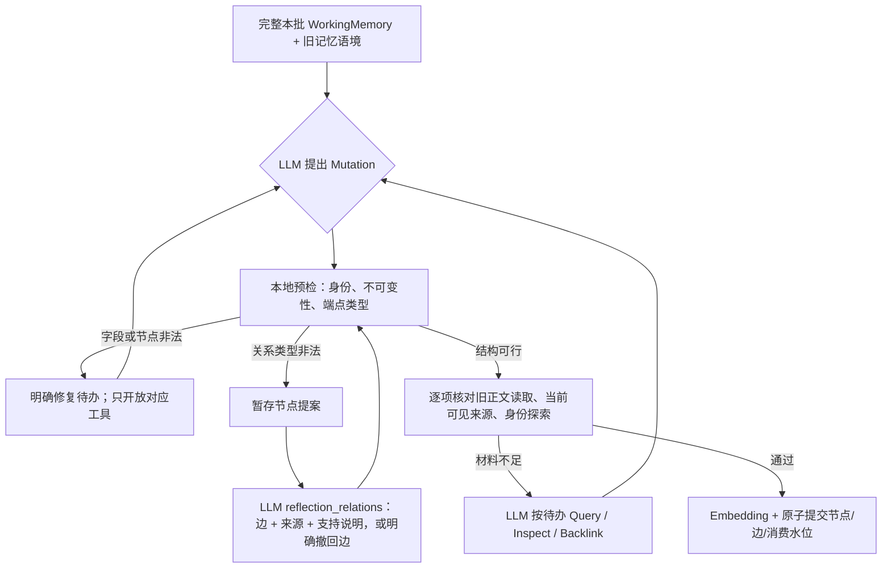

# 跨数据集方法迭代与真实观测

日期：2026-10-24。承接[执行计划](../phase-2/2026-10-24-broad-method-improvement-plan.md)。本轮局部修复、分层实验与分析done；**方法质量仍未验收**。共81个运行档案，其中65次运行有真实模型返回，覆盖23个不同问题；累计1385次模型调用（embedding 394、gpt-4o-mini 991），另有45次网络阻断尝试。供应商累计输入11,613,772 tokens、输出136,930 tokens，费用未知；完整分母与失败见[逐运行台账](./2026-10-24-broad-run-ledger.md)。公开 Add/Search、数据库格式、默认模型及确定性装箱保持原语义，未部署、未提交。

## 已实施的改进及边界

1. **修复任务与阅读任务分开。** 缺来源/旧正文时继续探索；字段、不可变节点或关系类型错误且没有缺材料时，工具集只提供对应修复，不继续让模型无目的 Inspect、Backlink 或 Evict。重复无进展仍显式失败，没有内部网络重试。
2. **增加关系修复阶段。** 非法边阻断提交，但节点提案暂存于本批 Workspace；`reflection_relations` 只修正关系、直接支持来源与简短支持说明。模型可以明确撤回全部非法边；系统不会自动翻转或静默删除。节点、边、水位仍在所有校验通过后一次提交。说明单独进入观测，不能当成已验证的语义事实。它是出错后的局部拆分，**完整的“先节点提案、后关系提案”协议尚未实现**。
3. **先判断操作是否可能合法，再要求读旧材料。** 新增本地预检：虚构旧身份、覆盖最小 episode、改写不可变 fact/event、已知端点的非法类型方向先反馈。预检不算模型读过数据库，也不代替材料门槛。工具里的 Item ref 收紧为 `new:` 或明确可修改的旧节点列表；旧 fact/event 可以作为关系端点，无需在 items 中重写。
4. **BFS 局部协议失败可观测地终止。** 已获得 Query/Inspect 证据后，若后续 BFS 返回畸形工具参数、过期位置或无法解析的结构化决策，记录 `bfs terminalized` 并用已有证据装箱。网络、超时、Query/Select 失败仍返回显式错误；没有重新调用模型。这个分支表示探索提前结束，**不表示多跳成功或证据完整**。
5. **原子性和重放边界。** 暂存提案不提前入库；新一轮冻结批次清除旧的临时修复提案。`drop_invalid=true` 同时带非空关系列表会明确失败，不静默丢弃模型提出的边。

## 实验口径

原计划对 21 个案例做 plan-only，跨 PerLTQA、BEAM、LoCoMo、LongMemEval、PersonaMem v2/v3、CL-bench Life、MemoryAgentBench。b3/pv4 无 turn 锚点，计划使用 full；其余窗口/锚点的作者证据保留检查通过。实际运行覆盖其中 19 个案例，l4/pv4 本轮未执行；另加入 conv-41、44、47、50 四段不参与本轮修复的人物历史，共 **23 个不同问题**。不能将同一问题多次调试算作独立样本。

窗口和锚点是研究者辅助选择的诊断输入；四个新历史也按作者证据加前后两条发言抽取，**不是盲测全历史召回**。标准答案与证据标签不进入目标 Add/Search。CL-bench 的 full 是所选记录完整正文，适配器仍按 2000 words 切成若干 Add；“一条原始样本”不等于“一次 Add”。每次运行独立建库、固定 chunk-size=6、top-k=5。

早期基线和多轮单缺陷修复使用 `broad24-<case>-<stage>`；后续三个明确批次为 R2/R3/R4。R2/R3 的系统版本标签仍沿用诊断脚本的 baseline 字符串，实际代码含本轮修改，不能据标签当作未改基线。R4 起在运行目录保存 `method-source-snapshot.json` 和逐文件 SHA，便于恢复真实版本。R5 是写入身份约束的最后复验。跨轮模型输出有随机变化，不能据一个前后样本声称因果收益。

期间普通沙箱的模型请求出现 WinError 10013。复核授权范围后，在允许网络的执行环境中两端点均返回 HTTP 200，随后真实矩阵正常运行。网络阻断尝试单列，不作模型质量分数。费用没有可核验供应商价格，保持未知。

## R2—R4：24 次运行、21 个不同问题

这三轮合计 Add **40/54**、Search **23/24**，共 **508 次真实模型调用**（embedding 143、gpt-4o-mini 365）。这是机制诊断汇总，包含失败 Add 后依靠最小 episode 得到的 Search，不能作为端到端成功率。

| 运行 | 范围 | Add | Search | 观察 |
| --- | --- | --- | --- | --- |
| R2：b1 / b2 | window | 各 2/2 | 各 1/1 | 字段/类型修复后提交了节点；模型撤回全部非法边；无作者检索评分 |
| R2：l1 / l2 / lm1 | window | 2/2、1/1、2/2 | 各 1/1 | 标注来源 top-5 均完整；l1/lm1 的 top-1 仅 1/2 |
| R2：p1 | window | 1/1 | 0/1 | 最后一次模型工具输出不可解析，Search 失败 |
| R2：pv2 | window | 2/2 | 1/1 | 有 person/event/fact，无边；不能由节点类型推断主体判断正确 |
| R2：c1 | full | 1/5 | 1/1 | 4 次材料预算失败，58 次 Reflection Inspect；靠最低 episode 返回材料 |
| R3：p1 / p2 / l3 / lm2 | anchors | 1/1、2/2、1/1、2/2 | 各 1/1 | 标注来源 top-5 完整；p1/p2 的模型输出错误被明确终止并保留证据 |
| R3：lm3 / pv1 / v31 | anchors | 各 1/1 | 各 1/1 | 无检索金标，不能把成功返回解释为拒答、偏好或推荐正确 |
| R3：c2 | full | 1/4 | 1/1 | 3 次 Reflection 材料预算失败 |
| R4：p1 | 同 R2 window | 1/1 | 1/1 | 同切片复验，标注来源完整；本次未触发畸形输出分支 |
| R4：m1 | window | 5/5 | 1/1 | 24 个 fact；真实调用 Select，但没有关系边；无作者检索金标 |
| R4：lm4 | window | 1/4 | 1/1 | 返回含 4/4 标注来源，但其中 3 个来源的 Add 失败；不能算端到端通过 |
| R4：c1 | 同 R2 full | 1/5 | 1/1 | Inspect 降至 40 次，但仍 2 次材料预算、2 次无进展失败；未解决 |

这 24 个新库的关系数均为 **0**。全轮早期两个探索库曾各有 3 条边，不能抹去；其中一条 supersedes 将“使用体验”与“限制”当成替代关系，仍需语义核验。这说明“边少”与“边错误”是两个问题，不能靠放宽类型校验或追求边数量解决。

### 四段新历史的真实结果

| 历史 / 问题 | Add / Search | top-1 来源覆盖 | top-5 来源覆盖 | 方法含义 |
| --- | --- | --- | --- | --- |
| conv-41 / qa-2：John 学过哪些武术 | 2/2；1/1 | 1/2 | 2/2 | 需要两次对话互补；一张卡不足 |
| conv-44 / qa-7：两次领养狗相隔几年 | 2/2；1/1 | 2/2 | 2/2 | 返回含相对日期及来源日期，仍未运行 Answer 验证计算 |
| conv-47 / qa-2：John 和 James 约过哪些见面地点/活动 | 3/3；1/1 | 1/4 | 4/4 | 多会话集合题，必须保留分散来源 |
| conv-50 / qa-12：Calvin 在东京的演出何时举行 | 2/2；1/1 | 1/2 | 2/2 | 两段时间线交叉约束，不能只取一个日期片段 |

四题 Add 9/9、Search 4/4；原文标记在 top-5 中 10/10 出现。这证明当前输出在这些辅助窗口内保留了标记，**不证明 Answer 正确、人物归属正确或图多跳起作用**。自然图仍为 0 边；Inspect 在真实运行中更多承担节点/来源分页读取，Backlink 调用也可能返回空集。

## R5—R6：改善写入后，又发现检索退化

R5是在节点工具中限制可写身份，并把非法身份预检前置后的三次同范围新库复验，103次真实调用；最终又纠正了提示中的两处阶段措辞，完整矩阵没有因此再跑一次。

| 样本 | 前一轮 Add | R5 Add / Search | 结构与限制 |
| --- | --- | --- | --- |
| C1 full | 1/5 | 4/5；1/1 | 8 episode、4 fact、4 contains 边；仍有一次材料预算失败 |
| C2 full | 1/4 | 3/4；1/1 | 6 episode、4 fact、0边；仍有一次无进展失败 |
| LM4 window | 1/4 | 4/4；1/1 | 4 episode、10 fact、0边；top-5标注覆盖反而只有2/4 |

这些是单次复验，不能直接计算稳定提升率。C1的边从派生episode指向fact，有合法方向与来源，但不少正文将某位用户的具体体验泛化为“从Android换到iPhone可能遇到什么”，也出现近似重复episode/fact；这还不是预期的主体清晰、能导航到互补事实的图。

LM4问“今年自行车相关总花费”。需要保留链条$25、车灯$40、头盔$120，并识别多个会话里的车灯是在重复讲同一次购买。R5中四个来源均已存储，相关episode也被Query召回。断点为：

随后试验“候选超过top-k就Select”，在三个数据库的隔离副本上只重跑Search，共33次调用。LM4的Select真实执行，但仍为2/4，top-1从1/4降到0；conv-44保持2/2，M1没有检索金标。因此**该阈值试验已撤回，不进入当前默认实现**，不是把新增模型步骤当成修复成功。

更深一层的真实断点是：Select输入中四个episode的片段都没有呈现金额$25/$40/$120；“since the start of the year”反而命中了里程叙事。模型最后保留了两个重复的里程fact，并排除全部episode。头盔原文在数据库和Query候选里，**但关键金额未进入模型可见片段**；这不能归为未存/未召回，也不能简单归为模型看了完整证据后选错。查询扩展还出现把未给出的“今年”自行补成2023的情况，需要约束。

本轮全部真实调用中，Reflection 564次、BFS决策384次、查询扩展32次、Select 11次、embedding 394次；并非只验证了接口接通。仍未证明这些模块共同产生高质量图和完整答案证据。R6只复用自然图，不构成三次新的Add成功样本。

## 缺口分析：下一步应做什么

**1. 图的“目录”还没建好。** B1 模型把多个 fact 用 about 串在一起；B2 把 event 当 episode 用 contains；L1 在没建立 person 的情况下引用虚构的 `memory:caroline`。当前分离关系修复可以阻止坏边污染数据库，却只能修边，不能补出缺失的人物或项目节点。下一阶段应在第一次提案就分开节点与关系任务：先形成小规模节点草案，校验身份/来源，再允许补充确有来源的导航节点，最后提出关系并一次提交。空关系可以合理，但不能把“撤回全部错误边”当成构图验收。

**2. 探索要服务于具体变更。** C1/C2 的许多 Inspect 发生在第一次提案之前；那时系统不知道模型究竟准备改什么，自然也无法给出准确待办。应先让模型提出有界的变更草案/所需旧身份，再根据草案生成读取清单；必要材料补齐后回到对应提案。先有方案，再查证，避免“把全部旧材料看一遍再想”。不能只加长轮次或放松完整阅读条件。

**3. 来源存在不等于语义支持。** `source_refs` 说明材料从哪里来；“某人拥有某物”“新值取代旧值”“两件事是同一次事件”仍需句级证据。当前修复阶段已有独立 support 说明，但尚未覆盖所有首次合法关系，也没有成为持久可核验支持范围。下一步用已存在的 origin_ref/digest/[start,end) 片段结构表达支持，而不是再造一套编码；分别检验节点陈述、关系方向、两侧主体和时间。共同出现不构成替代或人物关系。

**4. 先区分文本成功与图成功。** 新历史里来源闭合良好，但没有边，因此还不能评估图 BFS 的增益。下一轮需要三栏：自然构图的端到端结果；人工核验图上的工具机制诊断；同输入去掉图扩展的对照。人工图只验证 Inspect/Backlink/Select/装箱接线，不能混入自然构图成绩。Select与装箱也不能只看闭合标签：里程fact的原文可以完整闭合，却完全不足以计算花费。

**5. 可见片段必须与问题所需信息相称。** 当前局部词面命中容易把“今年/自行车”放大，遗漏“花了多少钱”需要的交易与金额。下一轮先冻结LM4的Query候选，对照现有片段、多来源短预览、问题要素引导的片段；严格记录金额、时间、主体、否定等是否真正进入输入，再评价Select。查询扩展应分解互补证据需求，禁止补造日期/人物，不只是改写同一个问题。最终装箱先审计相同来源重复占位与互补来源，再对比受限LLM；不能用gold直接挑片段，不能只针对金额写死答案规则。

**6. 长材料与对话不能使用同一种进度直觉。** C1 的一个长原始消息被拆成五个 Add；跨 Add 的大段资料不是五场独立对话。应评估前缀概览是否保留文档结构、正文分块是否切断论据，以及什么时候形成一个可整理的语义单元。先记录这些边界，再校准触发；不为了提高 Add 成功率改成每个 Add 立即摘要。

## 执行核对与产物

- done：计划质检、跨来源真实基线、关系错误局部拆分、明确修复待办、前置可行性校验、Search 局部失败保留、独立历史扩展及后验分析。
- done：148 项本地回归通过；涵盖非法关系不提前入库、修复后原子提交、旧 episode 不可覆盖、身份枚举、畸形/过期 BFS 保留已有证据等。
- partial：节点—关系完整分步协议、句级语义支持、长材料探索收敛、真实图多跳增益。它们是下一轮实施包，不写成已完成。
- 默认最终装箱未切换为 LLM；本轮没有新的装箱优越性或 Answer 准确率结论。

全部原文、trace、模型输入输出、SQLite、运行源码快照及辅助脚本都在忽略的 `benchmark/data/`、`amlink/data/diagnostics/`；不进入公开 Git。全部run id与错误见[台账](./2026-10-24-broad-run-ledger.md)。实验已登记到研究工作区，可按run id重建可视化。每个运行限制200次调用/500万输入字符；B3在100次实际调用后耗尽输入预算。预算耗尽后的后续Add错误也保留，不删除失败来改善统计。
