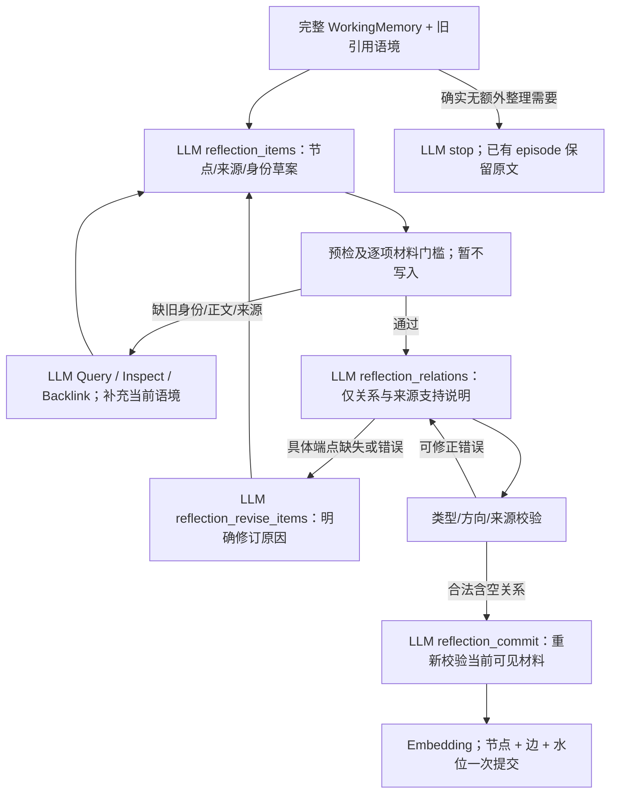

# 证据窗口与分步 Reflection：实施、反例和下一步

日期：2026-10-26。基线为用户提交的 `6e34e1f`；本轮修改尚未提交、未部署。对应[执行计划](../phase-2/2026-10-26-evidence-and-draft-plan.md)。

最终核对：**162项回归通过**。本轮9个不同问题、4类数据来源，16个完整运行，另有独立Select对照。418次已知模型请求尝试中417次有返回（其中1次独立诊断缺少span），1次超时。标准观测覆盖416次：embedding109、gpt-4o-mini307。独立诊断2次用量未知；完整分母、全部失败、源码哈希和费用限制见[运行台账](2026-10-26-run-ledger.md)。没有Answer准确率或新一轮100题总体结论。

## 先说结论

本轮把两个问题分开了：**记录里的关键句有没有被模型看见**，以及**看见以后是否被正确保留和组织**。前者已有明确局部改进；后者仍有真实失败。LM4 中的链条 $25、车灯 $40、头盔 $120 终于同时进入 Select 输入，但模型仍丢掉包含头盔的 episode。不能再把这一轮失败解释成“价格没展示”，也不能说片段修复已经解决回答。

Reflection 的首次节点—关系—提交协议已实现为实验选项 `AML2_REFLECTION_STAGED=true`，默认仍为 false。先提出最多12个有依据的节点；校验产生具体材料待办；再提出关系；最后重新检查并原子提交。中途没有节点/边落库或水位推进。最终协议已在 L1 上完成2/2 Add，形成3条关系；完整人物材料仍暴露来源归属、空字段、重复与跨批整理问题，暂不切换默认。

## 改了什么，为什么

### Reference：从首个命中改为有区分度的证据窗口

旧逻辑选第一个查询词出现处，“今年”“自行车”等场景词经常抢占窗口。现在对整个候选窗口计分，降低反复出现的场景词权重；同分时给真正命中点后的条件、否定和日期留空间。来源排序加入长度归一化，避免长篇通用建议仅因包含更多主题词压过简短事实。可容纳的短消息尽量完整保留；同一字符上限仍生效。

Select 对一个 episode 的多个来源独立保留窗口，不再把片段数机械限制为查询分支数。没有按金额写死规则，也没有输入 gold；同一机制用于人物、日期、数量与否定。原文不变，原文坐标、digest、角色、来源时间、未展示范围继续可追溯。窗口定位在原始 Unicode 字符串上进行，避免 casefold 改变字符坐标。

查询扩展提示改为互补证据需求。真实模型仍将“今年”扩展成2023，因此增加确定性数值约束检查：输入中不存在的数值分支直接剔除并埋点；不删改分支含义、不重试模型。该检查只验证数值依据，**不能证明人物、事件或其它语义均正确**。

### Reflection：草案可回退，阶段不能原地打转

R3 的第一版拆分仍在关系阶段直接开放 `reflection_items`，模型反复重写已接受节点，16步耗尽。R4改为必须指出具体端点问题才能申请回到节点阶段；完全相同草案再次提交会明确失败。R4又发现 `drop_invalid=true` 与非空 links 同时出现。新协议取消这个冗余布尔值，空列表已经能表达无关系；旧默认修复协议保留兼容。

关系工具参数从本次草案和旧引用的 kind 构造合法方向选项，例如 fact→person 的 about、episode→fact 的 contains。它只是生成约束，仍需原文支持和旧节点阅读门槛；不能把类型合法当作语义正确。关系支持说明保留到最终提交调用及观测，但**句级直接支持范围尚未持久进入关系表**。

### 真实新样本促成的两项修复

完整 PerLTQA 人物记录暴露了中文支持说明被英文式8字符下限拒绝的问题。现改为非空说明；语义充分性不能按字符数判断，仍需评审引用原文。

另一个实现断点是：Reference/Inspect 中已经展示的旧来源，其 `workspace.sources` 重复缓存可能被折叠；旧 Mutation 校验只查缓存，造成 `mutation_unknown_source`。现在仅依据系统记录的**实际可见来源凭据**回载该来源，并检查同用户、当前批次/旧范围资格。数据库存在本身不授予引用权限；隐藏来源和未来来源仍拒绝。真实轨迹促成修复，边界回归已验证；不能据此替模型修正“把性别引用到爱好字段”的语义错误。

## 已观察的对照

| 运行 | 条件 | 主要结果与边界 |
| --- | --- | --- |
| evidence26-r1-lm4-default | 早期窗口修正版；旧库副本，默认Select阈值 | Search成功但标注来源@5为1/4。与后续版本不同，不作为最终修复效果。 |
| evidence26-r2-lm4-select | 长度归一化/互补来源；旧库副本；仅本次实验提前Select | 四个episode片段均展示相关金额，三种金额全部可见；模型仍排除全部episode，来源@5为2/4。默认阈值未修改。 |
| evidence26-select-readable-v2 | 相同14候选、相同片段和顺序；把重复元数据改成可读叙事 | 保留了一个episode，仍遗漏头盔。仅单次Select，不等同完整Search改进。 |
| evidence26-select-readable-concise | 上述冻结输入，额外换简短指令 | 单次模型超时；没有选择结果，不能判断优劣，无内部重试。 |
| evidence26-r3-l1 / p2 / c2 | 首次分步协议 | 反复重写草案；Add分别1/2、1/2、1/4。失败完整保留。 |
| evidence26-r4-l1 / c2 | 受控返回节点阶段，尚有drop_invalid字段 | L1被矛盾关系参数阻断；C2仍有材料/关系/无进展错误。 |
| evidence26-r4-conv49 | 新人物历史，车辆更替计数 | Add1/1、来源2/2；未触发Reflection、0边，只证明episode路径。 |
| evidence26-r4-conv43 | 新人物历史，跨会话收藏集合 | Add2/3、来源2/3、1边；一批草案无进展。不能按全链成功计数。 |
| evidence26-r5-conv48 | 新人物历史，亲属事件时间 | Add1/1、来源1/1；未触发Reflection、0边。 |
| evidence26-r5-l1 | 类型约束、无冗余布尔值 | Add2/2，3条边，来源@1和@5均2/2；仅一个辅助窗口的成功。 |
| evidence26-r5-per24 | 新PerLTQA完整人物记录 | Add5/14、13条边；关于哥哥的一题来源命中。9次Add失败，不是端到端验收成功；这次运行早于可见来源回载和短中文修复。 |
| evidence26-r6-p2 | 最终修正版，独立新库 | Add2/2、来源@5为1/1、@1为0；1个event、0边。 |
| evidence26-r6-c2 | 最终修正版，完整文档 | Add1/4、0边；模型申请补端点后又给出相同草案，3次无进展失败。不能因为失败更快就称整理有效。 |
| evidence26-final-lm4-default | 最终默认Search；旧库副本 | 来源@5仍2/4，与10月24日R5相同；默认仍不提前Select，整体遗漏尚未解决。 |
| evidence26-final-conv44-default-v2 | 最终默认Search；另一人物历史旧库副本 | 时间题来源@1/@5均2/2；只验证这个样本，无新Add。 |

全部窗口使用作者证据周围的诊断范围，不是盲检全历史。PerLTQA character-24 使用完整人物记录，C2 使用基础记录全部文档；不把它们称为整个数据集全量。模型仅收到公开样本历史/问题，答案与标注只用于后验核对。成功Search可能来自失败Add留下的最低episode，这类运行不算端到端成功。

## 新认识与后续设计

1. **可见不等于选中。** LM4已经能观察到“有金额却排除episode”。下一步固定同一批候选、片段和预算，检查 Select 对摘要和原文的偏好以及重复fact占位；需要集合覆盖评估，不能继续用加长片段掩盖选择错误。
2. **把任务拆开还需要阶段约束。** 模型能产生有来源的节点和边，但若任意阶段都能重写全部内容，拆分反而延长循环。先有草案的意义在于让探索围绕明确缺口，不是增加工具数。
3. **空字段不是世界事实。** PerLTQA完整人物记录中的空模板项被抽成 `(empty)` fact；旧person摘要又同时包含“教育信息未提供”和后来的具体教育背景。保留原文，语义节点应记录有意义的断言；缺失标记只说明这条来源未记载。当前只加提示，尚无跨样本质量保证。
4. **有来源与来源支持陈述仍是两道检查。** character-24曾把性别、昵称都指向爱好字段。真实来源ID和可见范围门槛不能检出所有语义错配；下一包要让逐节点陈述/逐边论元对应精确支持范围，并独立审查主体、时间、方向。
5. **图尚未证明检索增益。** L1的两条about边有直接原文支持，contains边引用了宽泛的整段材料；新收藏案例的边主要连接无关的粉丝项目，不能帮助补全收藏集合。需要自然图、核验图和关闭扩展的同输入对照，不能只数边。

本轮不默认启用提前Select、可读Select实验投影、分步Reflection或LLM装箱。保留小步可证伪的改进，下一次再按新反例扩展；不以增加调用量替代设计检验。

四条评注已持久保存；[本地研究页](../../visualization/data/local/index.html)当前加载LM4片段/Select与L1构图两组真实轨迹。新增[案例研究附记](../../casestudies/2026-10-26-evidence-and-drafts.md)串联这些断点。其它运行可按run id加载，不重跑模型。

未提交范围是方法代码、测试、文档和新增默认关闭配置。用户此前批准的旧pytest产物清理已核验并完成：4个owner标记与4个指向同一旧测试目录的链接；忽略的测试数据库保留。无归档代码删除、无部署或配置凭据变更。建议提交标题：`fix(memory): improve evidence windows and add staged reflection experiment`；说明：修复可见来源/扩展查询边界，增加有界草案协议和回归，记录跨样本真实失败及可视化评注，清理旧pytest跟踪产物。
