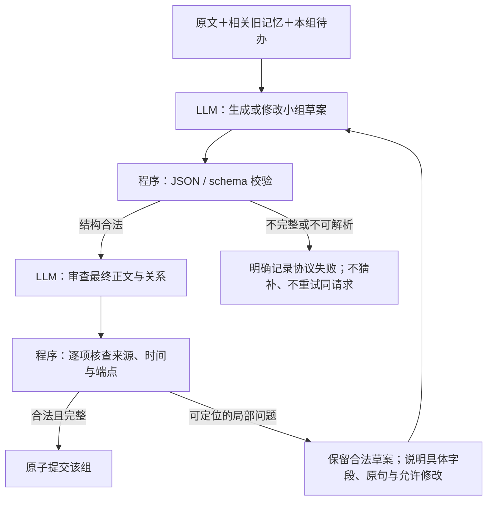

# 整理困难、协议错误与模型接口核查

后续[完整执行计划](../phase-2/2026-10-28-tool-contract-and-reflection-repair-plan.md)已形成，尚未实施。该计划另将 TinySoul 参考仓库更新至 `ad7ce637`；本审计正文中的 `llm/provider/openai_sdk` 是更新前 `4a9a58aa` 的源码位置，最新对应实现在 `llm/adapter/`，不能混作同一版本。

2026-10-28，基线 `b000d96`，开始时工作树干净。本轮审读当前代码、上一轮真实输入输出与 TinySoul 接口实现，对照 OpenAI 和智增增官方文档，另做 6 次合成短文本接口探测。**没有修改默认方法、配置或数据库。以下改进是建议，尚未实施。**

## 结论

当前主要问题不是请求时间不够，而是三层问题叠加：

1. **接口约束没有得到可靠保证。** 代码发送了严格工具定义，但实际返回仍有缺字段、多字段和损坏 JSON；兼容代理的行为与官方严格模式文档有差异。
2. **有些“协议错误”实际来自我们定义的字段联动规则。** 最终七份组件输出全部符合当次发送的 JSON Schema，其中两份仍被应用解码器拒绝。模型把撤销理由的证据放进了“保留陈述的支持”字段。
3. **语义错误还没有完整接入可操作的修订路径。** 关系审查失败可以直接结束该整理组；正确节点与错误关系一起卡住。有剩余时间也没有后续可执行动作。

增加时间、输出长度或泛化的“请认真检查”提示，不能单独解决这三层问题。应当依次解决接口可验证性、字段语义和局部修订闭环。

## 时间、窗口、输出上限要分开看

| 约束 | 当前实现或实测 | 判断 |
| --- | --- | --- |
| 整个请求期限 | 1740 秒，给官方 30 分钟留余量 | 最终三切片最大 Add 分别 21.71、17.52、11.42 秒；不是本次整理中断主因 |
| 单次模型网络超时 | 120 秒 | 上轮 236 次调用都有响应，无网络失败 |
| 方法轮数 | Reflection 16 步、Search 8 步；另有无进展终止 | 与时间期限不同；检查错误直接抛出时，不会自动耗尽剩余轮数 |
| 输入预算 | 方法 80000 字符，活跃 context 24000 字符 | 不能把字符与 token 混算；本次查出的六份完整 schema 违规输出输入仅 1484—2518 tokens，不能归因于上下文溢出 |
| 输出上限 | 所有工具调用统一 5000 tokens | 一次 BFS 确实到上限，但它在约 100 字符的参数之后就损坏并重复数字，不是合理内容写不完 |

BFS 异常来自 `integrity28-l1-r6` 的 span `9c052d459300438cb66782f956a0ece1`：输入 2170 tokens，输出 5000 tokens，耗时 54.95 秒，`finish_reason=length`。参数中 `page_position` 的引号/分隔已经损坏，后接伪工具文本和大量重复 `1`。Search 最后返回已完成步骤的合法证据，不能算该 BFS 成功。**不建议通过调大统一输出上限修复这次异常。**

## “协议错误”至少分四类

本轮使用现有 Conda 环境的 `jsonschema`，按每次实际发送的工具 schema 离线核验上一轮全部 145 份 GPT 返回；没有用新 schema 反推旧输出。结果如下：

| 层次 | 证据 | 应如何处理 |
| --- | --- | --- |
| 输出不完整 / JSON 损坏 | 1 份 BFS length 输出无法解析 | 保留 finish_reason 与原始返回；不得猜补 JSON 后执行 |
| JSON 合法但违反发送的 schema | 6 份完整返回：3 份缺必填字段、2 份 Select 多了 maxItems 字段、1 份审查理由为空 | 统一 schema 校验，报出具体字段路径；不把默认值补齐误记为严格模式已兑现 |
| schema 合法但违反应用字段规则 | 最终组件 7/7 符合 schema；其中撤销问候语推导爱好、替代/补充两例被 decode_review 拒绝 | 修清字段含义，减少可由程序推导的联动要求 |
| 结构与字段都合法，但语义无依据 | 原文只有 April 20th 却补 2023；两条消费信息被判 supersedes | 需要语义审查、来源守卫与具体修订动作，schema 无法证明真假 |

总计 138/145 份通过当次 schema 检查，6 份完整输出违规、1 份 JSON 损坏。这是同一批短案例跨版本的诊断统计，不是模型总体失效率，也不等于七次对外请求失败：当前下游 Pydantic 默认值或局部解析可能接受部分不一致。

### 一个过严而含混的字段约定

模型看到“Hello”与草案“用户喜欢骑车”，正确决定撤销草案，写 `text=null`，同时引用问候语位置 `[0]` 解释为什么没有支持。当前 `decode_review` 要求撤销时 `source_positions=[]`，于是拒绝整份输出。

提示词和字段描述已经明确写了撤销用空数组，问题不是完全没写规则；而是模型自然理解的“作出审查结论所参考的材料”，与程序要求的“最终保留陈述的支持材料”不同。继续增加同义提醒未必有效。

建议把模型字段定义为**审查依据位置**：保留时必须支持最终正文；撤销时可说明撤销依据。程序对撤销项不生成任何持久支持关系、来源凭据或节点。这是一个显式协议修订，不能靠静默忽略异常字段假装修好了。

### 一个没有修订出口的语义拒绝

LM04 R6 的审查把“买灯使骑车更安全”与“修车换链条和装灯”当成替代关系。其理由只是“同一件事、补充安全意义”；一份 replacement_quote 复制了派生节点正文，另一份为 null。原文替代依据守卫正确阻止提交。

但是 `_review_draft` 中 `decode_review/check_review` 抛错发生在 `_finish_reflection` 接收审查后草案之前。外层保存该组错误并继续下一组；相同输入/依赖下还会跳过这个未完成组。现有 `remaining_work` 续做路径只覆盖**已经通过解码和检查的审查结果**，并没有覆盖这些异常。

因此只说“再给模型时间”不准确：**模型并未收到一份可以修正这条错误关系的反馈。** 先前时间字段的具体 patch 反馈真实生效，说明有针对性的反馈值得保留；它不能证明所有审查错误已闭环。

## 当前接口用法与官方能力

目前 `providers.py` 直接使用 HTTP 调用 `/v1/chat/completions`，没有依赖 SDK。每次请求有 system＋user 两条消息，携带 tools、`tool_choice=required`、`parallel_tool_calls=false`、函数 `strict=true`；实际读取 `message.tool_calls[].function.arguments`。不是从普通回答文本中提取 JSON。

这一接口类别适合 gpt-4o-mini；函数工具调用本来就用 JSON Schema 定义参数。更换 SDK 不会自动修复关系语义，但可以用统一类型生成 schema、校验返回，减少“发送的约定”和“本地接受的约定”分裂。若采用 SDK，必须显式关闭它的自动重试，保持项目约束。

[OpenAI 函数调用文档](https://developers.openai.com/api/docs/guides/function-calling)要求严格模式对象禁止额外属性、全部字段 required，可空字段使用 null；本地 `_tool` 已设置这些要求。官方严格模式不满足条件时应拒绝请求，而不保证应用额外的真假、来源或字段联动规则。[结构化输出文档](https://developers.openai.com/api/docs/guides/structured-outputs)也明确区分结构保证与内容错误。

### 代理兼容性：6 次真实短探测

目的地仍为已有配置的智增增，模型仍为 gpt-4o-mini；只有合成配额文本，不发送凭据到日志，不写数据库。每种检查一次，无重试。

| 探测 | 结果 | 能证明什么 |
| --- | --- | --- |
| 合法 strict 工具 | 200，合法工具参数 | 基础工具调用可用 |
| strict 但缺一个 required 属性 | 200 | 与官方严格模式拒绝规则不一致 |
| strict 但 additionalProperties=true | 200 | 同上；不能据此假定受约束解码真实开启 |
| max_completion_tokens 替代 max_tokens | 200，正常工具输出 | 参数被接受；短输出不能证明上限严格执行 |
| assistant.tool_calls＋对应 role=tool 结果续接 | 200，正确读取合成配额 | 标准工具消息续接路径可调用；尚不是完整方法收益验证 |
| gpt-4o-mini 加 reasoning_effort=high | 200，reasoning_tokens=0 | 只证明代理接受参数，不能证明推理能力/强度已启用 |

合计 6 次请求、6 次 200，输入 494、输出 108 tokens，无网络失败。两个故意不符合严格模式要求的请求获得 200，不应记作严格模式验收成功。

结合既有完整输出缺字段的证据，**当前端点不能当作已验证兑现 OpenAI strict 保证的端点**。原因可能是字段过滤、归一化、转发行为或上游差异，现有证据不能定位代理内部，也不能由返回 model 字符串确认实际底层服务。未改 base_url、Key 或模型。

[智增增 Chat 文档](https://doc.zhizengzeng.com/doc-3989021)列出了 tools/tool_calls/tool_call_id；本轮读取页面没有 strict、reasoning_effort 或缓存的明确能力约定。它不能替代当前端点的实际兼容性检查。

### 推理回放与工具回放不是一回事

`gpt-4o-mini` 不应当按带 reasoning effort 的推理模型使用。[官方参数说明](https://developers.openai.com/api/reference/resources/chat/subresources/completions/methods/create)把 reasoning_effort 定义为推理模型参数；[reasoning items 回放建议](https://developers.openai.com/api/docs/guides/reasoning)针对推理模型的 Responses 调用。当前模型约束下，不应虚构 reasoning_content，或者认为代理接受 high 就获得更强推理。

真正可借鉴 TinySoul 的是**动作与结果的连续对话**。TinySoul 的 `llm/provider/openai_sdk/payloads.py` 将配对的 assistant 工具调用和 tool 结果续接，并按供应商能力处理 reasoning 字段。AM-Link 当前每次重新渲染状态，`_parse_tool` 仅交回名称和参数，没有在下一次请求里使用 call_id 和工具消息。

重渲染并不意味着完全丢失状态：Workspace、草案、材料、错误和最近动作仍会投影到下一次输入。但模型看到的是一份重新组织的状态说明，未必清楚哪次动作产生哪份结果。建议仅在一次 Reflection 小组或一次 Search 内保留有界工具往返；跨组压缩后仍以明确状态和真实材料为准。不能把所有旧工具结果无限追加，也不能让标准 Search 共享 Add 的内部对话。

### 提示词缓存已经部分命中

上一轮 145 次 GPT 调用共报告输入 404527 tokens：79 次返回 cached_tokens，16 次大于零，合计 17920；另 66 次缺少此字段。已报告缓存 token 占全部输入约 4.4%，这不是完整实际命中率，未知项不能填零，也不能直接据此计算代理账单。

[官方缓存说明](https://developers.openai.com/api/docs/guides/prompt-caching)支持保持共享前缀、工具定义与历史消息稳定；缓存主要优化费用和延迟，不会自动提高语义正确性。当前工具 schema 内含每轮 refs/位置枚举，正文也重新渲染，会改变可复用前缀。建议稳定工具定义，候选位置和可读引用放在本轮消息中，由程序检查位置是否合法；对此需要比较约束错误率与成本，不能只为缓存撤掉有效约束。prompt_cache_key 可以作为后续兼容性探测项，但本轮未测试，也不把长保留或新模型缓存参数直接套给 mini。

`max_tokens` 已被官方标为旧参数，可在完整上限探测后统一到 `max_completion_tokens`。输出预算更应按任务决定：BFS 仅需短动作与简短依据；节点编辑/审查按实际组大小给额度。改变参数名称或增加额度不是本次语义错误的解法。

## 建议的收敛路线

不增加新的长期记忆对象或新一层审查模型，仍用现有 Working、MemoryItem、References 和局部草案。

这是建议流程，当前实现只覆盖其中部分反馈路径。

1. **先让接口与本地协议一致。** 单一类型定义生成工具 schema 与验证器；错误区分 length/JSON/schema/字段规则/证据语义，记录 finish_reason、调用 ID、请求 ID 和具体字段路径。严格能力不明时依然显式校验，不静默改协议。先用极小一致性探测确认供应商路线，再改方法，避免把接口故障归到记忆设计。
2. **减少需要模型维护的机械字段。** 撤销的依据和持久支持按明确语义分开；节点变更及依赖边是否需重审由程序比较正文/时间推导，研究移除模型重复确认 revised_endpoints。不要只增加更复杂 anyOf 或嵌套条件来表达所有业务约束。
3. **让拒绝变成具体修订任务。** 例如：“u2 是 supersedes；所引原句只是在补充购买经历，没有替换旧断言。保留可成立的节点，撤销 u2，或提供真正的替换原句。”保存已经合法的审查片段但暂不提交；局部修改后仅重审受影响节点/关系，最后原子提交。新增证据或实质 patch 才继续，不重试相同输入，不重新读整组，不绕过守卫。
4. **让自然语言承担判断，程序承担身份与结构。** 模型先判断“这两句话能否同时为真、是否同一主体同一属性、哪句话明确废止另一句”。再输出现有的保留/撤销关系动作和必要来源。不是强制输出长推理，更不是要求每组都建边。原文与草案并排，提示用少量互为反例的案例说明。
5. **再验证有界工具回放与缓存。** 在相同冻结材料、相同总 token/调用预算下，对比状态重渲染和动作—结果续接；之后在新库不同完整历史验证。先量化一次调用是否更容易正确完成，再考虑长历史收益。

验收需分别看：schema 合法率、业务校验通过率、局部修订是否真实改变问题、正确节点是否被无效边拖住、错误替代是否入库、Search 完整证据、模型次数/token/延迟。来源齐全与 HTTP 200 都不能代替这些指标。本轮未新增 Answer 评测，也未重跑完整靶场。

## 可复核材料与收尾

- 离线接口/缓存审计：`amlink/data/diagnostics/api-audit-20261028.json`。
- 按当次发送 schema 的核验：`amlink/data/diagnostics/api-schema-audit-20261028.json`。
- 六次真实兼容性探测：`amlink/data/diagnostics/api-contract-probe-20261028/`，保存无鉴权信息的请求、响应、用量与 request ID；脚本为同级 `api_contract_probe_20261028.py`。
- 当前源码入口：`amlink/providers.py`、`amlink/engine.py` 的 `_review_draft/_finish_reflection`、`amlink/drafts.py` 的 `decode_review/check_review`；TinySoul 参考为 `reference/TinySoul-Agent/tinysoul/llm/provider/openai_sdk/`。

本轮只有文档与忽略目录诊断文件。无方法/测试/配置变更，无数据库增删、归档删除、部署或自动提交；没有新运行回归，上一轮 258 项＋3 子测试不冒充本轮新增验证。
