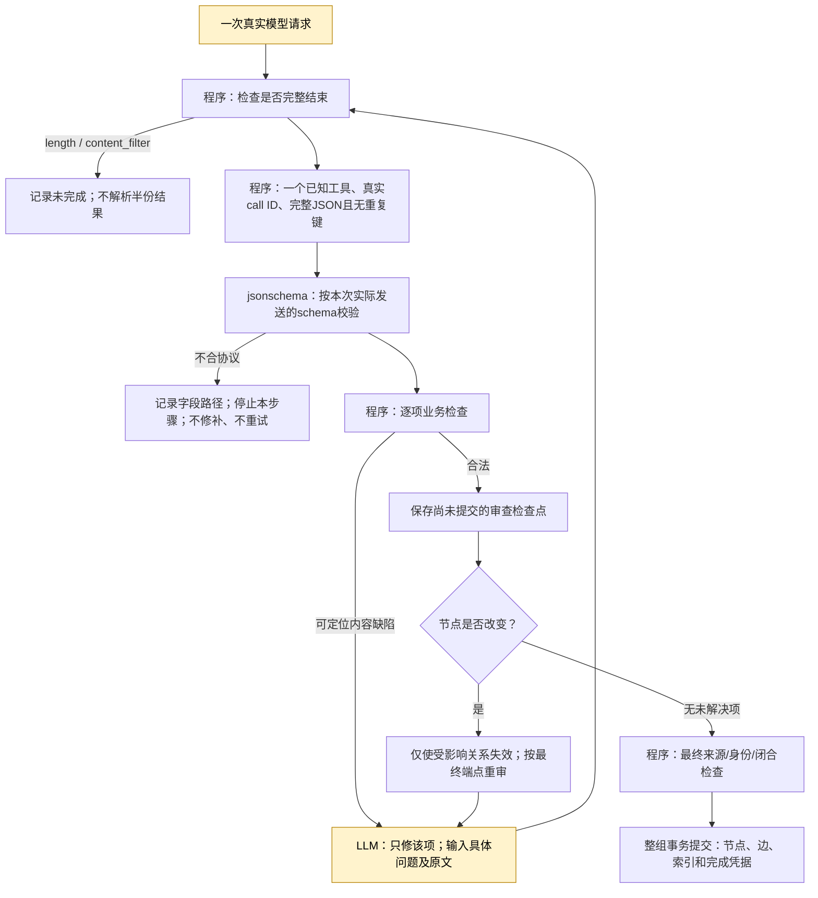

# 工具协议与局部整理修订：实施及验收

2026-10-28。起点 `5b806c8`（计划），方法基线 `b000d96`。用户确认后实施。执行依据：[本轮计划](../phase-2/2026-10-28-tool-contract-and-reflection-repair-plan.md)、根 AGENTS 和 DESIGN。

## 本轮交付与边界

P0/P1 已进入唯一默认方法：按实际发送的 schema 校验完整工具返回；审查逐项保留合法草案、只修具体缺陷；端点变更由程序使相关关系审查失效。Add 的原子接收、成功重放零调用、请求内整理、Search 独立语境和不代答的边界不变。

没有内部网络重试、JSON 修补、默认关闭的增强或新的后台任务。使用 `gpt-4o-mini` 与 `text-embedding-v4` / 1024；未修改私有配置、模型、数据库版本或冻结计划版本。新运行从新库开始，没有恢复或删除旧库、归档源码、部署或自动提交。

**工程实施与整体质量分开验收。** 工具往返经过对照后不进入生产。完整历史 6份/12问→12份/36问须先通过本轮诊断门槛；没有通过的项目不能用 HTTP 200 或原文直达回答冒充完成。

## 已实现的处理顺序

`stop` 与 `tool_calls` 都可表示完整结束，但 **stop 本身不等于合法结果**：必须仍有恰好一个合法工具调用、ID、JSON 和 schema。真实命名单工具探测返回 `stop + tool_calls`，第一版仅接受 `tool_calls` 误拒了14份返回；已修正并保留该失败轮次。`length/content_filter` 仍在任何解释前拒绝。8 token 的真实探测返回了 `length` 和半截 JSON，证实 `max_completion_tokens` 确实约束生成。

调用输入增加简短的交付说明：顶层字段、每个节点必须显式返回 nullable 时间字段、每条关系必须有 `support`；schema 去掉 Python 侧的 default/title 注解，但保留真正名为 title/default 的参数。输出没有缺省填补或额外字段清洗。已删除旧 `Providers.json`、`_model_json`、query 的 JSON fallback 和根时间字段丢弃逻辑。anyOf诊断显示有界的具体子字段原因，不复制整套巨大schema；NaN和数值溢出都在JSON层拒绝。

短 BFS/查询扩展默认最多1024输出 tokens；规划、Select、节点、关系、审查最多5000。Reflection 一次决策可能选择写节点，不能预知它只做 Inspect，因此该混合菜单使用5000。所有额度仍受统一输入80000字符、请求1740秒、单调用120秒及研究预算约束。没有推理强度或新缓存配置。

## 局部审查的实际含义

`evidence_positions` 表示审查依据。保留/改写必须有支持，生成来源凭据；撤销可以给出反例依据或空列表，但没有持久支持。取消 `revised_endpoints`。同组 `uN` 绑定节点ref或关系三元组，原文位置绑定来源版本与范围，新增只追加，撤销不复用编号。

审查先完整解码本页，再逐项检查：原句时间、年份精度、真实有序日期、旧 episode/fact/event 改写、替代原句。可定位的缺陷进入内容修订，合法项在现有 group progress 内保存。检查点版本1，SQL数据库仍3、冻结计划仍v3；不存在的检查点不等于已审，未知版本拒绝。

初审加最多两轮有内容修订。自动审查的每一页计入现有16次主决策额度，嵌套Query/Select与embedding在实际调用处计数。相同草案/问题/来源没有变化就停止。失败后的合法节点只是未提交草案；整组未闭合前不会有部分节点入库。成功Add重放不会趁机重新整理。

节点改变时只重审关联边；节点撤销时删除依赖该草案节点的边；来源/旧正文/身份比较材料/端点指纹变化使相应检查点失效。合法结果不要求模型抄写一遍。需要新增内容的 remaining_work 仍可回到现有局部patch，涉及协议错误则不进入此路线。最终审计补齐“后页失败仍保存前页待办”和“旧正文变化使检查点及无进展指纹失效”，两项已做定向回归；此前启动的真实档案不冒充含这两项最终补丁。

本地回归包括“两个合法节点＋错误替代边”：先保留两个节点的检查点，第二次仅审一条边，撤销后整组提交；两次相同坏边则停止且数据库只有已接收episode。另有一节点日期错误只重审该节点、端点修改只重审边、坏schema零部分消费、成功重放零调用等用例。

## 真实实验与限制

完整逐档案计数见[运行台账](./2026-10-28-tool-repair-run-ledger.md)，原始请求、返回、快照、数据库在忽略目录。组件中的 `ok` 仅表示程序走完；正文、来源、关系、条件是否正确另行人工核查。

第一轮新库LM04 Search因额外`maxItems`被拒；L01缺time_start/end，P02缺no_prior_match，整理被明确记为未完成。清楚提示必填字段后，后续L01/P02真实整理恢复完成。没有删除违规字段后冒充模型正确输出。

最终短例LM04 R3达到3/3组完成，三笔金额25/40/120的原句都进入最终交付，标注来源覆盖3/4（R2为2/4）。第四条车灯复述的episode已被Query召回，被Select排除；断点在选择集合，不能把金额齐全当成来源覆盖4/4。先前固定基线来源4/4，本轮没有达到不退化门槛。

最终14组件中13组程序走完，人工按预声明的有效结果核对为12/14；真实更新边被过度撤销、旧episode非法改题被拦住却未有效转成撤销/新陈述，是两个剩余缺口。前轮和独立往返对照也出现听者误归属、丢失条件、错误替代；不能把最终组件的改进当作这些问题已普遍解决。程序的来源存在性检查不能证明关系成立。没有用特定人物名称或测试答案写规则绕过难点。

长记录PersonaMem还暴露内容归属：用户要求润色文章，助手返回改写稿，派生event却直接写成Miguel的经历。原文存在不代表它是用户自传，应保留“这份待编辑材料写道”的叙事层级。R2还把具体邮件修改与概括性的沟通风格连成same_event_as；R3两条about只是同篇材料内的泛关联，另一条contains错误连接来源不交的episode与购物建议。本轮没有将关系数量算作质量增益。

全部真实实验已结束：1343次尝试/1343次响应，v4 381次、GPT 962次；无网络失败。11新库累计79/104 Add、8/11 Search，包含开发失败轮次。两轮PV4均耗尽10M输入字符预算，最终轮只接收32/41 Add、组完成40/49、Search未执行。按执行计划，V1质量门槛未过，因此没有扩大V3。详细成本和各轮源码边界以台账为准。

## 工具往返的取舍

完成16个不同冻结场景的成对对照：8个局部审查，8个图中后续动作。每个场景先由真实模型发出Inspect并执行读取，再比较状态投影与包含真实assistant/tool配对的输入。每臂一次，交替顺序，所有候选和原文一致；编号在该场景冻结，最大一对、小于8000字符，总消息小于80000字符。没有伪造助手工具调用。

这只是输入组织的局部实验，不是已运行16个完整Search。图题两臂均7/8次选择预期动作；“购买指向资助项目”的例子两臂都再次Inspect而非查Backlink。人工审查两臂均5/8有效，总计均12/16。工具往返改善了一例条件表达，却新增错误supersedes；输入token中位数849→890.5，配对增幅中位数7.58%，未满足安全、净改善或节省门槛。

因此，生产只保留**自然叙事的状态投影**。没有加入默认关闭的回放配置或另一套运行模式。研究脚本和失败输出保留在忽略路径；未选择的动态消息回放、跨步临时位置体系、Evict历史传播不作为交付功能，更不宣称这些完整生命周期已验证。

## 与 AGENTS / 执行计划核对

| 项目 | 实施核对 |
| --- | --- |
| P0-A/P0-B | done：成熟schema校验、完整性/工具/JSON顺序、无猜测、唯一工具通道、真实限额与失败诊断 |
| P1-A | done：审查依据与持久支持分开；去端点确认字段；同组稳定位置 |
| P1-B | done（工程）：逐项合法草案、版本检查点、依赖失效、有界修订、整组提交；语义质量另计 |
| P1-C | done：具体错误优先、原文与草案区分、语气/条件/时间/主体提示；效果非完美 |
| V0 | 286项回归＋3子测试通过；不以测试数证明模型语义 |
| V1 | 14组件与6个案例（5类数据）按计划运行，全部轮次保留；质量未整体通过，逐项核对见台账 |
| P2/V2 | done（对照并不采用）：未达到安全/收益门槛，无生产备用分支 |
| O | done：版本化artifact显示失败层、局部修改、撤销依据/写入支持、待办和未提交状态；旧事件缺字段保持未知 |
| V3 | 未验收：只有诊断达标后才能进入完整历史对照及扩大；不得把同案例重跑计成新增独立历史 |
| D1 | done：文档/入口/设计图/案例评注与台账已核对；无自动提交 |

下一步需要用真实失败继续改进的核心是关系任务、材料归属与来源集合，不是增加请求时限。协议错误多发生在未截断的短输出；长记录则消耗了研究输入总额，两者都不能靠放宽单请求时限解决。优先研究更易理解的合法关系选择、contains与episode实际来源范围的对应、对待编辑/引用材料保留叙事主体、减少重复整理相似沟通风格；这些是新证据支持的后续方向，本轮不擅自增加另一套机制。
