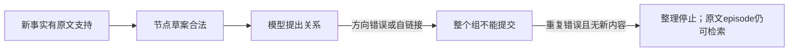

# 扩大本地测试前的现状复核

2026-10-29。重新读取根AGENTS、README、文档索引、比赛接入研究、最新实施及真实台账，并核查当前源码。HEAD仍为`6714ab6`，保留此前未提交修改。本轮只做审读、离线数据预检和回归，无新增模型调用或方法配置修改。

## 判断

**仍有明确问题，不能称为方法已经稳定；也不应把所有语义难例解决作为扩大测试的无限期前提。** 优先收敛写入任务与提交依赖、处理长输入边界，然后冻结版本，以更多完整历史诊断。自动图的存在和边数不是比赛成绩；最低episode仍可提供有效证据。扩大后的核心问题是：整理是否帮助完整、正确地交付证据，付出的调用和时间是否值得。

本轮重新运行：**310项回归及3子测试通过**。只有既有Starlette/httpx弃用提示。回归通过说明已编码的工程约束没有退步，不等于真实模型稳定完成整理。

## 比赛背景与核验范围

[当前赛事页面](https://agentmemoryleaderboard.ai/competition/)再次确认：参赛系统提供Add/Search，平台负责Answer/Eval；Search不能直接生成最终答案。开源方法榜使用text-embedding-v4和gpt-4o-mini，当前默认配置一致。

本轮API指南抓取超时、中文docs页无法访问，未把本地2026-09-23记录的并发/分块/超时全部重新宣布为当前线上事实。下述20消息、2000空格分词和top_k=100是现有接入文档及本地adapter采用的测试口径；正式对齐仍需核对当期机器契约。本地空格分词本来就是近似值。

## 仍然明显的三个改进点

### 1. 整理提交的依赖范围过大

最新控制例仅完成7/15规划组，最后新样本4/6组；多数失败不是请求时间用完。控制例的无进展集中于非法contains方向、自链接，以及改变旧不可变事实。当前先暂存节点、再提出关系、最后整组审查和提交；错误关系可以一直挡住已经合法的节点。

继续加提示、放宽时间或增加原样尝试，不足以解决这个提交耦合。建议下一轮把**实际语义依赖**作为提交边界：独立事实可以完成自身审查；需要一起成立的变更及supersedes等状态影响必须共同验证。无效导航边保留明确的未完成状态，不得悄悄作为成功边落库，也不能让所有独立节点无限等待它。完整组的完成状态仍应真实反映未完成工作，防止只交节点就虚报完成。

这是待设计的提交语义变化，**本轮没有直接改成部分提交或自动丢边**。需要验证：坏边不会挡住独立事实，坏事实不会借局部提交落库，遗忘/替代等相依动作不会拆出半成品。

### 2. “补充旧事实”与“事实发生变化”仍易混淆，归属也未稳定

Cedar保留期由14天变21天，合理结果应保留旧陈述、新建21天陈述并在证据充分时说明替代关系。当前仍会提交改写旧fact，或再建一条近义14天fact。Nia例还会把真实用户姓名赋给虚构故事中的无名叙述者。这不是单纯缺少字段反馈：旧值、差异和具体反馈已经可见，模型仍未稳定判断写入意图。

建议将每个局部写入任务先用自然叙事说清楚“哪个对象、什么条件、这次是确认旧陈述还是引入不同陈述”，再形成草案。对旧fact/event只补支持时由程序保留旧正文和时间，减少模型重复抄写；对变化必须形成新陈述。虚构、他人转述、未采纳建议的限定必须同时进入正文及真正支持它的来源，审查理由不能代替检索可见内容。

这不是立即恢复已实测退步的独立reuse数组或简写协议，也不增加一轮纯控制模型调用。应优先在现有逐项任务/审查中完成，再与当前完整条目协议做有边界的实测。不要仅凭“字段更少”认定方案更可靠。

### 3. 长episode仍整体嵌入，缺少单条token边界

`engine._prepare_episode`把整个Add的episode交给一次embedding；`Providers.embed`检查批量数量，但没有单条token限制或多片段索引。[v4官方接口](https://help.aliyun.com/zh/model-studio/text-embedding-synchronous-api/)规定每条最多8192tokens、批量最多10条。

本轮预检没有发现请求超过当前64000字符限制，但这不能证明embedding安全。中文PerLTQA最大episode约12711字符，BEAM约18203字符；字符数不等于v4 tokens，尚未取得这些具体文本的精确模型token数，**不能直接宣称它们已经超限**。现有按空格计2000词的适配也不能保证中文或代码在token限制内。

建议保留同一高保真episode正文，向量按来源/段落拆成受限片段，并保存节点ref、版本、起止范围；Query命中后按ref合并，片段进入Reference叙事，Inspect仍能回到完整原文。来源/时间/角色不能因切分丢失，Add幂等和双索引原子接收边界继续成立。准确token计量或保守上界及其依赖需明确，不能靠字符比例假装精确。该设计尚未实施。

## 测试覆盖才是目前最大的判断盲区

最新16份档案共803次模型尝试，并不等于大范围验证。端到端内容只有2个公开切片、7个人工短历史、16个不同问题；最后Select规则仅在最后留出复验使用。全轮81/81 Add、40/40 Search成功，没有Answer/Eval。人工图能走通3条检索路径，也不证明Reflection能自动构成这些图。

LM04来源2/4但25、40、120三笔必要金额齐，另两个来源重复40；因此必须区分重复出处覆盖和必要事实覆盖。反过来，错误派生事实即使附上原文，也不能据此判为语义正确。

需要同时报告四层结果：

1. **接收和运行**：Add原子成功/失败、未完成整理、Search基础失败/局部停止、隔离与幂等。
2. **记忆质量**：主体/限定/时间准确性、支持对应、更新冲突、重复节点，以及真实构图是否有用。
3. **证据交付**：Query→Select→实际模型语境→多跳→最终装箱；必要证据在哪一步消失，返回前缀内是否完整。
4. **下游可答性与成本**：另行固定诊断Answer条件、参考答案/原始rubric后验核查；与正式平台成绩分开。记录每历史/每Add/每Search调用、tokens、时间及整理增量，不能只按题数算成本。

当前study默认top_k=5；扩大时必须显式指定测试口径，不能把不同top_k、分块和版本混成一张平均分。诊断Answer只读取真实Search输出和问题，gold只能用于后验评估，不回流方法输入。

## 已完成的数据离线预检

脚本及带文件hash的结果在忽略路径`amlink/data/diagnostics/broad29_inventory.py`和同名JSON。使用现有adapter、chunk_size=20、top_k=100，不调用模型、不新建数据库。下表是本机已准备包的可运行范围，不代表原始来源全量，也不代表均为未用过的留出数据。

| 数据包 | 可运行记录 | 可运行问题 | 完整加载这些记录所需Add |
| --- | ---: | ---: | ---: |
| LoCoMo full | 10 | 1984 | 399 |
| LongMemEval S research | 7 | 7 | 468 |
| PersonaMem v2 research | 2 | 56 | 28 |
| PerLTQA中文 full | 32 | 8593 | 214 |
| BEAM smoke / update | 1 / 1 | 10 / 20 | 38 / 37 |
| CL-bench smoke | 1 | 1 | 6 |
| CL-bench Life smoke / extra | 3 / 2 | 3 / 2 | 22 / 9 |
| MemoryAgentBench CR研究记录 | 1 | 1 | 23 |
| PersonaMem v3时间切片 | 2 | 2 | 222 |

ScriptMem只有任务，不能端到端运行；CL-bench smoke另2条没有已分离的问题，adapter排除。MAB和v3是限定研究材料，不把它们写成原始全量适配。中文结构化人物材料与真实聊天应分组统计。

## 建议的扩大方式（未启动）

先完成上述写入依赖与长输入边界的明确设计/最小实现及针对性复验；随后冻结源码与配置，开展**完整历史**的跨集诊断。不要继续用已知答案附近的窗口代替完整历史，也不要要求先证明所有自动图都成功才准扩大。

一个现有数据可支撑的目标是**6类数据、26份记录、100题**：

| 来源 | 完整记录目标 | 问题目标 | 关注点 |
| --- | ---: | ---: | --- |
| LoCoMo | 4 | 40 | 多人、时间、多跳与不可回答前提 |
| LongMemEval S | 7 | 7 | 每题独立长历史、更新与拒答；7题仍需468次Add |
| PerLTQA中文 | 6 | 24 | 人物关系、中文、结构化来源文档 |
| PersonaMem v2 | 2 | 12 | 长期偏好、人物归属与状态变化 |
| BEAM | 2 | 12 | 长历史里的配额、冲突和指令更新 |
| CL-bench Life | 5 | 5 | 领域规则与材料组合 |

这是容量与覆盖建议，尚未冻结record/task清单。任务按题型/历史长度事先选择并保留种子和hash，不看方法得分挑题；与既有开发历史对照后，分别标记开发复验与新来源测试，不能把熟悉历史中的新问题直接称为独立留出。

先跑每类1份完整记录验证输入、观察和成本链路，再扩到目标。每份从空库开始，所有Add完成后再Search；原文接收失败的历史不得混进完整成功组。中途不改提示词/方法再汇总成同一版本。设置整份历史的明确调用/输入预算，并根据首批实耗估算总量；达到预算保留为未完成档案，不重复原样追加尝试。出现原文丢失、跨用户泄露或来源错配立即停止扩大；一般语义不完美按错误类型保留并继续受控诊断，避免门槛无限抬高。

本轮仍发现明确问题，因此**没有启动大批量真实调用**；已完成可直接复用的数据预检和范围设计。该方案不改变此前方法交付状态，无部署、自动提交、旧库恢复或删除。
