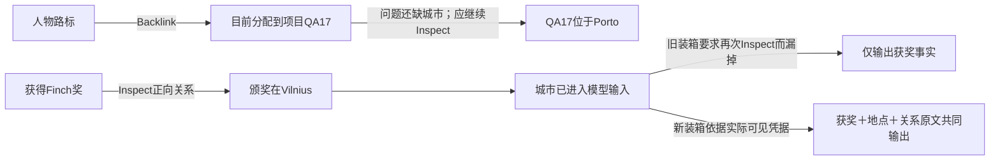

# 可见字段、增量审查与检索：实施核对

2026-10-29。用户确认四项方向后，按[执行计划](../phase-2/2026-10-29-visible-increment-execution-plan.md)实施。起点为已提交的 `6714ab6` 加上一轮尚未提交的 ground28 修改；原有修改保留。本轮改进直接进入默认方法，无备用开关、模型内部重试、接口或数据库版本变更。

## 已实施的四项改进

| 方向 | 实际改动 | 核验边界 |
| --- | --- | --- |
| 可见旧字段与反馈 | Inspect、Reference片段、旧目标审查均带完整事件时间及null；明确区别消息日期。不可变错误指出具体ref、字段、原值/提交值，未读旧正文不暗取全文。中文时间错误列出实际可引用原句。只有同草案和材料完全重复才判无进展 | 回归及真实时间组件验证；不代表模型一定按反馈修好全部草案 |
| 新增支持审查 | 根据实际差异分配审查任务。旧陈述补来源只允许此次新增来源作为依据；旧来源不能替新来源作证。只撤销此次无效添加，不删除旧记忆。尚有冲突、更新、遗忘或待办不能假装完成 | 同事实确认与异项目/异条件/半句支持的真实正反例；完整历史的补支持仍可能卡在更早的关系阶段 |
| 主体导航与事件分工 | person/entity短身份与fact/event经历分别说明；审查可以真正改正文、撤销或提出具体事件待办。任务说明互斥，避免一边要求短身份、一边要求保留整个故事 | 新样本出现正确的两个人物路标和独立受伤事件；控制例仍有把用户姓名赋给虚构角色的问题，不能宣称身份问题解决 |
| Select与多跳分段验证 | 超阈值互补证据组件、必要图扩展与无需扩展反例分开实测。基于新失败改进反向关系叙事、停止条件、实际已见图正文装箱和否定前提证据选择 | 人工图只证明检索组件，绝不当作自动Reflection构图成功；完整结果见[台账](./2026-10-29-visible-increment-run-ledger.md) |

旧 `episode/fact/event` 的正文与事件时间保护继续存在；支持新增与历史溯源没有混合。审查中的 `support_addition/navigation_create/navigation_update/new_assertion` 是调用任务说明，不是新持久类型或新原语。原有完整工具条目和扁平审查输出不变。

## 为什么这次还修改了Search装箱

隔离图组件首次给出了两个不同的断点：

第一种是没有继续读，第二种是读到了却没有交付。为第一种，把“incoming/outgoing计数”变成自然语言说明：哪些其他记忆指向当前项、Backlinks能发现它们；当前项又指向哪些记忆、Inspect能沿它们展开。停止提示要求核对问题所需属性，中间名称不等于所需地点/日期/金额。

为第二种，路径装箱接受最后一次实际模型输入中同版本、非空的邻居正文范围，不再强制额外Inspect同一内容；原可见范围优先保留。只有引用标签或旧版本凭据不能满足条件。原有来源核验、字符预算和路径闭合检查继续执行，未闭合关系仍不输出。观测记录 `visible_graph_refs`，可区分被模型读到的路径成员与推测。

独立Select场景还表明：购买、配额和日期的互补正面事实通过，不等于否定前提题也通过。新留出样本问“Selin是否真的独自横渡大西洋”，原文已经在候选里，Select却排除了“这是虚构、不是Selin”的关键说明。因此把虚构、他人经历、拒绝或否定明确列为可能必要的证据；它们不是一律相关，而是依据问题是否在核查该前提。没有增加新模型步骤。

## 实施与质量的分界

可见字段、范围限制、原子接收、来源与时间保护等属于程序可以核验的边界。新增原文是否支持完整旧陈述、人物到底指向谁、哪些事实是问题所需，仍含模型语义判断。

最清楚的剩余问题有三类：

1. **坏关系仍拖住好节点。** 最终控制例多次提交fact→episode的非法contains或自链接，明确反馈后又重复。校验正确阻止写入，但整组合法事实也没有提交。继续拉长请求期限不能解决这种相同草案重复。
2. **“同一节点”与“改变了事实”还会混淆。** 新配额/保留期改写旧不可变fact，被明确字段反馈挡住。应该新建变化陈述并建立有证据的替代关系，模型尚未稳定做到。
3. **提示词能修一部分归属，不能保证整批质量。** 简单审查能保留真实身份和虚构限定，完整历史仍可能把用户名字赋给虚构人物；来源里有否认原句也不能证明派生正文正确。新的留出样本有短身份和独立事件，但关系仍未建立。

本轮没有放松校验换完成率，也没有加入“失败则偷偷丢掉所有关系并提交”的补偿分支。工程实施完成与真实整体质量验收分别标记。后续应围绕关系是否必要、合法节点与未完成关系的提交边界进一步设计；这属于待讨论的方法调整，不在本轮暗中改变整组原子提交。

## 复验与交付

完整调用数、版本差别、失败、组件和新库结果见[真实台账](./2026-10-29-visible-increment-run-ledger.md)。没有Answer/Eval调用，不能将证据字符串出现或HTTP成功当作正式回答准确率。旧库未恢复，新样本从空库Add起步；人工图和冻结首轮Query在组件里明确标注。

执行计划、根DESIGN、文档索引和观测面板同步更新。原文、数据库、真实请求/响应、源码快照、脚本和评注都在忽略路径；未改依赖或私有配置、未删除旧库或源码归档、未部署、未自动提交。
