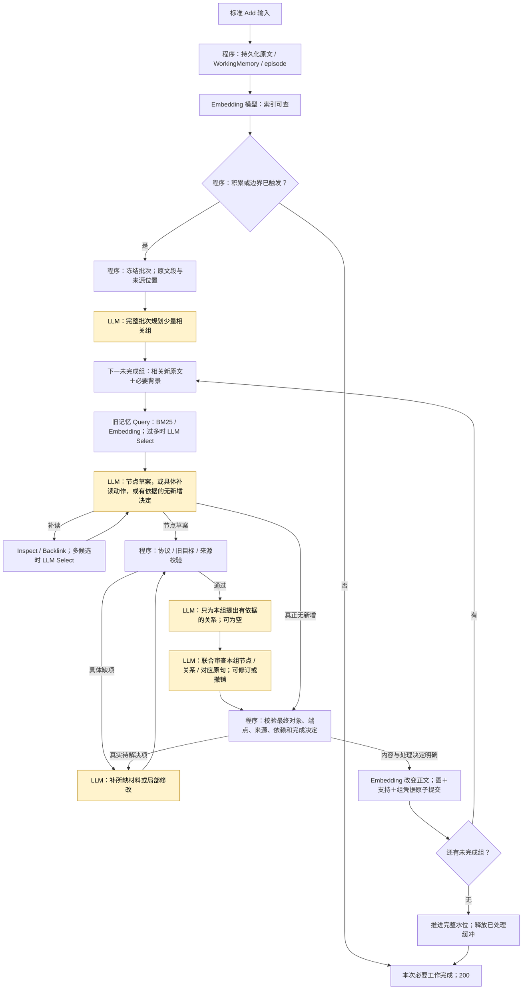
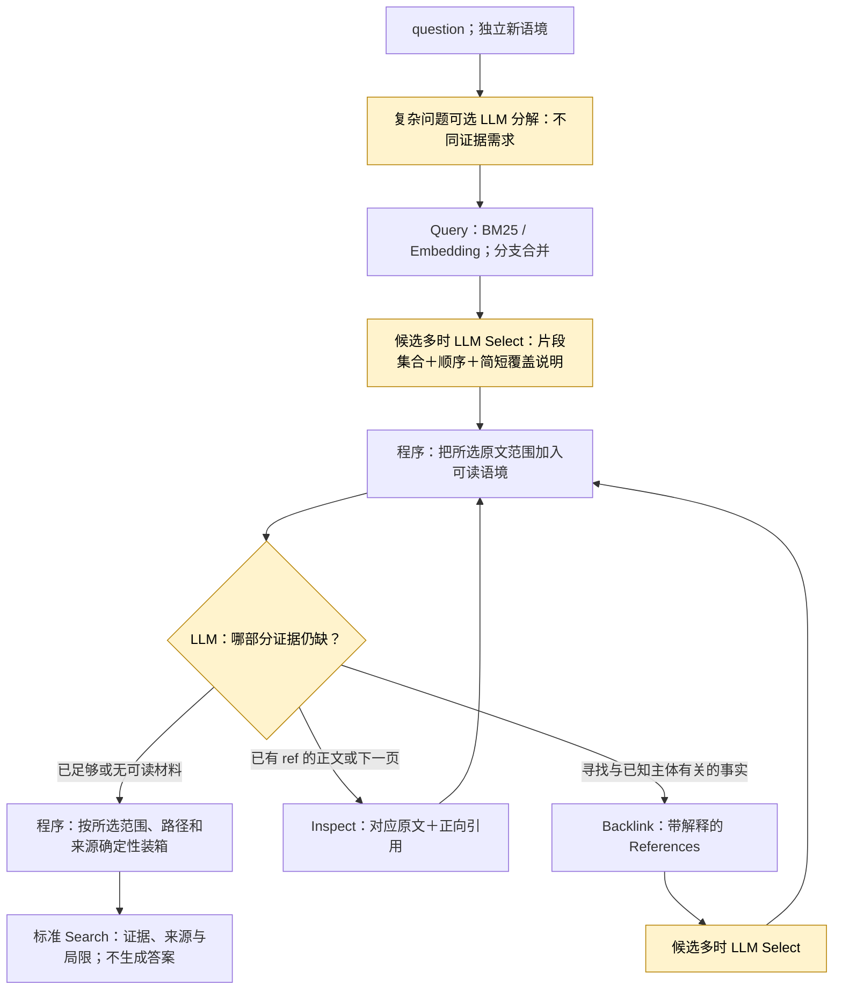

# AM-Link 下一轮计划：把整体方法收敛到稳定、有效、代价可解释

状态：**用户已确认，工程项按[10月27日执行清单](2026-10-27-convergence-execution.md)实施；整体质量验收未通过**。精确默认行为、真实成功和失败见[实施核对](../doing/2026-10-27-convergence-implementation.md)。下文保留设计依据与上级验收目标，不把旧未通过项标成完成。

## 1. 下一轮交付目标

把AM-Link收敛为：**可靠保存情景原文；积累后只整理有增益的变化；按问题找齐证据。** 使用模型理解人物、事件、冲突和证据集合，程序处理已确定的流程、校验、索引和提交。

不是要求所有材料都生成六种节点，也不要求每组都有边、每次Search都有多跳。完整原文episode负责保真；其它MemoryItem和关系承担有用的归纳与导航。两者共同是默认方法，不另建一个出错后冒充成功的分支。

收敛同时看三条线：

| 目标 | 必须观察 | 不采用的替代指标 |
| --- | --- | --- |
| 写得稳定 | 完整历史各次Add结果、可恢复进度、支持/冲突处理、幂等 | Search仍能从最低episode找到部分内容 |
| 找得有效 | 关键断言、来源、主体/时间/条件和互补证据共同出现 | 返回200、候选相似、节点/边越来越多 |
| 代价合理 | 每次请求、每个完成组的GPT/embedding调用、输入输出tokens、耗时 | 只看单次窗口上限，或只看成功请求的平均成本 |

本轮不新增MemoryItem类型、独立rerank、答案模型或LLM装箱；没有实测收益的能力不扩张。仍默认embedding、Select、可探索的引用图，没有“新方法默认关闭”的双路径。

## 2. 明确保留的设计

- 标准Add先持久化RawEvent/WorkingMemory及可检索最低episode；触发整理后等待目标组全部收束才返回200。1740秒是内部期限，不是故意等待的目标；把时间用在必要工作上。
- WorkingMemory跨Add积累，会话边界、容量、明确变化与普通积累分开处理。不因减少调用而改成每条消息立即反思，也不把全量整理挪给Search。
- 标准Search始终新语境，只看MemoryItem/episode；Query分支先合并再Select，图探索使用模型决定的Inspect/Backlink，返回可追溯证据，不代答。
- 语义ref和可读原文/解释同行。工具参数保留精确位置，hash与内部凭据不占据叙事中心。
- 局部完成凭据、原子图/向量提交、处理水位、同用户隔离、实际披露范围、失败重放与成功幂等继续成立。没有内部网络重试、后台补偿或整用户重建。

## 3. 改动一：让组内材料真的变小，而不是只换主题标题

当前模型按消息位置分组；单条长消息可以出现在多个组里。下一轮使用**可回溯的原文段**作为分组最小位置，仍属于输入组织，不是新的记忆对象。

### 原文段与整体视野

1. 程序按自然段、发言和句界切分，保留speaker、session、顺序、原始时间与原文区间。过长无句界内容才能按硬长度切分并标明续段。正文原样保存；不先用模型总结替换证据。
2. 批次规划仍读本批完整材料，看到段落编号与全文，形成少量相关组。**覆盖所有原文段不等于每段都要生成事实**：规划可把复述、寒暄放入同一组，后续明确判断是否有新增支持。
3. 每段有一个主要处理归属；为解决指代、否定、条件、时间，可作为其它组的共享背景。共享背景不能默认为该组又要重写的新增内容。计划冻结完整映射，不能只挑容易的段推进水位。
4. 分组围绕同一事件、同一属性变化或同一组相互约束的规则；避免一组一个微小属性，也避免一组整个人物传记。先以每组约3,000—6,000正文字符、约3—6条必要陈述作为实验目标，不把这些数值解释成语义正确的固定比例。
5. 需要更多背景时可沿原文相邻段或Inspect补入，实际输入与披露凭据同步；不能只在数据库里存在就视作已读。共享背景和跨组依赖作为规划说明，过长计划依然显式失败，不默默丢段。

### 旧记忆的使用

按本组的主体、事件或属性寻找旧记忆；旧正文只在比较、复用、冲突或连接端点所需时展开。前组完成后，后组可见其ref与简短叙事；旧组全文、草案和审查菜单不自动常驻。本组写目标与必要原文保持可读，已完成组的保护范围及时释放。

同一版本已读取且仍实际呈现的旧正文不重复Inspect。被逐出或只剩摘要的内容不沿用“已读全文”权限。身份查询结果、查询向量可在同一处理范围内按问题与版本复用；不缓存过期检索结果，不跨user复用记忆。

**验收：**原文覆盖清单完整；相关组实际输入字符下降；一个长消息参加两组时不重复整条长消息；指代/条件未被切丢；分组数量不随一句一个属性无节制增长。若更细切分损害理解，增补必要原文背景，不能用错误的短摘要掩盖。

## 4. 改动二：写入使用少量有内容的模型步骤

### 正常路径的建议形态

一次分组规划由批次共享。每组通常三次有内容的生成调用：**节点草案 → 关系草案 → 小组联合审查**。Query过多时的Select和确有必要的探索另计。纯状态推进不再调用模型。

关系草案可为空，不为了跳过一次调用而让模型凭空宣称“没有关系”；若节点阶段已经明确无新节点、无新增支持、无关系/遗忘待办，真实no-op可直接收束。上图是语义主路径，错误/依赖失败仍显式返回，图中未画出每条错误支路。

### 从当前实现删减什么

- 删除模型可选的空参数`reflection_validate`、`reflection_commit`：补读后程序自动复核；最终审查与校验通过后程序直接提交。它们的观测阶段仍存在，标注为程序步骤。
- 节点和关系仍分步起草，避免重新回到“一次生成整张图”。把原来的逐节点页、逐边审查收成**有界小组联合审查**，一次提供少量节点、成对端点、相关原句和具体变化。
- 联合审查必须能修订节点，撤销错误边，选择准确支持来源；输出的是同一个最终提交的节点与关系决定。节点正文变了，关系必须明确按修订后的端点重新判断；没有这项结果就撤销依赖边，不能沿用旧审查凭据。
- 审查材料优先使用该提案直接引用的原句及必要相邻语境；为了允许纠错，再给本组其它新原文的清楚入口。模型若需未展开内容必须补读，不给每个候选一份全部历史来源菜单。
- 真正超出小组输入预算时按完整陈述和依赖关系分页，跨页关系审查必须使用已定稿的两个端点。不能为追求“一次”截断材料；额外页计入成本。优先在规划阶段防止大组，而非堆多层审查循环。

这里有一项需要实测的取舍：小组联合审查减少调用，但让模型同时顾及节点和边。先用本轮真实错误输入检验；若联合审查不能保持正确性，应调整小组粒度或放弃这项合并，不保留默认关闭的替代实现，也不取消语义审查换取低调用量。

### 少建、复用、更新与冲突

模型对本组回答一个自然的问题：“这些原话，相比已经知道的内容，究竟增加或改变了什么？”

| 材料情况 | 写入处理 |
| --- | --- |
| 同一主体、事件、条件下的复述 | 复用旧ref；确实新增支持才追加原文位置；不重建一份传记 |
| 新增互补信息 | 增加该事实/事件，与必要主体连接；不覆盖旧事实 |
| 明确更改同一属性、同一适用条件 | 保留新旧陈述及来源；有直接替代依据才建立supersedes |
| 同条件下不可同时成立但未裁决 | 两边保留，必要时contradicts；不能靠消息晚就视作解决 |
| 情景记录已完整表达，额外节点没有增益 | 明确决定只由episode保存；不要求凑节点或边 |

`about`核对实际行为者/被描述对象，不能把听者、相近名字或话题对象当作主体。`supersedes`有较高破坏性，不能用“更新内容更全面”作为理由。“二人都喜欢电影”与“Nate喜欢电影”相容；规则、例外、申报步骤也通常可以并存。事实/事件正文与时间仍不可原地覆盖；复用时只增加经过审查的支持。

**审查全撤销的收束规则是本轮明确提出的行为调整：**

- “所有草案都被撤销”本身不等于本组完成。审查同时要说明新材料是否仍有未处理的有效变化。
- 若本组原文已完整呈现、episode已索引，且模型明确判断无须额外语义结构、没有更新/遗忘等未处理要求，可记录有解释的无变更凭据并完成该组。
- 若存在真实变化、缺背景、协议不合法、网络失败或只是耗尽预算，不能改成无变更。局部修订/补读后再判断，仍未解决则Add失败，保留此前组凭据。

此决定是模型的语义处理结果，不是“模型失败时episode兜底成功”。必须在观测中区分：新增、追加支持、显式更新、无语义增益、尚未完成。它们是组处理结果，不新增MemoryItem种类。

## 5. 改动三：Search只为补足证据增加步骤

当前Select已经question＋原文卡、80,000字符预算和集合选择提示。本轮不再把扩大窗口或“保留互补证据”当作尚未实现的新功能。下一步集中检查**信息是否真的跨步骤传递，后续读取是否增加了有用内容**。

1. Select的coverage只是模型对已给材料的简短归纳，不能当gold或当证据正文。校验它指向真实入选位置；将仍未满足的需求用自然语言交给下一次探索，不再每一步重新从零判断。若没有查询扩展，不额外花一次调用生成需求清单，在已有Select或探索调用中说明即可。
2. 查询分支应寻找不同的事实部分，避免三次同义重写全问题。相同表达去重；同一问题向量可在本请求内复用，新增索引后重新检索。复杂查询机制不增加独立调度模型。
3. Inspect已完整呈现且同版本的范围不重复读取。对“这是哪个地方”的缺口，优先跟进含地点的引用/反链；不反复读已有的日期/人物段落。程序只禁止重复的同一动作，不能因两页词面相似就认定没有新信息。
4. 保留真正多跳能力：前一步披露的新ref立即影响后一步选择。一个人物节点有反链不意味着必须遍历全部；没有Backlink调用也不自动判失败，只有真实任务需要而链路漏掉时才是问题。
5. 最终确定性装箱先保住互补原句和必要条件/时间/身份来源，再添加导航说明；禁止按旧检索分数覆盖Select顺序。预算舍弃明确记录；本轮不再叠加LLM装箱或自由回答调用。

Select的评估单位是**有用贡献集合**。相同事实来自不同卡片，顺序扰动后换卡但事实齐全可以接受；不同卡片提到了不同金额/条件，缺一才是集合损失。先做原序、倒序、固定随机顺序和重复复述干扰，避免用一次输出相同与否判断方法稳定。

## 6. 调用与质量预算

本轮R8的17次纯控制调用占Add GPT的20.2%；它们约占输入tokens的21.6%。这给出明确的首批精简对象。小组材料变小和联合审查的额外收益必须另做实测，不能简单相加为预测准确收益。

建议验收目标如下，均为**待验证目标，不是运行时强制剪断证据的阈值**：

- 正常局部写入以3次有内容的GPT调用完成，批次规划摊销；查询Select、必要探索和局部修改逐项解释增量。记录组数及每组调用，防止用更多小组伪装每组更便宜。
- 相同完整历史的配对实验中，Add GPT调用与输入tokens分别争取降低至少30%，不牺牲成功率、来源或关键图语义。不能只减少调用却把每次输入撑满，也不能只比较成功的短历史。
- 普通Search争取中位不超过4次GPT；确需多跳/分页的题单列。超过8次时人工核对每步新增证据，不直接截停或归入普通题平均值。
- 长历史的调用应随新材料和必要语义变化增长，不能随“历史节点数×分组数”失控。逐批画新增原文、组数、模型输入、有效新节点/支持、耗时曲线，检查后半段是否持续恶化。
- embedding分别报告请求次数、文本条数和tokens；复用旧节点仅追加来源且正文未变时，不重复算正文向量。任何缓存均需模型指纹/文本/版本匹配。

供应方价格未知时只报告真实tokens、请求数和时间，不猜测人民币费用。网络失败和无usage分列。1740秒总期限、实际请求字符预算和明确错误继续有效；不以提高窗口/重试次数代替收敛。

## 7. 执行顺序与验证

| 阶段 | 具体交付 | 通过条件 / 不通过时的处理 |
| --- | --- | --- |
| P0：现状冻结 | 本轮备份、清空活动库，成本归因，记录基线65bc34a | **done**；只使用历史轨迹复盘，新实验新库 |
| P1：确定性收束 | 删除模型commit/validate；读取后自动检查；提交保留原子凭据；只变支持不重嵌入 | 失败重放/幂等/原子性、缺项和依赖失败回归通过；真实短例不出现新语义退化 |
| P2：小组材料与写入 | 原文段定位、主要归属/共享背景、少量相关组；联合审查及明确无增益决定 | 长消息不整段重放；完整来源和真实修改能力；错误替代/错主体反例通过；没有预算失败假no-op |
| P3：Select与探索 | 传递入选范围和覆盖说明；检查阅读增量与停止；请求内精确复用 | 顺序/重复干扰下关键贡献齐；真实多跳补得上缺项；最终装箱不丢已选必要条件 |
| P4：完整历史配对 | 先6份完整历史、至少12问；5类来源，至少一份长讨论和一份多人物记录 | 方法错误为0才扩大；网络错误另列但不能从端到端分母移除；稳定后扩12份完整历史/36问 |
| P5：收敛核对 | 同版本结果、成本曲线、失败解析，更新DESIGN/案例/页面 | 方法代码只留验证后的主链路；未达指标明确未验收，不靠追加调用稀释失败 |

### 实验设计，避免重复花钱却没有新结论

1. 先建立固定诊断集：真假supersedes、听者/行为者、同名、事件重复支持、原文完整但没有结构化增益、真实更新不得no-op；配合金额集合、时间和条件证据。取自公开原文与已有失败轨迹，人工判断只在评估侧。
2. 小组联合审查、Select顺序扰动先用冻结输入做算子检验，不能据此宣称Add端到端成功。对错因可归类后才放入完整流水线。
3. P4使用LongMemEval、LoCoMo、BEAM、PerLTQA和CL Life。根据长度与类型预先选6份完整记录并冻结pack/hash及问题，至少一半来自此前未跑的记录；不得利用gold锚点裁剪Add。6份包含2份匹配基线的短/中完整历史；基线与新方法均从空库构建，Git快照固定为65bc34a。其它旧长历史只作为失败诊断参照，不伪称同条件消融。
4. 另至少一份长历史测试渐长前缀，前缀从头连续增长，不按答案挑片段。各次曲线记录真实完成程度；出现同类阻断就先修原因，不继续跑剩余题掩盖失败。
5. 小阶段建议最多800次GPT、200次embedding请求、已知GPT输入约600万tokens，然后审读再扩；这是实验预算检查点，不是HTTP内部静默取消。供应方迟到usage可能造成末次超出，单列记录。预算不够完成时报告未完成，不挪用旧库冒充新结果。
6. 扩至12份/36问前冻结最终版本，至少半数为本轮未用于调参的完整记录。所有题先检查相关Add是否成功；失败后的Search可做诊断但单独统计。展示“完整历史成功数”“有效/错误边人工审查”“关键证据完整数”和“总调用”四列，不只给一个汇总分。
7. 为观察图的边际价值，只在已成功新建的研究库副本上做少量不展开关系的离线/实验对照；不进入生产配置。对比额外探索实际补回哪句话、付出几次调用。若图无增益，先修语义和路径，不增加hop上限。

人工抽查至少覆盖每类新关系、所有supersedes/contradicts、所有同名/主体风险、所有无增益决定及全部失败。关键边不能只抽看好看的正例。保留未标注样本，不把“未发现错误”写成已证明正确。

## 8. 可观测与工程落点

- `local_reflection.py`、`store.py`：冻结计划由消息映射升级为原文段映射，组完成凭据与完整水位不变；新库使用明确版本，旧草案不能静默按新协议解释。
- `engine.py`、`drafts.py`、`reflection.py`：程序推进、局部联合审查、来源比较、明确组处理结果、复用支持；语义草案修订区别于请求失败后的内部重试。
- `narrative.py`、`projection.py`、`grounding.py`：同一组的原文、必要背景、旧目标、陈述与支持按阅读顺序呈现；仍以真实输入范围记账。
- Query/Select/探索：保留输入/候选/所选范围/后续正文/装箱对应；覆盖说明只是观测及探索提示，不新建一套大型推理状态系统。
- 靶场及可视化：每请求显示GPT/embedding调用、token、耗时与失败；每组显示新原文量、重复背景量、节点/支持/关系变化和处理决定；每次探索显示新披露范围，语义是否有用由后验评注判断。成本统计依赖实际根span，未落盘的未知量单列。

回归重点是原子进度、范围安全、无增益与未解决的分界、旧目标同版本、关系随节点修订、选择范围传递和遗忘不回流；不为文案或实现细节编写镜像测试。改动后执行项目要求的完整回归，再做上述真实检验。

## 9. 可行性结论与待讨论取舍

**工程可行。** 原文坐标、范围凭据、分组计划、局部草案、审查、原子完成与Select集合都已存在；主要是调整粒度、移除纯控制调用和收束输入，不需要再建一个Agent框架或换模型。三项尚需真实验证：小组联合审查是否可靠、允许有依据的episode-only决定是否减少无效节点而不损害导航、成本下降后关键证据是否仍齐全。

建议优先接受以下取舍：

1. 少量有用节点与可靠关系优先于图的规模；结构化增益必须能解释。
2. 模型决定语义；程序负责已知阶段推进。保留可补读/局部修订的灵活性，去掉无内容的确认调用。
3. 有依据的“原文已足够保存、无须额外节点”可以完成整理；失败或真实增量未处理则不可以。
4. 先把这三包做稳定、量清代价，不同时改触发门槛、换embedding、叠加LLM装箱和加深跳数。当前触发不是已证明最优，只是在这一轮保持单一可解释的实验变量；完成后再按积累曲线决定是否需要改它。

本轮交付是可实施、可评估的方案预览。确认后从P1顺序实施；每个子阶段依据实测修订后续，不直接把未通过的设计切成另一套隐藏备用方法。
