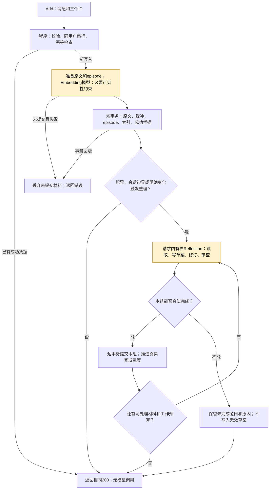
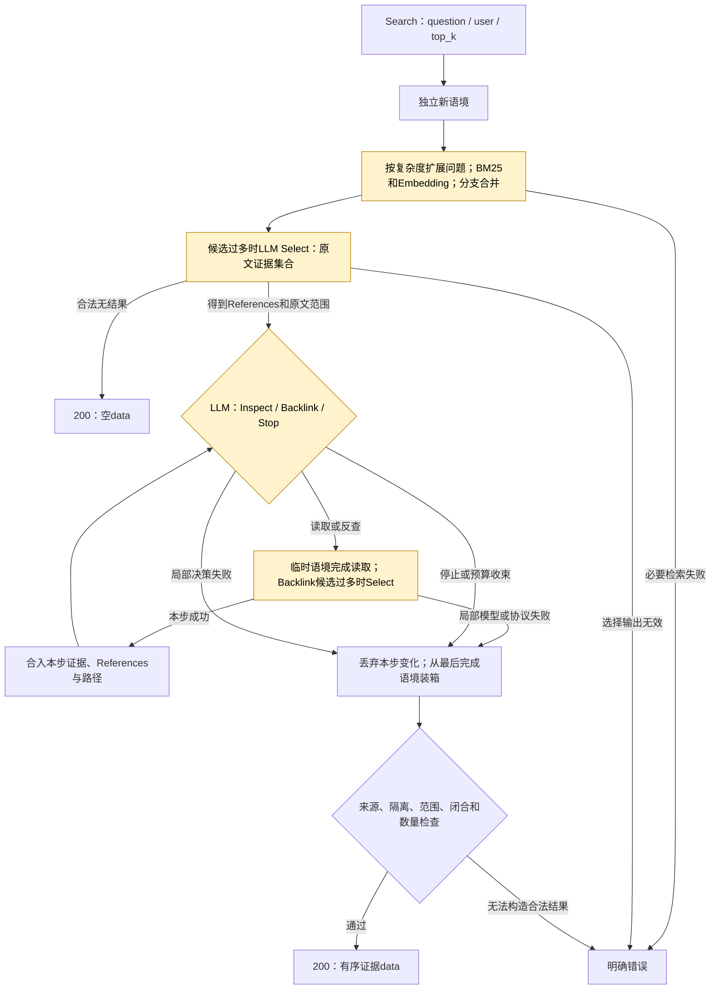

# Add/Search 对外语义与方法收敛执行计划

2026-10-27。源码基线为用户已提交的 `ee6fe76`。输入为[真实失败复核](../doing/2026-10-27-add-failure-review.md)，以及用户提出的“Add 失败撤销本轮写入，成功允许保留缓冲或不完备 Reflection；同时梳理 Search 对外语义”。

**状态：用户确认后，P0/P1 工程改动、观测和有限真实验证已实施；整体质量与扩大规模门槛尚未通过。** 最新核对见[实施报告](../doing/2026-10-27-delivery-contract-implementation.md)：224 项回归及 3 子测试通过，6 个新库档案、41 次 Add、21 次 Search，加组件验证共 618 次真实模型调用。仅两份不同的完整历史，其余为切片或重复复验，不能替代 6 份/12 问验收。本计划描述确认的目标；涉及“目前”的缺陷为实施前基线，当前行为以报告与根 DESIGN 为准。方法接口仍为 Add/Search，不新增长期记忆类型、内部网络重试或后台补偿服务。

## 1. 核心决定与官方边界

Add 确认本次材料可靠接收；Reflection 的整理进度独立记录。Search 返回本次真正取得、可追溯的证据；不承诺已找到所有证据或能够回答全部问题。内部未完成工作和错误必须可观测，不能以 HTTP 成功覆盖。

2026-10-27重新核验[官方 API Guide](https://agentmemories.ai/api-guide)：Add 成功须持久化且立即可检索，返回 success=true 并原样回传三个 ID；同一逻辑写入重试沿用 request_id 和 payload，符合条件的 Add 最多 32 次尝试。Search 返回按相关性排列的 data，数量不超过 top_k；确实无结果时可以为空。公开接口没有用于解释内部 Reflection 进度的必需字段。

据此，MemoryWorking 可以保留未整理材料，但 **200 不能只有一个 Search 不可见的缓冲区**。沿用高保真最小 episode 及 BM25/Embedding 索引，使后续 Search 无需读取 WorkingMemory 或触发 Reflection。将未完成整理与接收结果分开，是本计划的方法设计选择，不声称官方要求采用此种内部实现。

这修订了此前“只要触发 Reflection，必须处理完整目标水位才返回 200”的本地约束。触发后仍在请求内认真完成有用工作；完成或有明确原因停止本次有界工作后返回，剩余整理不等于本次材料接收失败。

## 2. Add：一次可靠接收，整理可以分阶段完成

### 2.1 成功与失败表

| 情况 | 对外结果 | 持久状态 |
| --- | --- | --- |
| 原文、工作缓冲、episode、必要索引和成功凭据完整提交；未触发 Reflection | 200 | 保留待整理范围，立即可查 |
| 必要接收已提交；Reflection 完整或部分完成 | 200 | 合法完成组保留；其余范围及具体待办保留 |
| 必要接收已提交；Reflection 模型异常、草案不合法、无进展或预算收束 | 200 | 此次整理阶段明确失败/暂停；不提交未通过检查的草案，不伪造整理完成 |
| 参数、权限、幂等内容冲突 | 对应 4xx | 本轮不产生记忆变更 |
| 必要 episode embedding 失败、索引或接收事务明确回滚 | 对应暂时失败 | 本轮没有已生效的原文、缓冲、索引或派生记忆 |
| 提交成功，但 HTTP 响应丢失 | 调用方可能观察到超时 | 同 ID/同内容再次调用，读取成功凭据返回同一响应，不重复模型调用 |
| 进程崩溃或存储异常使提交结果暂时未知 | 不伪称“已经撤销” | 恢复后以原子成功凭据判断是否已提交；调用方重投同一请求 |

“失败撤销”约束服务端能够确认未提交的应用失败。网络超时不等于数据库回滚，不能在响应发送失败后反向删除已经提交的记忆。失败诊断和请求摘要可以保留，但不得作为 Search/Reflection 的材料。

### 2.2 两个明确的提交边界

**必要接收采用一个短事务。** 同用户串行检查 request_id/payload；准备原文、episode 和必要向量；在一次事务中写入 RawEvent、MemoryWorking 进度、episode、BM25/向量和成功响应凭据。远程模型调用在数据库事务之外完成；准备期间不公开未提交数据，不跨模型调用持有 SQLite 写事务。成功凭据与必要索引不能分开提交。

**每个 Reflection 完成组采用一个短事务。** 新增/修改的节点、边、旧状态、向量、遗忘约束、组完成凭据和相关工作区进度共同提交，失败则该组共同撤销。尚未审定的草案属于工作区，不是正式记忆。

必要接收一旦确认成功，Reflection 失败不再把对外结果变成“Add 未接收”。已完成的历史组也不因新组失败而被撤销。普通组失败不得删除当前新材料或已成功确认的历史请求。

此前支持的显式遗忘需要单独保住语义：对已确认为授权遗忘指令的请求，目标定位及必要屏蔽属于必须兑现的可见性约束，应在接收确认前准备、在必要提交中原子生效；无法完成时不能仅保存“请忘记”就声称执行成功。资料中的引述和一般叙述不能只靠关键词误判为指令。普通事实补充不因此要求完成全部图整理。

### 2.3 请求内编排

默认仍按积累/会话边界触发，并在触发时使用允许的时间整理。1740 秒是包含排队、准备、整理和响应收束的请求预算；不为凑满时间持续调用模型。依赖故障不在内部重试；有实质新证据或草案变化的局部修订是任务步骤。

实现时给事务确认、保存已知待办和响应编码保留收束时间；每次发起模型调用前按剩余期限设置上限，剩余时间不足就不再开启新整理步骤。期限结束后仍有未提交草案，只记录未完成，不能为了清空缓冲越过校验或继续后台调用。

同 ID/同内容的已成功请求只重放成功响应，即使存在待整理材料也不再次运行 Reflection。后续新 Add 可依触发规则继续整理；Search 始终独立，不负责清空尾部。接口保持 success/request_id/user_id/session_id，内部进度通过观测记录。

### 2.4 当前代码必须改动的地方

- `Store.start_add` 现在先提交 RawEvent，随后 `_ensure_episode` 才完成向量；应改为先准备、再原子接收，避免必要 embedding 失败却留下可处理材料。
- `finish_minimum` 当前将请求成功绑定 `reflection_watermark`；需解除这种绑定，以必要接收凭据确认成功。整理水位继续描述整理进度。
- `Engine._add` 当前强制继续最早未完成计划，错误直接冒泡；需明确接收提交前后的错误边界。不能用一个包住整个 Add 的 catch-all 把所有异常变成 200。
- HTTP 与 native 靶场必须走同一结果判定；发生提交结果未知时保留明确诊断，不能假定事务成功或失败。

## 3. Search：只返回已完成步骤获得的证据

### 3.1 对外结果表

| 情况 | 对外结果 | 必要解释 |
| --- | --- | --- |
| Query/所需 Select 成功，获得合法证据；图探索正常结束 | 200 + data | 完成有界检索，不等于穷尽证据或答案正确 |
| 基础候选已完成 Query/所需 Select；后续 BFS/Backlink 局部模型或协议失败 | 若从最后完成语境仍可装箱出合法证据，则 200 + data | 出错阶段仍记录 error；返回前验证来源、隔离、数量和装箱完整性 |
| 正常达到深度/步数/时间收束边界 | 200 + 已有合法证据 | 不继续启动无法在预算内结束的模型工作 |
| 正常检索为空，或合法 Select 明确未选任何候选 | 200 + 空 data | 仅表示此次检索未找到可返回材料，不声称事实不存在 |
| 必要 Query 的 embedding/模型/索引失败，或必要 Select 输出不合法 | 对应错误 | 不用未经完成筛选的候选冒充该步骤成功，也不返回空列表掩盖失败 |
| 来源、用户隔离、存储完整性或最终响应构造不能保证 | 对应错误 | 不返回不能核验的片段；系统故障不是“无结果” |

本计划把“后续扩展失败可保留已有证据”统一应用于有明确作用域的模型/工具失败；这是对当前只容忍部分 BFS 协议错误行为的扩展。不会捕获未知异常并随意拼出结果，存储完整性错误仍显式失败。

### 3.2 每个扩展步骤先完成，再加入语境

`_explore` 目前会在 Backlink Select 之前修改 explored/edges 等字段。若允许局部失败后返回证据，就必须先将本步读取、筛选和路径更新放在临时语境，全部通过后才合入本次 Search 的正式语境。失败步骤中途出现的引用、边、覆盖说明和已读凭据一并舍弃。

最终装箱只使用最后完成语境及其可核验来源。某条路径不完整时，不把它写成成立的推理关系；可以返回其中独立成立的原文证据。已有证据仍无法合法装箱时返回错误，不能换成空结果。同用户串行读边界保证一次 Search 内源版本一致。

Query、Select、图读取和装箱仍为一条默认链路；上述表格定义同一方法在有限工作完成后的结果，不引入关闭向量/Select或切换另一种方法的开关。Search 不生成答案，不写入 MemoryItem，不处理 WorkingMemory。正常空结果与发生错误的阶段分别记录。

## 4. Reflection 收束：具体修改、可恢复进度、正确关系

### 4.1 审查输出与后续动作一致

把当前“reviews 修改列表 + 一个可能矛盾的 needs_revision/commit 判定”整理为：逐对象的保留/修改/撤销、明确尚未处理的内容，以及没有新增时的理由。程序决定是否满足组完成条件，不增加独立 commit/validate 模型调用。

节点和关系分别绑定已知待审对象；输入将语义引用、正文与允许动作放在一起，输出使用程序提供的对应项，避免混用节点/关系/来源的编号。重复键、遗漏或不合法动作明确拒绝，不从解释猜测目标。关系审查只保留/撤销；修改关系应作为局部关系提案重新检查。

先验证并应用合法修订到草案，再将剩余事项交给已有 Inspect/Backlink/局部 patch 流程。审查给出的有效删边和改文不应因为另一个剩余问题而全部丢失。无效审查整次不应用；不采用“挑出看似合法的几项”推测其含义。

正常组仍为节点、关系、联合审查；不存在合法端点组合时省去关系调用。补读和审查后的修订共用每组有界预算；将联合审查也计入内容决策成本，不能形成预算外循环。重复相同草案/证据状态停止；仅改说明文字不算内容进展。

### 4.2 未完成不能堵住所有后续工作

沿用已有冻结组和原文范围凭据，将“完成组必须是连续前缀”的执行假设改为逐组保存完成凭据。某组未完成时保留草案、来源版本、具体待办及最后失败原因，后续未处理组仍可在满足自己的证据门槛时工作。

完整水位只推进真正连续完成的来源范围，用于回收与展示，不能再充当接收门槛或唯一待办筛选条件。已完成范围不因前面存在缺口而重新规划、重写；一个原消息分成多段时，只有其全部主要范围完成才释放相应缓冲。

恢复草案先核对计划、原文 digest 和旧节点版本。没有相关新材料、证据增量或实质修订时，不因新 Add 到来而再次调用同样的失败组。可以先处理新的可处理组；若它们需要尚缺的旧材料，照常留下明确待办，不假定前组已完成。跨组变更不能用旧版本草案覆盖后来的有效更新。

待处理正文继续指向 RawEvent，不复制成长文本队列；MemoryContext 只加载当前工作需要的范围。未来执行仍在新 Add 请求内触发，不建立后台重试服务。尾部未整理范围通过 episode 提供检索，观测如实显示。

### 4.3 简化分组输出

实施候选方案采用逐原文段给出自然语义组名/问题，程序将完全相同的组名聚合成组；每个段落是工具中已知且必填的项。可列出本段所需的其它原文段作为背景，程序按组汇总。这样不再同时维护动态 groups 数组和另一份指向它的组号表。

主要归属仍完整且唯一，背景不算已处理。程序不模糊合并不同组名、不给遗漏猜归属；工具输出错误作为规划未完成记录。组名同时作为具体旧记忆查询表达，避免为了补标题/问题另加模型调用。分组数量、单组材料和输出预算需在完整历史上检查，防止语义组名重复导致输出过长或过细分组。

### 4.4 陈述与来源、更新与补充

给模型的主要任务是整理“谁，在什么条件/时间下，说了或发生了什么”，提供新旧陈述与实际支持原句。source ID、digest 和坐标承担追溯，不能代替可读证据。

- 同一事实的重复表达优先补充支持；有新条件/属性时保留必要增量，避免再造整篇摘要节点。
- fact/event 按紧密相关陈述组织，不能把一般规则、例外、流程、建议揉成一条不可比较的长节点；也不机械变成一句一节点。
- supersedes 需要同主体/属性/条件下的明确替换依据；共同兴趣、补充条件和操作说明不能替换原事实。
- about 指向陈述实际主体；人物可作导航，但不为了边数强制造人物或连接。关系合法类型不等于语义成立。
- 来源不同或条件不明的陈述可以带归属并列，不要求记忆模型裁决外部世界的唯一正确结论。
- 审查输入合并同源重叠范围，保留条件/说话人/否定/时间；每条陈述的支持必须可解释，不能用“引用全部可见位置”代替对应检查。

未解决组不得伪装为 episode_only 或推进整理水位。新的 Add 接收成功与真正的 episode_only 整理结论是两回事。

## 5. Query、Reference、Select 与装箱

复用已产生的具体分支问题生成原文窗口，覆盖金额、日期、主体、条件和跨节点连接所需的句子；分支候选先合并再 Select。不另加一层查询调度模型。

Select 输入继续是 question + 可读 References/原文卡，共用 80,000 字符预算。以总输入预算和不同问题贡献组织范围，替换每 ref 固定最多 4 段的限制；优先合并同源重叠窗口，再在不同候选和分支间增补互补原句，超出则分页并做全局集合选择。未显示范围必须明确记录，不能冒充完整阅读。

输出保留可重排的 References 子集及对应原文范围，覆盖说明只解释所选材料。Select 选中的句子必须持续进入 Inspect 后语境和最终证据卡，不能每层重新抽另一个片段。纯词面重复不等于不同贡献；主题接近不能挤掉独立金额、条件或时间。

确定性装箱作为本轮交付链路：先保留所选原句及其必要主体/条件，再补实际探索路径和来源。完整证据组不能重复展开大块原文；路径未闭合时只返回可独立支持的片段，不生成补桥推理。暂不增加未经验证的 LLM 装箱层；后续若提出实测方案，应独立说明它改善了哪个已定位的遗漏。

## 6. 观测与网页呈现

沿用现有 span/artifact 体系，不扩充公开 Add/Search 响应。至少分别显示：

| 层次 | 需要记录和呈现 |
| --- | --- |
| Add 接收 | 是否原子提交、幂等重放、原文/episode/索引是否齐全、失败或结果未知位置 |
| Reflection | 完成/待处理范围、实际修订、没有增量的理由、阻塞原因、是否重复相同输入 |
| Search 基础检索 | 分支、候选、Select 实际范围及输出；正常空结果与失败区分 |
| 图扩展 | 每步新增证据/路径、局部失败、丢弃的临时变化、停止原因 |
| 最终证据 | 输出原句、来源、依赖闭合、未装入原因；未采集不推断为成功 |
| 成本质量 | 分阶段模型调用、输入/输出、延迟；HTTP 成功、整理完成和证据质量分别统计 |

子阶段依赖失败保留 error，即使父级依据已完成交付返回 200；网页不可只显示一片绿色。旧轨迹缺少新字段时显示未知，不反向推测“已接收但未整理”。理论链路和实际观测继续分开，gold 只用于研究后验核查，不进入方法输入。

## 7. 实施顺序与验收

| 包 | 目标与文件范围 | 关键验收 | 状态 |
| --- | --- | --- | --- |
| P0-A | `store.py`/`engine.py`/`intake.py`；HTTP/native 沿用适配 | 必要索引失败回滚；重放零调用；明确遗忘与接收原子完成 | done：故障及接口测试、真实接收通过 |
| P0-S | `engine.py`/`packing.py`：基础检索、扩展步骤、最终来源 | Query 失败不伪装为空；本步变化不泄露；缺失/过时/跨用户来源拒绝 | done：回归与真实局部终止 |
| P1-R | `local_reflection.py`/`drafts.py`/`engine.py`/`store.py` | 分组/局部审查/逐组恢复和版本检查 | 工程 done；真实未完成组仍存在，稳定性未验收 |
| P1-M | `narrative.py`/`drafts.py`：自然来源叙事、关系及替换原句 | 正反例检查；同主体不同事件不误连 | 工程 done；冻结复验有效，完整图质量未验收 |
| P1-Q | `evidence.py`/`engine.py`/`packing.py`：互补范围及装箱 | 范围连续性、去重、闭合与明确遗漏 | 工程 done；7 来源回归通过，集合/多跳质量未验收 |
| P2-V | 观测、靶场报告、网页、案例评注与中文设计 | 三类完成状态独立展示，联合报告效果/成本 | 工程及有限真实验证 done；扩展门槛未通过 |

先完成 P0-A/P0-S 的确定性边界测试，再做 P1。新行为直接成为唯一默认方法；同步移除旧成功门槛和相冲突的工具字段/测试，不遗留双路径开关。数据结构如需升级使用明确版本，新实验新库；现有诊断库只读保留，不静默转换。实施完成再同步根 DESIGN 的当前流程。

### 7.1 必须完成的故障与恢复测试

1. 必要 embedding 失败、索引写入失败、接收事务提交前异常：无新 RawEvent/Working 范围/episode/向量/成功凭据可见；旧用户数据不变。
2. 接收提交后审查返回无效项、要求补读、网络失败、预算结束：接收 200，内部结果如实；仅合法完成组生效，未完成范围存在。
3. 提交成功到 HTTP 返回间模拟响应丢失/进程中断：重开库，同请求返回缓存成功，原文/节点不重复、模型调用为零。
4. 同 ID 不同内容拒绝；同用户并发相同 ID 只提交一次；不同用户不能互见。失败诊断不成为记忆来源。
5. 显式授权遗忘定位或提交失败不伪称已执行；成功后原文投影及所有相关索引/来源可见性一起改变。
6. 同组一次有效修订后可完成；非法审查不部分应用；旧版本草案失效时不覆盖新节点。
7. 一组未完成时其它可处理组完成；重复 Add 不重新整理；已完成原文段不因低水位而重新规划。
8. Search 真实空库/合法空 Select 返回 []；embedding、初始 Select 或索引异常返回错误；输出无法合法装箱不伪装无结果。
9. 后续 Backlink Select/Inspect/BFS 局部失败：丢弃该步所有增量，从最后完成语境返回证据；数据、路径和来源均未混入失败步骤。
10. top_k、用户隔离、模型实际可见范围、来源时间、Select 顺序与必要闭合同时检查；HTTP/native 结果一致。

测试应验证业务边界和恢复效果，不仅匹配函数或提示词文字。按文件执行定向回归后跑根测试集；最后核对不存在旧的“Reflection 未完成就必须 Add 失败”假设。

### 7.2 真实验证：反例、完整历史、扩展

**第一步：冻结反例的组件诊断。** 使用已有公开轨迹里的兴趣/冰淇淋、不成立替代关系、完整讨论混合条件、重复审查编号、金额集合等输入。固定材料比较审查合法率、剩余事项、错误边和可见原句；这是组件实验，不算新库端到端成绩。

**第二步：6 份完整历史、至少 12 个 Search 问题。** 从新库完整 Add，覆盖 LoCoMo、LongMemEval、BEAM、CLBench、PerLTQA 等已可用数据。保留核心诊断锚点，也加入新样本；不拿失败 Add 的旧副本继续测后声称端到端成功。

**第三步：12 份完整历史、至少 36 个问题。** 第二步的边界和已知错误关闭后扩展，至少一半问题为本轮未反复调试的新问题。冻结选择清单、方法源码 hash 和运行配置，记录全部请求及模型尝试。先核对现有数据 pack 是否真的完整，窗口切片单列，不冒充完整历史。

真实验收分别报告：

- Add 接收成功与未确认数、成功重放额外模型调用数；不能用接收语义变化制造“方法准确率提升”。
- Reflection 完成/明确无增量/待处理范围、重复无效工作、陈述与关系人工复核结果；大量待处理即使 Add 全 200，也不算方法质量通过。
- 完整证据集合和关键原句覆盖、Select/Inspect/装箱分别丢失在哪里；按条件题/更新题/多跳题等归纳，不只汇总 @k。
- 后续探索提前终止的原因与所返回材料是否仍成立；“有证据”不等于“足够回答”。
- 每组/每请求实际模型调用、tokens/字符、延迟及调用失败；未知供应方单价不估算费用。成功率变化和调用节省不可跨不同完成率直接相除。

已授权的真实 gpt-4o-mini/embedding 使用范围继续有效。每个独立运行设置调用/输入预算并纳入台账；异常无进展时停止该路径，修改方法后再用新版本/新库验证，不靠同输入内部重试碰运气。尚未达到扩展门槛时如实保持未验收，不为完成规模而反复扩大失败。

## 8. 计划可行性核查与交付要求

可复用的基础：已经有原文/episode 投影、默认双索引、同用户锁、请求幂等、局部图事务、原文范围凭据、局部 patch、标准观测和网页。此轮主要改变成功确认的时间点、工作区恢复/组进度和模型任务表达。

需要真正重构的部分：必要接收现在分两次持久化；请求完成绑定整理水位；组凭据假设连续顺序；Search 扩展在失败前就修改语境。它们都不能通过改提示词或错误码完成，必须有对应事务、恢复和故障测试。

范围有界：不要求整个用户库回滚，不跨模型调用持有数据库写事务，不引入额外后台 Agent；沿用现有模型和工具原语。新增保存内容主要是未完成草案/具体待办及逐组完成记录，原文和来源范围复用现有对象。并发仍按同用户串行，先把边界做对。

剩余风险：成功接收后不再依靠外部重投促进 Reflection，因此未完成范围可能保留至后续新材料或一直作为 episode 被检索。这是本次允许缓冲/不完备整理的直接结果，必须在实验中量化。若需要主动定时整理，那是另一个尚未授权的运行机制，本计划不隐式加入。

设计核查结论：**合理可行，但不是返回码层面的微调；P0 事务语义与 P1 进度恢复须配套交付。** 对外成功条件、内部未完成含义和离线质量指标已分开；不得将未知提交状态说成已撤销，不得将内部失败改名为 Reflection 完成。

交付时更新 DESIGN、amlink/README、benchmark/OBSERVABILITY、相关案例与本计划逐项核对表；运行根回归、真实新库实验和 git diff --check，检查临时文件/密钥/数据库未进入 Git。实施成果由用户提交，不自动提交、推送或部署。

## 执行状态

- [x] 核查当前源码及失败恢复边界。
- [x] 核验官方 Add/Search 成功与重试要求。
- [x] 形成整体方案、分包执行顺序与验证要求。
- [x] P0-A：可靠接收与幂等结果，必要遗忘。
- [x] P0-S：Search 对外语义、单步证据合入及来源完整性。
- [x] P1-R：分组、审查续做与逐组恢复工程交付。
- [x] P1-M：陈述/来源/关系语义改动及冻结正反例。
- [x] P1-Q：互补窗口、Select 范围传播与确定性装箱。
- [x] P2-V：观测网页、有限真实验证、案例记录、计划核对。
- [ ] 整理稳定性与图语义：遗漏审查项、错误关系方向、宽泛节点和错误关系仍需关闭。
- [ ] Select 集合与多跳质量：LM04 最终来源 2/4、独立金额三项齐；LoCoMo 3/7，不当作全面通过。
- [ ] 6 份完整历史/至少 12 问验收；当前只有 2 份不同完整历史。
- [ ] 已知错误关闭后再做 12 份完整历史/至少 36 问，不以短切片或重复题凑规模。
