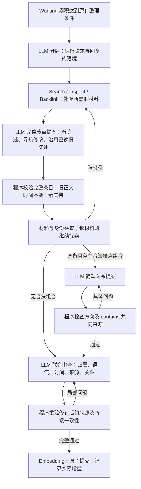

# 来源约束、叙事归属与增量整理执行计划

2026-10-28；基线 `6714ab6`。用户确认围绕四点实施。**状态：P0/P1及观测实施完成；P1-C按真实失败撤回简写协议，改为一致完整条目及明确复用输入；V0通过，V1/V2执行完成但质量门槛未过，V3不扩展。** 逐项核对见[实施报告](../doing/2026-10-28-grounded-increment-implementation.md)和[全部运行台账](../doing/2026-10-28-grounded-increment-run-ledger.md)。

## 目标与依据

上一轮 PV4 R3 只有 32/41 次 Add 完成、尚未运行 Search，不能视为端到端通过。已观察到三个可定位问题：一个 episode 的原文与它所 contains 的 fact 来源完全不同；待润色故事被写成用户亲身经历；关系调用提供的工具定义占这些请求正文字符的 42.6%。这里的占比不是 token 占比，也不全由关系工具贡献。旧提示已经要求增量整理，但复用旧陈述仍要求模型重新抄写正文和时间。

本轮目标是让模型用更小、更清楚的任务形成有来源的增量；不以边数、HTTP 200 或回归数量代替语义质量。保持 Add 原子接收/成功重放、Working 缓冲、独立 Search、原文不可覆盖、模型单次调用和显式错误；不增加后台重试、Answer、开关式备用方法、数据库迁移或模糊自动合并。

## 四项实施

### P0：contains 必须具有共同原文依据

`episode --contains--> fact/event` 的每个声明支持来源，必须同时属于该 episode 和目标陈述。目标陈述可以有其它独立支持，但不能用 episode 以外的段落证明这条 contains。预检、最终准备和审查改动后的校验一致实施。审查同时显示两端正文与来源。

这是必要条件，不是充分语义证明：同一消息仍可能讲不同事情，模型审查还要判断“这段情景是否确实包含此陈述”。非法边作为明确的局部修订任务，不静默翻转、不自动丢弃后冒充通过，也不丢失合法节点草案。

### P1-A：简化关系工具，保留业务约束

用一个固定 link 结构表达 `from_ref / relation / to_ref / source_refs / support`；端点和来源枚举仅列当前实际可见对象，不再展开全部合法端点组合的 anyOf。模型读到简短方向规则、实际节点正文及连接依据。结构校验仍严格；方向、端点、来源与语义是程序预检和联合审查的职责。没有合法端点组合时继续由程序跳过关系调用。

### P1-B：按交流语境理解材料归属

在分组、写入、审查三处明确区分：用户直接自述；用户提交的引文、故事或待编辑材料；助手提供的改写或建议。引文中的“我”不能直接升级为用户经历，建议不能变成已经采纳的决定。

同一冻结批次内，助手段落携带它最近的同会话用户请求作为共享背景，避免把改写独立看成事实；背景不重复计入本组新工作。不读取后续批次材料。如果请求不在可见范围，保留“助手建议/提供文本”的归属，不猜测。需要保存的可写为“用户提交一段关于……的故事请求润色”；重复改写和通用建议可说明最小 episode 已充分记录。

### P1-C：围绕语义增量，明确复用材料与实际变更

最初计划使用轻量旧陈述条目，让程序复制正文/类型/时间。真实验证先试独立 `reuse` 数组，再试同列表的 ref/source_refs、ref/kind/source_refs 简写；均出现字段遗漏/混用、未读旧目标和旧来源冒充新增，最后控制实验仅5/15组完成。因此这两种格式全部撤回，不能作为默认交付。

最终实施：`items`/`upsert` 统一使用完整节点条目，输入以自然叙事明确列出已读且本次仍完整可见的旧对象和新来源。模型对同一陈述使用同 ref、原正文/类型/时间，仅附新增支持，程序合并旧支持，继续经过材料核验、联合审查与原子提交。没有新模型回合、简写解析器或备用开关。配套实际增量观测，让后续能检查是否真的减少了重复写入；整体收益仍需质量验证。

不可复用隐藏/他人/失效对象，不允许改写 episode；新支持必须真实支持旧陈述。新事实、新事件或条件变化仍生成新陈述，不做近义自动归并。局部 patch 同样能加入复用条目。观测明确列出本次新增、补充支持、导航更新和无实际变化，避免将“提出草案”当“落库”。

## 完整流程

Search 本轮不改变算法；通过真实 Search 检查改善后的记忆能否被找回，独立报告答案所需证据与图探索，不将标准 Search 偷接 Working 或 Reflection。

## 验证与验收

| 阶段 | 验证内容 | 通过条件 |
| --- | --- | --- |
| V0 | contains 同源/异源、审查改源、方向错误；reuse 可见版本/隔离/原文时间保护；同会话背景与主归属 | 关键负例不能落库，合法增量可以完成；全部现有回归通过 |
| V1 | 关系工具定义体积；新叙事材料、直接自述、助手建议、相同事实重复和不同事件组件 | 记录每次响应与语义结果；协议与内容分开统计；不只验证负例 |
| V2 | 新数据库完整 Add 后 Search：更新/多证据及新的叙事/重复样本 | Add 接收、整理完成率、来源、错误边、实际新节点/复用和调用成本一起报告 |
| V3 | 短例质量允许时，在固定调用/字符预算内重跑完整 PV4 | 不隐藏预算中止；不将未完成 Add 的 Search 当端到端通过；与上轮限制一致比较 |

所有运行都留独立目录和源码快照，禁止恢复旧库起步。新公开切片或人工对照材料注明来源/性质；不把检验问题和答案送进 Add。失败实验也进入台账。本轮不以无限扩大样本代替解决已知错误。无收益的新增设计修订或撤回，不留默认关闭分支。

## 执行清单

- [x] P0 contains 三处一致约束与可读局部反馈，正反组件和回归通过。
- [x] P1-A 固定关系结构、方向反馈；历史102份定义同候选离线对照中位缩减81.58%，不是实际token节省。
- [x] P1-B 请求背景及三处叙事归属已实施；模型语义仍不稳定，未验收整体效果。
- [x] P1-C 完整条目、已读复用提示、统一审查和实际增量观测；独立数组/简写实际失败已移除，无备用分支。
- [x] V0：299回归＋3子测试；V1：34次组件；V2：12份新库档案，共852次真实模型调用。全部失败保留。
- [x] V3门槛核对：最终两个档案只有11/18组完成，且主体/来源仍错，决定不扩大。
- [ ] V3完整PV4及更大完整历史验收：未执行，质量门槛不满足。
- [x] 根 DESIGN、实施报告、运行台账、索引及项目记忆同步；不部署、不自动提交。
