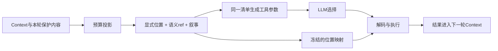
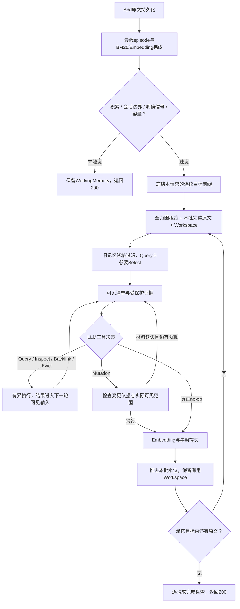

# P0/P1 证据链与 Reflection 改进执行计划

日期：2026-10-23。基线：`afe8c8d`，AM-Link 0.2.1。

状态：**五个工作包已接入，126项本地回归通过；8次真实调试运行完成，整体方法质量未验收。** 实施、真实失败与修正见[10月23日实施核对](../doing/2026-10-23-evidence-loop-implementation.md)。尚未满足扩大20/100题门槛；本文保留完整目标与验收条件，不以工具存在替代方法验收。

**提交后复核（`0e6f035`）：**[最新审计](../doing/2026-10-23-reflection-convergence-audit.md)发现隐藏页重读、统一可见范围、Reflection材料保留及触发分级仍有缺口，P0-B/P1-B/P1-C重新打开。真实运行未触发Select/查询扩展；关系提出与过滤也未构成有效图。按[闭环执行方案](reflection-convergence-plan.md)补齐后再进入扩大验证；126项通过不覆盖这些新反例。

## 1. 范围、目标与最少的协议变化

沿用 MemoryItem、MemoryRelation、References、MemoryContext、MemoryWorking、Query、Select、Inspect、Backlink、Reflection。本文的“可见清单”“片段”“证据组”“展示记录”都是这些对象的调用/输出组织方式，不是新增长期记忆类型，不增加一套事实库。

| 工作包 | 目标 | 主要改动 |
| --- | --- | --- |
| P0-A 引用一致性 | 模型选择与程序执行严格一致 | 本次可见清单统一编号、工具枚举和解码 |
| P0-B 证据披露 | 同源多处证据可读，所有裁剪可定位 | 统一范围投影、Inspect续页、工具结果展示保护 |
| P1-A 最终证据组合 | 图发现的有效补充不被原候选队列挤掉 | 有界证据组、两遍装箱、受限LLM离线对照 |
| P1-B Reflection依据 | 先读取相关旧材料，门槛与预算相容 | 旧记忆范围、实际展示记录、按变更检查、探索预算 |
| P1-C 缓冲整理 | 跨Add积累，按会话/容量合理收束 | 明确触发目标、连续前缀、跨批概览、Workspace回收 |

保留以下边界：

- Add最低episode、BM25/Embedding和逐请求成功检查先完成；触发Reflection的请求还须完成已承诺目标水位。未触发可以保留WorkingMemory并返回200。
- 标准Search每次独立语境，只检索已提交MemoryItem；不读取WorkingMemory、不执行Reflection、不生成答案。
- 向量、LLM Select默认开启；Select同时筛选和排序，不新增rerank阶段。
- 不增加内部模型重试、后台补偿、故障降级、自动整库重建。校验反馈后的有界新决策是工具loop的一部分，不得重发同一失败模型请求。
- 确定性装箱为默认；LLM装箱只做离线对照。完整并发追加协调器、类型倾向Query属于P2，本轮不混入。
- 普通实验可以先Add后Search，但正确性不依赖最后一次Add触发整理，也不依赖赛道永远没有增量Search。

建议收敛为三个内部变化：Inspect增加可选续页选择；Search的一张证据卡可以包含一条已探索路径上的多个Item；Reflection为新人物提供可关联到该新ref的定向查询记录。它们改变内部工具/呈现协议，不改变公开Add/Search字段。以下给出推荐实现，实施记录必须明确这些变化何时落地。

## 2. 共同基础：只保存有消费者的信息

### 2.1 本次可见引用清单

模型输入中的引用使用数组，包含显式 `position`、语义 `ref`、`kind`、可读叙事和本次允许的读取动作。现有Reference的来源、命中片段和关系继续保留。位置仅在当前模型调用内有效，不能持久化为记忆身份。

内部保存该数组的不可变映射与调用ID；调用ID用于观测和解码，不必增加模型必须填写的字段。工具选择位置时查这份映射，不再遍历原Context字典。

### 2.2 内容范围

新增一个内部不可变片段表示，最小事实为：

```text
origin_ref       raw:... 或 memory:...
content_digest   对对应正文计算的摘要
start, end       原正文的半开字符区间 [start, end)
text             必须等于原正文[start:end]
```

`fragment_id` 由上述身份与范围确定性计算，用于观测、实验装箱和来源追踪。它不是新的MemoryItem引用。来源角色、时间、会话在来源描述中维护；命中分支和说明在Reference中维护，不在每个对象重复复制。

原文范围以Python Unicode字符索引为准，保留原始换行，不按UTF-8字节或JavaScript UTF-16位置解释。网页使用服务端给出的片段正文；若客户端定位，使用相同码点规则。正则匹配在原字符串上取位置，不能直接将 `casefold()` 后可能变长的坐标用于原文。

来源标题、日期、角色、解释及省略号与原文片段分开渲染，不能先拼接再反推坐标。派生Item正文只能标为Item内容，不能伪称为某条原文的逐字摘录。关系保留端点及 `source_refs`，也不编造“边的原文”。

### 2.3 展示记录

每次真正发出的模型请求记录：调用用途、可见清单、实际正文范围、哪些Item版本可见、哪些片段被省略及原因。记录从最后一次序列化投影生成，不从候选数据库或工具执行次数推断。

区分三个事件：工具读到了内容；请求体包含了内容；模型调用成功返回。只有成功返回的主决策调用才算完成该轮展示保护。它仍不表示模型理解正确。Select自己的输入记录不能替代后续BFS/Reflection的展示记录。

模型不需要填写这份账本。观测沿用标准span及artifact，不请求内部思维链，不强制gold evidence。

## 3. P0-A：可见清单与工具选择一致

### 调用流程

1. 刷新当前user下合法、未遗忘的引用及内容版本。
2. 依据整体模型输入预算，保留本轮必须展示的工具结果和工作原文，再选择其它Context内容。
3. 在最终可见集合上生成有序数组、显式位置和允许动作；没有正文但有完整导航叙事的Reference仍可Inspect。
4. 用这一份清单生成工具定义并完成整包预算校验。若再次缩减投影，重新生成清单和工具；冻结后才调用模型。
5. 对模型结果进行结构与位置校验，按冻结清单解析ref；执行前再检查其user、状态及内容版本。
6. 保存选择位置、解析ref、实际执行ref及结果。新内容只影响下一次调用的清单。



Search的Inspect/Backlink、Reflection的Inspect/Backlink/Evict及Select统一使用这条工程规则，各自仍保留不同的模型语境。停止动作没有引用参数；不得为零候选生成空的必填integer enum。API严格工具模式下，可选参数须明确可为null，而不是只在Pydantic中省略required。

非法位置、跨user、遗忘对象和失效页面均显式错误，不猜测相近ref，不取模，不把模型拒绝或异常解释为空结果。Select的合法空子集继续正常；合法重复位置可保序去重并记录。新协议不再静默丢弃夹杂其中的非法位置。现有测试替身要走相同的位置协议，不能长期依赖生产模型没有的直接ref捷径。

**代码位置：**`engine.py` 的 `_model_context/_next_bfs_action/_run_reflection/_select_refs`；小型纯函数放入拟新增 `amlink/projection.py`，共享投影与位置协议。`schemas.py/providers.py`只调整实际工具字段和序列化契约，不改公开HTTP接口。

**必须通过：**裁剪 `[A,B,C]→[C]` 后0只能执行C；字典插入顺序与JSON排序不同仍正确；空列表；连续两轮清单变更；重复/非法位置；Evict与Backlink同样一致；冻结后的清单不能被原Context修改。

## 4. P0-B：多窗口与渐进披露

### 4.1 同一来源允许多个范围

在现有候选Item所引用的来源范围内，对原问题及查询分支定位命中。按句子/相邻上下文生成窗口，优先保留完整的数量、否定、条件和时间表达；过长句子只能显式截断。不同分支先各争取一个窗口，再补充新增信息，合并重叠范围，不能按 `source_ref` 提前去掉第二个命中。

保留预览的有界片段数和字符预算，但应记录未展示的范围与分支。最终装箱不继承预览最多4片段的限制。没有可定位词法命中的向量候选仍有Item叙事或常规页面，标为预览，不能伪称精确原文语义命中。

投影器返回结构化片段；Reference、Select、Context和最终装箱直接复用或缩小这些范围。缩小时重新记录实际区间；如果后来改用另一窗口，应保留变更原因，不能把之前的覆盖记录照搬。

### 4.2 Inspect续页：仍是读取一个已知ref

推荐内部签名为 `Inspect(reference_position, page_position=null)`：

- null读取该Item的默认问题相关页面，包括正文片段、来源片段及正向引用。
- 返回“还有哪些内容可读”的少量页面选项，每项有当前位置、所属语义ref、内容类型、范围/来源说明；模型不填写原文offset。
- 续页参数从本次可见清单中的页面选项枚举。内部页面计划绑定user、Item、正文/来源版本和范围；不能接受来自其它ref或旧版本的位置。
- 先提供其它查询命中范围及下一个未读页面，不能一次列出整个长文档目录挤占正文。连续翻页可以覆盖其余内容，仍受全局步数和字符预算限制。
- 同一ref的后续页不增加图跳数/节点数，但消耗一次工具步。去重从 `(ref, inspect)` 改成内容版本与已展示范围；有新范围可以继续，完全重复且无新内容的动作明确终结/报错，不能空转。
- Backlink仍查询真实入边，不把续页混成新的关系。只有沿边到新节点才计算图深度。

原文不是新的Query通道：所有读取都由合法MemoryItem及其来源关系到达，标准Search仍不直接搜索WorkingMemory。

### 4.3 工具结果必须实际回放

Inspect返回的页面先加入“下次主决策必须展示”的保护集合。下一次BFS/Reflection请求必须完整带入该已返回页面，不能再默默截成另一段。页面大小在执行读取前根据工作原文、工具定义和剩余预算决定；放不下时缩小本次实际返回页并如实记录，而不是先返回大页再谎称已展示。

该主决策成功返回后可按容量折叠页面，但保留可读Reference与已展示范围。Select、Embedding等辅助调用不解除保护。主决策调用失败则不把保护记为已完成，也不内部重试。Reflection进入最终Mutation调用时，还须满足P1-B对变更依据的保护要求。

Search和Reflection都须预留一次读取结果之后的主决策机会：最后一轮只提供合法终结动作，不再发起一个没有后续回放机会的新Inspect/Backlink。Search在该轮可停止并装箱，Reflection只能合法Mutation/no-op或明确未完成。总期限若在回放前耗尽，记录“已读取、未成功展示”并显式失败，不能把未发生的模型阅读补记为成功。

“已经展示”不意味着后续无条件拒绝重读：同一页面曾展示但现已被Evict/折叠、或正文版本已经改变时，可以重新加载；内容已在当前投影中且没有新范围的重复读取才属于无进展。否则会出现门槛要求重新呈现旧正文、Inspect却永久禁止重读的死锁。

### 4.4 容量和可见性的两个量

`shown_ranges` 表示原文可见区间并集，`complete` 仅当覆盖全文时成立；模型整包字符数则包含JSON、工具定义和说明。不能用“渲染后文字长度/原文长度”计算来源覆盖，也不能将工具返回的大范围当作实际模型输入范围。

**代码位置：**`evidence.py`负责范围选择与合并；`projection.py`负责投影和展示记录；`engine.py`负责页计划、图深度/操作去重和保护；`schemas.py`增加内部续页字段。不修改原文，不重嵌入既有节点来修复展示问题。

**必须通过：**同一长消息首尾两证据；中文/emoji/大小写长度变化/CRLF；重叠窗口；页内二次裁剪；派生正文与原文区分；翻页不增加hop；内容版本变化；遗忘失效；新读页面确实进入下一次主决策；受预算省略不能记为已展示。

## 5. P1-A：确定性证据组合与装箱

### 5.1 组合什么

默认不追加一次LLM Select。将Query有序候选、图发现候选、实际探索路径、来源片段和状态关系交给确定性组合器。必须把路径来源从 `_search/_explore` 传给装箱器，不能再只传平面的rows。

“证据组”只是最终卡片的组织单位：例如人物A、事件C和地点D的已探索路径，或冲突两侧A/B及支持原句。它不存入数据库、不新增推理事实，也不表示系统已经证明答案。

一张证据卡可包含多个Item的小节，保留每个语义ref、角色/时间、来源和关系。卡片 `id` 使用该组首个候选的现有ref；被归入该卡的节点通常不再作为重复独立卡。`score`继续表示输出次序，不冒充相似度。公开字段不变，但“卡片不再严格等于一个节点”的呈现变化必须写入协议和实验元数据。

### 5.2 第一版确定性规则

1. **顺序基础：**保留上游Select后Query候选的相对顺序。图补充归入其最早的可追溯Query候选所在组，不能一律追加到全部Query候选之后；未归组的图节点仍保留独立候选资格。
2. **优先补充：**已被模型进一步Inspect的节点、Backlink Select保留的补充、对尚未展示查询分支提供新范围的节点。仅“存在一条边”不自动代表它必须进入最终内容。
3. **路径闭合：**选择某补充时，保留本次实际路径上必要的连接节点、关系说明和关系 `source_refs`；只使用本次已知的有界候选与路径，不在装箱中隐式遍历整个图。无法取得连接依据时记为部分支持，不虚构连接。
4. **更新与冲突：**本次路径包含 `contradicts/supersedes` 时，成组保留两侧原句及状态/时间。不能先按superseded过滤掉旧侧再声称更新证据完整；未进入相关路径的所有历史节点不强制加入。
5. **有界选择：**每轮只加入一个有新增支持的最短路径包；相同支持不重复加入。组内优先明确更新/冲突的必要配对，其次已读补充、命中未覆盖分支的补充，再以深度、上游顺序、ref稳定打破平局。每组最多消耗 `result_chars`，不追求越多越好。
6. **不凭组伪造闭合：**选择和排序使用的是操作/覆盖信号，不是一个已证明正确的语义裁判。无词面命中但有效的未读关系仍可能漏掉，应在对照中记录，不能宣称确定性策略解决全部多跳。

对已复现的A/B/C例：A与C构成一张可独立阅读的证据卡，包含指南与地点的原句；B在后续预算允许时独立返回。这样无需用旧检索分数重新压过Select，也不会让C永远排在B后。

### 5.3 两遍装箱，避免最后一次截断破坏组合

第一遍选组及每组的最小可读支持：实体/事件叙事、关键来源窗口、必要关系依据。先为能完整容纳的组预留空间，再把剩余预算用于扩展正文。代价用实际渲染长度计算，覆盖标签与日期也计入；总输出继续受 `context_chars`，单卡受 `result_chars`，卡数受 `top_k`。

第二遍确定最终顺序后才做跨卡去重。复用只能指向最终存在、排在前面且确实展示了同版本同范围内容的卡，不能指向后来被预算裁掉的候选。一个来源的不同范围不能因为source_ref相同而整体去重。

不能容纳完整支持的组可跳过或输出明确partial的证据，但不能用无说明的中间截断破坏数量、条件或冲突配对。每个丢弃组/来源记录具体原因；不给下游只有孤立编码的空卡。

分开报告：来源展示完整性、所选路径支持是否齐全、以及可选标注/人工评价的问题证据完整性。只有前两项可以由现有结构做有限机械检查，不能将它们合称“答案正确”。

### 5.4 受限LLM装箱对照

在忽略目录的独立实验产物中冻结同一次Search的候选、片段和路径；确定性装箱与LLM装箱使用完全相同的候选与预算。模型通过API tool返回现成片段/组位置及顺序，不返回新正文、答案或新的来源。

程序检查位置、范围、user、状态、组依赖和预算，确定性展开。无效模型输出在实验中记为失败，不静默回退并计为模型成功。初期每个Search只有一次装箱模型调用，不增加修复重试；合法但不完整的选择单独记partial。

卡片分组会改变@k的统计单位，因此对照必须同时报告固定输出字符预算下的证据覆盖/完整链、卡片数、实际来源数和答案诊断；不能只利用一张卡容纳更多节点而宣布@1全面提升。旧指标保留，标注 `packing_unit`，不重算覆盖历史报告。

既有靶场有字面片段和结果ID两种匹配方式。字面片段仍必须真正出现在卡片正文；不能把source_ref出现在标题当成正文覆盖。只有ID标注的题不能在分组后偷偷沿用“一个节点一个结果”的假设，应单列兼容结果或用观测中的成员映射提供明确的新指标，保留原指标定义。

**代码位置：**拟新增 `amlink/packing.py`，`engine._search/_assemble`传入路径与片段；靶场新增独立装箱对照入口。正式Search不调用新装箱模型。

**必须通过：**A/C替代A/B断链；三跳连接；同名人物不串来源；冲突/更新成对；共享来源不同窗口；组过大；top_k=1/2/5；跨卡复用无悬空指向；循环关系终结；无原文支持的边不能装成完整证据。

## 6. P1-B：Reflection先读相关材料，再提交

### 6.1 旧记忆候选的时间范围

每个整理批次冻结起始水位。其当前WorkingMemory和后续未处理消息的最低episode不能充当“已检查旧身份”的证据，否则orientation可能主要找回刚写入的自己。

旧记忆资格按来源序号定义：只把批次起点之前已存在的有效节点及来源用于旧记忆探索证明。当前最低episode仍然可被普通Search检索，Reflection也可把它当本批来源视图，但不能伪装成跨批旧依据。来源跨越边界的混合节点只提供明确属于旧侧的证据；不能证明旧身份的部分不计门槛。

资格筛选要发生在词法/向量各通道取前N之前，不能先被当前episode挤掉候选再事后过滤。本轮只添加Reflection来源范围约束，不引入按kind分通道的P2设计。

### 6.2 检查材料，而非只检查操作名称

| 变更 | 确定性必要材料 | 模型/研究仍负责 |
| --- | --- | --- |
| 纯新事实/事件 | 本批可见原文范围、合法来源 | 是否值得长期保存、是否遗漏条件 |
| 更新已有person/entity等正文 | 当前Mutation调用能看到待替换的旧正文、相关新来源 | 身份一致与归纳准确性 |
| 更新fact/event | 旧事实与新事实原句及来源；仍走另建事实与关系，不覆盖旧事实正文 | 是否明确替代，还是仅矛盾 |
| 处理冲突 | 两侧可见证据及适用条件/时间 | 是否可消解，不能确定则保留冲突 |
| 复用人物/实体身份 | 对目标的Inspect正文与相关来源；必要时Backlink上下文 | 同名是否同一人、别名与关系归属 |
| 新人物 | 针对该新身份的查询记录；有旧候选则检查相关候选，没有则明确记录空结果 | 查询表达是否充分、“未找到”不等于绝对不存在 |
| 新关系 | 已有端点的实际正文；新端点的本批原文；支持关系的来源片段 | 关系语义、方向与人物归属 |

Backlink负责发现相关引用，不能单凭 `Backlink(A)` 的调用记录就证明读到了A正文。旧目标更新须有针对该目标同版本的Inspect记录，且Mutation调用中可验证其完整旧正文；orientation自动加载不替代这个门槛。同版本的既往Inspect可复用，但旧材料被折叠后仍须在提交前重新呈现，内容版本变化后必须重新检查。

节点全文替换要求看到完整待替换旧正文，不能用只读一段的权限覆盖全文。其正文最多6000字符；若多个目标和工作原文无法同时放进最终请求，应缩小待整理批次或显式失败，不能放宽为“曾经读过，所以可以覆盖”。fact/event保留现有不可覆盖约束。

已存在旧来源可以由系统继续继承；这不等于新生成内容得到那些未展示来源的支持。新声明的source_refs必须来自本次可见原文范围，旧来源继承在账本单列。

人物归属还须区分：`user_id`是记忆空间，`role`是消息角色，两者都不自动等于原文中的人物。来源明确的Speaker标签、姓名、称谓与指代线索一起进入模型可见材料；“别人的女儿/偏好”不能自动写成该空间主人的事实。同名仅是查找线索，身份不清时保留可读的区分与不确定性，不强行合并。程序验证出处，人物对应是否合理由真实切片复核。

时间材料同时保留原句、来源日期与顺序；来源时间不自动转换为事件日期。相对时间缺少锚点时保留原表达和缺项，不在本轮增加答案推理器来猜出日期。

### 6.3 新身份的定向查询记录，避免无关探索过关

在现有内部 `reflection_search` 工具增加可空 `for_new_ref`，只用于模型拟创建的 `new:...` 占位引用，与Mutation使用同一个占位名称。调用语义仍是Query/Select，不冒充完整标准Search；文档和展示标为“Reflection Query”。工具结果由系统记录该目标、问题、实际候选及后续读取范围。

对新person的Mutation，门槛检查是否存在对应目标的定向查询；候选非空时，至少有该查询结果中的相关旧候选被Inspect并在Mutation语境中可见；结果为空时允许 `no_prior_match=true`，不强迫模型Inspect一个无关节点凑次数。初期不再增加一套每节点LLM评审器。

目标绑定只能保证流程指向这个身份，不能自动证明模型问的问题足够好。提示词要求查询包含来源中的姓名/身份线索；观测展示该问题与依据，真实切片复核其相关性。不能将最小episode或无关操作冒充目标查找证明。

全新关系的两端若都来自当前WorkingMemory，且没有旧身份复用，则以本批可见原文与定向身份查询（涉及新person时）为依据，不要求凭空读取一个不存在的旧端点。混合Mutation按每项风险检查，不能用根 `basis=new_information` 绕过其它项的风险。

### 6.4 门槛与轮数一起调整

推荐保留一次Inspect一个ref，先不引入批量工具。实验配置将 `reflection_steps` 从8调为16，仍受1740秒总期限、单次模型剩余期限及provider总预算约束。增加的是有边界的实际探索动作，不是错误重试。

每轮给模型展示剩余轮数；至少保留一次最终Mutation/no-op决策机会。第一次门槛反馈列出明确缺项（哪个旧目标未展示、哪个来源不在当前输入、哪个新身份未查询），不只返回同一个笼统错误码。相同未补材料的提案不得循环提交；缺项最低读取数已超过剩余轮数时明确预算不足。

被拒绝的Mutation尚未提交，不能自动转为no-op推进水位。第一版不在一次批次里提交部分Mutation再猜测哪些原文已完成；仍坚持完整批次事务提交或真正no-op。若错误提案无法在本轮形成合法终结，则失败保留WorkingMemory，由调用方按原约定重放。

不在模型已经处理一个批次后自动重切原文并再调用一次相同整理。可确定的保护内容/输入容量超限，沿用413一类非重试容量错误并记录所需/可用预算；依赖超时或总期限耗尽沿用既有暂时错误。若需要更小批次，作为明确的后续配置实验，在原水位未前进的条件下重新规划；不能让已知不可容纳的输入反复消耗模型调用。

16轮不是无条件成功保证，也不是必须跑满。平均调用数、门槛拒绝次数、无效读取和实际新增关系质量都要报告；若仅成本上升且无有效探索，应回到读取/提示设计，不能继续无限加轮数。

**代码位置：**`reflection.py`拆出逐项材料检查；`engine.py`产生本批旧资格、目标查询记录和实际展示记录；`store.py`支持资格过滤；`schemas.py`增加可空内部工具字段；`config.py`明确实验轮数配置。新记录不增加MemoryItem持久字段。

**必须通过：**读无关B不能更新A；只Backlink A不等于读A；当前episode不能伪装旧身份；第一位全新人物在无旧候选时可创建；查询失败不等于无匹配；旧人物同名异人；新旧混合端点；8个小旧目标可在预算内读完再提交；超预算/无效提案不推进水位；遗忘来源不能重回语境。

## 7. P1-C：缓冲、会话前缀与Workspace

### 7.1 不把每个Add都送去Reflection

现有阈值是消息数，不是Add次数。正式/研究分块常包含多条消息，所以只删除now/never仍可能每个Add都触发。推荐初始实验策略：

- 普通积累触发：保留当前8条/6000字符的可配置门槛，但同时要求待处理范围至少来自 **2个不同Add请求**。成功幂等重放不增加次数。
- 容量硬上限：即使只有一个大Add，达到 `2 × batch_messages` 或 `2 × batch_chars`（当前64条/36000序列化字符）也应启动有界整理，不能无条件等第二次Add。
- 会话边界：出现新的连续session段时，优先终结前一段的未处理前缀；不按日历时间模拟TinySoul的一天。
- 明确更新/遗忘：来源中有明确纠正/替换或遗忘请求时可提前触发。只以用户角色、命令/纠正句式和具体对象构造保守候选信号；裸 `now/never/actually` 和普通“忘记带伞”叙事不能独立触发。硬信号只是安排整理，绝不是删除或更新授权。

数值是首轮对照配置，不宣称最优。保留旧配置作基线；如果当前请求自身非常大，容量边界优先保证有界完成。是否因误触发减少而改善图质量，需用相同历史对照，而非只统计调用变少。

### 7.2 冻结当前请求的连续处理目标

会话切换例：

```text
session A: Add1、Add2、Add3        → 可形成较完整语境
session B: Add4第一条             → 最低episode立即建索引
                                  → Reflection先消费A的未处理前缀
                                  → B的WorkingMemory继续积累
Add4返回200：自己的最低episode完成，所承诺的A前缀也已终结
```

目标选择规则：

1. 已持久化 `reflection_watermark` 的失败重放，继续原目标，不能因为后来Add到来而无限扩大目标，也不能缩小。
2. 新触发请求在自身接收末序号处取稳定快照。若只有会话边界，目标是该快照中前一个连续session段的结束序号；重复出现相同session_id也按连续段处理。
3. 若同时有当前范围的明确更新/遗忘、普通积累或容量压力，目标提升到需要处理的当前连续前缀。不能跳过中间原文，只处理最后一句指令。
4. 触发目标先持久化再开始loop；一旦承诺便只增不减。内部批次不得越过该目标，且优先在会话边界结束，再按完整消息数/字符切分。
5. 失败发生在目标确定之前时，按原请求末序号重建判断范围；不能用后来的 `last_session` 误判原请求语境。
6. `settled_through`仅在批次Mutation/no-op事务成功时推进；失败保留已提交前缀。消息因合法遗忘已被阻断时，明确记录其已处理状态，不能跨越仍有效但未处理的消息。

这可使用现有requests水位和原文ordinal实现，不要求先做并发协调器。当前锁内同步处理保留；本轮不改成后台消费。



图中的no-op是无新增结构时的事务终结，不调用无必要的Embedding。任何依赖、容量或校验未能合法终结的情况均显式失败，不能沿成功箭头推进水位。

### 7.3 积累之后还要给模型看见全貌

触发时提供整个冻结范围的有界概览：连续会话段、请求范围、消息数量、角色/日期、各段可读的原文片段与对应最低episode引用；再提供本批完整WorkingMemory及保留Workspace。概览来自现有原文/episode投影，不调用额外摘要模型，不使用题目答案。

批次仍受32条/18000字符约束；前批的节点和关键来源范围保留至后批，使后批可继续关联。概览不等于全文已读，应显示省略范围。后续未处理批次只能提供规划线索；当前Mutation不能引用尚未轮到的WorkingMemory作为已完成来源。工具source枚举与校验区分“可读概览”与“本批可提交依据”。已处理旧来源可以继续引用。

因此本轮改善的是“先积累、看概览、连续整理”，不是声称任何长会话全文都能同时进入一个模型请求。无限长WorkingMemory不常驻Context；原文与水位才是恢复依据。

### 7.4 no-op与保留缓冲

未达到触发条件时保留WorkingMemory，不调用Reflection，这是跨Add等待材料的主要机制。触发后 `reflection_stop` 仍只表示“当前完整批次没有额外语义Mutation需要”，不能解释为“我没读完/没轮数了”。有未解决的门槛失败或强制处理目标时不能因工具耗尽自动stop成功。

本轮不新增跨Add悬挂的Mutation草稿、半提交原文标记或开放式Agent调度器。若后续需要“维护多批后才统一Mutation”，应另行设计消费语义，而不是把stop改成两种含义。

### 7.5 Workspace是有界活跃语境

WorkingMemory原文保留在数据库，Workspace保留可重建的活跃引用、已加载片段、必要关系与展示记录。建议活跃序列化内容上限为 `2 × context_chars`，引用和加载节点分别受现有候选/节点预算约束，避免越来越多不可见内容跨批堆积。

保护集合：尚未回放的工具页面、本轮必要旧目标与相关来源、未终结的变更依据。其它内容按最近实际使用/展示顺序回收；优先折叠正文为带叙事的ref，再逐出低使用引用。模型Evict也只操作非保护活跃内容，底层节点、边和原文不删除。全是保护内容仍超限时显式预算失败，不能偷偷丢证据。

每次恢复/刷新按数据库检查有效状态和正文版本。遗忘/已删对象立即清除相关片段、续页与展示凭据；不能因Workspace持有旧副本重新泄露内容。内容变化使旧读范围不能继续作为新版本的变更依据。

**代码位置：**`engine._add/_run_reflection/_refresh_context/_commit_reflection`、`text.py`的触发规则、`store.py`水位查询与Workspace保存；增加纯函数规划模块 `amlink/reflection_policy.py`，不新建调度服务。

**必须通过：**多消息单Add仍可积累；两个以上Add达到阈值再整理；单大Add容量触发；普通now/never无硬触发；显式更新/遗忘按顺序处理；A→B→A连续段；切换后B首条保留且可Search；失败重放原目标不漂移；跨批来源不丢；Evict不消费WorkingMemory；遗忘与正文变化失效；保护内容超限显式失败。

## 8. 可观测与可视化随每一步实施

沿用 `benchmark/OBSERVABILITY.md` 的operation、parent关系和模型调用记录；新增数据放在有版本的内部artifact中，不为每个字段扩张公共事件顶层。

| 展示面板 | 必须展示 | 不得推断 |
| --- | --- | --- |
| 引用选择 | 本次可见清单、模型位置、执行ref、允许动作 | 候选存在就代表模型看见 |
| 证据披露 | 来源全文长度、当前窗口、后续页、各阶段实际范围 | Inspect执行就代表全文已读 |
| Reflection依据 | 本批/旧记忆范围、定向查询、可见旧目标与来源、门槛缺项 | no_prior_match已经证明绝无旧身份 |
| 装箱 | 候选→证据组→实际卡片、共享来源、丢弃原因 | complete代表答案正确 |
| 缓冲 | 接收/处理水位、触发原因、目标范围、批次和保留尾部 | Add200代表WorkingMemory为空 |

一条来源能跨Select、BFS/Inspect、Reflection及最终卡片对照范围；网页再次裁剪时必须标注“展示预览”，保留完整artifact入口。旧轨迹缺少新字段时显示未知，不补造历史读范围。网页与会话片段继续同源生成，案例catalog不复制。

实现位置为 `visualization/spans.py`、`view.template.html` 和对应测试；仅在支持内容格式验证、大小限制与SHA校验后展示新的专门面板。HTTP默认不开内部观测的边界保持不变。

## 9. 实施批次、交付物和回归

| 顺序 | 实施包 | 依赖 | 完成条件 | 建议提交标题 |
| --- | --- | --- | --- | --- |
| 0 | 冻结基线与反例 | 无 | 保留afe8c8d；把引用错位/同源双命中/图装箱反例变成当前方法回归；真实实验使用独立库 | `test(memory): 固化引用与证据丢失反例` |
| 1 | P0-A | 0 | 生产工具与替身走同一可见位置映射；空/失效场景通过 | `fix(memory): 统一模型可见引用与工具解码` |
| 2 | P0-B | 1 | 范围投影、续页和下次决策展示保护通过；可视化能复核原句 | `feat(memory): 支持可追溯多窗口与渐进读取` |
| 3 | P1-A | 2 | 分组/两遍装箱及来源复用通过；默认路径无新增LLM调用 | `fix(search): 按探索路径组合完整证据` |
| 4 | P1-B | 1、2 | 旧候选资格、逐项材料检查、定向查询与预算通过 | `fix(reflection): 校验相关可见依据并协调探索预算` |
| 5 | P1-C | 2、4 | 稳定前缀、跨Add触发、Workspace回收与重放通过 | `feat(reflection): 按积累与会话前缀整理记忆` |
| 6 | 联合观察与真实切片 | 3、4、5 | 按下节逐级验证，修订DESIGN和案例结论；无依据的质量声明不进入完成报告 | `docs(research): 记录证据链修复对照与限制` |

测试按行为组织，避免为一行实现写镜像测试。新增测试文件建议为 `test_projection.py`、`test_disclosure.py`、`test_packing.py`、`test_reflection_evidence.py`、`test_reflection_policy.py`，复用现有真实Store/确定性provider设施。关键断言包括实际序列化的模型输入，不只检查内存Context。

步骤0先在工作区证明相关反例为失败，再与对应修复一起达到全绿；不把故意失败的测试单独作为可交付检查点。表中提交标题仅供分组，不要求拆成不能通过检查的提交。

所有实施包运行当前适用测试与根目录联合回归；临时库继续使用忽略目录。只有必要新增的低层模块参与重构，避免顺便重写engine全部结构。源码、DESIGN、协议、主计划、观测和测试在对应包同步更新。未经用户要求不自动提交或推送。

## 10. 实验设计与通过门槛

### 10.1 分层比较，避免一次改完无法归因

- **引用/展示确定性验证：**模型脚本必须从真实序列化输入选择位置或页；断言实际执行对象、范围及后续输入。不得用直接ref回传绕过本轮修复目标。
- **固定图Search对照：**同一只读结构图，先比较P0前后，再比较旧装箱/确定性分组/受限LLM装箱。候选输入与输出字符预算冻结，单列各阶段成本。
- **同历史Add对照：**独立新数据库、相同Add切分与模型，比较旧触发与新触发；Search逻辑固定，观察节点/边来源归属、有效关联、跨批复用与完整链。
- **联合端到端：**先修复代码的小切片，再20题均衡问题，再100题及跨数据集扩展。明确哪些是锚点人工选片，哪些是完整历史；不能互相代替。

优先沿用catalog：L04多来源集合、L01人物/跨会话、L02与LM01/LM02时间、B01更新、B02冲突、P01关系、PV01他人信息、PV04遗忘。锚点只作定位，接着加邻居和完整记录验证干扰；答案/gold只在后验评估侧使用。

### 10.2 必须达成的工程验收

1. 所有指定反例及隔离、幂等、失败重放、原文保真、无内部重试等既有回归通过。
2. 每次工具定位可由同一可见清单重放；范围文字与原文一致；不使用失效或被遗忘来源。
3. 新读页面实际回放；存在真实 `Inspect→新ref→Inspect` 和 `Backlink→Select→Inspect` 轨迹；如未出现不能宣布方法验收完成。
4. Reflection合法复杂变更有可完成的预算路径；非法/未完成情况不推进水位，不以空Mutation掩盖。
5. A/C、同源首尾、更新/冲突两侧等控制案例在足够预算下保留支持，在不足预算下准确记录partial。
6. Add尾部未整理仍能通过最低episode检索；标准Search不消费WorkingMemory。

### 10.3 方法效果的判定

20题用于发现与解释失误，不作为显著性或全量准确率结论。报告Add/Search成功与失败、证据召回、完整链、固定字符预算覆盖、来源/主体/关系人工复核、诊断Answer、调用量、输入输出token/字符、延迟与已知费用。

进入100题前应完成全部工程门槛，困难切片没有未解释的新断链；若质量退步，先归因到可见性/选择/组合/写入，而非立即增大窗口或阈值。100题按相同来源成功范围做成对比较，同时保留全体运行失败统计，不能通过排除困难失败题制造提升。

冻结代码commit与脏差异摘要、配置、数据pack/切片指纹、工具/prompt版本、原始调用及模型身份。`benchmark study`须显式传真实 `--system-version`（当前默认native版本仍可能是旧值）；登记结果和网页标题不可仅凭0.2.1名称判断代码相同。

本轮不需要真实API。实施后的联网探测沿用已授权模型与调用方法；依赖失败单列，不反复大规模重跑去测试连通性。小切片成功后按既有授权扩大，不因HTTP200就宣称增强有效。

## 11. 存储兼容、风险与停止条件

### 兼容范围

公开Add/Search字段、RawEvent、MemoryItem、MemoryRelation、词法/向量索引不因P0展示修复而迁移或重建。新增片段和位置是运行/观测数据。Workspace JSON若变更，增加内部格式版本：从旧格式读取有效refs并重新加载/投影，旧“已展示”状态一律视为未知，不伪造新凭据；不得修改accepted/settled水位或删除原文。

迁移先在数据库副本验证，包括跨批继续、失败请求重放、删除节点清理和未知版本拒绝。内容/工具格式不兼容时显式报错，不悄悄清空整个Workspace。研究使用新库，历史运行库只读保留。

### 可行性复核

| 问题 | 推演结论与约束 |
| --- | --- |
| 是否只是加更多字段/模型？ | 长期记忆结构不扩张；必要新信息集中在投影与观测。P0与默认装箱无新增LLM阶段；定向查询和续页有调用成本，须单独统计 |
| 是否仍可能展示后执行错ref？ | 映射冻结到本次调用，且实际序列化输入进入回归；调用后状态变化检查，不能按另一清单解释 |
| 续页会不会变成无限Agent？ | 页不增加hop但计步数；禁止无新内容重复；全部遵守同一个总期限，无后台继续 |
| 图证据成组会不会把噪声带入？ | 仅本次路径和有贡献的补充，单组/总量有界；仍有语义误判可能，必须与固定图和LLM对照 |
| 门槛会不会使第一条人物记忆永远失败？ | 定向查询无旧候选允许建立新身份；不要求无意义旧Inspect，但查询失败不能冒充空结果 |
| 8个旧目标怎么办？ | 单ref工具不变，16轮实验预算可容纳8次短读取及提交；字符和总期限仍需满足，超限不强行成功 |
| 多个长旧节点装不下怎么办？ | 不允许用部分阅读覆盖全文；缩小批次/操作范围或明确失败。本轮不新增半提交Mutation机制 |
| 会话切换后新消息留缓冲是否违约？ | 最低episode与索引已完成；Add还等待承诺的旧前缀，Search独立读取已提交结构 |
| 失败重放是否会追着新Add无限工作？ | 原请求末序号和已承诺目标冻结；不随最新accepted水位盲目扩大 |
| 删除/遗忘后旧缓存能否回流？ | 每次使用检查底层有效状态与版本；页、来源、引用和展示凭据一起失效 |
| 是否改变实验统计单位？ | 分组卡会改变@k含义；必须记录packing_unit并报告固定字符预算指标，保留旧报告 |
| 能否证明全部问题答对？ | 不能；程序保证材料与执行一致，语义充分性必须用真实切片与人工复核检验 |

**检查结论：**五个工作包可按依赖逐步落地，不需要先实现P2协调器或新数据库架构。最明确、可先实施的是P0-A；其余推荐参数和卡片分组语义已给出具体选择与对照方式。方案的主要剩余不确定性是模型如何选择相关片段、确定性组合的噪声代价、Reflection身份判断与缓冲阈值效果，不应包装成设计阶段已解决。

任一包若破坏原文、隔离、水位、幂等或错误边界，停止扩大实验并修复该包；真实质量结果不理想时保留失败轨迹，不能覆盖基线。完成报告逐项标记“实现/确定性验证/真实验证”，不以所有工具都存在作为验收标准。

## 12. 参考与维护

- [当前核查与复现](../doing/2026-10-23-design-status-audit.md)、[根设计总览](../../DESIGN.md)、[主执行计划](./method-improvement-plan.md)。
- [AM-Link engine](../../amlink/engine.py)、[证据投影](../../amlink/evidence.py)、[Reflection校验](../../amlink/reflection.py)、[存储与水位](../../amlink/store.py)。
- TinySoul本地参考：[DisclosureSlice/范围](../../reference/TinySoul-Agent/tinysoul/kernel/retrieval/disclosure.py)、[Memory.inspect/续页](../../reference/TinySoul-Agent/tinysoul/plugins/memory/engine.py)、[Select候选投影](../../reference/TinySoul-Agent/tinysoul/kernel/retrieval/selection.py)。借鉴范围与渐进披露原则，不移植它的完整Agent调度、重试或独立rerank。
- [观测标准](../../benchmark/OBSERVABILITY.md)、[案例实验入口](../../benchmark/STUDIES.md)、[可视化入口](../../visualization/README.md)。

本文负责下一阶段操作细节；主计划维护优先级，DESIGN维护已实现链路，doing报告保存实测结果。实施时更新对应状态，避免在三处复制整份计划。
