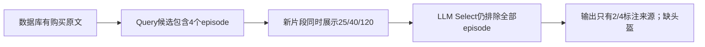
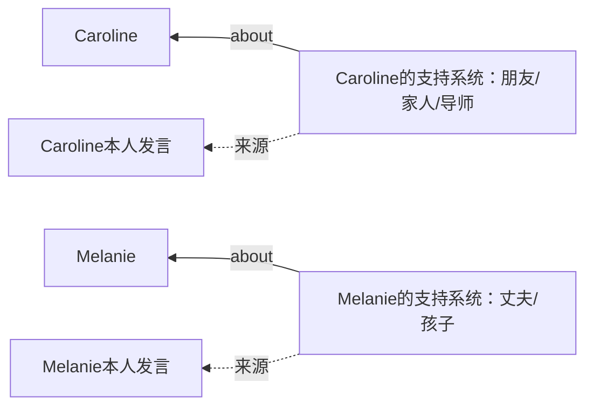

# 从“看见”到“选中”，从“有边”到“有用”

2026-10-26 方法研究附记。它连接现有案例与新增真实样本，不另建案例绑定或评分标准。完整条件和失败见[实施报告](../docs/doing/2026-10-26-evidence-and-draft-implementation.md)，原文和运行轨迹保存在本地忽略目录。

## LM04：价格终于摆上桌，仍可能选错材料

问题是累计自行车相关支出。需要保留链条25、车灯40、头盔120的原文，并判断几次提到车灯是否是同一次消费，不能重复相加。

旧片段主要展示“今年骑了347英里”。这时模型即使认真阅读，也不知道头盔多少钱。本轮在同一片段预算内改善来源与窗口选择，三种金额都进入Select输入。

这次的失败属于“看见但未选中”。把错误继续归到向量召回、或让最终装箱在被保留的几个fact里重新排序，都无法凭空补回头盔。下一步需要检查Select对摘要和原文的偏好、以及重复事实是否挤掉互补证据。

## L01：人物节点应当带我们找到什么

新分步协议在一个辅助窗口里形成了两条可核对的路径：

这两条边的方向、主体和来源一致，具有导航意义。但本次Search没有证明必须通过Backlink才能找到它们；正确返回原文，也可能靠episode检索完成。结果是“有了可核对的图结构”，还不能写成“图提升了多跳准确率”。

## 新人物记录：小窗口掩盖不了跨批问题

完整PerLTQA character-24有资料字段、人物关系、事件和对话。本轮运行14次Add，只有5次成功，仍生成13条关系；关于哥哥的单题Search能命中来源。这同时说明：**能找到一道题的证据，不代表整个人物历史整理成功**。

原始模板的空字段被写成“年龄空、职业空”等fact；后来的人物摘要又出现“教育信息未提供”和具体教育背景并存。合理处理应保留模板原文，但不把“这条资料没填”变成“这个人没有该属性”。

另有性别和昵称引用到爱好字段的提案。来源ID是真实存在的，材料可能也可见，但引用内容不能支持陈述。这是下一阶段逐节点、逐关系支持范围的关键反例；不能靠放宽来源校验来修好。

新增LoCoMo conv-43的收藏集合、conv-49的车辆更替计数、conv-48的亲属事件时间也进入了研究记录。后两者只有一次Add、未触发Reflection，成功只能归于最低episode；收藏集合样本出现缺项和整理失败，继续作为跨会话反例。
