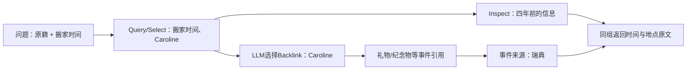

# 原文卡、局部草案与图导航：五个观察

这是现有案例库的运行研究补充，不新增另一份catalog或数据绑定。原文/模型输入/数据库仍在忽略的运行目录。完整规模、失败与版本见[实施报告](../docs/doing/2026-10-26-live-method-implementation.md)和[台账](../docs/doing/2026-10-26-live-run-ledger.md)。本页按研究问题组织，不把人工分析当作模型实际做过的步骤。

## LM04：账单缺项，可能不是检索不到

问题需要合并自行车相关支出：链条25美元、车灯40美元、头盔120美元。早期Select已经看到了头盔金额，但一个Reference塞了多段内容和重复元信息，模型仍反复选择车灯、里程或保养摘要。仅把Select提前、改变分页大小，都没解决集合遗漏。

本轮把原文片段拆成可独立选择的输入卡：模型分别看到每段提供了哪一项支出，再选互补集合。`live26-r8-lm4`最终返回三项金额的原文，头盔没有再在Select→装箱之间消失。

这里不能只读一个分数：标注来源命中仍是2/4，其中标注包含重复提到车灯的材料；三项费用出现不等于全部标注都命中，也不等于回答模型已经算对总额。旧库仍有重复车灯节点与来源错配，某条车灯fact的直接引用不含金额；本次正确的金额来源在另一条证据组内。

## L01：人物像路标，事件才带来缺失信息

“从哪里来”和“多久以前搬来”分散在不同对话。只读取搬家时间的episode，无法凭空补出原籍。

同一自然图副本上，`live26-r8-l1`只有1/2来源；增加实际入/出边导航提示后的`live26-r9-l1`出现一次Backlink，最终两条来源都在首个证据组。该图来自`live26-r6-l1`的2/2成功Add，含2个person、3个event、4条边。

这验证的是一次反向扩展和来源闭合。模型停止说明仍未完整归纳原籍，装箱通过事件来源补齐了原文；因此不能说模型已经完成正确回答，更不能据此证明任意三跳推理有效。

## C02：不是读得越多越容易完成整理

完整长文里有一般规则、例外和更具体的说明。模型容易把“后面更详细”当作“取代前面”，提出错误supersedes；也会产生多个同义fact。旧来源要求因此增加，随后出现重复Inspect。

本轮定位到一个实现错误：旧节点正文已读，但冲突关系要求的来源是否可见没有进入待办更新，且待办没有列出该来源的正确页入口。当前已与提交校验统一，相关来源被读入后会保留至验证。

另一方面，即使类型和来源都合法，语义关系仍可能错误。`live26-r9-c2`的残留supersedes不能只凭有来源就认定正确；一般规则、特例、同义改写都不自动构成替代。本案例讨论数据中的陈述关系，不核实现实税务规则。

## 新LoCoMo双人物窗口：审查必须有实际修改能力

`conv-41:qa-3`需要比较两个人的公益活动。真实草案出现把持续活动强行记成某天、把对话顺序连接成supersedes的情况。仅让审查模型指出问题，会把整批草案送回重复生成。

当前审查直接修改单个节点的正文、来源和已有时间字段；先完成节点，再让关系审查读取修改后的端点。关系工具只提供保留/撤销，不允许通过改写正文假装修好了边。被撤销的是未提交提案，原始episode没有删除。最终复验见报告，不能用先前某次2/2成功掩盖中间失败版本。

## PerLTQA完整人物：检索成功不能掩盖Add失败

完整人物记录比一个标注附近窗口包含更多身份、关系、事件和干扰。`character-29`的旧版本完整运行只有5/14 Add成功，但所有Add都已生成最低episode；在其副本上新增的6道不同人物关系/事件题都能找到标注来源。

这说明原文检索仍有价值，却不是结构化整理通过：失败请求留下的最低episode不能替代Add的成功契约，六题的共同数据来源也不是六段独立历史。另一段完整人物运行因旧版本反复卡在整理中而停止，单独标记中断，不能记作完整实验。

接下来最有价值的检查不是继续统计边数，而是逐条查看：陈述说的是谁；来源支持其中哪部分；关系表达真实联系还是只表达话题相似；缺少哪条原文时，Search还能否从人物/事件导航到它。
