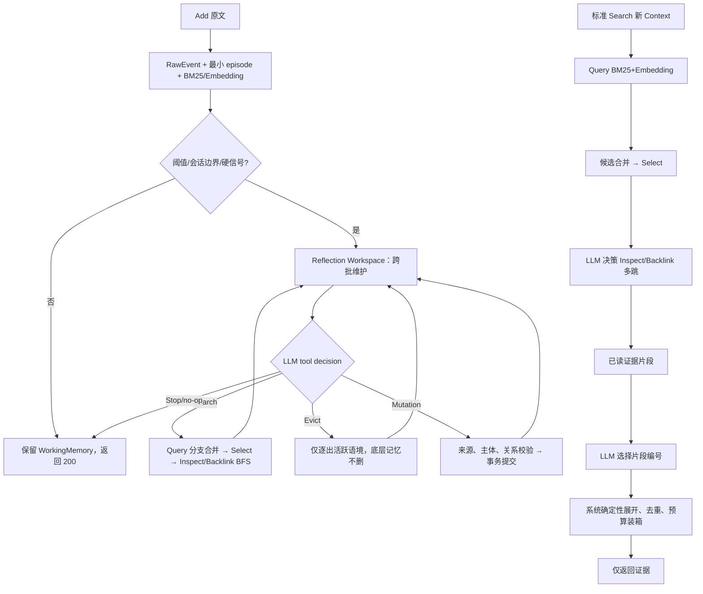

# AM-Link 0.2.1 真实重跑与方法改进诊断

更新日期：2026-10-11。本文记录 0.2.1 修复版的 100 题 LoCoMo 重跑过程、可复核的中间结果和后续改进方案。它不等同于官方 Smoke/Full 成绩；模型返回的证据仍由主办方 Answer/Eval 负责评测。

## 状态边界

本轮第一次 100 题进程在用户切换会话时被中断，只留下部分运行目录 `benchmark/data/runs/amlink-repaired-locomo-100-real-20261011/`，没有 `report.json`，因此不能称为完整 100 题结果。该目录的观测文件和数据库保留为中间证据，不能覆盖或删除。

截至中断时，目录中可核查到：

| 项目 | 结果 |
| --- | ---: |
| Add 记录 | 28 |
| Add 成功 | 13 |
| Search 记录 | 19 |
| Search 成功 | 11 |
| 原始消息 | 419 |
| MemoryItem | 71（29 episode、42 event） |
| MemoryRelation | 8（7 contains、1 same_event_as） |
| 主要错误 | 46 selection_unknown_ref、9 mutation_relation_types、3 minimum_episode_immutable、3 mutation_invalid_identity |

这些数字只说明真实链路已经走到了错误位置：它们不代表全量准确率，也不代表 0.2.1 已完成。第二次独立重跑使用新的 run-id，完成后再补充可比较的完整统计。

## 当前链路中已经验证的事实

1. 每个成功 Add 都先持久化原文、生成最小 episode，并完成 embedding/index；在这部分轨迹中没有重新出现旧版的输入预算死循环。
2. Reflection 确实会产生 event 节点和 contains/same_event_as 边，说明 Mutation 工具已被真实模型调用；但模型也多次提出非法关系、修改不可变 episode 或引用不存在的 ref，导致 Add 失败。
3. Select 的合法引用约束仍是高频边界：部分模型选择了候选页之外的 ref，结果为 `selection_unknown_ref`，Search 直接失败。结构化工具 schema 只能约束形状，不能保证模型只复制当前页的语义引用。
4. 19 个 Search 中有 11 个成功，成功并不等于证据完整；失败 Search 会在适配器边界被明确记录，不能伪装成空结果。
5. 数据库中出现 42 个 event 但没有 person/entity/concept/fact，且关系主要是 episode 到 event 的 contains。这说明当前模型容易把长对话切成事件日志，却没有稳定建立人物身份、事实主体和跨会话导航。

## 根因分析

### 1. 缓冲容量与整理时机混在一起

`reflection_threshold=8`、`reflection_chars=6000` 同时承担输入分批和“是否值得做全局整理”的职责。分批是容量约束；Reflection 是否产生高层语义记忆则需要跨 Add 的全局视角。若每批都被当成完整总结，模型会重复建 event，或在还没有人物/时间全貌时做错误归属。

应保留 `MemoryWorking` 和跨 Add Workspace，把“本批可安全读取”与“本批已经完成语义整理”分开。停止可以表示等待更多材料，也可以表示明确 no-op；只有后者推进已处理水位并清理工作缓存。

### 2. 引用有导航含义，但片段披露仍不完整

Query/Backlink 的候选 Reference 已有类型、可读 ref 和命中叙事，但长 episode 的片段可能只展示开头。Select 看不到的句子无法被选择；Inspect 之后若仍只返回同一截断片段，模型会误以为已经读完；最终装箱再重复展开正文时，互补证据容易被预算挤掉。

每个候选必须带 `hit_fragments`、来源角色、会话日期和已读/未读范围。长内容应允许 Inspect 按 continuation 继续读取，且观测明确区分“未召回、Select 排除、未 Inspect、上下文裁剪、最终装箱裁剪”。

### 3. 来源存在不等于来源支持主体

真实轨迹中已观察到：派生 event 的正文与所列 raw source 不一致，或者 contains 边的端点与来源说话人不匹配。当前校验主要证明 ref 存在、类型合法、来源非空，尚未证明“谁说了什么”。

Mutation 前必须同时展示 speaker、原文句子、会话日期和相邻语境。对于主体归属不清、同名未消歧或时间限定缺失的内容，应保留 episode 而暂不建立确定的 person/fact/event 节点或关系。图的稀疏度不能用错误的边换取。

### 4. Select 与最终装箱承担不同任务

Select 决定候选 References 是否值得继续探索；最终装箱决定已经得到的证据中哪些需要一起交给 Answer。前者不应抄写不存在的 ref，后者不应只按旧检索分数重新排序而丢掉互补来源。

建议最终装箱增加一个可选的 LLM 证据编排步骤：输入 question、已 Inspect 的证据片段、关系叙事、来源日期、`top_k` 和字符预算；模型只通过工具调用选择已有片段编号及顺序。系统再确定性展开原文、去重来源、保留必要相邻句并执行预算。模型不能生成新证据或答案。

## 修订后的验证顺序

### A. 完成干净基线

用新的 run-id 重跑完整四个 LoCoMo 记录（100 题、4 个独立 user 空间），生成 `report.json` 和 `observability.meta.json`。报告至少包含 Add/Search 成功率、错误分布、节点/关系类型、Reflection 工具调用、Inspect/Backlink 次数、Select 保留率、最终装箱决定和模型输入字符。

### B. 修清可见证据范围

先不改变 MemoryItem schema：

- 合并同一 ref 的多分支命中片段，而不是只留一个 preview；
- 给 episode/长节点提供有界 continuation Inspect；
- 将 speaker、session date、ordinal 和 source ref 一起放进 Reference narrative；
- 在 `select` 与 `context` 观测中记录每条候选的去向和理由。

验收是同一题中能分辨证据在 Query、Select、Inspect 或装箱哪一步消失，而不是只看最终 top-k。

### C. 改善主体和来源归属

把 Mutation 提示和确定性校验分为两层：schema/引用/关系类型校验，以及 speaker-claim-subject 的语义支持检查。重复或含糊的同名对象不合并；没有充分证据时只保存 episode。优先通过真实案例核对，不预设节点或边数量。

### D. 对照最终装箱

在同一完成的数据库和同一 Search 轨迹上比较：

1. 当前确定性装箱；
2. LLM 仅选择片段编号、系统确定性展开的装箱。

只比较证据覆盖、互补性、顺序稳定性、字符数和延迟；不让装箱模型生成 Answer，也不把诊断 Answer 当官方分数。

### E. 校准跨批 Reflection

用短 Add 连续积累、会话切换、明确更新/遗忘和长历史四类切片，观察：

- 未触发 Reflection 的 Add 是否仍可由最小 episode 检索；
- 触发后是否先读取相关旧记忆，再 Mutation；
- Workspace 是否跨批保留未决主体、时间和冲突；
- 显式 no-op 是否真的有理由，是否错误清除了待处理 WorkingMemory。

所有内部工作保持单请求有界、显式错误、无内部自动重试；官方约定内的重试仍由调用方负责。

## 目标流程

图中标准 Search 与 Add 内 Reflection 始终是两个独立 loop；标准 Search 不读 WorkingMemory，不把临时探索写回长期记忆。

## 待验证而非已完成

- 新一轮四记录基线是否能完整跑完；
- Select 合法 ref 约束是否能消除 `selection_unknown_ref`；
- Reflection 是否形成有效 person/entity/fact/concept 和跨会话关系；
- LLM 装箱是否提高互补证据覆盖而不增加错误片段；
- 跨批 Workspace 是否改善主体归属、时间组合和冲突处理；
- 各类模型调用的成本、延迟与官方 30 分钟请求边界。

