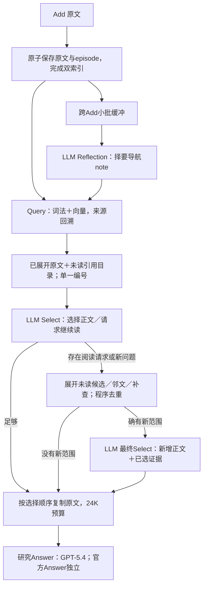

# 引用与续读改进：实施、真实验证及边界

2026-10-30。执行依据：[本轮计划](../phase-3/2026-10-30-reading-continuation-execution.md)。基线为5a9146a及此前全部未提交改动；本轮方法为`0.3.2-continuation`，DB301/passages-v2不变。生产模型仍为mini/v4，本地Answer沿用上一轮已实现的GPT-5.4 medium。

## 已经交付的改变

把模型看材料的过程整理成“正文、未读目录、继续阅读、交付原文”，不再同时把局部编号、全局顺序、hash和偏移都作为类似操作编号呈现。后台的身份、范围与来源账本完整保留，网页可以对照实际模型输入和映射表。

1. **Add整理只承担导航。** 原文先保存并可检索，小批缓冲后一次生成简短导航。提示强调具体称谓、动作、条件与说话角色，允许不写泛泛摘要；来源只能放入本批` sources `数组，不把旧笔记当新证据。没有恢复审查loop或关系构建。
2. **原文阅读块更连贯。** 相邻短段跨空行合并为约600字符的连续块；保留内部原字、换行、明确标题、来源及遗忘边界，不加入网页按钮黑名单。明确区分阅读块和索引episode，存储不迁移。
3. **未读候选可继续读。** 首轮正文50K字符，未读目录最多24项/8K字符，预览来自原文匹配片段。正文和目录使用唯一连续编号。选择目录项表示请求展开，而不是把预览当完整证据交付。
4. **第二轮真正前进。** 请求的候选、邻文或新query形成新增阅读，先前选中范围携入；已读未选范围不重复塞回。没有实际新增范围就停止；最多两次Select和两条补查，仍无重试或模型回退。
5. **交付与观测分工清楚。** 装箱继续按Select顺序复制原句，保留真实说话日期和自然的历史先后说明。稳定ref/精确范围在观测中可查；新增、已读、未读、选中、丢弃分别记录。`new_ranges`是拟新增范围，实际模型看到多少要再看末轮输入映射，不能混为一谈。

## 实测促成的取舍

首轮固定组件中，16个整理输入有2个把引用写进正文、漏来源数组；12个Select有2个把有用的未读引用选进positions。如果仅继续强调“不能选预览”，模型需要遵守更复杂的参数区分。

最终方案直接明确：**positions选择预览意味着先读原文，再交末轮Select**。这改变算子语义，不是自动修补非法输出；0、重复和越界编号仍拒绝。整理提示补清三字段职责。另建r2条件后，16/16整理与12/12Select结构合法；这些输入有意富集旧失败，不能当总体准确率。评论组件由550微小选项降到90阅读块，但真实完整历史仍出现几乎全选，组件不能替代端到端检验。

## 真实结果与核对

所有回归153项＋5子测试通过；仅有原有依赖弃用提示。完整成本见[台账](2026-10-30-reading-continuation-run-ledger.md)。

| 范围 | Add | Search / Answer | 整理 |
|---|---:|---:|---:|
| 原12份完整历史38题，新库重建 | 400/400 | 38/38、38/38 | 418/420 |
| 额外6份完整历史23题 | 155/155 | 23/23、23/23 | 186/186 |
| 合计公开面板 | 555/555 | 61/61、61/61 | 604/606 |
| 独立人工控制5历史6题 | 10/10 | 6/6、6/6 | 2/2 |

公开面板六类数据，全部原始历史先Add后Search。额外6份未用于本轮组件提示调试，部分曾进入较早百题基线，不称外部盲测。比原r2同12历史的36/38 Search、409/420整理，接口完成性改善；这不是答案质量提升率。

61个保存回答全部做题意/标注复核：40达到题意、9未达标、12不确定；25题另读原文或轨迹。不确定包含开放推断、历史自相矛盾与标注歧义。mini辅助评分为42正确/19未达标，均保留在页面，不能代替研究复核或官方成绩。强Answer、方法以及评价歧义共同影响结果，不把这组数与旧mini的17/38直接相减。

公开面板77次Select、2条补查、42次阅读请求（31次指向未读引用）；16次有新增范围后调用末轮Select，3次无增量停止。55个范围是拟新增，不保证全部进入末轮；实际看见的范围由输入账本确定。共有11个正文块因阅读预算未呈现，59个选中块因最终装箱预算排除（均在评论题）。这些是范围出现次数，不是55个不同新事实。

核验4914条活动来源全部有episode，9832个活动episode为原文精确范围；无活动节点引用已屏蔽来源。11872次引用范围映射、536次选中范围核对通过。61次最终交付按保存的选择范围从原文重新装箱后逐字一致、均在24K预算内；这证明保真和范围一致，不证明选择充分。

本轮共3428次尝试/3428响应（含两版56组件及控制），无网络失败或内部重试。公开面板两个整理失败分别为工具schema错误和笔记条数超限，原文接收完整。工程实现、接口/保真核对已完成，整体语义质量未验收。

## 执行计划核对

| 工作 | 结论 | 证据 |
|---|---|---|
| S0冻结与独立身份 | 完成 | 起点源码保存，38个方法/靶场/数据源码与最终快照一致 |
| P0模型叙事与来源标签 | 完成 | 默认代码、真实组件及完整历史，无默认关闭分支 |
| P1连贯块、目录、两轮续读 | 完成 | 未读只可请求展开；新增/携带/无增量均实测 |
| T0协议和保真回归 | 完成 | 153项＋5子测试 |
| V0组件和机制控制 | 完成 | r1失败保留、r2结构合法；6个控制任务满足期望 |
| V1完整历史与扩样 | 完成 | 18完整历史/61题/555 Add，同一冻结版本 |
| V2实际链路与效果复核 | 完成，质量仍有缺口 | 61答复阅读、25题额外证据检查，负例未移出分母 |
| O页面和文档 | 完成 | 11数据集、37案例、37研究登记、88运行/261问题条目；含重复和失败，不能作为独立样本分母 |

页面新增模型输入引用映射、已读/未读区分、续读请求和拟新增范围说明，保留完整I/O。文件构建、身份及静态验证完成；新增案例后网页定向复核26项＋3子测试、JavaScript语法检查通过，38个冻结源码仍一致，新增案例历史与准备包相符。没有绕过此前真实原文浏览器访问限制。

## 已确认的案例变化

| 案例 | 实际观察 | 方法判断 |
|---|---|---|
| 自行车费用 | 120已出现在未读目录，仍未被选择；Answer仍为25＋40＝65 | 从候选不可见推进到了可见但漏选，完整185仍未打通 |
| API Key冲突 | “从未取得”已读，“曾取得”在目录；最终主要选择获取教程 | Select把话题相似当成回答状态问题所需证据；强Answer无法补冲突另一端 |
| 家庭活动 | 本题从旧Search编号错误变成合法完成，但仍偏户外活动 | 协议改善不等于集合覆盖；陶艺、绘画等仍缺 |
| 评论多引文 | 24句引文均可在交付原文找到，互不重复，三观点与五栏符合任务 | 本地任务复核通过；但Select几乎全选后装箱丢59块，不能宣称集合预算已解决 |
| 比赛日志（新） | 复核更正：首轮已读到两次大推进与关键擒杀却漏选；后续两条补查无新增范围，没有第二轮Select | 材料已经可见不是充分条件，Select需要按问题各部分保留互补证据 |
| 人物关系 | “邻居”同时受关系字段和事件支持，参考却是宽泛“熟人” | 尊重原文，不为标注收窄或改错 |
| 弱隐含偏好（新） | 讨论进口/美国混动车技术，不足以推出“我偏好美国车” | 隐藏persona不能当明确历史事实；与真正漏检分开 |

对比继续使用相同强Answer的旧固定Search回答；这些是同一公开研究集的单次迭代观察，不把新模型与旧mini的差异全部归给记忆方法，也不发布相对旧百题的总体提升率。

## 接下来值得做什么

这一轮解决了引用和阅读接口的实用问题，但没有证明整体质量已经通过。下一步应围绕**选择一组能共同回答问题的证据**收敛，不再先增加图、审查或循环。

- Select不只看每条是否相关，还要让不同子问题、状态双方、不同事件共同得到支持。可以试验极简自然语言的缺口说明与选取理由，但需要同候选对照证明收益，不能直接把每题变成大型覆盖schema。
- 区分个人陈述、通用解释和助手建议的证据作用。角色不能一刀切过滤；需要判断该片段能否支持问题中的主体、状态和动作。API Key与比赛日志共同说明“教程/流畅摘要挤过原始事实”的风险。
- 导航笔记仍有泛化和重复。先验证一条笔记是否增加有效入口，而不是增加笔记数、关系种类或修改旧节点的能力。
- 装箱仍可能损失证据。评论题虽最终完成，但几乎全选不可取；先评估选择阶段能否在真实预算内保留充分集合，再决定是否值得增加独立模型装箱。
- Answer已较强，仍会把“建议一个新地点的酒店”理解成只能复述历史具体酒店。后续复核进一步发现，用户明确偏好在首轮已读却被排除，最终只有助手套餐介绍；因此需先修Search对偏好证据的选择，再固定交付比较Answer边界，不能将本题全部归因于Answer。详见[新复核](../phase-3/2026-10-30-selection-mechanism-review.md)。

上述是本轮新观测形成的后续研究方向，未新增生产分支或宣称已经验证。无内部重试、无自动提交、未部署；默认空库、凭据、依赖均未改。
