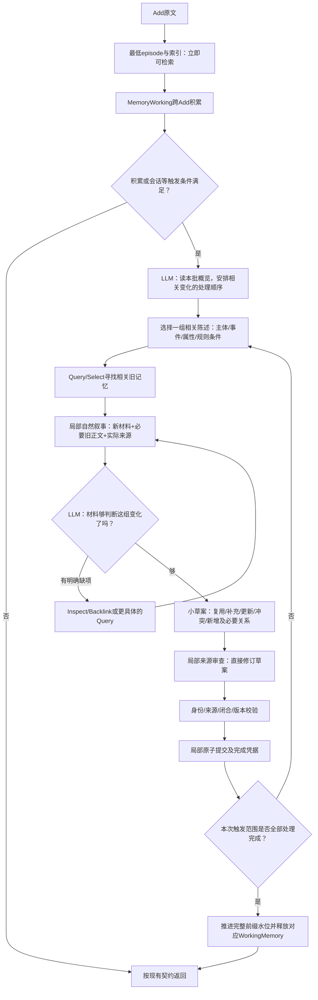

# 下一轮讨论稿：自然叙事、局部整理与证据集合

状态：设计讨论，尚未实施方法变更。当前代码基线为用户提交`256fced`，方法事实仍以[DESIGN](../../DESIGN.md)为准。本轮只清理实验数据库、审读现有输入与源码、记录方案；未发起真实模型调用。历史实测见[上一轮报告](../doing/2026-10-26-live-method-implementation.md)。

## 1. 当前缺口不是一个统一的“模型不够好”

| 观察事实 | 问题判断 | 对应方向 |
| --- | --- | --- |
| C2实际审查把“规则”与“如何申报”认作supersedes | 模型能满足字段协议，却没有充分对比两端的具体断言 | 展示旧说法、新说法、条件与直接原文；关系先解释语义，再编码 |
| 同义fact在不同批次重复出现 | 现有去重主要是已加载节点中正文、时间等严格一致；“不可覆盖fact”被模型理解为不断新建 | 写入前对同主体、事件、属性寻找旧记忆；复述复用，更新留版本 |
| C2整理约79,400字符仍缺有效材料与容量 | 长草案把许多旧目标一起变为必须材料；菜单、状态与重复结构也占预算 | 局部语义任务＋按调用目的生成叙事，非单纯提高字符上限 |
| LM4三项金额可进入结果，但旧库多个车灯fact仍挤占名次 | 精确范围传递已改善，集合去重与贡献排序仍有缺口 | 区分直接证据、导航引用、重复支持；按新增信息贡献排序 |
| L1人物反链找到礼物事件，来源补回原籍 | 人物节点有导航价值，事实常在具体事件/情景里 | 让人物提供可读导航，而非无限增长的个人大传记 |
| PerLTQA完整记录Add失败，Search仍可命中最低episode | 原文可查与结构化整理成功是两项能力 | 新库从Add开始验收，失败前缀不进入成功样本汇总 |

以上均为源码与旧轨迹观察，不是本轮新增模型结果。尤其不能把schema、来源ID存在、源文已展示或审查模型同意当成语义正确。

## 2. 从一次模型调用的读者视角重新组织输入

本轮离线审读`live26-r11-c2`、`live26-r12-conv41`、`live26-r8-lm4`共51次gpt调用输入。Reflection有21次，完整序列化输入18,558—79,404字符；Select有5次，为6,067—12,081字符。完整数据在忽略的`amlink/data/diagnostics/narrative-audit-20261026.json`。字符不是token，不能据此宣称模型上下文窗口规格。

最重的一次Reflection中，系统提示约5,723字符，工具定义9,634字符，新工作材料16,035字符，context中的choices约18,045字符、reflection_control约10,485字符。分项是不同层次的序列化长度，存在包含关系和转义开销，不能简单相加。证据是：该调用中菜单与流程结构明显挤占正文，而非所有空间都用来阅读必要原文。

建议输入采用以下可读顺序，由代码从真实状态渲染，不额外调用一个模型去编写摘要：

1. **这次任务**：现在整理谁的哪件事，或Search还要找什么。
2. **新材料**：原话、说话人、会话/日期；不把assistant建议直接写成用户事实，不把发言日期等同事件日期。
3. **相关旧记忆**：可读标题、语义ref、正文与支持片段；说明是原文还是派生陈述。
4. **当前进度**：哪项已经有依据，哪项仍缺什么，上一动作实际补回什么。
5. **可选动作**：只呈现当前真正可用的工具与入口。未读就是未读，不能用语言叙事掩盖缺证据。

例如下面只是格式示意，不是某次真实模型输入：

> 本轮整理：项目每日API配额的明确调整。
>
> 旧记忆「每日配额1000次」：先前用户要求每天最多1000次，同时每分钟最多60次。
>
> 新材料「配额调整」：用户后来明确要求把每日配额改为1200次。
>
> 待判断：这是每日配额的更新，还是另一个项目的要求？只有确认项目一致，才可将新旧每日配额关联为替代。每分钟60次不在本次修改范围内。
>
> 可继续查看：旧记忆原文、项目身份的相关引用；材料充分时提交这项变化。

它仍携带可解码的短位置号/语义ref，但不要求模型从长hash猜出意义。字符范围、版本摘要、哈希和ID映射由系统维护并进入观测。tool calling继续保留，输出用小型schema绑定动作与依据；自然叙事主要解决输入可理解性，不能替代幂等、权限、位置和类型检查。

TinySoul可借鉴的是当前/最近日志以正文呈现、引用有语义、候选选择绑定具体内容片段。实际查看的TinySoul Select仍使用结构化候选与片段ID，LLM路径输出JSON且不走tool calling；它不是“完全自然语言所以更好”的实验证据，也不应照搬其JEV、rerank或调用协议。AM-Link继续采用Select统一筛选排序与tool calling。

## 3. Add保留全局视野，提交按局部变化组织

建议引入的只是“本轮整理哪一小组相关陈述”的内部工作单位，不新增MemoryItem种类，不再造一套长期记忆对象。

“一组”取决于需要一起理解的材料，而不是固定几条消息：一次配额调整及旧要求属于一组；无关的旅行偏好不应一起锁进同个草案。人物/主体先确定，再组织事件或事实；确有跨事件比较需要时，可共同处理。不能机械按人物切开关系、按消息切断指代。

全局视野保存在批次概览、原文缓冲和处理清单中；每组只加载必需正文。完成一组后释放这组的正文保护，保留可读引用、处理结果和可追溯位置。另一组需要时重新Inspect。不是把全部历史压成一个不可核验摘要，也不让模型替程序宣告材料读过。

这涉及一个需讨论确认的语义调整：**局部组为原子提交边界，整个Add仍需等待其触发范围全部完成才返回200**。若后一组失败，已提交小组保留，Add显式失败。调用方重放时复用冻结处理清单和已完成凭据，不能重新规划已提交小组或重复创建节点。组有交叉来源/依赖时，所有相关组处理完之前不得越过原文水位；同批新节点作为后续组可查的旧材料。来源依赖、版本检查、同用户串行不放松。

当前实现一次批次的整体原子提交，不具备上述局部完成凭据；不能只把循环拆小却沿用现有水位。实施时先确定这个进度语义，再改模型流程。

## 4. 去重、更新和冲突应是写入决策的一部分

模型首先比较新旧陈述，而不是先生成新fact再要求审查兜底：

| 新旧材料关系 | 建议处理 | 不能混淆的情况 |
| --- | --- | --- |
| 同一主体/事件/条件下的复述 | 复用旧节点，合并确实支持该陈述的新来源 | 两次相似购买可能是不同事件，不能按文字相似直接合并 |
| 对同一事件的补充 | 保存补充事实或扩充可修改导航，连接同一事件 | 不应重建整个人物传记或把补充标成替代 |
| 明确更正/更新 | 保留新旧版本，说明哪个属性在哪个适用条件下变化，再建立supersedes | “说得更具体”“更晚提到”本身不是替代 |
| 同条件下互不相容且未澄清 | 保留各方说法及来源，标明冲突 | 不能替用户擅自裁决哪条为真 |
| 不同条件/时段下分别成立 | 并存，并在正文中说清条件或时间 | “工作日/周末”“日配额/分钟配额”可能不矛盾 |
| 原始材料确实不支持草案 | 局部改写或撤销未提交提案 | 撤销草案不等于删除用户原文 |

近义去重不能只依靠相似度阈值。用BM25/embedding提出候选，模型结合主体、事件、时间和条件比较。初期从新增时的复用入手；对已存重复节点的物理删除/重定向，需要明确维护所有入边、来源和缓存失效，不能在本轮顺手做全库清洗。

关系叙事建议与两端一起显示：例如“这条每日配额陈述更新了上一条每日配额，依据是用户明确改为1200次”。现有about也需区分正文中谁是行为者、对象、赠送者或同伴；第一步在原文和关系解释里保留角色，不急于增加一大套关系枚举。person作为导航，不自动等于全部about事实的主语。

审查按同一局部组给出修改，不分散到许多无关候选。来源中的一句话与具体断言建立对应；多条断言可由不同片段共同支持，不要求每条来源独自证明整个段落。语义解释须附原文，不能成为模型自证的“新证据”。

## 5. Select：先把材料读清，再选互补集合

**当前已经共用80,000字符的整包上限**，并非Select只有小模型窗口。真正不同的是披露和分组：每个Reference约1,200字符、最多4段，每页24张卡。实际抽查Select只有约6千—1.2万字符；不能从这5次推断所有Select都短，但足以说明先增大统一上限未必对症。

建议按以下顺序实验，成功的方案直接成为主方法，失败的分支移除：

1. **可读候选**：标题+语义ref、说话人/日期/条件、原文段落、为什么这个候选被找到。明确派生节点与原文，短材料完整展示。给出相关段落前后必要语境，不只给关键词周围零碎窗口。
2. **按完整输入大小决定是否分页**：候选能装下就同次比较，不因刚好第25张而切断集合；超出时分页。页面保留后全局比较仍基于原文，不能只比较上一轮生成的摘要。
3. **选择集合并排序**：优先保留新增事实贡献，去掉同一事件的重复复述；同时保留能通往缺失事实的少量导航引用。不能把人物简介当成已经回答了地点/时间问题。
4. **仅给必要检索语境**：首次Query用问题+候选；Backlink的Select可以附“从哪个引用走来、原问题还缺什么”的短叙事。不要把整个Reflection工作区复制过去，也不为所有Select强制加一轮需求规划模型。
5. **输出绑定实际范围**：仍返回有序References子集与所选片段；短说明表达贡献/缺项，不输出答案。不新增独立rerank步骤。

完整输入增加也可能让干扰增多，因此要做位置打乱、多种长度、多样干扰的配对测试。若一个重要句子没被展示，诊断是披露；若已经展示却没选中，诊断是选择；若选中后被装箱裁掉，诊断是组合。三者不应混成一个召回分数。

另一个需要明确的选择：普通Search和Reflection的Select目标不同。前者为回答问题提供证据与导航；后者为判断一组新旧变化找到旧目标与支持来源。使用同一个Select算子，但输入任务说明必须不同，不能拿一句泛泛“选择相关信息”覆盖两种目的。

## 6. 新一轮执行计划草案

| 阶段 | 工作 | 验证与停止标准 | 当前状态 |
| --- | --- | --- | --- |
| P0 从新库起步 | 用户确认后备份并清空实验数据库、默认库和活动观测索引 | 可恢复备份逐文件hash一致；数据集/案例未删；网页0运行 | done，见清理记录 |
| P1 模型叙事 | 按任务/新材料/旧记忆/缺项/动作渲染Reflection、Select、Inspect与审查输入；缩减重复字段和菜单 | 对照真实请求体人工读审；同材料配对调用，正确区分更新/补充/冲突；工具输出和范围映射仍有效 | 待讨论后实施 |
| P2 局部整理 | 冻结相关组计划、局部提交凭据、依赖与水位；新组先找旧目标，完成即释放材料保护 | 模型故障/中断重放不重复提交；有交叉来源不提前消费；不能用无依据no-op避开失败 | 待确认原子边界 |
| P3 Select | 同上限按大小合批、可读且连贯的来源披露、互补贡献排序、导航与证据区分 | 重要句可见率、已可见句保留率、top-k独特事实、冗余、末端闭合、延迟/调用分别计量 | 待实施 |
| P4 新库比较 | 8题/至少4段历史先查链路，再扩至约36题/至少12段历史/5种来源 | 每个方法版本从相同空库完整Add；失败Add单列；不把同一人物的多题当独立历史；小批稳定后才扩大 | 尚未运行 |

P4包含原有困难案例和新历史，但主评测使用完整选定历史，不能依赖gold evidence挑一个有利窗口。必要的人工切片只做局部故障定位，单列结果。标注仅用于评估，不进入Add/Query/Select；不从备份恢复旧图充当新方法数据。对照可来自提交基线的独立研究实现，不在最终服务里留下运行期开关。

语义质量至少人工检查：重复事件是否误合并、不同条件是否误判冲突、关系是否真正支持多跳、助手建议是否误记为用户事实、局部修订是否丢掉限定。材料没有gold时保留未知，不用ID合法性填充正确率。以上都是测试安排，不是已测收益。

## 7. 建议本轮先确认的设计点

首要确认局部原子提交与Add完成语义。模型自然叙事、短引用映射和Select共用输入上限不改变公开协议；“局部提交已成功而本次Add仍失败”则需要明确接受，并为调用方幂等重放建立可核查进度。

此外，Select建议先允许在现有80,000字符上限内更完整地共同阅读候选，以配对实验判断分页与披露效果；暂不凭上下文容量想象提高整个系统的上限。若仍不足，再依据真实长度与供应方容量讨论，而不是将“窗口大”当作语义稳定性的保证。
