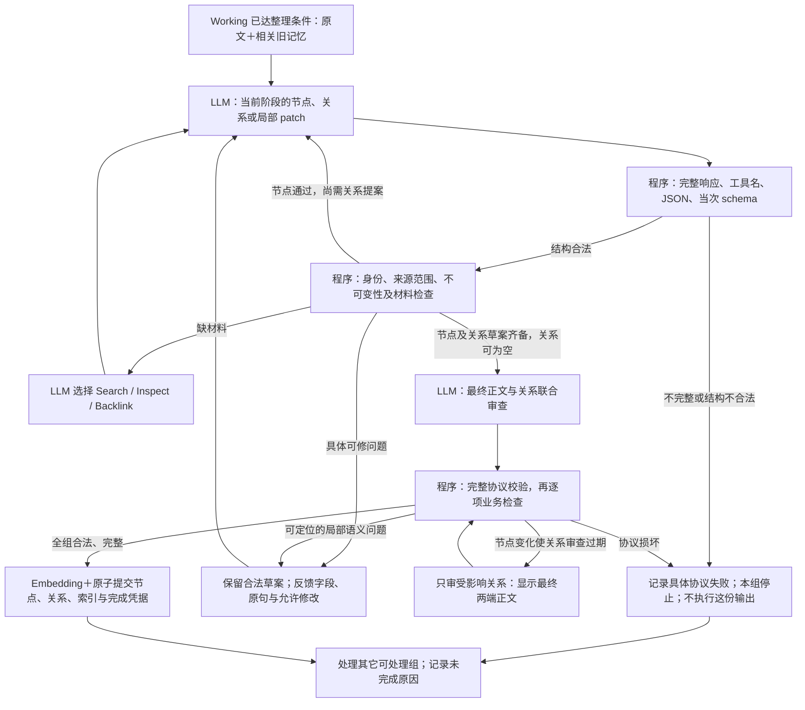
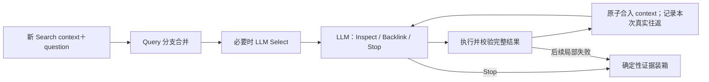

# 工具协议、局部整理修订与有界对话执行计划

2026-10-28。方法基线 `b000d96`；依据[接口与整理审计](../doing/2026-10-28-reflection-api-audit.md)。**状态：分析、设计及计划核对 done；下面的方法改动、回归与真实实验全部 todo。** 本轮没有实施方法，也没有新增模型调用。

目标是让一次小组整理更容易正确完成：模型读懂当前任务、给出可靠可解释的输出、收到具体问题后只改相关部分。完整性、安全边界与调用代价一起验收。不以增加等待时间、反复调用或强制建边代替方法改进。

## 1. 事实、目标与实施边界

上轮 145 份 GPT 输出按当次发送的 schema 重验：138 份合法、6 份完整输出违规、1 份 BFS 损坏后重复至输出上限。最终七份审查组件全部 schema 合法，其中两份却违反本地撤销/来源联动规则。LM04 最终 4/4 Add、来源 4/4，但仅 1/3 整理组完成；不能把 API 成功等同于图和整理质量。最大 Add 约 22 秒，远低于 1740 秒期限。

六次接口探测说明工具结果续接及 max_completion_tokens 可调用，却没有证明代理兑现 strict 或 reasoning_effort。计划按这个现实设计，不等待供应商完全实现 strict 才开展本地改进，也不把本地校验冒充受约束生成。

| 必须保持的语义 | 本轮具体要求 |
| --- | --- |
| 原子 Add 接收、成功凭据与整理分离 | 必要接收失败不留下本轮半份记忆；已接收原文不因整理失败撤销；同 ID 成功重放零模型调用 |
| Working 缓冲 | 累积/会话边界/明确变更触发，不改成每次 Add 都整理；正常尾部与失败积压分开统计 |
| 独立标准 Search | 每次新 context；只查 MemoryItem，包括最低 episode；不读取 Working，不触发 Reflection |
| 原文、来源与节点保护 | episode/fact/event 正文和时间不覆盖；导航节点变化仅带当前支持；必要遗忘仍随接收原子生效 |
| 记忆算子 | Query、Inspect、Backlink、Select 及语义 ref 继续使用；Select 可筛选排序；不新增 rerank 或 Answer 算子 |
| 真实模型与重试 | gpt-4o-mini、text-embedding-v4/1024；一次模型操作只尝试一次，不新增网络重试或协议修复器循环 |
| 最终交付 | 通过验证的设计直接成为唯一默认方法；实测无收益的实验代码撤回，不留下默认关闭的备用分支 |

本轮不同时修改长文本向量分段、query 通道比例、最终装箱算法或数据库图类型。先修正进入这些环节的陈述、关系与实际可见材料。后续实测发现的新问题进入同一分析台账，按证据调整计划。

## 2. TinySoul 最新参考与取舍

已将干净的 `reference/TinySoul-Agent` 从 `4a9a58aa` 快进到 **`ad7ce63791e8e99ec91c6a849f62d8788321bc50`**，提交时间 2026-10-28 11:30 +08:00。来源为用户提供的[仓库](https://github.com/Graygoo7529/TinySoul-Agent)。只更新忽略的参考仓库，没有改其代码或安装依赖。

| 最新参考位置 | 学到的原则 | AM-Link 的落点 |
| --- | --- | --- |
| `docs/design/llm.md`、`llm/execution/task.py` | 供应商响应、任务解释结果、业务执行效果分开；停止原因先于内容解释；失败反馈有稳定原因及简短叙事 | 统一解析/校验入口；错误的内部细节与安全外部错误分开 |
| `llm/adapter/history.py` | 原生工具回放必须是调用 ID、名称、结果完整配对；提议不等于已执行 | 只回放实际发生的操作；暂存草案不得标成已写入记忆 |
| `llm/adapter/replay.py` | 供应商原生状态绑定模型、适配器与原始消息，不能任意移植 | mini 不引入加密推理状态；运行上下文有明确生命周期和归属 |
| `llm/adapter/openai/chat.py` | Chat 输出额度映射 max_completion_tokens；保留原始响应、停止原因、用量 | 沿用轻量 HTTP，一致设置额度并记录结果；不为接口迁移建立通用模型框架 |
| `docs/analysis/done/20261013-done-phase-protocol-and-generation-budget-execution-plan.md` | token 额度与字符限制分开；局部失败说明原因、实际效果和修正方向 | 有界修订必须带具体新任务；不照搬其 65536 输出额度及大模型推理设置 |
| `AGENTS.md`、`docs/design/context.md` | 每次模型输入可重建，但动作/结果事实和披露范围必须可解释 | 保持 Workspace 为状态来源；近期工具往返只是一种模型输入投影，不另建长期记忆 |

TinySoul 的模型链、供应商切换、后台 Job、三阶段 Agent 内核不进入 AM-Link。其 64K 生成额度有自身推理 token 耗尽证据；AM-Link 的异常是短动作参数损坏后的重复输出，问题不同。

## 3. 目标流程

图中 C/C2 的协议检查是程序动作；E/L 是模型内容判断。程序延续节点→关系的内容阶段，只有存在合法端点组合时才安排关系提案；没有合法组合直接进入审查，不能反复要求建边。每份输出都先过完整协议检查，才允许从中提取合法草案。保存部分已审草案不等于部分提交数据库。

基础 Query/必要 Select 失败仍对外报错；后续扩展失败只保留最后完整步骤的证据。P2 对模型消息组织的试验不改变这个语义。

## 4. P0：让工具定义、返回校验与错误信息一致

### 4.1 唯一的工具协议入口

在 `Providers.tool` 的调用边界统一执行：响应完成状态 → 唯一合法工具调用/ID → JSON（拒绝重复键）→ **当次实际发送的 schema** → 业务解释。模型调用不成功时没有任何业务副作用。拒绝内容过滤、非完整输出、未知工具、多个调用及畸形参数，不猜补括号、删除多余字段或填充缺失字段。

工具定义作为传输协议的唯一来源；现有 Pydantic 类型生成的 schema 和少量动态位置 schema 均进入同一入口。采用成熟的 `jsonschema` 运行时验证器，列入 `amlink/requirements.txt`，不自己实现一套 schema 解释器。业务 Pydantic 检查继续验证业务条件，但只能处理通过传输校验的数据，不能先用默认值掩盖漏字段。

所有实际模型调用都走这条路径，包括计划、查询扩展、Select、节点生成、关系、审查和 BFS。清理无消费者的 `_model_json`、`Providers.json` 及仅为旧替身模型存在的 hasattr 分支；先核对全仓消费者，测试替身也服从唯一工具协议。`parse_mutation` 现有移除根部时间字段的补救不再用于接收模型输出：位置错误应明确报告，不能当作有效调用。

一次性专用任务只有一个工具时使用指定工具名；多动作 loop 使用 required。保留 parallel_tool_calls=false。外部接口响应形状不变，`MemoryError` 的公开文案仍只含安全 code。

### 4.2 失败分层与行为

下表名称是内部失败类别，不新增比赛 API 字段。观测记录详细路径和值的有界摘录；安全外部错误不含用户原文或供应商响应。

| 类别 | 示例 | 当前请求中的动作 |
| --- | --- | --- |
| 依赖失败 | 网络、超时、429、非预期 HTTP | 一次失败；按已有 Add/Search 交付契约结束；不内部重试 |
| 生成未完成 | length、content_filter、未知/不完整 finish | 不消费参数；记录实际额度、token 与停止原因 |
| 协议失败 | 坏 JSON、重复键、未知工具、缺必填字段、越界枚举 | 不消费本份输出，不从中救出个别项目；该组/扩展停止 |
| 可修业务问题 | 已识别项的无依据年份、非法旧正文改写、替代原句不支持、仍需原文 | 产生本组具体待办；保留已通过检查的草案，进入有限内容修订 |
| 完整性/实现故障 | 跨用户引用、丢失数据库来源、未知工作区版本 | 显式失败，不交给模型猜修 |

可修业务问题不能仅凭一个 error code 判断。必须已有合法工具、可确定的对象、原草案与检查依据；这些条件不满足即停止。此边界防止“所有异常都 catch 后再问模型”变成隐式重试。

### 4.3 接口与输出额度

默认仍用当前 Chat Completions 端点及模型，不迁移 Responses 或 SDK，不切换 Key/供应商。继续发送 strict，但观测将“请求要求 strict”与“本次输出通过本地 schema”分别记录；不声明代理保证已通过。只在独立诊断工具探测不合法 schema，不能在正式 Add/Search 中每次做能力探测。

统一采用 max_completion_tokens，先补一次低额度生成终止的真实测试；上一轮正常短响应只能证明接受参数。初始预算：BFS/Inspect/Backlink/Evict/查询表达等短决策 1024 tokens；计划、Select、节点/关系与审查继续最多 5000。输出额度与输入字符预算单独记录，输入仍统一 80000 字符、活跃语境仍受原有预算约束。每类真实输出分位数和 length 单列，若合法任务被新额度截断，调整该类唯一默认值，不自动加倍再试。

模型输出不需要长推理过程；短理由只解释所选证据或动作。reasoning_effort、reasoning_content、加密 reasoning 回放不进入 mini 默认请求。

## 5. P1：简明审查与能够完成的局部修订

### 5.1 模型字段的语义修订

保留顶层 uN 与节点最终正文协议，不退回列表交叉编号或嵌套动作 schema。uN 在同组内稳定，不因分页、撤销或局部审查重编号；节点绑定原有草案 ref，关系绑定端点与关系类型，新增项追加编号，撤销项编号不重用。这是本组工具位置映射，不是新的持久记忆 ID。

把模型 `source_positions` 改为 **`evidence_positions`（审查依据位置）**：

- 节点有最终正文或关系 keep：必须非空，所选原文必须支持最终陈述/关系；程序从这些位置生成持久支持来源与原文范围凭据。
- 节点 text=null 或关系 drop：可以为空，也可以引用解释撤销的材料；程序只记审查轨迹，**不生成支持凭据、不写节点、不写边**。
- 任何位置都必须属于本次实际可见的来源表。字段重命名是有意修订，不同时接受两个旧新名称。

去掉模型输出 `revised_endpoints`。程序比较节点审查前后正文、时间、来源及身份；当端点有效版本改变，相关关系判断自动过期。只有显示最终端点版本后的关系审查才能生效，模型一句“已重审”不再承担一致性保证。

节点仍输出 text、三个时间字段、简短 detail 和 evidence_positions。关系仍输出 keep/drop、detail、evidence_positions；supersedes 仍要求保留时的原文 replacement_quote。撤销项的时间/替代字段仍须满足字段类型，但允许保留原值，仅记轨迹、不参加写入；模型无需额外清空无作用字段。保留项继续接受完整时间和替代依据检查。这是明确的新业务约定，不是 parser 遇到坏格式后擅自删除字段；不增加新的长期节点类型。

### 5.2 逐项结果，整组提交

将 `decode_review` 的传输形状检查与 `check_review` 的业务检查分开。完整传输通过后，业务检查逐项得到：合法草案、明确撤销、具体问题；不在第一条业务错误处抛掉同份返回的其它合法审查结果。

在现有 group progress 中保存必要检查点：当前草案、已通过项及其草案/来源/端点版本、待办、剩余内容修订额度。它是现有草案的恢复信息，不是新记忆层。SQL 表/数据库版本无需因此改动；新增局部进度格式版本，旧缺省表示没有可复用审查凭据，未知版本明确拒绝，不默认为通过。

有效结果只暂存；全组仍在一次事务中提交。依赖闭合规则：

| 变化 | 必须作废/重新判断的部分 |
| --- | --- |
| 新事实的语气、日期、正文或支持改变 | 该节点审查；与其相连的关系判断 |
| 只撤销一条无效关系 | 该关系；其它节点和无关边不重做 |
| 节点被明确撤销 | 程序移除依赖该节点的草案边并记录原因；不删除其它有效节点 |
| 来源被遗忘、版本改变或不再可用 | 所有依赖它的草案/审查凭据；不能拿旧回放继续提交 |
| 恢复未完成组 | 核对组身份、原文/旧节点版本及进度格式；旧阅读凭据不等于当前模型已见，按原有可见范围规则补齐 |

首次仍联合审查节点与关系；节点完全未变的合法关系可直接接受。节点被审查修改后，只对受影响的关系补做一次审查，输入显示最终正文；不因删除 revised_endpoints 退化为每次全量两遍审查。需要补读才开放读取动作；材料齐全时明确只编辑，不默认再 Search 一遍。

### 5.3 有界修订与停止规则

一组最多 **初审＋两轮有内容的局部修订**。一次“轮”可能因完整材料分页而产生多次调用，不能把分页藏到调用统计外。现有 16 次主决策上限不增加，自动审查调用也纳入决策计数；嵌套 Query/Select 和 embedding 另列真实调用数，仍受请求与研究总预算约束。每个正常步骤不固定耗尽额度。

下一轮内容任务必须带上：哪条对象出错、哪句原文/哪条字段不支持、实际尚未写入什么、允许修改哪些对象。节点可 patch/撤销；关系可明确撤销或给出真正支持，程序不替模型发明关系。保留的旧草案不重复生成。

例如向模型呈现：

> 修车事实与头盔购买都可由原文支持。u2 声称后者替代前者，但所引原句只描述另一笔消费，没有更正或废止旧信息。本组尚未写入；请只修订 u2。没有替代依据时撤销该边，不要撤销有效事实或重新读取整份历史。

如果模型试图写未知旧引用、整份输出坏 JSON，走协议失败；上述任务不适用。若相同草案＋问题＋来源版本无实质变化，立即记无进展，不再次发送同样输入。修订次数或时限耗尽则保存未完成；不转成 episode_only。只有确实无额外语义增量的材料才可 episode_only，空草案必须解释原因并通过既有约束。

完成组跳过、未完成组有新依赖才恢复、成功 Add 幂等重放零调用均保留。新方案的组内修订发生在第一次退出该组之前，不依赖下一个 Add 来“碰运气”。

### 5.4 提示词从模型实际任务出发

输入依次说明：本组需要记住什么 → 实际原文/人物/时点 → 相关旧节点 → 本组草案 → 当前唯一要解决的缺陷。正文尽量一次展示；证据表和草案旁引用保留明确指向，全部重复内容计入模型预算。

关系审查用少量成对例子说明：同属性明确改值 vs 补充操作步骤；同一事件的补充 vs 另一笔消费；同名人物 vs 同一人物；建议/可能 vs 决定/承诺；发言日期 vs 事件日期。要求回答“原文支持怎样的关系”，不泛问“这两条是否相关”。保留有用的不确定事实，不为追求确定性一律撤销。

提示版本独立记录。用未参与提示词编写的新案例检验，禁止把 benchmark 答案、gold evidence 或最终问题加入 Add/Reflection 输入。

## 6. P2：有界工具往返与缓存，必须先证实收益

本阶段是实现期间的离线对照；不是交付一个默认关闭开关。先比较同一语义流程的两种输入组织，胜出的一种进入唯一方法；无收益就删除实验实现并保留结论。

### 6.1 生命周期和真实效果

一次 Reflection 小组、一次标准 Search 各自持有工具往返；不跨 user、Search 请求或整理组传递。跨 Add 恢复仍读取已保存状态/草案/待办，不把完整 API 会话写成新的长期 memory。

`Providers.tool` 可返回本地类型化的调用结果，保留真实 call_id/name/arguments、规范化 assistant message、finish_reason、usage 和 request ID。上层执行后才产生对应 role=tool 结果，明确区分“已读取”“草案已暂存但未提交”“检查未通过”。程序自动安排的审查不能伪造成模型曾请求过的工具，只有它自身实际输出的工具结果可以配对。

Select 和审查的内部子调用不直接混入父 loop 的工具序列；父 loop 只接收这一算子最终的实际结果，完整子轨迹仍由 observability 保存。模型请求了 Inspect 但执行失败，不能回放成读到正文。

### 6.2 编号、证据与压缩的必要条件

直接追加旧 messages 不可接受。当前 `Choices.freeze` 每轮从零编号、页表也会重建，回放可能把“旧位置 0”误读为新的对象。

对照实现须让**同一 loop 内**的引用编号只追加、不重用；页编号绑定来源版本和范围，隐藏/失效编号不再可选，不能悄悄指向另一页。模型只看到当前允许操作的位置与可读语义引用；这些编号仍是临时工具参数，不变成 MemoryItem ID。Select 的独立单次位置表不必全局化。uN 同组稳定与此一致。

初始保留最近最多 2 组完整 assistant/tool 往返，合计最多 8000 字符，包含于原有 80000 输入预算；不是额外扩窗。预算预检、HTTP 实际发送、可见证据账本读取**同一份 messages**。正文出现在历史工具结果里也算实际可见，不能只统计末尾新渲染的 context。草案正文、模型理由仍不是原文。

Workspace 继续是实际状态来源；新材料与近期往返去重展示。超限按完整往返折叠，不留下孤立 tool 消息或截断半条 JSON；当前必要证据、合法草案与待办仍须保留。Evict、遗忘或版本变化后，相关历史消息必须一并退出当前模型输入，不能从另一条回放通道偷偷保留已逐出/失效正文。最新必读材料若无法完整进入预算，显式失败，不解除保护。

引用/页编号生命周期、可见证据合并和失效传播完成后，才比较回放效果。此项的工程复杂度高于“换 messages 格式”；若成本不划算，采用清晰的状态重渲染仍是完整、合法的最终方案。

### 6.3 缓存不主导记忆语义

稳定 system 提示、工具顺序和静态参数定义，动态材料放后。仍按当次 schema/当前允许清单验证。**本轮不为缓存取消动态枚举或摊平全部 Inspect target 约束**；完整往返的收益也可能主要是上下文连贯，不能保证获得长前缀缓存。

本轮不增加 prompt_cache_key/retention 新配置，也不使用 mini 未验证支持的新模型缓存参数。现有 cached_tokens 报告保留 null 与 0 区别，按可比任务统计实际命中和费用未知项；缓存不作为语义验收门槛。

## 7. 观测与案例网页

沿用 `amlink.observation.v1`，详细信息进带版本的附属 artifact，不向事件顶层随意增加字段。

| 可见内容 | 记录内容与用途 |
| --- | --- |
| 模型交互 | 实际请求、返回、call ID、请求 ID、finish_reason、输出额度、schema 指纹、缓存是否报告；不保存鉴权头 |
| 协议失败 | 类别、字段路径、期望/实际的有界描述；能区分“少字段”与“没有替代依据” |
| 局部修订 | before/after、保留项、无效项、原文依据、修订次数、影响的关系和未提交状态 |
| 来源解释 | 撤销所参考的证据，与最终写入的支持来源分别展示 |
| 往返投影 | 实际保留/折叠的配对、编号绑定、重复正文节省、实际可见范围与失效原因 |
| 结果与成本 | 原子接收、整理完成/未完成/正常尾部、失败层次；按实际 model span 计数而非嵌套 error span |

在现有运行视图增加“这组为什么未完成/改了什么”叙事，连接原文→草案→问题→实际修订→提交结果。人工评注绑定真实 span。网页缺字段标未知，不依据 HTTP 200 补造完成；没有新运行时不重写既有实验结论。

## 8. 实施顺序与文件落点

| 步骤 | 主要改动 | 完成条件 | 状态 |
| --- | --- | --- | --- |
| D0 | 本计划、最新 TinySoul 比对、审计索引 | 明确流程、边界、预算及验证口径 | done（设计） |
| P0-A | `providers.py/errors.py/requirements.txt`；工具 schema 注册/校验的小模块 | 统一输出解析；完整诊断；同一 schema 验证；不引入通用 provider 框架 | todo |
| P0-B | `engine.py/reflection.py` 调用点与测试替身 | 去掉默认补字段/丢字段路径及旧 JSON 分支；短工具输出额度与观测一致 | todo |
| P1-A | `drafts.py/narrative.py` 和审查 fixture | evidence_positions 单一新协议；撤销证据不入库；去掉 revised_endpoints；稳定 uN | todo |
| P1-B | `engine.py/store.py` 现有 group progress | 逐项业务结果、合法草案保存、局部待办、依赖失效、有限修订与原子提交 | todo |
| P1-C | `reflection.py/narrative.py` | 具体修订任务、关系正反例与语气/时间保真；不新增纯控制模型步骤 | todo |
| V0/V1 | 方法回归、冻结输出/组件、新库六诊断切片 | 安全边界与典型整理闭环先通过 | todo |
| P2/V2 | `providers.py/engine.py/projection.py`；忽略目录对照 runner | 消息配对、稳定临时编号、预算/可见范围一致；16 条独立场景成对对照后择一交付 | todo |
| O | `observation.py`、`benchmark/OBSERVABILITY.md`、`visualization` 相应消费者 | 上述错误/修订/来源/往返可以在已有界面核对 | todo，与各阶段同步 |
| V3 | 新库完整历史 6份/12问，再总12份/36问 | 同版本、同预算、质量与成本门槛分别报告 | todo |
| D1 | DESIGN、README、实施报告、台账、案例评注与 AGENTS | 对照每项实际结果核对，失败留档，清理实验分支，工作树检查 | todo |

P0→P1→V1 是最短闭环；P2 不阻塞前面工程，但必须在完整历史验收前作出取舍。每个方法版本只在新库执行 Add；允许冻结输入组件比较，不恢复旧研究库当新起点。改了方法后，旧运行不能冒充最终代码结果。

## 9. 验证：方向—设计—实验—分析

### V0 本地回归

运行根目录完整 pytest，并增加有实际边界意义的测试：

1. finish_reason=length/content_filter、坏 JSON、重复键、缺调用 ID、未知工具、额外/缺失字段：一次调用、无部分消费、正确错误层次。
2. 撤销可引用审查依据但零支持凭据；有效陈述必须有真实支持；非法位置、跨用户和隐藏来源拒绝。
3. 两个有效节点＋一个错误 supersedes：仅修改关系后整组提交；未修好则零部分提交、保留待办。
4. 审查中一个合法节点、另一个补年：合法项不丢，修正后只重审受影响项；没有用坏 schema 的部分字段补稿。
5. 端点修订/撤销使关联审查失效；无关边不重审；源码版本不一致的旧检查点不能获得新凭据。
6. 无进展不重复调用；局部次数/请求时限耗尽显式未完成；成功幂等重放零模型调用；其他组仍能推进。
7. Search 基础失败与后续扩展失败维持原契约，失败消息不贡献证据，独立 context 不串用户或 Add。
8. 往返配对、临时编号不重用、旧页失效、Evict/遗忘传播、预算投影与 HTTP/证据账本一致；工具子调用不污染父级消息。

测试临时库只用现有忽略目录；无需为纯文档或低影响格式修改增加测试。

### V1 组件与六个诊断切片

组件保留上一轮七组作为公开开发集，新增至少七组未放进提示词的对照：真实更新/补充、两个人同名、建议/承诺、部分来源、撤销理由、节点改动影响边、跨会话日期精度。每组明确期望正文/关系/支持与禁止行为。冻结坏 JSON/schema 只做本地回放，不以真实模型“再次生成正常”替代错误路径验证。

组件验收：全部越权写入/覆盖/错误日期守卫通过；负例无错误入库；至少 12/14 组达到预先声明的有效处理结果。未达标分析具体失败，不重复同样请求取最好一次。新版本复验保留全部轮次。

新库诊断选 `lm4/l1/p2/b1/b2/pv4`，涵盖 LongMemEval、LoCoMo、PerLTQA、BEAM、PersonaMem。前三组复核已知断点，后三组检查更新、冲突和遗忘；不是六份独立完整历史，b1/b2 还共享同一原始记录。有 anchors 用明确锚点，没有 anchors 的 pv4 使用 catalog 基础记录 full；不临时挑金标准句子替代历史。

验收：所有必要 Add 接收和 Search 交付符合契约；LM04 有效新事实不会因错误边全组卡住；错误替代为零；来源覆盖不低于固定基线，可能/承诺及时间精度不退化。无须为了增加边数强造关系。

### V2 有界往返对照

至少 16 个不同场景，Reflection 局部修订与 Search 多跳各 8 个；相同起始材料、当前合法选项、问题和预算，比较状态投影与完整工具往返，每臂每场景一次。静态历史可作冻结组件，数据库场景各自新建，不混用前臂修改后的记忆。

记录一次决策正确率、有效修订完成率、选择错误引用/页的次数、实际原文覆盖、输入输出 token、模型调用与延迟。诊断阈值：无新增不安全行为或证据范围错误；在此基础上，至少净改善 2/16 场景且输入 token 中位数增幅不超过 15%，或质量逐项不退化且输入 token 中位数减少至少 15%。否则本轮不进入默认。样本少，只能决定工程取舍，不能声称统计显著；即使通过，V3 仍需验证。成本降低但语义退化不能通过。

### V3 完整历史与扩展

先冻结运行清单、问题和抽样理由，再执行所有 Add 后统一 Search。初始 **6 个不同完整记录/12 个不同问题**：2 LoCoMo×3问，2 PerLTQA×2问，2 LongMemEval×1问。随后扩至总 **12 个完整记录/36问**：4 LoCoMo×4问、4 PerLTQA×4问、4 LongMemEval×1问。记录/问题从已有 prepared pack 选取并校验唯一性；初始六份纳入十二份，总数不重复累加。

至少一半记录未参与当前提示设计；选择包含真实关系、多事件、同名/身份、跨会话时间、长材料和无充分证据的问题。原始问题若只有一道，不人为复制成多题。人工补充题单独标注，不混充作者标注。若 pack 未含目标记录完整历史，先补齐或换记录并解释，不能只把选中窗口命名为 full。

先在初始六份上建立 b000d96 与候选方法的同预算新库对照，使用隔离源码快照/导入路径，不能污染当前工作区模块加载。基线历史报告仅供定向，不替代该对照。扩展十二份使用最终同一源码；中途改方法则受影响最终结果需要新库复验。Answer 如用于诊断单独报告，主要验收不依赖另加一个裁判模型。

研究限制初值为每档案最多 600 次真实模型尝试、10000000 输入字符，模型单次/请求时限继续已有约束；遇到上限就记录未完成并分析，不加倍重跑。额度是研究止损线，不是服务降级分支或推荐成本。组件和新库分别汇总，未知费用不估造成已支付金额。

质量门槛：必要接收/检索交付成功；人工复核的错误 supersedes、主体错配、原文覆盖、违规遗忘为零；可整理组完成率至少 90%，同时统计主要原文段覆盖和正常未触发尾部，防止用拆小组/多判 no-op 提高比例。全部新建高风险关系逐条复核；至少四道自然需要关联材料的问题检查真实路径，未触发图探索则该项未验收，不能用原文直达冒充图收益。

成本门槛：按完整记录、每个有效完成组与每个 Search 同时比较模型调用/token/延迟。完整历史正确处理范围增加时允许总成本上升，但每个有效完成组的输入成本中位数目标不超过基线 1.25 倍，P95 请求不得触碰 1740 秒期限。基线没有有效组时比值标不可计算，报告绝对数及人工完成质量，不用“除以零”宣称提升。证据覆盖总体不下降，退化题逐题解释；90% 是有限验收门槛，不表示剩余 10% 可静默忽略。

## 10. 合理性与可行性核对

| 核对问题 | 结论及约束 |
| --- | --- |
| 依赖代理修好 strict 才能实施吗？ | 不依赖。先本地统一校验；结构合法率仍由实测决定，不能自动忽略错误 |
| 会变成每次失败都重试吗？ | 不会。协议/依赖失败停止；只有可识别业务缺陷能进入有状态、有新任务的内容修订，且无进展即停 |
| 保存部分审查结果会破坏原子性吗？ | 只保存未提交草案，节点/边/索引/完成凭据仍原子提交 |
| 为修一条边会重写整个用户画像吗？ | 局部对象与依赖闭包决定范围；无关已审项复用，经版本核验 |
| 审查证据与写入支持会再次混在一起吗？ | 字段定义和持久化动作明确区分；撤销依据只有轨迹，保留项才可生成支持 |
| 工具回放会增加长期状态和证据泄漏吗？ | 限定本组/本次 Search；预算、编号、Evict/遗忘/版本失效及可见账本是上线前置条件 |
| 缓存会牺牲引用约束吗？ | 本轮不取消动态枚举；只整理真正稳定的前缀与工具顺序，收益实测 |
| 会无限扩大重构范围吗？ | P0/P1 先闭环；P2 对照后只留一种；不引入多供应商框架、备用路径、新记忆概念或装箱模型 |
| 验证是否又只重复三个短例？ | 明确区分14组件、6诊断切片、16往返场景和最终12份完整记录/36问；最终同版本，新增记录至少一半 |

当前没有需要先改比赛契约或更换模型的阻塞决策。以上是可实施的默认建议；工具往返是否值得进入最终方法是明确的实验决策，不伪装成已经证明的收益。实施结束需将各项 todo 按工程、实测及未通过质量分别核对，不把“实验执行完”记作“方法验收完”。

收尾必须运行 git status、git diff --check，检查运行数据/Key/临时库未进入跟踪范围。更新根 DESIGN 时正文只写已实现状态，计划建议清楚标识。无部署、自动提交、旧数据库恢复/清理或源码归档删除。
