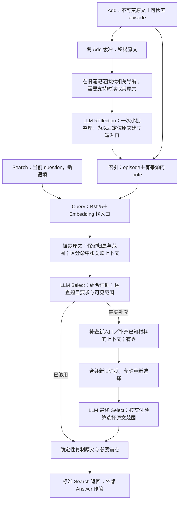

# 从实测现象追到模块语义：根因复核与改进方向

2026-10-30。当前提交 `5a9146a`，百题实测方法冻结于 `4191890`。本轮只做源码审读、保存轨迹的离线复算、设计和研究记录；没有修改生产方法、调用新模型、重写原运行或改变评分。下文的方案尚未实施。

## 先明确每个模块应该承担什么

第三版的原文优先、小批整理和两轮检索仍值得保留。核心问题不是缺少更多算子，而是几个不同含义被当成了同一件事：

| 模块 | 应当表达的含义 | 不能据此推出 |
|---|---|---|
| 原文与 episode | 这段话确实存在，可以追溯到位置、说话者和上下文 | 一个有界字符片段已经包含完整事件 |
| note 与来源链接 | 有一个值得继续阅读的主题入口；这里是它所据的原文 | 每条来源都同样回答当前问题；笔记解释就是已核实事实 |
| Query | 按词法和语义找到可能相关的入口 | 排名等于证据强度，或前面几项已经覆盖全集 |
| Inspect／来源反链／邻接 | 补充理解当前材料所需的原文 | 被关联带出的材料应自动压过独立命中 |
| Select | 在实际看见的材料里选出有用组合，并发现可继续检索的缺口 | 未看见就是不存在；选择成功就代表交付成功 |
| Reflection／缓冲 | 积累后构建轻量检索入口，减少重复处理 | 缓冲变长自然产生全局理解；工具成功就是语义整理成功 |
| Search 交付 | 给外部 Answer 可追溯、有条件限制的证据 | 记忆系统已经替 Answer 做出结论 |

分析遵循三个层级：**已保存的真实行为、可复现的实现机制、尚待实测的改进假设**。不同层级不互相冒充。

## 本轮核查范围和新证据

读取26个冻结实验库，重算100题的160次 Query，逐次核对保存的前48候选；重放135次 Select 的候选构成，首轮展开和补查后的合并均与实际输入一致。另按历史提交顺序重建732次 Reflection 的当时语料，逐次核对实际呈现的旧笔记文本，全部一致。

离线分析脚本与结果在忽略目录 `research/data/mechanism30/`：`analyze.py`、`reflection_history.py`、`presentation.py` 及对应 JSON。SQLite 以只读模式打开；没有实例化 provider 或调用模型。

| 观察 | 数量 | 正确解释 |
|---|---:|---|
| 首轮候选达到24张上限 | 98/100题 | 候选取舍是普遍生效的机制，不是偶发边界 |
| 去掉邻接后候选集合发生变化 | 94题，548个卡片位置 | 邻接影响很大；不能由此直接判它有害 |
| 去掉 note 展开及来源反链后集合变化 | 78题，453个位置 | 导航参与了阅读路径，但仍需区分有用引路与挤占 |
| 提出补查 | 35题，60条补查 Query | 另有100次初始 Query，总计160次 |
| 补查后最终选入首轮未见的原文 | 8/35题 | 其余27题没有这种增量，不等于27次补查都无价值 |
| 新候选被首轮保留项挤出合并预算 | 3题，共10张新卡 | 是已发生的合并机制；没有逐条证明这10张都是必要证据 |
| Reflection 看不到旧笔记 | 413/732次 | 其中26次尚无旧笔记；另387次存在词法可匹配旧笔记，却未进入前置截断后的候选 |
| 活动 note | 3,745条 | 1,797条仅引一个 episode，2,316条仅来自一条原消息；不能把单来源直接判为低质量 |
| 实际 Select 输入中原文以外的字符 | 总体37.0%；LoCoMo 68.4% | 包含问题、有效元信息和冗长标识；是字符占比，不是 token、无效占比或质量损失率 |

这里的来源是标准Add接收并保存的消息；预处理若已切分消息，不能把它直接等同于上游完整文档。

另外，对有标注的100个**原文证据片段**做了路由层消融。这100个片段并不覆盖100个问题，也不是完整的必要事实集合。固定原 Query 排名，首轮原文命中片段为66个；去邻接为71个（新增6、失去1）；去 note 路由仍66个（新增5、失去5）；两者均去除为67个（新增9、失去8）。这不是“无 note 索引”的实验，更没有重新调用 Select／Answer。结论应是**路由同时有收益和代价，应改分配方式，不宜根据净数直接删除模块**。

## 问题一：导航相关性被当成了所有原文的相关性

当前 `_disclose` 的实际做法是：命中 note 后，把它的 Query 分数完整交给所有支持原文；前六个原文又通过来源反链带出同 note 的其它原文，再补相邻消息。它们最后进入一个平坦的24张卡竞争池。

“这条笔记和问题有关”，并不意味着“笔记引用的每段话都同样重要”。来源链接保证可追溯，却不保证当前问题相关性。一个宽泛主题笔记可以把数段回应和旁支一起提升；多个独立低排名事实则没有获得阅读机会。这是导航与证据排序之间的语义混用，而不只是比例没调好。

活动案例 r01 中，首轮24张卡里16张的最高权重包含 note 路由贡献，5张包含消息邻接贡献；计数可有同分重叠。露营相关材料多，其他活动没同时出现。离线只保留直接 episode 路由能补出其中两段遗漏，但也会在别的题丢掉必要证据，故不能简单裁掉所有 note。

支出案例 lm4 也揭示修复边界：去邻接可让两段已经召回的费用原文提前可见，但120美元头盔在原展开池第46位；仅去邻接仍进不了24张卡。**一个更干净的候选池有帮助，却不能代替查询覆盖。**

建议：保留 Query 的原始命中与导航路径，关联材料首先表示“可继续读的上下文”，不把路径分数直接解释成每个子片段的证据强度。相同或重叠范围折叠；不同事实仍有独立阅读机会。不要仅按 source_id 合并——同一长消息可能包含几十条评论、多个牌局和多笔购买。也不要仅按向量近似合并，否则两个相似但不同的事件会被错误消掉。

这不需要恢复固定节点类型配额，也不需要每对材料增加 LLM 判断。可以先在现有候选构造与 Select 中试验“直接命中及其解释上下文共同呈现，关联来源保持可辨认”，观察必要事实覆盖与输入成本。

## 问题二：episode 保住了原字节，却没有保证阅读单位完整

字符切分会切断标题与正文、主体与代词、事件编号与后续步骤。当前卡片有起止位置，但没有父消息总长度、继承标题和是否还有上下文，模型不知道自己看到的是整条事件还是中间一页。

此外，当前“邻接”实际条件是同 session、同 request、消息 ordinal 差不超过1：

- 同一消息的所有切片 ordinal 相同，因此命中开头可把远处切片也当邻居；
- 相邻两条消息如果被分入不同 Add 请求，就失去这条邻接路径。

离线合成例证已复现这两点：同样的两条消息合包时能补出第二条、拆成两个请求后不能；一条长消息的0、1800、3600、5400位置都被视为第一段邻接。这证明的是实现依赖传输分包，不能将合成结果记成真实回答失败。

牌局 r09 的错误同时包含两种情况：一处正文缺编号锚点；另一处编号已经交付仍被 Answer 误用。前者明确属于披露问题，后者只能通过展示对照验证是否可改善，不能承诺补标题全解决。

建议：以会话内真实来源顺序和原文范围定义阅读邻接，以明确原文标题定义可继承锚点。对没有标题的普通聊天，不制造事件编号或推断标题边界。标明已读范围与尚有上下文；只有理解当前片段需要时才补读。应验证 Add 如何合理分包不会改变这些邻接含义。

模型可见叙事可以变成“片段12：某段对话中的头盔购买；对话日期……；原句……；这是原消息的一部分”，机器仍保留稳定 ref、精确范围、完整来源。缩短反复出现的哈希、长 session 标识与技术解释，保留真正有语义作用的身份、日期和原文限定。不能用一个流畅的模型摘要替换原句，再重现二期摘要窗口漏证据的问题。

角色也不能机械降权：本地LoCoMo适配把两位真实对话人物映射到user／assistant，原文另有明确Speaker前缀。API role不是人物身份，也不能据assistant字段判定某段只是AI建议。应理解材料本身是谁的陈述，而不是增加“assistant都次要”的规则。

## 问题三：Select 同时承担筛选和判断“还有没有别的证据”，却没有足够线索

现有提示已经要求保留清单、比较、变化、多步证据，也已经要求不要混淆主体与语气。继续加入同义提醒，未必解决问题。

真正的限制是：模型只看到24张卡；补查又被限定为“在已给片段中出现的具体桥接或命名主题”。这适合“已知朋友名字→查住址”，却难处理“今年所有自行车支出”这种集合问题。如果头盔根本没出现，模型不能发现一个具体的头盔缺口；同时它也不该凭空断言用户买过头盔。

需要区分**查询假设**与**事实断言**。从问题出发寻找“购买、维修、配件支出”是检索方向，不是在编造用户经历；从 gold 得知“Bell Zephyr，120美元”并写入查询则是泄漏。允许前者，禁止后者。补查可以来自题目要求、原文已知实体或尚未覆盖的材料范围，不只来自当前卡片已提到的名称。

还要区分两种缺口：

- 没找到新的事实入口：继续 Query；
- 已定位一条材料，但缺标题、上文、后文：补读这条材料，而不是换几个词再搜一次。

35题补查中31题确实有首轮未见材料进入末轮，但只有8题最终选入新材料。可能包括新材料无关、原证据已够、Select错排、查询同义重复，不能用一个数字定性全部失败。需要按这几种机制读对照。3题还有首轮所选卡先占预算、末轮新材料被挤掉的情况；保留旧证据应表示不无故失去它，不应表示它永久优先于新证据。

建议继续复用第一次 Select，不增加所有问题都必经的规划模型；最多一次补查后的最终 Select 作为成本边界。最终模型要能重新组合新旧证据。先让补读与查询有清楚区别，是否需要新增工具字段在执行计划中再收敛，不预先扩成完整 agent loop。

## 问题四：Reflection 目前更接近局部摘要，而非持续导航整理

“旧笔记没有被模型利用”要分成两件事。

**第一件是明确的入口缺陷。** 代码在全部新旧 episode／note 中先截词法前48，再筛 note。新批次原文与由这些原文拼成的查询高度重合，竞争范围与“找旧笔记”的目的不一致。历史复算确认387次有词法可匹配旧笔记却完全不显示。应在旧笔记范围内先找候选，再按相关性选择，而不是先让它们与当前原文竞争。词法匹配仍不等于语义相关，不应强塞六条旧笔记。

**第二件是任务定义。** 当前旧笔记只读，新 note 只能引用本批新原文，不能把旧来源一起链接。732批中699批有多条原消息、279批跨会话，但最终只有29条 note 的支持跨会话。这个比例不能单独评价质量，却说明完成率726/732不代表已经形成跨批导航网络；能力边界是局部组织。

一个实质样例：原文明确写“Bell Zephyr helmet for $120”和“might just go back”。派生 note 标题为“Positive Experience with Local Shop”，保留商店体验，却省掉金额，并写成“plan to return”。原文没有改，最终结果也不直接使用 note 作证据；问题在于导航主题丢掉了以后会用于定位事件的区分信息，并把可能性写强。

更合适的整理目标是：**让原文以后更容易被找到、被区分、被一起读**。笔记可用简短自然语言突出具体对象、行为与有区分力的细节，例如“头盔购买与商店服务体验”；不要求为所有材料套一组事实属性，不要求生成最终答案，也不要求每条旧记忆都合并进来。

建议先修旧笔记入口，并用同样的小批次、一次生成验证导航目标。单来源 note 并非冗余——它可能把原文很口语化的表达变成好的检索入口。79条额外 note 与其它 note 具有完全相同的支持集合，也不能直接判为重复，因为同一原文可以服务不同主题。真正要测的是：新增 note 是否帮助原来难找的事实，又是否制造候选挤占。

跨批追加支持应当另设验证：必须实际读旧原文，不能把旧 note 的摘要当新事实依据。先证明这种增量有益，再决定是否引入更新能力；不把复杂草案审查和关系写入重新带回当前稳定主链。

## 问题五：交付完整性与遗忘边界是独立契约

**交付。** Select 用60k字符候选空间决策，交付最多24k，却不知道卡片代价。当前135次 Select 中总体37.0%的输入字符不属于原文正文，LoCoMo 为68.4%。这些字符并非全无用，但自然叙事的改进应优先压缩不帮助理解的标识，而不是删掉角色、日期或限定条件。24张硬卡数限制仍在，缩短元信息不会自动让遗漏事实出现。

评论 c1 实际选择24张、只交付11张。应让最终选择承担交付预算，并可选择经过验证的原文段落；程序复制选中范围及必要锚点，不自由摘要。原文中主体、否定、时间条件不能被切走。仍然只有这一题出现最终预算遗漏，不能把其余失败全部归给装箱。

**遗忘。** 当前只处理指令之前的来源，没有后续复述与被撤销事实的关系。因此旧原文虽屏蔽，助手确认也能作为新事实重新入库。它不是再加一条“不要弄错音乐节”式提示能修好的问题，而是接收端缺少范围明确的撤销语义。直接照搬持久主题黑名单也不合理：会误伤同主题一般知识、他人信息和用户后来明确的新陈述。

先区分撤销旧陈述、对撤销的确认、后来真正的新信息。是否把遗忘理解为持续禁止某类信息，需要与用户明确；不能从一个案例推断无限期封禁。仍应维护 Add 的原子接收语义，避免以可选 Reflection 成败决定是否完成必要遗忘。

## 统一后的方向预览

下面是讨论中的设计语义，不是现有代码流程。

不是把每次搜索变成长循环。优先守住当前普通问题一次Select、补查最多再一次的调用边界；没有必要每条原文增加分类模型，也不先加一个总是运行的规划模型。Reflection 仍是轻量整理，而不是第二个负责回答的 Agent。

## 怎样验证，避免按这100题定制方法

1. **先验证模块契约**：同样的消息合理改变 Add 分包不应改变邻接；片段补读范围可验证；参考同一原文的多个入口不重复消耗正文预算；旧笔记选择不被当前原文的排名截断；Select选中材料与交付范围一致。
2. **固定证据的展示对照**：人物、状态、日期误读类先固定候选，比较旧卡与更清楚的卡。若回答仍错，就承认外部Answer能力边界；不通过增加无出处的解释替它回答。
3. **冻结库的检索对照**：改路由时固定索引和查询；改补查时记录每个查询实际新增什么；分别报告原文范围、必要事实、错误归属及调用成本。不能把离线片段覆盖当回答正确率。
4. **新库的整理对照**：修旧笔记入口与导航目标后，完整Add再Search；测真实检索增量、笔记语义、重复与成本，不只测工具合法性或写入条数。
5. **保留正例和新样本**：20/100比例、7天日期差、1000→1200配额作为正控制；另选未用于分析设计的完整历史，跨数据集看集合、关系、时间、冲突、长材料和拒答。方法输入不读gold，不出现某个案例特定金额、活动类别清单或人物名字。

推荐顺序：必要遗忘边界单独处理；主线先做来源／阅读范围与路由分配，再协调Select补查和交付；Reflection先修明确的候选范围错误，再用实际增益决定跨批增强。暂不恢复二期自由BFS和语义图写入。这里的“暂不恢复”是设计取舍，不是在生产代码中增加默认关闭的功能分支。

## 参考与复现边界

- 当前依据：`amlink/engine.py` 的 `_reflect`、`_rank`、`_disclose`、`_select`、`search`；`store.py` 的来源顺序和事务；真实模型输入与不可变运行档案。
- 一期 `archive/phase-1/src/aml_memory/service.py` 已有证据组去重和原文提升的思路，可吸收“同一材料不要重复占位”，不照搬多组经验权重。
- 二期经验是模型实际可见范围、自然叙事与来源对应；失败教训是高负担的写入／审查协议，不能为追求图而重引。
- 本地 TinySoul 参考提交 `ad7ce63791e8e99ec91c6a849f62d8788321bc50`：`kernel/retrieval/disclosure.py` 的标题继承、coverage、continuation；`selection.py` 将候选及其实际可见范围一起投影。参考的是原语含义，不宣称其效果已由AM-Link验证。本轮未拉取或在线重新核验。

没有新模型成绩。百题51正确／47未达标／2不确定仍属于原冻结版本；本轮新增的是能够复现的机制证据，以及更收敛的下一轮设计依据。
