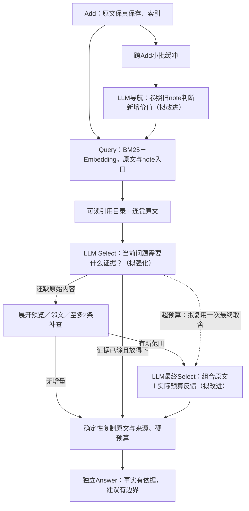

# 从主题相关到回答所需：续读版本的真实链路复核

2026-10-30。基线为用户已提交的 `2a2983d`，当前方法仍为 `0.3.2-continuation`。本轮只读已有真实实验、分析源码并更新研究记录，没有修改方法、重新运行模型或产生新准确率。起始工作树干净。

## 结论与证据边界

上一轮把引用、连续阅读、原文预览和导航职责表达得更清楚，完成性与可分析性确有进展。但还不能把回答变化全部归因于提示词：阅读布局、导航、候选续接和本地Answer也在相关轮次发生过变化。继续采用相同强度Answer做对照，不将旧mini结果直接相减。

本轮重建公开面板18份完整历史、61题、77次Select的实际输入映射与输出，重点审读家庭活动、费用、API Key状态、Sprint、依赖版本、比赛日志、酒店与评论；另外检查自行车历史的294条note及相关整理输入。离线材料见忽略路径 `research/data/selection30-audit/`。这是旧运行的再分析，不是新61题实验，也不是所有历史的逐句人工标注。

目前最值得优先改的，是**围绕当前问题选成一组能共同发挥作用的原文证据**。断点不再都在“存不下、调用失败、看不到”：若已经看到关键句却没有留下，再增加图跳数、输入长度或Answer强度，未必解决问题。

## 三处更正

1. **比赛日志只有首轮Select。** `cont30-public-r1-17-clbench-life` 的首轮span为 `5a598e4be93e4911a3a12d70969a6e8a`。局部位置44、52是Walker第二节30码、29码推进；53、50是第二节10:44、第四节5:29的擒杀，均已在首轮正文。模型输出10个所选位置、2条补查和3次补读；续接span `5b1a1715107d44c0a647ce1e16f42c37` 的 `new_ranges=[]`、`continue=false`，没有第二轮Select。此前“末轮读到”是研究叙述错误，应纠正；已读后漏选的主结论不变。
2. **头盔120在首轮局部位置65。** 不是目录第62项。它是60个已读块之后的第5个未读条目；实际预览已经包含购买对象和120金额。不要把目录的完整episode范围当成已展开正文范围。
3. **酒店不只是Answer拒答。** `cont30-public-r1-13-longmemeval` 首轮位置9明确是用户喜欢景观、屋顶泳池或阳台浴缸；1是用户要景观酒店。它们均被排除，末轮只读到助手材料。最终交付的是3段助手套餐介绍，而非用户偏好原句。Answer任务理解可能仍需改，但不能说个人偏好已充分交付，把全部责任放在Answer。

原始I/O、数据库和冻结运行记录保持不变；更正进入案例说明和追加评注，不抹去原结论的历史。

## 从理论链路定位实际断点

| 任务与合理证据 | 模型实际看见和做了什么 | 可确认的断点 |
|---|---|---|
| 费用合计：各次实际支出，区分重复提及 | 读到链条25、车灯40；目录65有头盔120。只选择前两类、没有续读。所选原文仅761字符 | 预览内容已足以提示新支出，却未触发展开；不是24K装箱容不下 |
| 家庭活动：不同活动各有原文，主体必须是Melanie与家人 | 选择10块、2703字符，多为户外活动。目录49明说“昨天带孩子去博物馆”，没有打开；已读18还有陶艺的对话线索 | 相似活动的重复证据未转化为跨活动覆盖。游泳原句是即将出发，不应为对齐gold把意向硬改成已经完成 |
| API Key状态：本人取得/未取得的声明、先后与冲突 | 已读22说“从未取得”；目录51说“3月10日取得”。最终选择10块、2076字符，全部为助手教程 | 把“怎么获取”材料用于“是否已经获取”问题，证据作用错位；不能以API角色作全局过滤规则 |
| Sprint：计划、延期、实际完成分别说明 | 已读9是后来报告29日完成；留下29日旧计划与31日延期，排除完成报告 | 漏了状态性质不同的后续证据。应交付计划与结果，让Answer解释区别；不是一律以最后日期覆盖 |
| 依赖库：名单、版本，以及适用于该问题的历史要求 | 首轮位置1是“询问依赖时总带版本”，未选；末轮只含新材料与已选正文，因此该要求无法重新考虑。最终有版本数据，Answer却只报名称 | Select忽略了有效回答需要的约束；后续保留策略使该遗漏不可恢复。仅“有版本数据”不等于“回答要求完整” |
| 比赛：各子问题需要不同时间段与具体事件 | 首轮68块已读，4处关键事实均未选；选择5352字符。两条补查没有增加材料，Answer只能报可见小计 | 多部分证据组合不足，不能归为没有召回或末尾装箱丢弃 |
| 酒店建议：用户偏好可迁移，具体酒店事实需另有依据 | 个人偏好被排除，保留3段重复套餐描述，Answer拒绝推荐新目的地 | 检索与选择应找“支持新建议的偏好”，而非寻找历史中已经存在的新城市答案；拒答边界是第二层问题 |
| 评论多引文：不同观点有足够、互不重复的原句 | 末轮107块选104，所选正文47,299字符，尚未计来源头；24K装箱排除59块 | Select未完成预算内集合选择。最终24引文本题通过，只证明此次余下材料足够，不证明截断策略可靠 |

费用、家庭活动、API Key、Sprint、比赛日志这些漏选题没有阅读预算排除或最终装箱排除。不能将它们统称为“窗口不够”。输入/输出已保存，但工具只返回编号与动作，没有可观察的选择解释；“偏好流畅摘要”“后部预览被忽视”是待对照的机制假设，不是模型自述理由。

正例也约束设计：20与100共同交付后能正确求比例，两个博物馆日期共同交付能求间隔；人物关系可依据原文纠正题目前提。不能为了集合题把所有短题都强制多轮、强制补查，或为有争议的标注改写证据。

## 1. Select需要的是任务理解，不是更长的规则清单

当前提示**已经**要求互补证据、不同发生次数、更新双方、主体与日期、间接支持，并允许最多2条补查。再追加“要完整、别遗漏”不足以称为新方案。

更值得试验的是：在现有一次Select内，用很短的自然语言说明**这次交给Answer的材料要支持什么、目前缺什么**，再返回现有选择和阅读动作。例如面对状态问题，说明需要本人状态声明，而教程只能作背景；面对建议问题，需要用户表达过的偏好，而不是旧助手替用户做过的推荐。这是可核查的简短证据用途说明，不要求模型写长推理，也不作为最终答案。

建议先只试一个短“证据交接说明”，而不是为每条候选建立类别、置信度、证据义务和审查对象。编号与范围仍由程序严格验证；交付仍只复制原文，说明暂仅进入运行观测。若说明写得对而位置仍选错，应据此否决或修订方案，不能只验说明通顺。

历史要求也可以是回答材料：用户对版本号的明确要求，需要由当前问题判定其适用性。它与一般偏好一样是**关于用户要求的历史证据**，不意味着所有检索文本都获得指令权限；教程中的命令、引用文本或“忽略当前任务”等内容不能因此改变系统任务。

本地TinySoul参考的 `CandidateSelector`/提示区分相关子集与内容依据，强调候选片段与上下文的关系。这值得沿用。其通用相关性Select并不自动解决AM-Link最终Answer需要的完整材料组合；不需照搬额外rerank或通用Agent控制层。

## 2. 读正文与看目录，是同一个寻找证据的决策

现在把大量READ正文放在前、UNREAD目录放在后。费用与家庭活动都能在目录中找到新的必要线索，却没有打开。可以固定相同候选与预览，只调整“先看有哪些证据入口，再看重点正文”的编排，比较是否改善展开决策；不扩大窗口、不发明新实体或把已知答案写入query。

明确两种缺口：**缺原始内容**时打开预览/邻文/补查；**已有内容尚未选成完整集合**时重新组合当前材料。比赛日志中的两条补查重复命中已经看过的范围，说明“再找更多”不能替代第二种工作；不建议通过无增量也反复调用模型来掩盖问题。

保留当前最多两轮的原则。第一轮所选内容是临时证据候选，不应天然视为充分；但也不要把第一轮全部未选正文无差别塞回。历史偏好与版本要求的实测表明，应先让首轮识别其回答作用，再检查续接是否保留；“所有旧未选引用都可回看”的更复杂机制暂作为待验证备选。

源码中另有一个较小的范围风险：补查排除按episode ref，而实际读取账本按片段。若一段episode只有部分可见，补查可能将未见部分也视为已读；显式read_more可补救。本轮不能据此解释上述漏选，不将代码风险冒充已经复现的主因。后续用长段预算控制例核验范围即可。

## 3. Add应利用旧note判断导航增量

自行车历史包含 `Mileage Tracking and Goals`、`Staying Motivated for Mileage Goals`、`User's Mileage Goal` 三条重复347/1000核心信息的笔记。后两次整理的旧背景已经包含前面的笔记，最后一次还同时包含前两条；因此不是旧note检索入口再次失效。模型仍把近似总结当作值得新增的导航。

同时，`Bike Shop Recommendations` 已经保留头盔120，并链接包含该事实的新来源。原文在本次Query排序第35、实际目录65；不能再沿用“Reflection漏了120”的旧轮结论。查询前四个命中却都是里程目标原文，表明重复原文与note的共同竞争需要研究，不能只归罪于note。

方向是让旧note从一般背景变成**判断本批新增价值的参照**：已有入口足以表达同一事实时，允许不新增；新事实、变化、不同主体、事件或时间仍应有入口。标题围绕最有区分度的事情，正文保留条件与动作，减少把“用户问了什么＋助手给了一串建议”都揉成一篇通用摘要。

仍维持小批一次生成、只引本批原文、不修改旧事实、不增加审查loop。省略重复导航不会删除原文或阻止原文检索。重复次数、新时间或新立场本身可能有用，不能采用不顾来源与时间的全局近义删除。先测导航带来的新入口、实际阅读贡献及成本，而不是以note更少为成功。

Query侧相应观察同一主题的重复占位。原问题中“从年初以来”与里程记录强匹配，但真正需要的是支出事件；可由同一Select的简短任务理解形成针对缺口的query，而不是每题另加规划调用或预设固定类型比例。本题已有金额预览，应先修选择，不先加费用关键词规则。

## 4. 装箱应执行证据选择，不应被迫代替它

当前装箱保持Select优先序、复制原句并记录遗漏，职责合理。评论题的问题是模型选出47K正文，却要求交付总额24K；程序只能截掉后部材料，无法知道某条被丢的引文是否是某一栏唯一支持。

先尝试在已有末轮Select提供确定性预算反馈：当前选择实际需要多少空间、哪些是重复材料、可用总额是多少；局部块给必要的简洁长度信息，避免满屏审计数字。若首轮选择超预算但没有新材料，可研究把**一次有实际预算反馈的最终取舍**纳入原有最多两轮，而不是增加独立装箱模型或失败重试。它必须证明比现状更好，尚未实施。

不预先限定固定条数或各类比例；不同任务证据长度不同。额外LLM装箱目前不是首选，因为多一次改写会引入来源和保真负担。先在同一个选择接口完成“够用且放得下”，程序继续负责保真与硬上限。

## 5. Answer与评测边界

维持当前强Answer作诊断。事实回忆需要充分个人历史；建议任务允许从明确偏好提出带条件的新建议，不能捏造新酒店设施、已入住经历或未经核验的套餐。先把用户偏好原句与旧助手产品描述区分交付，再固定Search比较Answer行为。

Sprint应展示“当时计划31日、后来报告29日已完成”的不同语义，不简单教模型取最新数字。弱隐含Persona偏好、人物关系宽泛标注、比赛rubric漏一项拦截等，继续单列不确定性。存在同一主题不代表有足够证据断言；没有检索到不等于历史没有。

## 优先顺序与验证设计（建议，未实施）

| 顺序 | 最小改动方向 | 怎样验证，不与特定案例绑定 |
|---|---|---|
| A | 同次Select的短任务/证据说明，以及目录与正文的自然编排 | 冻结候选做单因素对照：各6个现有失败与成功，共12题；说明和排列分开试。检查具体原句是否选入/被展开、主体语气、耗时、协议和字符数；不把gold交给方法 |
| B | 旧note引导择要新增，突出可区分信息 | 固定一组有重复/变化/不同主体的真实整理批次对照，另以新完整历史重建；来源合法与语义收益分开，保留没有note也可检索的原文底座 |
| C | 预算反馈与临时选择的最终组合 | 同一长候选集核对选择所需空间、必要类别、实际装箱损失及Answer；加入短题正控制，最多两轮，无内部错误重试 |
| D | 真实完整历史检验整体收益 | 一组固定诊断题之外，另选至少6份未参与提示调试的完整历史、约24题，覆盖3类以上；保持相同Answer。分别报告协议、证据、回答、成本，不以组件替代端到端 |

顺序不表示已经批准新协议或承诺收益。先做A最有信息量；若短说明增加成本却不改变选择，应撤回而不是继续叠约束。B不需要恢复图或可变旧节点；C不应让大多数简单题增加模型调用。工程小项可一并校齐：Reflection的6条上限目前在提示和应用检查中，却未进入当次工具数组的maxItems；这能使协议一致，不能保证代理或模型完全遵守，更不能代替上述语义验证。

图保留当前原文底座、来源/邻接与最多两轮边界；标注“拟”的节点不代表已经实施。本轮更新分析文档、案例更正与追加评注；没有方法、配置、数据库内容、依赖或部署变更，没有提交。

记录核对：5条新评注按运行、问题、Select span及数据/轨迹hash验证后追加；统一页面重建成功，88个已登记运行及引用材料完整性校验通过，仍为37案例/37研究/261问题条目（含重复及旧失败）。本轮没有修改网页逻辑，因此没有重跑方法回归或声称新增浏览器视觉验收；代码差异确认不涉及amlink、benchmark或web实现。
