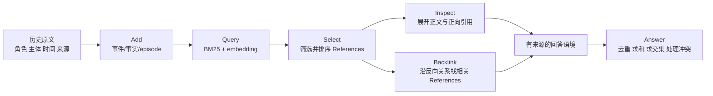

# 从“记住一句话”到“交付可用证据”

这份材料为一次记忆研究分享准备。它不把 AM-Link 当前版本当作主角，而是从公开数据和具体样本开始，解释记忆系统到底要保存什么、检索什么，以及为什么“找到相关句子”仍然可能答错。文中把四种内容分开：数据事实来自本地数据核验；理论链路是设计上的应该怎么做；真实观察来自 Mem0 和 AM-Link 已保存的运行；没有运行或证据不足的地方明确写成未知。

## 1. 先理解数据集在考查什么

记忆数据集表面上都是历史和问题，实际上考查的能力很不一样。LongMemEval 有 500 道题，包含跨会话、时间推理、知识更新、单会话用户信息、单会话助手信息和偏好等类型；S 设置的会话中位数是 48，而 Oracle 只保留与问题有关的较少会话。BEAM 把更长的聊天、代码和能力探针放在一起，最长档达到 10M。LoCoMo 有 272 段会话、5,882 条发言和 1,986 道题，重点是多次聊天中的人物、事件和关系。PersonaMem-v2/v3 则把主体边界、敏感信息、反馈、遗忘和时间遮罩带进记忆问题。

不同数据集的题目，真正“难”的位置也不同。BEAM 关注历史规模、事件顺序和长期状态；LongMemEval 关注跨会话、日期、更新、拒答和需要合并多条来源的问法；LoCoMo 关注人物之间的多跳关系和共同兴趣；PerLTQA 与 MemoryAgentBench 把关系方向、版本和冲突做成结构化材料；CL-bench Life 关注规则、条件和缺失信息；PersonaMem-v2/v3 关注偏好、敏感字段、遗忘，以及提问之后才出现的反馈。它们不是同一件“记忆容量”测试，而是分别追问：记不记得、记得哪一个版本、记得谁的、还缺哪个条件，以及这件事是否应该进入长期记忆。

这里的“跨会话”不是“上下文很长”这么简单。它表示当前问题发生在这次会话，但答案需要从以前几次彼此独立的会话中拼出来。LongMemEval LM04 中，链条、车灯和头盔分别出现在不同历史片段里；系统要知道它们共同回答一个支出问题，也要知道车灯的重复提及不是第二次消费。

“知识更新”也不是删除旧句子。B01 先出现每天 1,000 次，后来明确改成每天 1,200 次。回答“现在”要选择新值，回答“最初”又要能追溯旧值。B02 里“已经取得 Key”和“从未真正取得 Key”没有明确的替代关系，应该保留冲突并请求澄清。记忆因此要保存事实，也要保存事实的时间、主体和相互关系。

一个数据对象往往同时含有四类字段：历史材料、当前任务、评估标注和辅助信息。以 LongMemEval 为例，`sessions[].turns[]` 是可以交给 Add 的历史，`tasks[0].input.text` 是 Search 问题，而 `annotations.answer`、`evidence_turn_ids` 属于评估侧，不能泄漏进记忆输入。把整个 JSON 一起喂给系统，会让答案标签伪装成历史事实。

## 2. 用案例把理论链路讲清楚

### B01：更新需要版本关系

问题是“这个项目当前每日 API 调用配额是多少”。历史同时出现每天 1,000 次、每分钟 60 次，以及后来的每天 1,200 次。一个只按相似度取一句话的系统，可能召回旧值，也可能把每天和每分钟混在一起。

合理的链路是：Add 保存项目、属性、单位、顺序和来源；Search 找到同一属性的多个版本；Answer 根据“后来明确改写”选择 1,200，同时保留旧值供“最初是多少”这类问题使用。这里可以建立 `supersedes`，但不能把所有后出现的句子都当成覆盖。B01 没有作为独立的全量 Mem0 或 AM-Link 准确率实验，网页中的内容是理论案例和设计检查。

### B02：冲突不是更新

一段历史说 2024-03-10 已取得项目 Key，另一段说从未真正取得。两句都像事实，却没有足够信息证明哪一句是后来的修正。

正确做法是保留两条原文、主体、日期和来源，并把关系标成 `contradicts` 或待澄清。Search 的任务不是替用户挑一条，而是把冲突两端都交给 Answer。2026-10-08 的 AM-Link 诊断确实返回了两条相反来源，但回答先以肯定语气开头，之后才补充冲突。这说明召回已经成功，错误仍可能发生在回答表达阶段。

### LM04：跨会话聚合需要事件身份

历史里有链条 25 美元、车灯 40 美元、头盔 120 美元，车灯还被多次提及。理论答案是三笔独立消费去重后合计 185 美元。

Add 要保存金额、物品、主体、时间和原文，并把“再次提到车灯”与“新买了一件车灯”区分开。Search 要收齐不同物品的证据，必要时 Inspect 原文。Answer 再按事件去重后求和。一次 Mem0 诊断回答了 65 美元；观测中此前出现过头盔事实，所以不能简单断言是“完全没记住”，断点可能在候选、上下文装箱或最终组合。另一次 AM-Link 诊断拿到四个标注来源并答出 185 美元。这两个结果输入和运行条件不同，不能直接当作排名比较，但很适合展示证据集合为何比单句相似度重要。

### LM05：比例题先找齐证据槽位

历史分别说女性占 20 个领导岗位，公司共有 100 个领导岗位。20 是分子，不是百分比。若 Search 只找回第一句话，模型无法可靠计算。

理论链路要明确列出分子、分母、公司主体、时间和统计口径，再计算 `20 / 100 = 20%`。2026-10-08 的 AM-Link 单题诊断拿到了两个数字并答对 20%。这说明下游计算并不难，难的是检索阶段不能把分母当成“不那么像问题”的旁枝。

### LM02：时间戳必须进入正文和来源

“相隔几天”需要知道两件事发生的准确时间，还要知道题目采用的是经过时长、日历日期差，还是首尾都计数。Mem0 的日期前缀短例保留了一侧日期，却把另一侧压成 `recently`，因此无法稳定计算。AM-Link 的一次诊断拿到 UTC 时间戳并算出约 6.5 天，而数据集参考按日期差记为 7 天、首尾计数为 8 天。这里暴露的是时间口径和 Answer 解释问题，而不只是向量召回问题。

### L04：多跳问题要检查两边是否都覆盖

“Joanna 和 Nate 共享哪些兴趣”要求先分别找到两个人的兴趣，再求交集。只找到 Joanna 喜欢的电影，不能证明 Nate 也喜欢；只返回一条高相似结果，也不能说明没有第三项共同兴趣。

理论上 Query 可以分别围绕两个人提出候选，BFS/Inspect 沿人物和兴趣关系展开，Select 不能因为电影更像问题就丢掉甜点证据，Answer 再按人物分组求交集。一次 AM-Link 运行中，7 个标注来源都出现在 top-5 结果里，但诊断回答仍只说电影，遗漏共同做甜点。它说明“证据覆盖完整”和“回答完整”之间还有一道检查。

### PV04：遗忘必须能证明

用户曾喜欢手工艺品，后来明确要求忘记；新的问题只是请推荐乔迁礼物。系统应给出不依赖旧偏好的普通建议，并且不让旧偏好从摘要、向量或缓存中回流。

要验证遗忘，首先要确认该偏好曾经被写入，然后记录撤回范围，检查原文、摘要、索引和关系是否都失效。Mem0 的另一个 PV02 短例中目标偏好一开始就没有写入，因此“不再提及”不能证明删除成功。AM-Link 的 PV04 切片在 Add/Search 阶段受阻，也不能据此宣称遗忘成功或失败。

### V301：未来信息也属于证据边界

PersonaMem-v3 同时提供活动事件、问题和未来反馈。提问后的点击或作者生成的偏好标签可以帮助评估，却不是提问当时智能体已经看到的历史。

预处理要按提问时间切片，排除同刻和未来事件，保留动作、内容身份和时间。2026-10-14 的 Mem0 与 AM-Link 切片都完成了 Add/Search/Answer，但没有统一 gold answer；Mem0 给出三条游戏/幽默候选，AM-Link 的装箱只交付两条。因此这里适合展示“可见证据范围改变推荐覆盖”，仍不能当作准确率。

### B03：顺序题要求保留过程，而不是只保留主题

城市自动补全的五个实现关注点可能在相似代码上下文中反复出现，但题目要求五项都出现，而且保持原来的顺序。2026-10-14 的真实运行把这个断点具体化了：Mem0 37 次 Add 只有 7 次成功，因写入未完成而没有自动 Answer；AM-Link 37 次 Add 只有 10 次成功，Search 虽返回五个带来源事实，独立 Answer 却列出了性能、错误处理、加载动画、定制实现和输入校验，没有恢复标注要求的防抖、慢响应、快速输入、下拉/错误、监听器清理顺序。这里既有长历史 Add/Reflection 失败，也有 Search 没有把顺序当成证据槽位的问题。

### LM03：拒答题仍然需要边界证据

历史只说“猫叫 Luna”，问题问“仓鼠叫什么”。理想结果不是空白，而是说明 Luna 属于猫，历史没有仓鼠姓名。2026-10-14 Mem0 和 AM-Link 都完成 Add/Search/Answer，返回猫的相关证据并明确拒答；这说明 Search 可以有结果，而 Answer 仍然应该说证据不足。拒答题检验的是实体边界，不是简单的空召回。

### P01：人物关系的箭头不能被关键词替代

“张小红的兄弟是谁”需要保存张小红、弟弟、张小明和关系方向。如果只保留“小红、小明、兄弟”，系统可能把主客体反过来，或把同名人物合并。2026-10-14 Mem0 和 AM-Link 都完成 Add/Search/Answer；Mem0 答出张小明，AM-Link 还保留“弟弟”的方向语义。短关系链显示结构化关系和 References 叙事确实能减少主体、宾语和箭头被压扁的问题。

### P02：评估答案不能反过来修复原文

PerLTQA P02 的事件记录、对话日期和作者答案互相不完全一致。记忆层应保存事件、原句和时间冲突，Search 应同时交出冲突两端；Answer 可以说明“对话称已抵达，但具体日期矛盾”，不能把 gold answer 写回历史。真实 AM-Link 切片在 Reflection 生成非法 `about` 关系时被 schema 阻断，没有进入 Answer，因此目前只能定位到 Add/Reflection 断点。

### M01：三跳关系需要每一跳都更新状态

MemoryAgentBench M01 要沿着“作品 → 最新作者 → 配偶 → 国籍”走三跳，且作者、配偶和国籍都分别有旧值和新值。合理的 Search 是先找最新作者，再 Inspect、Backlink 或继续 Inspect；每一步都保留来源编号和版本状态。AM-Link 诊断返回了冲突关系并采取谨慎表达，但该 pack 没有统一 gold answer/evidence，所以只能作为真实可观测实例，不能当准确率。

### C02：缺少条件时，保留分支比猜结论更好

CL-bench Life 的税务案例同时给出 65、435 和 2,000 美元，但没有说明一般损害是否源于身体伤害。2026-10-14 两套系统都完成 Add/Search/Answer，然而 Mem0 按常见规则补写一般损害的适用条件，AM-Link 还加入证据中没有出现的 punitive damages 和 pain and suffering。这里 Search 已经拿到材料，断点在 Answer 把“未知条件”改写成常见法律分类。理论链路仍应要求对确定部分计算，对 435 保留条件化回答。

### PV03：敏感字段必须在写入边界被最小化

保险理赔请求可能包含社会安全号码。2026-10-14 PersonaMem 长历史的 Mem0 Add 为 8/15、Search 为 1/2，因 Add setup 不完整没有自动 Answer；AM-Link Add 为 0/15，错误集中在遗忘指令和 Reflection/schema 校验，但 Search 仍返回两组证据，独立 Answer 只给通用清单和安全传输建议。没有复述敏感字段只能说明输出层暂未泄露，不能证明 raw、episode、向量、关系和缓存都已最小化。

## 3. 从案例抽出共同的 Add/Search/Answer 链路

这条链路可以用一个问题来检查：每一步交给下一步的东西是否足够。Add 如果只保留摘要，时间、角色和原文可能已经丢失；Query 如果只按整句相似度取 top-k，分母或另一个人物可能被漏掉；Select 如果只看到短片段，无法判断候选是否互补；Inspect 没有来源和关系，展开后的正文就失去意义；最终装箱如果重复展开大块正文，又会挤掉另一条必要证据。Answer 还要执行问题需要的运算，不能把“找到了两条冲突事实”自动变成唯一结论。

因此，正确回答不是一项单独的“记忆能力”，而是证据交付能力。一个成熟的观察记录至少要能说明：原文是否存储和索引、候选是否召回、候选是否因预算被截断、Select 是否排除、关系是否扩展、最终上下文是否包含完整证据，以及 Answer 是否真正使用了它们。

## 4. Mem0 与 AM-Link 的真实观察应该怎样读

旧的 Mem0 六条件短例共 41 次模型请求，未出现请求失败；本轮新增的受控切片则记录了真实失败。关系组 9/9 Add、5/5 Search 并完成五个 Answer；LM03 1/1 完成；B03 长历史 Add 7/37 成功；PersonaMem Add 8/15、Search 1/2。它们说明日期摘要、更新并存、拒答、顺序和遗忘边界等具体现象，但不是全量数据集准确率。LM04 的 65 美元以及本轮 C02 的条件补写尤其适合说明：某个事实曾经出现过，不代表最终答案一定使用了它或会尊重证据边界。

AM-Link 2026-10-14 的 100 题复跑中，Add 为 128/145，Search 为 100/100；运行记录了 338 次 Inspect、72 次 Backlink、787 次 Select。Reflection 有 127 条工具决策，但尚未形成稳定的 Reflection 图探索路径。目标 Add 全成功的 94 道题子集上，top-5 证据召回约 55.3%，完整链约 59.6%。这些数字只能描述这一轮运行的证据链，不能替代官方 Answer/Eval，也不能证明图质量已经解决。

把它们放回案例中更容易理解：B02 的 Search 已经带来冲突两端，问题在回答策略；L04 的 top-5 已覆盖标注来源，问题在多项答案组合；LM02 的时间戳已被召回，问题在计算口径；PV04 还没通过 Add/Search，遗忘效果就是未知。运行统计只有在这样的案例背景下才有解释力。

新增切片把这些断点进一步落到了完整链路上：B03 的 AM-Link 37 次 Add 只有 10 次成功，Search 仍有结果但顺序题 Answer 错在证据集合；C02 两套系统都完成 Add/Search，却在 Answer 阶段补写了证据没有给出的税务条件；PersonaMem 的 AM-Link 15 次 Add 全部被遗忘/Reflection 协议拒绝，Search 的临时结果不能被写成“遗忘已成功”。详细请求数、错误码和短答案见 [2026-10-14 真实模型链路补充实验](../doing/2026-10-14-real-model-chain-report.md)。

## 5. 分享时的讲解顺序

可以先拿 LM04 让听众看到一个直观的数字：三笔支出应为 185 美元，但少一个头盔就会变成 65 美元。然后解释跨会话和重复提及，展示为什么 Add 要保存事件身份、Search 要收齐证据、Answer 要去重。接着用 B01/B02 对比“明确更新”和“无法解释的冲突”，让听众看到新值和矛盾不能使用同一套覆盖规则。最后用 LM05、LM02、L04 和 PV04 展示分母、时间口径、多人物交集和遗忘边界。

网页中的每个案例都按照“样本材料 → 必须记住什么 → 理论链路 → Mem0 观察 → AM-Link 观察 → 容易断掉的地方”展开。这样讲解不会先抛出一串方法名，而是先让听众看到问题为何需要某种记忆，再讨论方法在哪一步提供或丢失了证据。

## 6. 结论与边界

面向这些数据集，最低限度的记忆方法需要做到：每条内容可回指原文并保留角色、主体和时间；更新、冲突、撤回、过期和重复事件有不同状态；复合问题能表达分子、分母、人物和时间窗口等证据需求；输出给 Answer 的每条内容带有来源和关系；证据不足、冲突和未知不会被改写成确定答案；观测能定位证据在哪一步消失。

这不是说增加更多节点或更长上下文就一定有效。LM04 的问题不是缺少相似句子，而是缺少可计算的事件集合；LM02 的问题不是没有一个日期字段，而是日期没有以稳定口径进入后续推理；PV04 的问题不是回答没有提到旧偏好，而是没有证明它已经从所有存储路径失效。好的记忆方法要把原文、状态、关系、证据覆盖和回答所需的运算连起来。

本报告与网页共用 `casestudies/catalog.json`。网页是面向现场的交互讲解，完整运行轨迹和原始数据仍保存在忽略目录的研究工作区；缺失的模型调用、答案或标注不会被补写成成功。

## 参考入口

- [交互式数据与案例展示](./index.html)
- [案例库](../../casestudies/README.md)
- [统一研究可视化](../../visualization/README.md)
- [100 题 AM-Link 观测](../doing/2026-10-14-amlink-100-rerun-review.md)
- [2026-10-14 真实模型链路补充实验](../doing/2026-10-14-real-model-chain-report.md)
- [Mem0 与数据集研究综述](../doing/2026-10-08-memory-research-survey.md)
- [AM-Link Answer 诊断](../doing/2026-10-08-amlink-answer-research.md)
