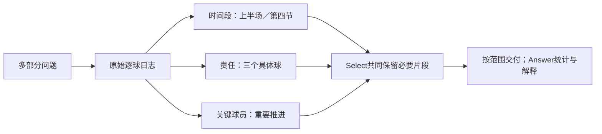

# 从“看见”到“选齐”：续读版本案例研究

本轮绑定`cont30-public-r1`，六类18份完整准备历史61题。方法及台账见[实施核对](../../docs/doing/2026-10-30-reading-continuation-implementation.md)。不是61个独立理论案例，也不是新的官方测评；唯一catalog保留旧研究，追加本轮实际观察。

## R15：多部分比赛日志

CL-bench Life记录`fe44b80a-8549-1b06-e39e-fecce3538cf9`。任务同时要求：用三个具体球解释责任；比较上半场与第四节的擒杀/失误；解释少达阵原因；列出关键进攻球员的重要推进。原材料为逐球日志加历史回答，3次Add完整接收。

理论上，需要保存的不是“这是一场防守主导的比赛”一句摘要，而是每个相关球的**节次、时钟、球员、动作、结果**。搜索应按各子问题收集互补原文，最后回答把统计和判断分开。任何缺失时段都不能直接记成零，历史助手的总结也不能代替原日志。

真实运行提出了2条补查，继续读到新材料。末轮Select的局部位置44、52、53、50分别包含Walker第二节30码与29码推进、第二节10:44擒杀、第四节5:29擒杀。它们确实出现在实际输入正文，随后未被选入最终交付。

Answer因而只说上半场可见1次擒杀、第四节未见擒杀，列出的Walker重要推进变成14码、3码及不够具体的驱动总结。它做了“只是片段”的限定，但没有完成用户的完整统计任务。

这不是原文未存或未召回，也不是末尾装箱把它们丢掉；**关键断点是已经读到后仍未被Select留下**。不能为了此题添加球员名、时钟或运动规则到提示。应研究所有多部分任务共通的选择职责：不同子需求是否都有原文，某段摘要是否只是看起来相关，数字统计是否需要完整区间。

标注也不是绝对权威：原日志还存在第四节8:49拦截，而rubric只要求一项第四节拦截；因此保留实际日志核对。上述失败成立于清楚可核验的擒杀与大推进遗漏，不依赖把rubric逐句当真。

## 与已有案例的联系

| 案例 | 关键事实在哪里 | 断点 |
|---|---|---|
| 自行车三笔费用 | 120在首轮未读预览 | Select不继续读；输出缺第三笔 |
| API Key矛盾 | 否定原句已读、肯定原句在目录 | 留下通用获取教程；冲突双方不齐 |
| Sprint截止日 | 延期计划和后来完成报告都已读 | 留下计划、漏完成报告，无法处理“计划与结果”区别 |
| 依赖版本要求 | 历史“总带版本号”指令已读 | 指令被Select排除；交付有版本数据，Answer仍只列名称 |
| 评论24引文 | 大量评论正文可读 | 最终回答本题通过，但Select几乎全选、装箱丢59块，预算判断未稳定 |

因此“扩大可见范围”“表达更自然”和“选择互补证据”是三个不同层次。这一轮前两项已经实现，第三项仍是主要研究问题。回答更强有价值，却无法可靠补回未交付的事实或历史指令。

## 两类不该追着标注改方法的例子

人物关系原文和事件都明确写“邻居”，标注“熟人”更宽；回答邻居遵循证据。另一PersonaMem问题的参考偏好是“美国制造汽车”，相关历史却只是询问国产与进口混动车技术差异，无法唯一推出个人购买偏好。这里可以说个性化任务尚未满足，但不能让模型把隐含标签生造为确定记忆。

所有研究评注都绑定本轮运行、问题、数据包hash和span。网页可以从理论链路切到实际输入、局部编号映射、候选读取与最终回答。全部61题读过保存答案，25题另查原文或轨迹；这不是全部历史逐句人工标注。
