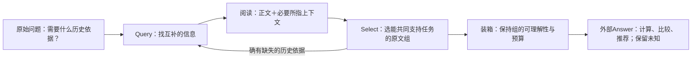

# 问题意图与共同证据：新完整历史中的四个案例

本轮四类六份完整历史、24个不同问题、两组新库48份回答。只改变Reflection提示，Search与Answer不变；不是48个独立问题。结果与统计见[两组验证报告](../../docs/doing/2026-10-30-intent-validation-findings.md)。下面只对已查读的实际轨迹作结论，不根据mini标签臆测原因。

## R16：领养先后，时间不能和所指宠物分开

LoCoMo conv-48 / qa-55。

理论链：保留Susie/Seraphim命名上下文、各自领养时间及说话日期；检索时共同交付，再由Answer比较年份。“去年得到她”单独出现，读者不能知道“她”是谁。

真实基线保留Susie两年与Seraphim去年，回答Seraphim更晚。增量提示组的首轮也有第10块“去年得到她”，但只选2/4/1，时间句被删除；最终回答无法确定。没有装箱截断，断点就在已读后的Select。

设计启发：Select保留的是一组共同成立的依据；不应只对每段独立估计相关性。已有相邻对话足以提供身份，不必为这题恢复复杂语义图。

## R17：问“除此之外”，相似检索却反复命中“此”

LoCoMo conv-48 / qa-88。

理论链：问Deborah除了瑜伽还有哪些活动，需要扫描其它生活活动；瑜伽是已知排除条件，不是需要反复解释的中心主题。

两组原文有骑车/看展、冲浪、园艺，且有对应部分导航笔记。实际Query前列主要是瑜伽教学、瑜伽帮助社区等；完整Query候选及首轮目录没有这些具体活动。最终两组都未进一步query其它活动。新提示没有消除同主题入口集中，笔记数也未下降。

设计启发：把完整问题直接作为相似度查询，并不总等于理解了其检索意图。可以让模型按问题需要提出有限的检索表达，再合并候选；不能为此案例硬编码“排除瑜伽”。

## R18：续读成功，最后又丢掉了主语

LoCoMo conv-43 / qa-65。

理论链：电影喜好需要片名与本人态度共同支持。历史中John问“看过所有哈利波特电影吗”，Tim答“看过，喜欢和原著比较”；问句没有Tim的喜好，答句没有片名，两者相连才完整。

增量组首轮选12号回答并请求50号问句。续读确实展开了50号，但末轮只留星战及那句“看过它们”。最终Answer只敢说另一个未命名系列。基线保留指环王和星战，却只拿到哈利波特书籍喜好，仍不完整。完整原文另有Tim喜欢第一部哈利波特电影的独立陈述，未进首轮可见集合。

设计启发：新展开内容不能因为是别人的提问就视为不必要。它可能是另一证据的所指对象。最终选择和装箱应保留能独立理解的对话小组，而非只保留包含态度词的句子。

## R19：文件适用条件与新实例，不能混成一回事

CL-bench 75121251-319e-f2d7-985c-112d0f76579f。此处研究样本文档与问答行为，不是现实税务指导。

理论链：当前问题是另一笔款项；所给文件提供分类规则，旧助手结论只针对上一笔。记忆应交付当前所需规则及其条件，不把旧实例类型自动赋给新实例。

基线主要交付旧助手分析，缺样本文档对loss of support的明确规则；增量组补回该规则，回答这一部分改善。两组仍把新款项看作与旧款项相同性质，限制条件解释不充分。mini把增量组判为8/9条件通过，但其文字理由也有过度宽松处，仍不能视为题目完成。

设计启发：Search不能只交付语义最相近的旧结论，需要区分规则、实例事实与历史建议。Answer更强也不会自动消除这种范围误用。

## 这四例如何指导下一轮

这是后续设计方向，不是宣称生产方法已新增这些能力。停止判断应围绕所需依据与现有缺口；不要求历史中已经写好最终答案，也不把一段流畅的模型说明当作充分性证明。
